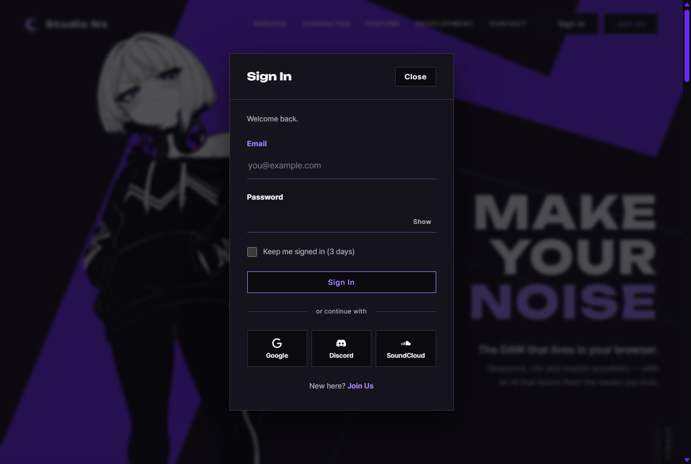

# JS 14 — `initLoginModalFromHash()`

| 항목 | 내용 |
|---|---|
| 파일 | `studionx/frontend/static/js/pages/home.js` |
| 작업 | P1-07 가입 · 로그인 JS · PRD 01 FR-103 (로그인 필요 페이지 → 로그인 → 원래 페이지) |
| 작성 | Claude (AI) · 2026-10-07 · 사용자 검토 |
| 이전 · 다음 | [13 `initLoginForm()`](13_auth-ui_initLoginForm.md) · [15 `initDuplicateChecks()`](15_join_initDuplicateChecks.md) |

## 1. 하는 일
주소가 `home.html#login…` 이면 **로그인 모달을 자동으로 연다.** 모달을 닫으면 주소에서 `#login…` 을 지운다.



| 들어온 주소 | 결과 |
|---|---|
| `home.html` | 모달 닫힘 (평소대로) |
| `home.html#login` | 모달 열림 |
| `home.html#login?next=%2FmyProject.html%3Fsort%3Dtitle%23new` | 모달 열림 — 로그인하면 `/myProject.html?sort=title#new` 로 (13) |
| `home.html#features` | 모달 닫힘 (그 구역으로 스크롤만) |

## 2. 언제 쓰나
로그인이 필요한 페이지가 로그인 안 된 사람을 홈으로 보낼 때 이 주소를 쓴다. **P1-02 · P1-05 · P1-07 이 이어지는 흐름의 가운데 고리**다.

| 순서 | 화면 | 일어나는 일 | 관련 |
|---|---|---|---|
| ① | myProject.html (로그인 안 함) | `requireLogin()` → 재발급 401 → `home.html#login?next=…` 로 이동 | [JS 07](<../P1-02 - 프론트 공통 JS/07_auth_requireLogin.md>) · [JS 04](<../P1-02 - 프론트 공통 JS/04_auth_loginUrl.md>) |
| ② | home.html | **이 함수** — 모달 자동 열림 | |
| ③ | 로그인 모달 | 로그인 성공 → 주소의 `next` 로 이동 | [JS 13](13_auth-ui_initLoginForm.md) · [JS 05](<../P1-02 - 프론트 공통 JS/05_auth_parseLoginHash.md>) |
| ④ | myProject.html | `requireLogin()` → 재발급 200 → 그대로 | |

로그인하지 않고 **Close** 를 누르면 주소가 `home.html` 로 바뀐다. 새로 고침해도 모달이 다시 열리지 않는다.

## 3. 코드
**import** (`home.js` 맨 위)
```js
import { initAuthState, initLoginForm, initPasswordToggles, initOAuthPlaceholders } from '../core/auth-ui.js';
import { initModalFallback } from '../core/modal.js';
import { includePartials } from '../core/include.js';
import { parseLoginHash } from '../core/auth.js';
```
**`parseLoginHash` 줄을 이번에 추가했다.** 이 함수는 그것만 쓴다.

**함수**
```js
export function initLoginModalFromHash() {
  const modal = document.getElementById('login-modal');
  if (!modal) return;

  const openIfLoginHash = () => {
    if (parseLoginHash().open && !modal.open) modal.showModal();
  };

  modal.addEventListener('close', () => {
    if (location.hash.startsWith('#login')) {
      history.replaceState(null, '', location.pathname + location.search);
    }
  });
  window.addEventListener('hashchange', openIfLoginHash);
  openIfLoginHash();
}
```
`home.js` 아래쪽에서 이미 `includePartials()`(모달 HTML 끼우기) 다음에 부르고 있다 — 모달이 있어야 찾을 수 있으므로 순서가 중요하다.

**최신 문법으로 쓰면** (공부용 — 실제 코드는 위)
```js
export function initLoginModalFromHash() {
  const modal = document.getElementById('login-modal');
  if (!modal) return;
  const openIfLoginHash = () => parseLoginHash().open && !modal.open && modal.showModal();
  modal.addEventListener('close', () => {
    if (location.hash.startsWith('#login')) history.replaceState(null, '', location.pathname + location.search);
  });
  addEventListener('hashchange', openIfLoginHash);
  openIfLoginHash();
}
```
| 최신 문법 | 실제 코드 | 뜻 |
|---|---|---|
| `조건 && 조건 && 실행()` | `if (조건 && 조건) 실행()` | `&&` 를 "참이면 다음을 실행" 으로 쓰는 짧은 습관 — 읽기 어려워 실제 코드는 `if` |
| `addEventListener(…)` (앞에 `window.` 없음) | `window.addEventListener(…)` | 전역 함수는 `window.` 를 생략할 수 있음 |

이 함수는 최신 전용 문법이 거의 없다 — 차이는 "짧게 쓰는 습관" 정도다.

### 문법 풀이
| import 문법 | 뜻 |
|---|---|
| `import { parseLoginHash } from '../core/auth.js'` | `../` = 한 폴더 위(`static/js/`) → `core/auth.js` |

| 식 | 뜻 |
|---|---|
| `const openIfLoginHash = () => { … }` | 이름 붙인 화살표 함수 — 아래에서 두 번(처음 · `hashchange`) 씀 |
| `modal.showModal()` · `modal.open` | `<dialog>` 를 모달로 열기 · 열려 있는지 |
| `modal.addEventListener('close', …)` | 모달이 **어떤 이유로든** 닫힐 때 (Close 버튼 · Esc · 로그인 성공 후 `close()`) |
| `location.hash.startsWith('#login')` | 주소의 `#` 부분이 `#login` 으로 시작하는지 |
| `history.replaceState(null, '', 새 주소)` | 페이지를 다시 열지 않고 **주소 글자만** 바꿈. 방문 기록도 새로 쌓지 않음 |
| `window.addEventListener('hashchange', …)` | 페이지 안에서 `#…` 부분만 바뀔 때 |

## 4. 흐름
1. 모달이 없으면 끝.
2. 모달이 닫힐 때 → 주소에서 `#login…` 을 지우도록 연결.
3. 주소의 `#` 가 바뀔 때 → 다시 확인하도록 연결.
4. 지금 주소를 확인 → `#login` 이면 연다.

## 5. 왜 이렇게
| 선택 | 이유 |
|---|---|
| `next` 를 따로 저장하지 않음 (템플릿은 "저장해 두었다가") | 모달이 열려 있는 동안 주소에 `#login?next=…` 가 그대로 있다. 13 이 로그인 성공 순간에 `parseLoginHash()` 로 직접 읽으므로, 저장 장소를 하나 더 둘 필요가 없다 |
| 닫으면 `#login…` 제거 | 그대로 두면 새로 고침할 때마다 모달이 다시 뜬다 |
| `replaceState` (`location.hash = ''` 아님) | `hash` 를 바꾸면 방문 기록이 한 칸 쌓이고, 주소 끝에 `#` 가 남는다. `replaceState` 는 둘 다 없다 |
| `hashchange` 도 받음 (템플릿에 없음) | 이미 home.html 을 보고 있을 때 `#login` 링크를 누르거나 주소창에 쳐도 모달이 열린다 |
| `!modal.open` 확인 | 이미 열린 모달에 `showModal()` 을 또 부르면 브라우저 오류가 난다 |
| 바깥 주소 `next` 는 걸러짐 | 판단은 [JS 05](<../P1-02 - 프론트 공통 JS/05_auth_parseLoginHash.md>) → [JS 03 `safeNextPath`](<../P1-02 - 프론트 공통 JS/03_auth_safeNextPath.md>) 가 한다. 모달은 열리지만 `next` 는 `null` 이라, 로그인하면 홈에 머문다 |

## 6. 시험 (실제 home.html 을 헤드리스 Chrome 으로 열고 그 안에서 실행 · 8개)
| 시험 | 확인한 것 |
|---|---|
| `home.html#login?next=%2FmyPage.html` 로 열기 | 모달 열림, `parseLoginHash()` = `{open: true, next: "/myPage.html"}` |
| 닫기 | 주소가 `/home.html` (해시 없음) |
| 페이지 안에서 `#login` 으로 | 모달 열림 (`hashchange`), 닫으면 다시 제거 |
| `#features` | 모달 안 열림 |
| `#login?next=https%3A%2F%2Fevil.com` | 모달 열림, `next` 는 `null` |
| `home.html` (해시 없이) 로 열기 | 모달 닫혀 있음 |

8/8 통과. 위 캡처는 `home.html#login?next=%2FmyProject.html%3Fsort%3Dtitle%23new` 로 열고, 첫 접속 로딩 화면이 끝난 뒤 찍었다.
