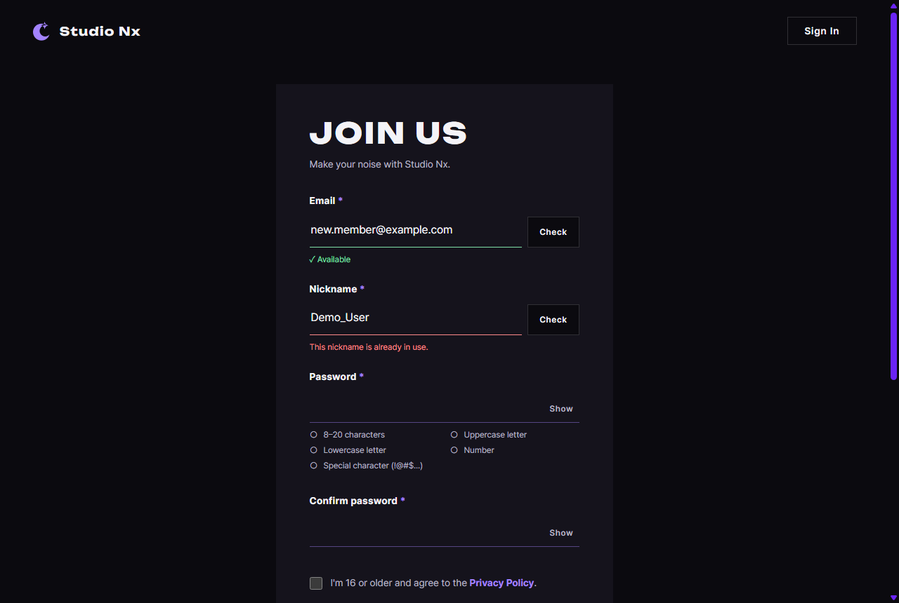

# JS 15 — `initDuplicateChecks()`

| 항목 | 내용 |
|---|---|
| 파일 | `studionx/frontend/static/js/pages/join.js` |
| 작업 | P1-07 가입 · 로그인 JS · PRD 01 FR-101 (실시간 중복 확인) · FR-108 (탈퇴 후 3일) |
| 작성 | Claude (AI) · 2026-10-07 · 사용자 검토 |
| 이전 · 다음 | [14 `initLoginModalFromHash()`](14_home_initLoginModalFromHash.md) · [16 `initPasswordRules()`](16_join_initPasswordRules.md) |

## 1. 하는 일
join.html 의 이메일 · 닉네임 칸이 **이미 쓰이고 있는지** 서버에 물어 칸 아래에 보여 준다. **Check** 버튼을 누르거나, 입력을 멈추고 0.5초가 지나면 묻는다.



| 입력 | 칸 아래 |
|---|---|
| (빈 칸) · `abc` · `kim@naver` | 빨강 "Enter a valid email address." — **서버에 묻지 않음** |
| 없는 이메일 | 잠깐 "Checking…" → 초록 "✓ Available" |
| 가입된 이메일 (`DEMO@Example.com` 처럼 대소문자가 달라도) | 빨강 "This email is already in use." |
| 탈퇴 후 3일 안인 이메일 | 빨강 "You can sign up again after Oct 9." (날짜는 **사용자 시간대**) |
| 닉네임 1자 · 21자 | 빨강 "Use 2–20 characters." — 서버에 묻지 않음 |
| 가입된 닉네임 (`Demo_User` ↔ `demo_user`) | 빨강 "This nickname is already in use." |

입력을 고치면 결과가 바로 지워진다 — 다시 확인해야 가입할 수 있다.

## 2. 언제 쓰나
join.html 이 열릴 때 `join.js` 가 한 번 부른다. 묻는 곳은 P1-04 에서 만든 API 다.

| 칸 | API | 서버 |
|---|---|---|
| 이메일 | `GET /api/v1/auth/check-email?email=` | [백엔드 23](<../../backend(fastAPI_Python)/P1-04 - 회원가입 API/23_auth_route_check_email.md>) |
| 닉네임 | `GET /api/v1/auth/check-nickname?nickname=` | [백엔드 24](<../../backend(fastAPI_Python)/P1-04 - 회원가입 API/24_auth_route_check_nickname.md>) |

**확인 결과는 가입 전송(17 `initJoinForm`)이 쓴다.** "✓ Available" 이 나온 값은 칸에 `data-checked="그 값"` 으로 남는다. 가입 버튼을 누를 때 지금 값과 같은지 보고, 다르면(확인 안 했거나 고친 뒤) 가입을 막는다.

## 3. 코드
**import** (`join.js` 맨 위)
```js
import { initLoginForm, initPasswordToggles, initOAuthPlaceholders, setFieldState } from '../core/auth-ui.js';
import { initModalFallback } from '../core/modal.js';
import { includePartials } from '../core/include.js';
import { api } from '../core/api.js';
```
**`api` 줄을 이번에 추가했다.** 이 함수는 `api`(서버에 묻기)와 09 `setFieldState`(칸 상태)를 쓴다.

**함수**
```js
/** 중복 확인 칸마다 다른 것 — 주소 · 문구 · 서버에 묻기 전 형식 검사 */
const CHECKS = {
  email: {
    path: '/auth/check-email?email=',
    taken: 'This email is already in use.',
    invalid: 'Enter a valid email address.',
    isValid: (input) => input.value.trim() !== '' && input.checkValidity(),
  },
  nickname: {
    path: '/auth/check-nickname?nickname=',
    taken: 'This nickname is already in use.',
    invalid: 'Use 2–20 characters.',
    isValid: (input) => input.value.trim().length >= 2 && input.value.trim().length <= 20,
  },
};

export function initDuplicateChecks() {
  for (const kind of Object.keys(CHECKS)) {
    const rule = CHECKS[kind];
    const field = document.getElementById(`join-${kind}-field`);
    const input = document.getElementById(`join-${kind}`);
    const button = document.querySelector(`[data-check="${kind}"]`);
    if (!field || !input) continue;
    let timer = null;

    const check = async () => {
      clearTimeout(timer);
      delete field.dataset.checked; // 이번 확인을 통과해야 다시 남김
      const value = input.value.trim();
      if (!rule.isValid(input)) {
        setFieldState(field, 'error', rule.invalid);
        return;
      }
      setFieldState(field, null, 'Checking…');
      let result;
      try {
        result = await api.get(rule.path + encodeURIComponent(value), { auth: false });
      } catch (err) {
        if (input.value.trim() !== value) return; // 그사이 입력이 바뀜 — 옛 응답은 버림
        setFieldState(field, 'error', err.status === 422 ? rule.invalid : err.message);
        return;
      }
      if (input.value.trim() !== value) return;
      if (result.available) {
        field.dataset.checked = value;
        setFieldState(field, 'ok', '✓ Available');
      } else if (result.reason === 'REJOIN_TOO_SOON') {
        const day = new Date(result.available_at).toLocaleDateString('en-US', { month: 'short', day: 'numeric' });
        setFieldState(field, 'error', `You can sign up again after ${day}.`);
      } else {
        setFieldState(field, 'error', rule.taken);
      }
    };

    input.addEventListener('input', () => {
      delete field.dataset.checked; // 값이 바뀌면 다시 확인해야 함
      setFieldState(field, null);
      clearTimeout(timer);
      if (rule.isValid(input)) timer = setTimeout(check, 500);
    });
    if (button) button.addEventListener('click', check);
  }
}
```

**최신 문법으로 쓰면** (공부용 — 실제 코드는 위, 바뀌는 부분만)
```js
for (const [kind, rule] of Object.entries(CHECKS)) { … }
…
const { available, reason, available_at } = await api.get(…);
…
button?.addEventListener('click', check);
```
| 최신 문법 | 실제 코드 | 뜻 |
|---|---|---|
| `for (const [kind, rule] of Object.entries(CHECKS))` | `for (const kind of Object.keys(CHECKS))` + `const rule = CHECKS[kind]` | 열쇠와 값을 한 번에 꺼냄 |
| `const { available, reason, available_at } = await …` | `result = await …` + `result.available` | 응답에서 칸 꺼내기 (구조 분해) |
| `button?.addEventListener(…)` | `if (button) button.addEventListener(…)` | 버튼이 있을 때만 |

### 문법 풀이
| import 문법 | 뜻 |
|---|---|
| `import { api } from '../core/api.js'` | `pages/` 에서 한 폴더 위 → `core/api.js` |

| 식 | 뜻 |
|---|---|
| `` `join-${kind}-field` `` | `kind` 가 `'email'` 이면 `'join-email-field'` |
| `input.checkValidity()` | 브라우저의 기본 검사(`type="email"` · `required` · `maxlength`)를 통과하면 `true` |
| `setTimeout(check, 500)` · `clearTimeout(timer)` | 0.5초 뒤에 실행하도록 예약 · 예약 취소. 입력할 때마다 취소하고 다시 예약 → **입력을 멈춘 뒤** 0.5초 |
| `encodeURIComponent(value)` | 주소에 넣을 수 있게 바꿈 (`+` → `%2B`, `@` → `%40`) — `a+b@x.com` 이 공백으로 바뀌는 것을 막음 |
| `delete field.dataset.checked` | `data-checked` 속성을 지움 |
| `new Date(…).toLocaleDateString('en-US', { month: 'short', day: 'numeric' })` | UTC 시각을 **이 컴퓨터의 시간대**로 바꿔 `Oct 9` 모양으로 |

## 4. 흐름
**Check 를 누를 때 (또는 자동 확인)**
1. 예약된 자동 확인 취소, 지난 통과 표시 지움.
2. 형식이 틀리면 빨간 문구로 끝 (서버에 묻지 않음).
3. "Checking…" → 서버에 묻는다.
4. 답이 오기 전에 입력이 바뀌었으면 **버린다**.
5. 사용 가능이면 초록 + `data-checked`, 탈퇴 3일 안이면 날짜 문구, 사용 중이면 빨간 문구.

**입력할 때**
1. 지난 결과를 지운다.
2. 형식이 맞으면 0.5초 뒤 자동 확인을 예약한다.

## 5. 왜 이렇게
| 선택 | 이유 |
|---|---|
| 서버에 묻기 전에 형식 검사 | `abc` 처럼 틀린 값은 서버까지 갈 필요가 없다. 서버도 422 로 막지만(23 · 24), 요청을 아낀다 |
| 자동 확인은 형식이 맞을 때만 | `kim@na` 까지 쳤을 때 빨간 "Enter a valid…" 가 뜨면 입력 중인 사람을 재촉하는 셈이다. 다 쳤을 때만 묻는다. Check 버튼을 누르면 형식 문구도 보여 준다 |
| 0.5초 기다림 (템플릿 권장) | 글자마다 묻지 않는다. `kim@naver.com` 13자를 칠 때 요청 13번 → 1번 |
| 늦게 온 답은 버림 | `demo@…` 을 확인하는 중에 다른 값으로 고치면, 늦게 온 "사용 중" 이 새 값에 붙을 수 있다. 답이 왔을 때 칸의 값이 물어본 값과 같은지 본다 |
| 확인할 때마다 `data-checked` 를 먼저 지움 | 시험에서 찾은 빈틈: 통과 → (입력 이벤트 없이 값이 바뀜) → 사용 중이 나와도 옛 통과 표시가 남았다. 이제 이번 확인을 통과해야만 남는다 |
| 날짜는 사용자 시간대 | 서버는 UTC(`…Z`)로 준다. 한국 사용자에게는 한국 날짜로 보여야 한다 |
| 칸마다 다른 것은 `CHECKS` 표로 | 이메일 · 닉네임의 동작은 같고 주소 · 문구 · 형식 규칙만 다르다. 같은 코드를 두 번 쓰지 않는다 |

## 6. 시험 (실제 join.html 에서 실제 서버로 · 15개)
데모 계정(`demo@example.com` · `demo_user`)과, 시험용으로 **탈퇴 1일 된 계정**을 DB 에 넣고 확인했다 (탈퇴 계정은 끝난 뒤 지움).

| 시험 | 확인한 것 |
|---|---|
| 빈 칸 · `abc` + Check | "Enter a valid email address.", 서버 요청 0번 |
| 없는 이메일 | 누르자마자 "Checking…" → "✓ Available", `data-checked` 남음 |
| `DEMO@Example.com` | "This email is already in use.", `data-checked` 없음 |
| 탈퇴 1일 이메일 | "You can sign up again after Oct 9." |
| 입력 | 바로 결과 지움, 0.3초에는 아직 안 물음, 0.5초 지나면 자동 확인 → ✓ |
| `auto.ch` 처럼 덜 친 입력 | 자동 확인 안 함 (빨간 글 없음, 요청 0번) |
| 확인 중에 값을 바꿈 | 옛 값의 "사용 중" 이 새 값에 붙지 않음 |
| 닉네임 `a` · `DEMO_USER` · `"  fresh_nick  "` · 탈퇴 1일 닉네임 | 2–20자 문구 · 사용 중 · ✓(`data-checked="fresh_nick"`) · 재가입 날짜 문구 |

처음 돌렸을 때 14/15 — 위 §5 의 빈틈(`data-checked` 가 남음)을 고친 뒤 15/15 통과.
