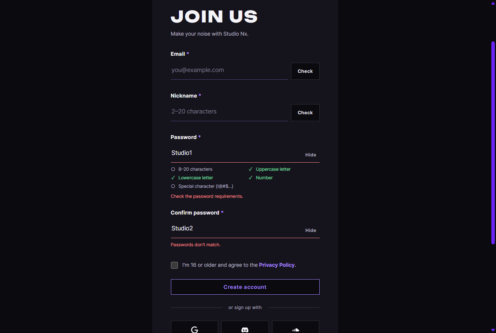

# JS 16 — `initPasswordRules()`

| 항목 | 내용 |
|---|---|
| 파일 | `studionx/frontend/static/js/pages/join.js` |
| 작업 | P1-07 가입 · 로그인 JS (PRD 01 FR-102: 비밀번호 조건을 입력할 때마다 ✓로 표시) |
| 작성 | Claude (AI), 2026-10-07, 사용자 검토 |
| 이전 · 다음 | [15 `initDuplicateChecks()`](15_join_initDuplicateChecks.md) · [17 `initJoinForm()`](17_join_initJoinForm.md) |

## 1. 하는 일
join.html에서 비밀번호를 칠 때마다 아래 **조건 목록의 ○를 ✓(초록)**로 바꾸고, 틀린 점을 칸 아래에 알려 줍니다. 비밀번호 확인 칸의 값이 다르면 그것도 알려 줍니다.



| 입력 | 조건 목록 | 칸 아래 |
|---|---|---|
| `a` | 소문자만 ✓ | (없음) |
| `Studio1` (입력 중) | 대문자, 소문자, 숫자는 ✓이고, 8–20자와 기호는 ○ | (없음: 입력 중에는 재촉하지 않습니다) |
| `Studio1`을 치고 칸을 벗어남 | 같음 | 빨강 "Check the password requirements." |
| `Studio1!` | 모두 ✓ | (빨간 글이 사라집니다) |
| `Studio1!한`, `Studio 1!` | | **바로** 빨강 "Use only English letters, numbers and symbols." |
| 확인 칸에 `Studio2` (비밀번호 길이만큼 침) | | 빨강 "Passwords don't match." |
| 확인 칸을 맞게 고침 | | **바로** 사라집니다 |

조건 목록은 화면 읽기 프로그램용 글자도 함께 바뀝니다 ("Uppercase letter, met" / "…, not met").

## 2. 언제 쓰나
join.html이 열릴 때 `join.js`가 한 번 부릅니다.

| 규칙 | 위치 | 같은 규칙을 쓰는 곳 |
|---|---|---|
| `PASSWORD_RULES`(5개), `PASSWORD_ALLOWED` | `join.js` 위쪽(템플릿에 이미 있었음)에 있다가 **2026-10-08에 `core/password.js`로 옮겼습니다** (회원 정보 화면 JS 25와 함께 쓰고, `join.js`는 import합니다) | 서버의 [백엔드 14 `check_password_rules`](<../../backend(fastAPI_Python)/P1-04 - 회원가입 API/14_security_check_password_rules.md>)입니다. 기호 모음이 같다는 것을 시험으로 확인했습니다 |

화면의 ✓는 **안내**입니다. 가입 버튼을 누르면 17번 `initJoinForm`이 같은 규칙으로 한 번 더 막고, 서버도 다시 검사합니다.

## 3. 코드
**import** (`join.js` 맨 위: 15번과 같고, 이번에 추가한 것은 없습니다)
```js
import { initLoginForm, initPasswordToggles, initOAuthPlaceholders, setFieldState } from '../core/auth-ui.js';
…
```
이 함수는 **`setFieldState`**(09)를 쓰고, 규칙은 같은 파일의 `PASSWORD_RULES`와 `PASSWORD_ALLOWED`를 씁니다.

**규칙 (템플릿에 있던 것)**
```js
export const PASSWORD_RULES = {
  length: (pw) => pw.length >= 8 && pw.length <= 20,
  upper: (pw) => /[A-Z]/.test(pw),
  lower: (pw) => /[a-z]/.test(pw),
  number: (pw) => /[0-9]/.test(pw),
  special: (pw) => /[!-/:-@[-`{-~]/.test(pw),
};
export const PASSWORD_ALLOWED = /^[!-~]*$/;
```

**함수**
```js
export function initPasswordRules() {
  const password = document.getElementById('join-password');
  const confirm = document.getElementById('join-password2');
  const passwordField = document.getElementById('join-password-field');
  const confirmField = document.getElementById('join-password2-field');
  const items = document.querySelectorAll('#join-password-rules li[data-rule]');
  if (!password || !confirm) return;

  const allMet = () => {
    for (const name of Object.keys(PASSWORD_RULES)) {
      if (!PASSWORD_RULES[name](password.value)) return false;
    }
    return true;
  };

  const showRules = () => {
    for (const item of items) {
      const rule = PASSWORD_RULES[item.dataset.rule];
      const met = rule ? rule(password.value) : false;
      item.classList.toggle('is-met', met);
      const state = item.querySelector('[data-rule-state]');
      if (state) state.textContent = met ? ', met' : ', not met';
    }
  };

  const checkConfirm = (force) => {
    if (confirm.value === '') {
      setFieldState(confirmField, null);
    } else if (confirm.value === password.value) {
      setFieldState(confirmField, null);
    } else if (force || confirm.value.length >= password.value.length) {
      setFieldState(confirmField, 'error', "Passwords don't match.");
    }
  };

  password.addEventListener('input', () => {
    showRules();
    if (!PASSWORD_ALLOWED.test(password.value)) {
      setFieldState(passwordField, 'error', 'Use only English letters, numbers and symbols.');
    } else {
      setFieldState(passwordField, null);
    }
    if (confirm.value !== '') checkConfirm(true); // 확인 칸을 이미 쳤으면 바로 다시 비교
  });
  password.addEventListener('blur', () => {
    if (password.value !== '' && PASSWORD_ALLOWED.test(password.value) && !allMet()) {
      setFieldState(passwordField, 'error', 'Check the password requirements.');
    }
  });
  confirm.addEventListener('input', () => checkConfirm(false));
  confirm.addEventListener('blur', () => checkConfirm(true));
  showRules();
}
```

**최신 문법으로 쓰면** (공부용이며, 바뀌는 부분만 적었습니다)
```js
const allMet = () => Object.values(PASSWORD_RULES).every((rule) => rule(password.value));
…
item.querySelector('[data-rule-state]')?.replaceChildren(met ? ', met' : ', not met');
…
const rule = PASSWORD_RULES[item.dataset.rule];
const met = rule?.(password.value) ?? false;
```
| 최신 문법 | 실제 코드 | 뜻 |
|---|---|---|
| `Object.values(…).every(fn)` | `for … of Object.keys(…)`로 돌다가 하나라도 틀리면 `return false` | 모두 참인지 확인합니다 |
| `rule?.(password.value)` | `rule ? rule(password.value) : …` | 함수가 있을 때만 부릅니다 |
| `… ?? false` | `: false` (삼항 연산자의 뒷부분) | 없으면 `false`입니다 |
| `el?.replaceChildren(글)` | `if (state) state.textContent = 글` | 있을 때만 글자를 바꿉니다 |

### 문법 풀이
| import 문법 | 뜻 |
|---|---|
| `export const PASSWORD_RULES` | 17번 `initJoinForm`도 같은 규칙을 씁니다 (같은 파일) |

| 식 | 뜻 |
|---|---|
| `/[A-Z]/.test(pw)` | 정규식입니다. `pw` 안에 대문자가 하나라도 있으면 `true`입니다 |
| `/^[!-~]*$/` | 처음(`^`)부터 끝(`$`)까지 모든 글자가 `!`(33)~`~`(126) 범위에 있는지 확인합니다. 영문, 숫자, 키보드 기호가 이 범위에 들고, 한글과 공백은 범위 밖입니다 |
| `item.classList.toggle('is-met', met)` | `met`이 참이면 클래스를 붙이고, 거짓이면 뗍니다 (2015년 무렵부터 있던 기본 기능입니다) |
| `PASSWORD_RULES[item.dataset.rule]` | `<li data-rule="upper">`이면 `PASSWORD_RULES.upper` 함수를 가리킵니다 |
| `'input'`, `'blur'` | 글자가 바뀔 때마다, 그리고 칸에서 커서가 나갈 때 일어나는 이벤트입니다 |
| `checkConfirm(force)` | `force`가 참이면 길이와 상관없이 "다름"을 보여 줍니다 |

## 4. 흐름
**비밀번호를 칠 때:** 조건 목록의 ✓/○를 바꿉니다. 허용되지 않는 글자가 있으면 바로 빨간 글을 보여 주고, 없으면 빨간 글을 지웁니다. 확인 칸에 이미 값이 있으면 다시 비교합니다.
**비밀번호 칸을 벗어날 때:** 조건이 하나라도 맞지 않으면 "Check the password requirements."를 보여 줍니다.
**확인 칸을 칠 때:** 같으면 문구를 지우고, 비밀번호 길이만큼 쳤는데 다르면 "다름"을 보여 줍니다.
**확인 칸을 벗어날 때:** 다르면 길이와 상관없이 "다름"을 보여 줍니다.

## 5. 왜 이렇게
| 선택 | 이유 |
|---|---|
| 조건 미달은 칸을 **벗어날 때** 알림 (템플릿대로) | 치는 중에 "조건이 맞지 않음"을 계속 보여 주면 재촉하는 것처럼 느껴집니다. 조건 목록의 ✓가 이미 진행 상황을 보여 줍니다 |
| 허용되지 않는 글자는 **바로** 알림 | 한글 입력 상태로 치는 실수를 빨리 알아챌 수 있습니다. 계속 치면 바로잡기가 더 어렵습니다 |
| 확인 칸은 비밀번호 길이만큼 쳤을 때부터 "다름"을 보여 줌 | 한 글자 칠 때마다 "다름"이 뜨면 안 됩니다. 다 친 뒤에야 비교가 의미 있습니다 |
| 맞으면 바로 지움 | 고친 순간 확인받는 느낌을 줍니다 |
| 비밀번호를 고치면 확인 칸도 다시 비교 | 시험에서 찾은 경우입니다. 확인 칸까지 맞게 친 뒤 비밀번호 끝에 한 글자를 더하면, 확인 칸이 "맞음"인 채로 남아 있었습니다 |
| ✓는 CSS가 그림 (`li.is-met::before`) | JS는 클래스만 바꿉니다 (09번과 같은 원칙) |
| 화면 읽기용 글자(`, met`)도 바꿈 | 색과 기호(✓)만으로는 화면을 보지 못하는 사람이 알 수 없습니다 |
| 규칙은 서버와 같게 맞춤 | 화면에서는 통과했는데 서버가 막는 일이 없게 합니다. 기호 모음이 같은지는 백엔드 14번 시험으로 확인했습니다 |

## 6. 시험 (실제 join.html을 헤드리스 Chrome으로 열고 그 안에서 실행, 17개)
| 시험 | 확인한 것 |
|---|---|
| 처음 | 모두 ○입니다 |
| `a`, `Abcdef1` | 소문자만 ✓ / 대문자, 소문자, 숫자 ✓이고, 화면 읽기용 글자가 `, met`과 `, not met`으로 바뀝니다 |
| 입력 중 / 칸을 벗어남 | 입력 중에는 빨간 글이 없고, 벗어나면 "Check the password requirements."가 나옵니다 |
| `Abcdef1!` | 모두 ✓이고, 빨간 글이 사라지며, 벗어나도 오류가 없습니다 |
| 한글, 공백 | 바로 "Use only English letters, numbers and symbols."가 나옵니다 |
| 24자 | 8–20자가 ○입니다 |
| 확인 칸 | 짧을 때는 말하지 않고, 비밀번호 길이만큼 쳤는데 다르면 "다름", 같아지면 지움, 짧은 채로 벗어나면 "다름", 비밀번호를 고치면 다시 "다름", 비우면 지웁니다 |

처음 돌렸을 때 두 가지가 실패했습니다.
- **시험 쪽 문제:** 페이지 스크립트가 끝나기 전에 시험이 시작되었습니다. 시험 도구가 2.5초 기다리도록 고쳤습니다.
- **실제 빈틈:** 비밀번호를 고쳐도 확인 칸을 다시 비교하지 않았습니다. §5에 적은 대로 고쳤습니다.

고친 뒤 17개 모두 통과했습니다. 앞의 09, 10, 11, 15번 시험도 다시 돌려서 모두 통과했습니다.
