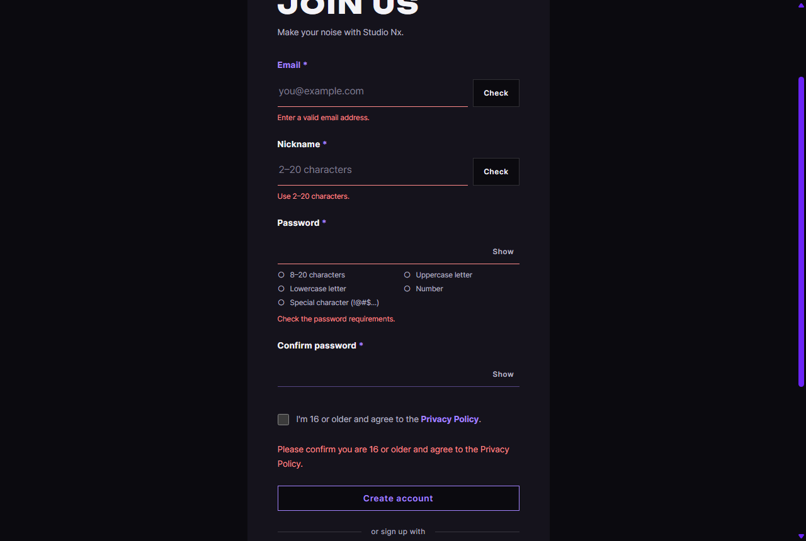

# JS 17 — `initJoinForm()`

| 항목 | 내용 |
|---|---|
| 파일 | `studionx/frontend/static/js/pages/join.js` |
| 작업 | P1-07 가입 · 로그인 JS · PRD 01 FR-101 · FR-102 · 처리방침 동의 (P1-07 마지막) |
| 작성 | Claude (AI) · 2026-10-07 · 사용자 검토 |
| 이전 · 다음 | [16 `initPasswordRules()`](16_join_initPasswordRules.md) · (P1-07 끝) |

## 1. 하는 일
join.html 의 **Create account** 를 누르면 모든 칸을 검사하고, 맞으면 서버에 가입한 뒤 **로그인 모달이 열린 홈**으로 보낸다. **이 함수로 사람이 화면에서 직접 가입할 수 있게 됐다.**



| 경우 | 화면 |
|---|---|
| 빈 칸 · 형식 틀림 | 그 칸 아래 빨간 문구, 커서는 **첫 번째로 틀린 칸**. 서버에 보내지 않음 |
| 중복 확인 전에 누름 (입력 후 0.5초 안) | "Click Check to confirm this email is available." |
| 비밀번호 조건 · 확인 칸 | "Check the password requirements." · "Passwords don't match." |
| 동의 체크 안 함 | 버튼 위 빨간 글 "Please confirm you are 16 or older and agree to the Privacy Policy." |
| 모두 맞음 | 버튼 잠깐 꺼짐 → **`home.html#login`** 으로 이동 → 로그인 모달 자동 열림 (14) |
| 확인 뒤 다른 사람이 먼저 가입 (서버 409) | 그 칸에 "This email is already in use.", 커서 그 칸, 버튼 다시 켜짐 |

**함께 바꾼 한 줄** — 가입 화면의 로그인 모달(이미 가입한 사람용)이 성공하면 홈으로 가게 했다.
```js
initLoginForm({ onSuccess: (next) => { location.href = next || 'home.html'; } });
```

## 2. 언제 쓰나
join.html 이 열릴 때 `join.js` 가 한 번 부른다. 앞 함수들의 결과를 모아 최종 판단한다.

| 검사 | 근거 | 만든 곳 |
|---|---|---|
| 이메일 · 닉네임 형식 | `CHECKS[kind].isValid` | 15 |
| 이메일 · 닉네임 중복 확인 통과 | 칸의 `data-checked` 가 지금 값과 같은지 | 15 |
| 비밀번호 조건 · 허용 문자 | `PASSWORD_RULES` · `PASSWORD_ALLOWED` | 16 |
| 확인 칸 | 비밀번호와 같은지 | 16 |
| 동의 | `#join-agree` 체크 | join.html |
| 서버 | `POST /api/v1/auth/signup` | [백엔드 21 · 22](<../../backend(fastAPI_Python)/P1-04 - 회원가입 API/22_auth_route_signup.md>) |

### 가입 한 번의 전체 흐름 (P1-04 · 05 · 07)
| 순서 | 화면 | 일어나는 일 |
|---|---|---|
| ① | join.html | 이메일 · 닉네임 → 0.5초 뒤 ✓ (15), 비밀번호 ✓ (16), 동의 체크 |
| ② | Create account | **이 함수** → `POST /auth/signup` → 201 |
| ③ | home.html#login | 로그인 모달 자동 열림 (14) |
| ④ | 로그인 | 헤더 My Page · My Projects (13) |

## 3. 코드
**import** (`join.js` 맨 위 — 15 와 같음, 이번에 추가한 것 없음)
```js
import { initLoginForm, initPasswordToggles, initOAuthPlaceholders, setFieldState } from '../core/auth-ui.js';
import { initModalFallback } from '../core/modal.js';
import { includePartials } from '../core/include.js';
import { api } from '../core/api.js';
```
이 함수는 **`api`** · **`setFieldState`** 를 쓰고, 같은 파일의 `CHECKS`(15) · `PASSWORD_RULES` · `PASSWORD_ALLOWED` · `PRIVACY_VERSION` 을 쓴다.

**함수** (길어서 세 부분으로 나눠 설명)
```js
export function initJoinForm() {
  const form = document.getElementById('join-form');
  if (!form) return;
  const fields = { email: …, nickname: …, password: …, password2: … };   // 칸(.field) 4개
  const email = …, nickname = …, password = …, password2 = …, agree = …, error = …, submit = …;

  const showFormError = (message) => {
    error.textContent = message;
    error.hidden = false;
  };
  const AGREE_MESSAGE = 'Please confirm you are 16 or older and agree to the Privacy Policy.';

  // 동의를 체크하면 동의 안내를 바로 지움 (다른 안내는 그대로) — 사이트 시험(ai-note 39)에서 찾아 추가
  agree.addEventListener('change', () => {
    if (agree.checked && error.textContent === AGREE_MESSAGE) error.hidden = true;
  });
```
**① 화면에서 먼저 검사** — 틀린 칸의 입력 요소 목록을 돌려줌
```js
  const findProblems = () => {
    const problems = [];
    for (const kind of ['email', 'nickname']) {
      const input = kind === 'email' ? email : nickname;
      const value = input.value.trim();
      if (!CHECKS[kind].isValid(input)) {
        setFieldState(fields[kind], 'error', CHECKS[kind].invalid);
        problems.push(input);
      } else if (fields[kind].dataset.checked !== value) {
        if (!fields[kind].classList.contains('is-error')) {
          setFieldState(fields[kind], 'error', `Click Check to confirm this ${kind} is available.`);
        }
        problems.push(input);
      }
    }
    let rulesMet = PASSWORD_ALLOWED.test(password.value);
    for (const name of Object.keys(PASSWORD_RULES)) {
      if (!PASSWORD_RULES[name](password.value)) rulesMet = false;
    }
    if (!rulesMet) {
      setFieldState(fields.password, 'error', 'Check the password requirements.');
      problems.push(password);
    }
    if (password2.value !== password.value) {
      setFieldState(fields.password2, 'error', "Passwords don't match.");
      problems.push(password2);
    }
    if (!agree.checked) {
      showFormError(AGREE_MESSAGE);
      problems.push(agree);
    }
    return problems;
  };
```
**② 서버가 막은 이유를 그 칸 아래에** (409 · 422)
```js
  const showServerError = (err) => {
    const details = err.details || {};
    if (err.code === 'EMAIL_TAKEN' || details.email) {
      delete fields.email.dataset.checked;
      setFieldState(fields.email, 'error', err.code === 'VALIDATION_ERROR' ? CHECKS.email.invalid : err.message);
      email.focus();
    } else if (err.code === 'NICKNAME_TAKEN' || details.nickname) {
      delete fields.nickname.dataset.checked;
      setFieldState(fields.nickname, 'error', err.code === 'VALIDATION_ERROR' ? CHECKS.nickname.invalid : err.message);
      nickname.focus();
    } else if (details.password) {
      setFieldState(fields.password, 'error', 'Check the password requirements.');
      password.focus();
    } else {
      showFormError(err.message || 'Something went wrong. Please try again.');
    }
  };
```
**③ 보내기**
```js
  form.addEventListener('submit', async (event) => {
    event.preventDefault();
    error.hidden = true;
    const problems = findProblems();
    if (problems.length > 0) {
      problems[0].focus();
      return;
    }
    submit.disabled = true;
    try {
      await api.post('/auth/signup', {
        email: email.value.trim(), nickname: nickname.value.trim(), password: password.value,
        privacy_agreed: true, privacy_version: PRIVACY_VERSION,
      }, { auth: false });
      location.href = 'home.html#login';
    } catch (err) {
      showServerError(err);
      submit.disabled = false;
    }
  });
}
```

**최신 문법으로 쓰면** (공부용 — 바뀌는 부분만)
```js
const rulesMet = PASSWORD_ALLOWED.test(password.value)
  && Object.values(PASSWORD_RULES).every((rule) => rule(password.value));
…
const { code, message, details = {} } = err;
…
problems.at(0)?.focus();
```
| 최신 문법 | 실제 코드 | 뜻 |
|---|---|---|
| `Object.values(…).every(fn)` | `for … of` 로 돌며 하나라도 틀리면 `false` | 모두 참인지 |
| `const { code, details = {} } = err` | `err.code` · `const details = err.details \|\| {}` | 꺼내면서 없으면 기본값 |
| `problems.at(0)?.focus()` | `if (problems.length > 0) problems[0].focus()` | 첫 번째가 있으면 |

### 문법 풀이
| import 문법 | 뜻 |
|---|---|
| (추가 없음) | 15 에서 넣은 `api` 와, 처음부터 있던 `setFieldState` 를 씀 |

| 식 | 뜻 |
|---|---|
| `<form … novalidate>` (join.html) | 브라우저의 기본 검사 말풍선을 끔 — 이 함수가 칸 아래 문구로 직접 보여 줌 (13 의 로그인 폼은 브라우저 검사를 씀) |
| `const findProblems = () => { … return problems; }` | 안쪽 함수 — 틀린 칸들을 모아 돌려줌 |
| `problems.push(input)` | 목록 끝에 넣기 |
| `problems[0].focus()` | 목록의 첫 번째 = 화면 위쪽부터 검사했으므로 **가장 위의 틀린 칸** |
| `` `Click Check to confirm this ${kind} is available.` `` | `kind` 가 `'email'` 이면 "… this email is available." |
| `err.code` · `err.details` | [`ApiError`](<../P1-02 - 프론트 공통 JS/02_api_apiFetch.md>) 가 서버 오류 JSON 에서 꺼내 둔 값 |
| `location.href = 'home.html#login'` | 홈으로 이동 + 14 가 로그인 모달을 엶 |

## 4. 흐름
1. 보낼 때 — 폼 전체 오류 글 숨김.
2. 화면에서 모든 칸 검사 → 틀린 칸이 있으면 문구를 붙이고 첫 칸으로 커서, 끝.
3. 버튼 끄고 서버에 가입 요청.
4. 성공 → `home.html#login`. 실패 → 그 칸(또는 폼 아래)에 문구, 버튼 다시 켬.

## 5. 왜 이렇게
| 선택 | 이유 |
|---|---|
| **모든** 칸을 검사한 뒤 첫 칸으로 커서 | 하나씩 고치고 다시 누르게 하지 않는다. 틀린 곳을 한 번에 다 보여 준다 |
| 중복 확인을 통과한 값만 보냄 (`data-checked`) | 템플릿 요구. 보내기 전에 "이미 사용 중" 을 알면 서버까지 갔다 돌아올 필요가 없다. 보통은 입력 후 0.5초 자동 확인(15)이 끝나 있어 따로 누를 일이 없다 |
| 이미 빨간 문구(예: 사용 중)가 있으면 그대로 둠 | "Click Check…" 로 덮으면 왜 안 되는지가 사라진다 |
| 서버 409 · 422 를 그 칸에 | 확인과 가입 사이에 다른 사람이 먼저 가입하는 경우(백엔드 21 의 동시 가입)도 사용자는 어느 칸을 고칠지 안다 |
| 가입 후 자동 로그인 안 함 → 로그인 모달 (템플릿 선택지 중 하나) | 가입과 로그인을 나눈 서버 설계(백엔드 22)와 맞춘다. "Keep me signed in" 을 직접 고를 수 있다 |
| 성공하면 버튼을 다시 켜지 않음 | 곧 다른 페이지로 간다. 그사이 또 누르는 것을 막는다 |
| 동의를 체크하면 동의 안내를 바로 지움 | 사이트 시험(ai-note 39)에서 찾은 빈틈: 체크했는데도 빨간 "Please confirm…" 이 다음 전송까지 남아 있었다. 서버 오류 같은 다른 안내는 지우지 않는다 |
| 가입 화면의 로그인 모달 → 홈으로 | 가입 화면에서 로그인한 사람이 가입 화면에 남을 이유가 없다. `next` 가 있으면 그쪽으로 |

## 6. 시험 (실제 join.html 에서 실제 서버로 · 10개)
| 시험 | 확인한 것 |
|---|---|
| 빈 채로 보냄 | 이메일 · 닉네임 · 비밀번호 문구, 동의 문구, 가입 요청 0번, 커서 = 이메일 칸 |
| 다 맞게 치고 0.5초 안에 보냄 | "Click Check to confirm this email/nickname is available.", 요청 0번 |
| 자동 확인 뒤 보냄 | 둘 다 ✓ → 보내는 동안 버튼 꺼짐 → 요청 1번 → `/home.html#login` 으로 이동하려 함 (시험에서는 이동만 막음) → 서버에서 그 이메일이 이제 `TAKEN` |
| 확인 통과로 꾸민 `demo@example.com` 으로 보냄 | 서버 409 → "This email is already in use.", 통과 표시 지움, 버튼 다시 켜짐, 커서 이메일 칸 |
| 가입 화면에서 로그인 모달로 로그인 | `/home.html` 로 이동하려 함 |
| 동의 없이 보낸 뒤 체크 (사이트 시험 뒤 추가) | 동의 안내가 바로 사라짐 |

처음 9/9 통과. 사이트 시험에서 동의 안내가 남는 빈틈을 찾아 고친 뒤 시험 1개를 더해 10/10 통과. 앞 함수들(09 ~ 16)의 시험도 다시 돌려 모두 통과했다. 시험에서 만든 계정은 끝난 뒤 지웠다 (데모 계정만 남김).
