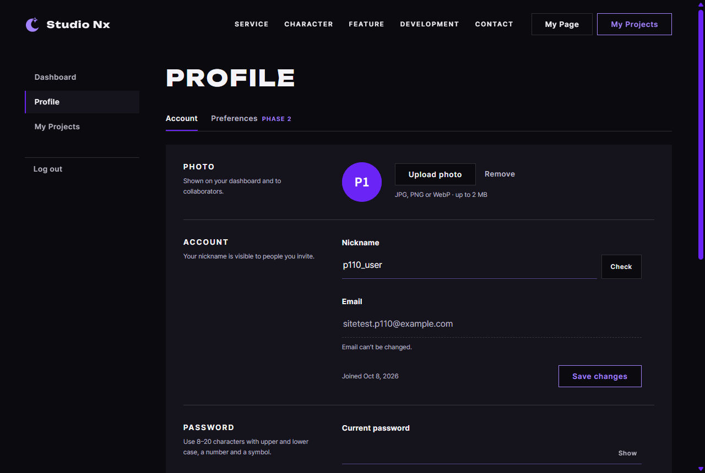

# JS 22 — `loadMe()` (+ `renderAvatar()`)

| 항목 | 내용 |
|---|---|
| 파일 | `studionx/frontend/static/js/pages/userinfo.js` |
| 작업 | P1-10 회원 정보 화면 JS — 내 정보 채우기 · PRD 01 FR-106 |
| 작성 | Claude (AI) · 2026-10-08 · 사용자 검토 |
| 이전 · 다음 | [21 `promptDialog()`](<../fix - SweetAlert 알림창/21_dialog_promptDialog.md>) · [23 `initPhotoUpload()`](23_userinfo_initPhotoUpload.md) |

## 1. 하는 일
userInfo.html 을 열면 서버에서 **내 정보**를 받아 화면의 예시 값(`nightowl`, `nyxi@studionx.app`, `Joined Oct 1, 2026`, 보라 `N`)을 진짜 값으로 바꾼다.



| 칸 | 채우는 값 |
|---|---|
| Nickname 칸 | `p110_user` |
| Email 칸 (읽기 전용) | `sitetest.p110@example.com` |
| 가입일 | `Joined Oct 8, 2026` — 서버의 UTC 시각을 **이 컴퓨터의 시간대**로 |
| 프로필 동그라미 | 사진이 있으면 ``, 없으면 닉네임 첫 글자(대문자) `P` |

**불러오지 못하면** (2026-10-06 결정 "본 데이터 API 오류 → 오류 화면")

| 상태 | 옮겨 가는 곳 |
|---|---|
| 401 (로그인 풀림) | `home.html#login?next=%2FuserInfo.html` |
| 400 · 403 · 404 · 429 · 503 · 504 | `errors/<같은 번호>.html` |
| 그 밖의 500 이상 (예: 502) | `errors/500.html` |
| 서버에 닿지 못함 (네트워크, 상태 0) | `errors/503.html` |

로그인하지 않은 채 열면 `loadMe` 전에 `requireLogin()`(P1-02 07)이 로그인 주소로 보낸다.

## 2. 언제 쓰나
| 순서 | userinfo.js 아래쪽 |
|---|---|
| ① | `await includePartials()` — 헤더 · 푸터 |
| ② | `initAuthState()` · `initModalFallback()` · `initPasswordToggles()` |
| ③ | **`if (await requireLogin()) await loadMe();`** — 템플릿의 TODO 두 줄을 이번에 바꿈 |
| ④ | 23 ~ 27 의 버튼 연결 |

`renderAvatar` 는 23(사진 올리기 · 지우기)이 응답을 받은 뒤 다시 쓴다. 닉네임 칸의 `data-checked` 는 24(닉네임 저장)가 "확인을 통과한 값" 으로 쓴다 — 지금 내 닉네임은 확인 없이 저장해도 된다.

## 3. 코드
**import** (파일 맨 위)
```js
import { initAuthState, initPasswordToggles, setFieldState } from '../core/auth-ui.js';
import { requireLogin, logout, loginUrl } from '../core/auth.js';
import { api } from '../core/api.js';
import { initModalFallback } from '../core/modal.js';
import { includePartials } from '../core/include.js';
```
**`loginUrl` 과 `api` 줄을 이번에 추가했다.**

**상수 · 도우미**
```js
/** 오류 화면이 있는 상태 코드 (errors/<상태>.html) */
const ERROR_PAGES = [400, 403, 404, 429, 500, 503, 504];

export function renderAvatar(me) {
  const avatar = document.getElementById('profile-avatar');
  if (!avatar) return;
  avatar.textContent = '';
  if (me.profile_image_url) {
    const img = document.createElement('img');
    img.src = me.profile_image_url;
    img.alt = ''; // 동그라미는 aria-hidden — 닉네임은 옆 칸에 글자로 있음
    avatar.appendChild(img);
  } else {
    avatar.textContent = me.nickname.charAt(0).toUpperCase();
  }
}

function formatDate(value) {
  const hasZone = /[zZ]$|[+-]\d\d:\d\d$/.test(value);
  const date = new Date(hasZone ? value : value + 'Z');
  return date.toLocaleDateString('en-US', { month: 'short', day: 'numeric', year: 'numeric' });
}
```

**함수**
```js
export async function loadMe() {
  let me;
  try {
    me = await api.get('/users/me');
  } catch (err) {
    if (err.status === 401) {
      location.replace(loginUrl(location.pathname + location.search + location.hash));
    } else {
      let page = 500;
      if (ERROR_PAGES.indexOf(err.status) >= 0) page = err.status;
      else if (err.status === 0) page = 503;
      location.replace('errors/' + page + '.html');
    }
    return null;
  }

  const nickname = document.getElementById('profile-nickname');
  const nicknameField = document.getElementById('nickname-field');
  const email = document.getElementById('profile-email');
  const joined = document.getElementById('profile-joined');
  if (nickname) nickname.value = me.nickname;
  if (nicknameField) nicknameField.dataset.checked = me.nickname;
  if (email) email.value = me.email;
  if (joined) joined.textContent = 'Joined ' + formatDate(me.created_at);
  renderAvatar(me);
  return me;
}
```

**최신 문법으로 쓰면** (공부용 — 바뀌는 부분만)
```js
const page = ERROR_PAGES.includes(err.status) ? err.status : err.status === 0 ? 503 : 500;
…
nickname?.value = me.nickname;          // ✗ — 이건 문법 오류 (?. 는 대입의 왼쪽에 못 씀)
…
const { nickname: name, profile_image_url: url } = me;
avatar.replaceChildren(url ? Object.assign(document.createElement('img'), { src: url, alt: '' }) : name.at(0).toUpperCase());
```
| 최신 문법 | 실제 코드 | 뜻 |
|---|---|---|
| `arr.includes(x)` | `arr.indexOf(x) >= 0` | 목록에 있는지 |
| 삼항 연산자 이어 쓰기 `a ? b : c ? d : e` | `let page = 500; if … else if …` | 여러 갈래 — 이어 쓰면 읽기 어려움 |
| `el?.value = …` | `if (el) el.value = …` | **대입에는 `?.` 를 쓸 수 없다** — 최신 문법으로도 `if` 가 필요 |
| `replaceChildren(…)` · `Object.assign(…)` | `textContent = ''` → `createElement` → `appendChild` | 안을 비우고 새로 넣기 |
| `str.at(0)` | `str.charAt(0)` | 첫 글자 |

### 문법 풀이
| import 문법 | 뜻 |
|---|---|
| `import { …, loginUrl } from '../core/auth.js'` | P1-02 04 — `home.html#login?next=…` 주소 만들기 |
| `import { api } from '../core/api.js'` | P1-02 02 — 토큰을 붙여 서버 API 부르기, 실패하면 `ApiError` (`status` · `code` · `message`) |

| 식 | 뜻 |
|---|---|
| `try { … } catch (err) { … }` | `api.get` 이 실패하면(`ApiError`) catch 로 |
| `location.replace(주소)` | 그 주소로 옮김 — 방문 기록에 지금 페이지를 **남기지 않음** (뒤로 가기로 오류 페이지 · 깨진 페이지에 돌아오지 않게) |
| `/[zZ]$\|[+-]\d\d:\d\d$/.test(value)` | 정규식 — 끝이 `Z` 나 `+09:00` 같은 시간대 표시인지 |
| `new Date('2026-10-07T01:12:30Z')` | 끝에 `Z` 가 있으면 UTC 로 읽음. **없으면 이 컴퓨터 시각으로 읽어** 9시간 어긋남 |
| `toLocaleDateString('en-US', { month: 'short', day: 'numeric', year: 'numeric' })` | `Oct 8, 2026` (사이트는 영어) |
| `dataset.checked = …` | `data-checked="…"` 속성 |
| `img.alt = ''` | 그림 설명 없음 — 꾸밈 그림이라는 뜻 |

## 4. 흐름
1. `GET /users/me`.
2. 실패 → 401 이면 로그인 주소, 아니면 상태에 맞는 오류 화면으로 옮기고 `null`.
3. 성공 → 닉네임 · 이메일 칸, 닉네임 확인 표시, 가입일, 동그라미를 채우고 내 정보를 돌려줌.

## 5. 왜 이렇게
| 선택 | 이유 |
|---|---|
| 서버 날짜에 `Z` 를 붙여 읽음 | 서버(P1-08 36)는 UTC 시각을 시간대 표시 없이 보낸다(`2026-10-07T23:30:00`). 그대로 `new Date` 에 넣으면 한국 컴퓨터는 이를 한국 시각으로 읽어 날짜가 하루 어긋날 수 있다. 이미 `Z` 가 있으면 그대로 |
| 오류 화면 표를 넓힘 (결정은 404 · 403 · 500 이상) | 400 · 429 · 503 · 504 오류 화면도 이미 있다 — 맞는 화면을 보여 주는 편이 정확하다. 서버에 닿지 못하면(0) "잠시 이용 불가" 인 503 |
| 401 은 오류 화면이 아니라 로그인 | 2026-10-06 결정 — 401 은 "다시 로그인" 이 맞다 |
| `location.replace` | 뒤로 가기를 눌러 깨진 회원 정보 화면으로 돌아오지 않게 |
| 동그라미 그리기를 따로 (`renderAvatar`) | 23 이 사진을 올리거나 지운 뒤 같은 방법으로 다시 그린다 |
| 사진은 `` 요소로 (`innerHTML` 아님) | 주소를 HTML 글자로 끼워 넣지 않아 안전하다 |
| 칸이 없으면 건너뜀 (`if (nickname)`) | 화면을 고쳐 칸이 빠져도 오류로 멈추지 않는다 |

**탈퇴 창의 닉네임(`#withdraw-nickname`)은 채우지 않았다** — 템플릿에는 있었지만, 탈퇴는 FIX-01 `promptDialog` 로 바꾸기로 해서(26) 그 창의 HTML 을 지울 예정이다.

## 6. 시험 (실제 userInfo.html · 실제 서버 · 헤드리스 Chrome)
시험 계정 `sitetest.p110@example.com` 으로 가입 · 로그인한 뒤 페이지를 열었다 (시험 도구에 "열기 전에 로그인" · "옮겨 간 뒤 확인" 기능을 더함).

| 시험 | 확인한 것 |
|---|---|
| 페이지를 열면 | 닉네임 · 이메일 칸, `Joined Oct 8, 2026`(오늘), 첫 글자 `P`, `data-checked` = 지금 닉네임 |
| 사진을 올린 뒤 다시 | ``, 그림이 실제로 뜸(가로 60px), 돌려준 내 정보 |
| 사진을 지운 뒤 다시 | 첫 글자로 돌아옴 |
| `renderAvatar({ nickname: 'zed' })` | `Z` |
| 실패 8가지 (API 를 가짜 실패로 바꿔서) | 404 → `/errors/404.html` · 403 → 403 · 429 → 429 · 502 → 500 · 0 → 503 · 503 → 503 · 400 → 400 · 401 → `/home.html#login?next=%2FuserInfo.html`, 모두 `null` |
| 로그인하지 않고 열기 | `/home.html#login?next=%2FuserInfo.html` |

17개 모두 통과.
