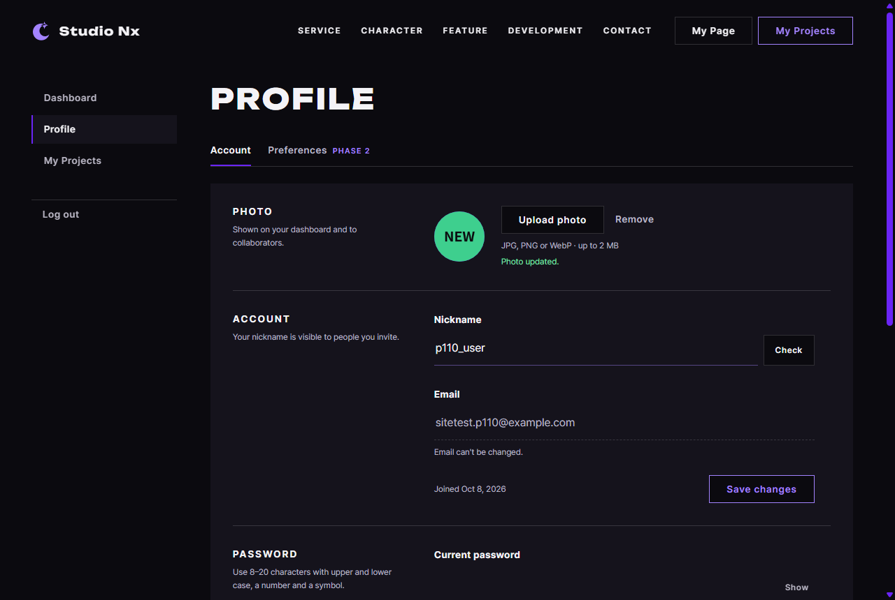
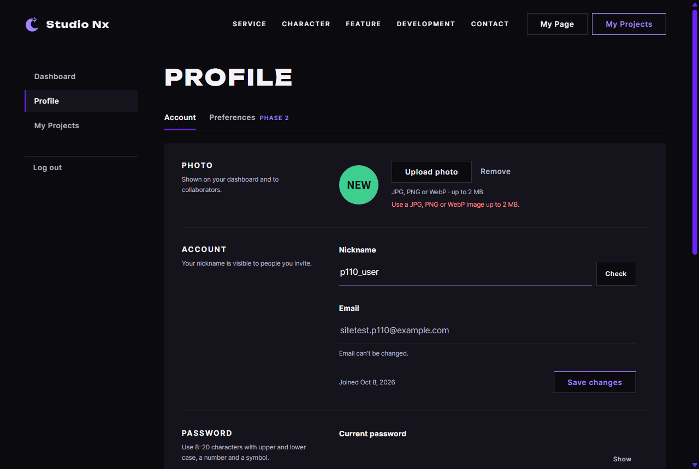

# JS 23 — `initPhotoUpload()`

| 항목 | 내용 |
|---|---|
| 파일 | `studionx/frontend/static/js/pages/userinfo.js` · `userInfo.html`(한 줄) · `static/css/pages/userinfo.css`(세 줄) |
| 작업 | P1-10 회원 정보 화면 JS — 프로필 사진 올리기 · 지우기 · PRD 01 FR-106 |
| 작성 | Claude (AI) · 2026-10-08 · 사용자 검토 |
| 이전 · 다음 | [22 `loadMe()`](22_userinfo_loadMe.md) · [24 `initProfileForm()`](24_userinfo_initProfileForm.md) |

## 1. 하는 일
**Upload photo** 로 고른 사진을 서버에 올리고, **Remove** 로 지운다. 결과는 사진 아래 한 줄로 알린다.

| 올린 사진 | 거절 (GIF) |
|---|---|
|  |  |

| 한 일 | 화면 |
|---|---|
| PNG · JPG · WebP (2MB 이하) 고름 | 바로 "Uploading…" · 버튼 잠금 → 동그라미가 새 사진, 초록 "Photo updated." |
| GIF · 2MB 넘는 파일 고름 | **보내지 않고** 빨강 "Use a JPG, PNG or WebP image up to 2 MB." — 동그라미는 그대로 |
| `.jpg` 라는데 내용은 사진이 아님 | 서버가 415 → 빨강 "Use a JPG, PNG or WebP image." (P1-08 38 의 내용 검사) |
| Remove | 닉네임 첫 글자로, 초록 "Photo removed." |
| 같은 파일을 다시 고름 | 다시 올라감 |

## 2. 언제 쓰나
userInfo.html 이 열릴 때 한 번 (`initPhotoUpload();`). 22 `loadMe` 가 처음 동그라미를 그리고, 이 함수는 바꾼 뒤 22 의 `renderAvatar` 로 다시 그린다.

| 쓰는 API | 서버 |
|---|---|
| `POST /api/v1/users/me/profile-image` (FormData, 칸 `file`) | [백엔드 42](<../../backend(fastAPI_Python)/P1-08 - 회원 정보 API/42_users_route_profile_image.md>) → 38 |
| `DELETE /api/v1/users/me/profile-image` | 42 → 39 |

**HTML · CSS 에 더한 것** (AI 화면 작업)

| 파일 | 내용 |
|---|---|
| `userInfo.html` | 사진 버튼 · 안내 · 문구를 감싼 `<div>` 에 `id="photo-field"` — `setFieldState` 가 상태 클래스를 붙일 곳 |
| `userinfo.css` | `#photo-field.is-ok` · `.is-error` 일 때 `#photo-msg` 를 초록 · 빨강, 위 여백 — 이 문구는 폼 칸(`.field`) 밖이라 폼 CSS 의 색이 닿지 않았다 |

## 3. 코드
**import** (파일 맨 위 — 22 와 같음, 추가 없음). 이 함수는 **`api`** · **`setFieldState`** · 22 의 **`renderAvatar`** · 템플릿의 **`PHOTO_TYPES` · `PHOTO_MAX_BYTES`** 를 쓴다.

**함수**
```js
export function initPhotoUpload() {
  const input = document.getElementById('photo-input');
  const remove = document.getElementById('photo-remove');
  const field = document.getElementById('photo-field');
  if (!input) return;

  const setBusy = (busy) => {
    input.disabled = busy;
    if (remove) remove.disabled = busy;
  };

  input.addEventListener('change', async () => {
    const file = input.files && input.files[0];
    if (!file) return; // 고르다가 취소
    if (PHOTO_TYPES.indexOf(file.type) < 0 || file.size > PHOTO_MAX_BYTES) {
      setFieldState(field, 'error', 'Use a JPG, PNG or WebP image up to 2 MB.');
      input.value = '';
      return;
    }
    const form = new FormData();
    form.append('file', file);
    setBusy(true);
    setFieldState(field, null, 'Uploading…');
    try {
      renderAvatar(await api.post('/users/me/profile-image', form));
      setFieldState(field, 'ok', 'Photo updated.');
    } catch (err) {
      setFieldState(field, 'error', err.message);
    } finally {
      setBusy(false);
      input.value = '';
    }
  });

  if (remove) {
    remove.addEventListener('click', async () => {
      setBusy(true);
      try {
        renderAvatar(await api.delete('/users/me/profile-image'));
        setFieldState(field, 'ok', 'Photo removed.');
      } catch (err) {
        setFieldState(field, 'error', err.message);
      } finally {
        setBusy(false);
      }
    });
  }
}
```

**최신 문법으로 쓰면** (공부용 — 바뀌는 부분만)
```js
const file = input.files?.[0];
if (!PHOTO_TYPES.includes(file.type) || file.size > PHOTO_MAX_BYTES) { … }
…
remove?.addEventListener('click', async () => { … });
```
| 최신 문법 | 실제 코드 | 뜻 |
|---|---|---|
| `input.files?.[0]` | `input.files && input.files[0]` | 목록이 있을 때만 첫 번째 |
| `arr.includes(x)` | `arr.indexOf(x) >= 0` (여기선 `< 0` 으로 "없으면") | 목록에 있는지 |
| `remove?.addEventListener(…)` | `if (remove) { remove.addEventListener(…) }` | 버튼이 있을 때만 |

### 문법 풀이
| 식 | 뜻 |
|---|---|
| `'change'` (파일 칸) | 파일을 고르고 확인했을 때. 같은 파일을 다시 고르면 값이 같아 **일어나지 않음** → 끝나면 `input.value = ''` |
| `input.files[0]` · `file.type` · `file.size` | 고른 파일 · 브라우저가 알려 준 종류(`image/png`) · 바이트 수 |
| `new FormData()` · `form.append('file', file)` | 파일 올리기용 본문. `api.js` 는 FormData 면 종류 헤더를 비워 둔다 → 브라우저가 경계(boundary)를 붙임 |
| `renderAvatar(await api.post(…))` | 서버 응답(내 정보)을 받자마자 그 사진 주소로 다시 그림 |
| `try … catch … finally` | `finally` 는 성공해도 실패해도 실행 — 잠금 풀기를 한 곳에서 |
| `<label for="photo-input">` (HTML) | 진짜 파일 칸은 숨겨 두고, 버튼 모양 이름표를 누르면 파일 고르기 창이 열림. 칸이 `disabled` 면 이름표를 눌러도 열리지 않음 |

## 4. 흐름
**파일을 골랐을 때:** 취소면 끝 → 종류 · 크기가 틀리면 빨간 문구, 끝 → "Uploading…" · 잠금 → 올리기 → 성공이면 새 사진 + 초록, 실패면 서버 문구 빨강 → 잠금 풀고 칸 비움.
**Remove:** 잠금 → 지우기 → 첫 글자 + 초록 (실패면 빨강) → 잠금 풀기.

## 5. 왜 이렇게
| 선택 | 이유 |
|---|---|
| 화면에서 먼저 종류 · 크기 검사 | 10MB 사진을 다 올린 뒤에야 거절당하지 않게. 서버도 같은 기준으로 다시 본다(브라우저가 알려 준 종류는 믿을 수 없어서 — 38) |
| 화면 문구는 하나 ("… up to 2 MB.") | 종류든 크기든 고칠 방법이 같다 — 조건을 한 번에 알려 준다 |
| 서버가 거절하면 서버 문구를 그대로 | 화면 검사를 통과했는데 내용이 사진이 아니면 서버만 안다 |
| "Uploading…" 과 잠금 | 느린 망에서 두 번 올리거나, 올리는 중에 지우는 일을 막는다 |
| 성공 문구 (템플릿에 없음) | 동그라미만 바뀌면 화면 읽기 프로그램 사용자는 알 수 없다 — `#photo-msg` 는 `aria-live` |
| Remove 를 사진이 없을 때도 둠 | 서버가 200 을 준다(39). 숨기면 화면이 사진 유무에 따라 흔들린다 |

## 6. 시험 (실제 userInfo.html · 실제 서버 · 헤드리스 Chrome · 9개)
사진은 페이지 안에서 canvas 로 만들고, `DataTransfer` 로 파일 칸에 넣은 뒤 `change` 를 보냈다 (사람이 고른 것과 같은 이벤트).

| 시험 | 확인한 것 |
|---|---|
| PNG 올리기 | 보내는 중 "Uploading…" · 두 버튼 잠김 → 동그라미 `` · "Photo updated." · 초록(`rgb(127, 224, 168)`) → 잠금 풀림 · 칸 비움 |
| GIF · 2MB+1바이트 | 빨강(`rgb(255, 138, 138)`) 문구, **요청 0번**, 동그라미는 앞 사진 그대로 |
| `.jpg` 인데 HTML | 요청 1번 → 서버 415 문구 "Use a JPG, PNG or WebP image." |
| Remove | 첫 글자 `P`, "Photo removed." |
| 같은 파일 다시 | 다시 올라감 |

9/9 통과. 22 시험(8개)도 다시 돌려 통과.
