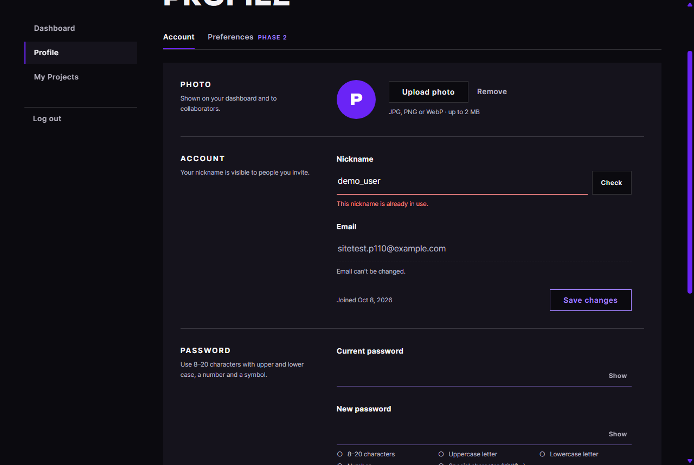
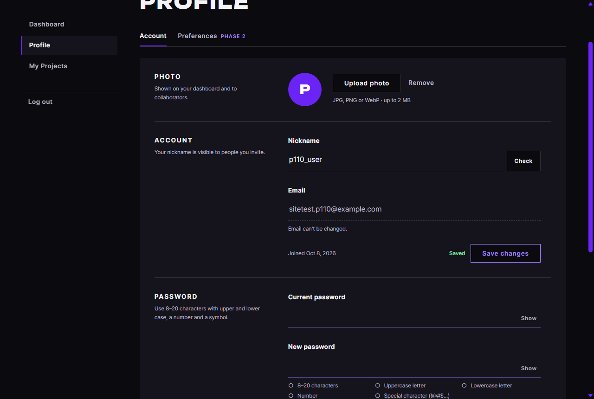

# JS 24 — `initProfileForm()`

| 항목 | 내용 |
|---|---|
| 파일 | `studionx/frontend/static/js/pages/userinfo.js`, `userInfo.html`(Saved 자리), `static/css/pages/userinfo.css` |
| 작업 | P1-10 회원 정보 화면 JS: 닉네임 중복 확인과 저장 (PRD 01 FR-106) |
| 작성 | Claude (AI), 2026-10-08, 사용자 검토 |
| 이전 · 다음 | [23 `initPhotoUpload()`](23_userinfo_initPhotoUpload.md) · [25 `initPasswordForm()`](25_userinfo_initPasswordForm.md) |

## 1. 하는 일
닉네임을 바꿀 때 **가입 화면과 같은 방식**으로 중복을 확인하고, **Save changes**로 저장합니다.

| 이미 쓰는 닉네임 | 저장됨 |
|---|---|
|  |  |

| 입력 (지금 닉네임은 `p110_user`) | 칸 아래 |
|---|---|
| `demo_user` (다른 사람이 씀) | 입력을 멈추고 0.5초가 지나면 빨강 "This nickname is already in use."가 나옵니다 |
| `a` | 자동으로 확인하지 않고, Check를 누르면 "Use 2–20 characters."가 나옵니다 |
| `P110_User` (대소문자만 다름) | **서버에 묻지 않고** "✓ Available"을 보여 줍니다. 내 닉네임이기 때문입니다 |
| `p110_user` (지금 그대로) | 아무 글도 나오지 않습니다 |
| `zeta_p110` (새 이름) | "✓ Available" |
| 탈퇴한 지 3일이 안 된 닉네임 | "You can use this nickname after Oct 9." |

| Save changes | 결과 |
|---|---|
| 확인을 통과한 값 | 저장한 뒤 버튼 옆에 초록 **Saved**가 나오고(3초 뒤 사라짐), 사진이 없으면 동그라미의 첫 글자도 새로 바뀝니다(`Z`) |
| 확인하기 전에 바로 누름 | "Click Check to confirm this nickname is available."이 나오고, 저장하지 않습니다 |
| 사용 중으로 나온 값 | 그 문구가 그대로 남고, 저장하지 않습니다 |
| 확인한 뒤 다른 사람이 먼저 가져감 (서버 409) | 칸에 "This nickname is already in use."가 나옵니다 |
| 그 밖의 서버 오류 | 폼 아래의 `#profile-error`에 보여 줍니다 |

## 2. 언제 쓰나
userInfo.html이 열릴 때 22번 `loadMe` **다음에** 한 번 부릅니다. 22번이 닉네임 칸에 `data-checked = 지금 닉네임`을 넣어 두므로, 이 함수는 그 값을 "지금 내 닉네임"으로 삼습니다.

| 쓰는 API | 서버 |
|---|---|
| `GET /api/v1/auth/check-nickname?nickname=` (로그인 없이) | [백엔드 24](<../../backend(fastAPI_Python)/P1-04 - 회원가입 API/24_auth_route_check_nickname.md>)이며, 가입 화면과 같은 API입니다 |
| `PATCH /api/v1/users/me` | [백엔드 41](<../../backend(fastAPI_Python)/P1-08 - 회원 정보 API/41_users_route_me.md>) → 37 |

**HTML과 CSS에 더한 것:** Save changes 버튼 옆에 `<span id="profile-saved" role="status">`와 이를 감싸는 `<div class="ui-save__end">`를 넣었습니다. 글자는 초록이고, 비어 있으면 숨기며, 휴대폰에서는 버튼 위 가운데에 놓입니다.

## 3. 코드
**import** (파일 맨 위: 22번과 같고, 추가한 것은 없습니다). **`api`, `setFieldState`, `renderAvatar`(22)**를 씁니다.

**상수**
```js
/** 닉네임 길이 (서버 Nickname 타입 · 가입 화면과 같음) */
const NICKNAME_MIN = 2;
const NICKNAME_MAX = 20;
```

**함수: 준비와 확인**
```js
export function initProfileForm() {
  const form = document.getElementById('profile-form');
  const input = document.getElementById('profile-nickname');
  const field = document.getElementById('nickname-field');
  const checkButton = document.querySelector('#profile-form [data-check="nickname"]');
  const error = document.getElementById('profile-error');
  const saved = document.getElementById('profile-saved');
  const submit = form ? form.querySelector('button[type="submit"]') : null;
  if (!form || !input || !field) return;

  let current = field.dataset.checked || input.value.trim(); // 지금 내 닉네임 (22 가 넣어 둠)
  let timer = null;
  let savedTimer = null;
  const isValid = (value) => value.length >= NICKNAME_MIN && value.length <= NICKNAME_MAX;

  const check = async () => {
    clearTimeout(timer);
    delete field.dataset.checked; // 이번 확인을 통과해야 다시 남김
    const value = input.value.trim();
    if (!isValid(value)) {
      setFieldState(field, 'error', 'Use 2–20 characters.');
      return;
    }
    if (value === current) {
      field.dataset.checked = value;
      setFieldState(field, null); // 내 닉네임 그대로 — 안내 글로
      return;
    }
    if (value.toLowerCase() === current.toLowerCase()) {
      field.dataset.checked = value;
      setFieldState(field, 'ok', '✓ Available');
      return;
    }
    setFieldState(field, null, 'Checking…');
    let result;
    try {
      result = await api.get('/auth/check-nickname?nickname=' + encodeURIComponent(value), { auth: false });
    } catch (err) {
      if (input.value.trim() !== value) return; // 그사이 입력이 바뀜 — 옛 응답은 버림
      setFieldState(field, 'error', err.status === 422 ? 'Use 2–20 characters.' : err.message);
      return;
    }
    if (input.value.trim() !== value) return;
    if (result.available) {
      field.dataset.checked = value;
      setFieldState(field, 'ok', '✓ Available');
    } else if (result.reason === 'REJOIN_TOO_SOON') {
      const day = new Date(result.available_at).toLocaleDateString('en-US', { month: 'short', day: 'numeric' });
      setFieldState(field, 'error', `You can use this nickname after ${day}.`);
    } else {
      setFieldState(field, 'error', 'This nickname is already in use.');
    }
  };

  input.addEventListener('input', () => {
    delete field.dataset.checked;
    setFieldState(field, null);
    if (saved) saved.textContent = '';
    clearTimeout(timer);
    if (isValid(input.value.trim())) timer = setTimeout(check, 500);
  });
  if (checkButton) checkButton.addEventListener('click', check);
```
**함수: 저장**
```js
  form.addEventListener('submit', async (event) => {
    event.preventDefault();
    clearTimeout(timer);
    if (error) error.hidden = true;
    const value = input.value.trim();
    if (!isValid(value)) {
      setFieldState(field, 'error', 'Use 2–20 characters.');
      input.focus();
      return;
    }
    if (field.dataset.checked !== value) {
      if (!field.classList.contains('is-error')) {
        setFieldState(field, 'error', 'Click Check to confirm this nickname is available.');
      }
      input.focus();
      return;
    }
    if (submit) submit.disabled = true;
    try {
      const me = await api.patch('/users/me', { nickname: value });
      current = me.nickname;
      input.value = me.nickname;
      field.dataset.checked = me.nickname;
      setFieldState(field, null);
      renderAvatar(me); // 사진이 없으면 첫 글자가 바뀔 수 있음
      if (saved) {
        saved.textContent = 'Saved';
        clearTimeout(savedTimer);
        savedTimer = setTimeout(() => { saved.textContent = ''; }, 3000);
      }
    } catch (err) {
      if (err.status === 409 || err.status === 422) {
        delete field.dataset.checked;
        setFieldState(field, 'error', err.status === 422 ? 'Use 2–20 characters.' : err.message);
        input.focus();
      } else if (error) {
        error.textContent = err.message || 'Something went wrong. Please try again.';
        error.hidden = false;
      }
    } finally {
      if (submit) submit.disabled = false;
    }
  });
}
```

**최신 문법으로 쓰면** (공부용이며, 바뀌는 부분만 적었습니다)
```js
const submit = form?.querySelector('button[type="submit"]');
let current = field.dataset.checked ?? input.value.trim();
…
checkButton?.addEventListener('click', check);
error && (error.hidden = true);
…
const { nickname } = await api.patch('/users/me', { nickname: value });
```
| 최신 문법 | 실제 코드 | 뜻 |
|---|---|---|
| `form?.querySelector(…)` | `form ? form.querySelector(…) : null` | 폼이 있을 때만 찾습니다 |
| `a ?? b` | `a \|\| b` | 없으면 b를 씁니다 (여기서는 빈 닉네임이 없어서 `\|\|`와 결과가 같습니다) |
| `checkButton?.addEventListener(…)` | `if (checkButton) checkButton.addEventListener(…)` | 있을 때만 연결합니다 |
| `error && (error.hidden = true)` | `if (error) error.hidden = true` | `&&`로 줄여 쓰는 습관입니다. 읽기 어렵습니다 |
| `const { nickname } = …` | `const me = …` + `me.nickname` | 응답에서 칸을 꺼냅니다 |

### 문법 풀이
| 식 | 뜻 |
|---|---|
| `let current = …` | 저장에 성공하면 값이 바뀌므로 `const`가 아니라 `let`으로 선언합니다 |
| `value.toLowerCase() === current.toLowerCase()` | 대소문자만 다른지 확인합니다 |
| `setTimeout(check, 500)`, `clearTimeout(timer)` | 입력을 멈춘 뒤 0.5초가 지나면 확인합니다 (가입 화면 15번과 같습니다) |
| `encodeURIComponent(value)` | 주소에 넣을 수 있게 바꿉니다 (`+`, `&` 등) |
| `delete field.dataset.checked` | `data-checked` 속성을 지웁니다 |
| `form.requestSubmit()` (시험에서 씀) | 사람이 Save를 누른 것처럼 `submit`을 일으킵니다 |

## 4. 흐름
**입력할 때:** 확인 표시, 문구, Saved를 지웁니다. 길이가 맞으면 0.5초 뒤에 확인하도록 예약합니다.
**확인할 때:** 길이를 검사하고, 지금 닉네임 그대로면 끝냅니다. 대소문자만 다르면 ✓를 보여 줍니다. 아니면 서버에 묻고, 늦게 온 응답은 버리며, 결과에 따라 사용 가능, 탈퇴 3일, 사용 중 문구를 보여 줍니다.
**저장할 때:** 길이와 확인 통과 여부를 검사한 뒤 버튼을 잠그고 PATCH를 보냅니다. 성공하면 Saved와 첫 글자를 바꾸고, 409와 422는 칸에, 그 밖의 오류는 폼 아래에 보여 준 뒤 잠금을 풉니다.

## 5. 왜 이렇게
| 선택 | 이유 |
|---|---|
| 가입 화면(15, 17)과 같은 규칙, 문구, 0.5초 | 같은 닉네임 규칙을 두 화면에서 다르게 보여 주면 헷갈립니다 |
| 대소문자만 바꾸면 서버에 묻지 않음 | 확인 API는 대소문자를 구분하지 않고 비교하므로 **내 닉네임을 "사용 중"**으로 답합니다. 서버의 저장(37)은 이것을 허용하므로 화면도 맞춰야 합니다 |
| 지금 닉네임은 22번이 남긴 `data-checked`에서 읽음 | 따로 저장하지 않고 22번과 이어서 씁니다. 저장에 성공하면 `current`를 바꿉니다 |
| 확인을 통과해야 저장 | 템플릿의 요구 사항이며, 가입 화면과 같습니다. 대부분 0.5초 자동 확인이 끝나 있으므로 따로 누를 일은 적습니다 |
| 409를 칸에 표시 | 확인과 저장 사이에 다른 사람이 먼저 가져간 경우, 고칠 곳을 바로 알려 줍니다 |
| Saved는 3초 뒤 사라지고, 입력하면 바로 지움 | 오래 남아 있으면 "지금 칸의 값이 저장되었다"고 오해할 수 있습니다 |
| 탈퇴 3일 문구를 "can use … after"로 바꿈 | 가입 화면의 "sign up again after"는 이 화면에 맞지 않습니다 (P1-08 37과 같은 이유) |

## 6. 시험 (실제 userInfo.html, 실제 서버, 15개)
| 시험 | 확인한 것 |
|---|---|
| 처음 | 지금 닉네임과 `data-checked`가 있고, 문구는 없습니다 |
| 그대로 Save | Saved가 나오고, PATCH를 1번 보냅니다 |
| `demo_user` | 입력하자 Saved와 확인 표시가 지워지고, 0.3초에는 요청이 0번이며, 0.5초가 지나면 "already in use"가 나옵니다. Save를 눌러도 PATCH는 0번입니다 |
| `a` | 자동 확인은 0번이고, Check를 누르면 "Use 2–20 characters."가 나옵니다 (요청 0번) |
| `P110_User` | 요청 0번으로 ✓가 나오고, 저장하면 서버에도 `P110_User`로 저장됩니다 |
| `zeta_p110` | ✓가 나오고, 저장하면 첫 글자가 `Z`로 바뀌며, 3초 뒤 Saved가 사라집니다 |
| 확인하기 전에 바로 Save | "Click Check…"가 나오고, PATCH는 0번입니다 |
| 서버 409 (확인 표시를 꾸며서 다른 사람의 닉네임으로 저장) | 칸에 "already in use"가 나오고, 확인 표시가 지워지며, 버튼이 다시 켜집니다 |
| 되돌리기 | 서버에 `p110_user`로 돌려 놓았습니다 |

15개 모두 통과했습니다. 22번(8개)과 23번(9개) 시험도 다시 돌려서 통과했습니다.
