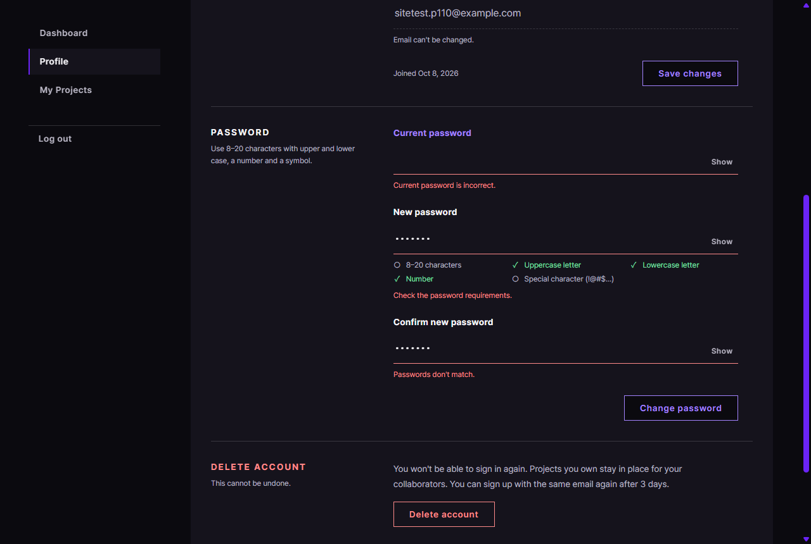
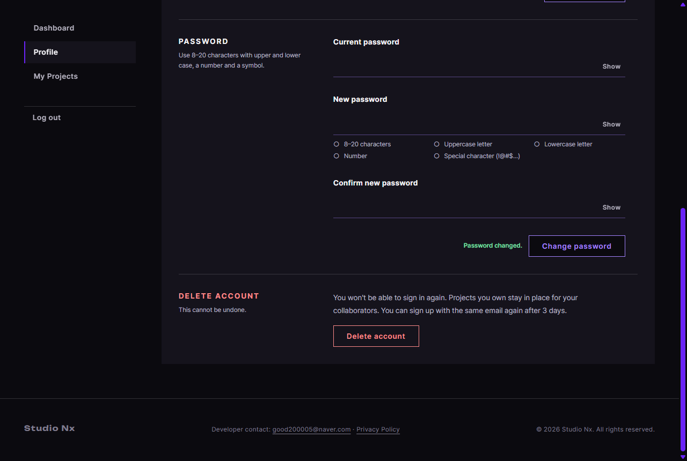

# JS 25 — `initPasswordForm()` (+ `core/password.js`)

| 항목 | 내용 |
|---|---|
| 파일 | `studionx/frontend/static/js/pages/userinfo.js`, 새 파일 `static/js/core/password.js`, `pages/join.js`(import 한 줄), `userInfo.html`(문구 자리) |
| 작업 | P1-10 회원 정보 화면 JS: 비밀번호 변경 (PRD 01 FR-107) |
| 작성 | Claude (AI), 2026-10-08, 사용자 검토 |
| 이전 · 다음 | [24 `initProfileForm()`](24_userinfo_initProfileForm.md) · [26 `initWithdraw()`](26_userinfo_initWithdraw.md) |

## 1. 하는 일
회원 정보 화면의 **Password** 칸 세 개(지금, 새, 확인)를 가입 화면과 같은 방식으로 검사하고, **Change password**로 비밀번호를 바꿉니다.

| 고칠 곳 표시 | 바뀜 |
|---|---|
|  |  |

| 한 일 | 화면 |
|---|---|
| 새 비밀번호에 `Studio1` 입력 | 조건 목록에서 대문자, 소문자, 숫자가 ✓가 됩니다 (입력 중에는 빨간 글이 없습니다). 칸을 벗어나면 "Check the password requirements."가 나옵니다 |
| 새 비밀번호에 한글 입력 | 바로 "Use only English letters, numbers and symbols."가 나옵니다 |
| 확인 칸이 다름 | 같은 길이까지 쳤거나 칸을 벗어나면 "Passwords don't match."가 나오고, 같아지면 바로 지웁니다 |
| 빈 채로 Change password | 세 칸에 문구가 나오고, 커서는 지금 비밀번호 칸에 두며, **보내지 않습니다** |
| 지금 비밀번호가 틀림 (서버 400) | "Current password is incorrect."가 나오고, 그 칸을 비운 뒤 커서를 둡니다. **로그아웃되지는 않습니다** |
| 새 비밀번호가 지금과 같음 (서버 422) | 새 비밀번호 칸에 "Use a different password."가 나옵니다 (P1-09 사용자 결정) |
| 바뀜 (204) | 세 칸을 비우고, 조건을 ○로 되돌리며, 버튼 옆에 초록 "Password changed."가 나옵니다 (5초) |

## 2. 언제 쓰나
userInfo.html이 열릴 때 한 번 부릅니다. 서버는 [백엔드 47 `PUT /users/me/password`](<../../backend(fastAPI_Python)/P1-09 - 비밀번호 변경·탈퇴/47_users_route_change_password.md>)입니다.

### 규칙 파일을 나눔: `core/password.js` (템플릿 권장)
| 전 | 지금 |
|---|---|
| `PASSWORD_RULES`와 `PASSWORD_ALLOWED`가 `pages/join.js` 안에 있었습니다 | `core/password.js`로 옮기고, `join.js`와 `userinfo.js`가 함께 import합니다 |

이유: `userinfo.js`가 `join.js`를 import하면 **가입 페이지의 코드(맨 아래의 init 줄들)까지 실행**됩니다. 규칙만 따로 두면 두 화면이 같은 규칙을 쓸 수 있습니다. `join.js`는 import 한 줄만 바뀌었고, 가입 화면 시험(P1-07 16, 17)을 다시 돌려서 모두 통과했습니다. P1-07 16 문서의 "규칙 위치" 줄도 고쳤습니다.

**HTML에 더한 것:** Change password 버튼 옆에 `<span id="password-saved" role="status">`를 넣었습니다 (24번의 Saved와 같은 모양, 같은 CSS).

## 3. 코드
**import** (파일 맨 위)
```js
import { api } from '../core/api.js';
import { PASSWORD_RULES, PASSWORD_ALLOWED } from '../core/password.js';
```
**`core/password.js` 줄을 이번에 추가했습니다.**

**`core/password.js`** (새 파일이며, `join.js`에 있던 것을 그대로 옮겼습니다)
```js
export const PASSWORD_RULES = {
  length: (pw) => pw.length >= 8 && pw.length <= 20,
  upper: (pw) => /[A-Z]/.test(pw),
  lower: (pw) => /[a-z]/.test(pw),
  number: (pw) => /[0-9]/.test(pw),
  special: (pw) => /[!-/:-@[-`{-~]/.test(pw),
};
export const PASSWORD_ALLOWED = /^[!-~]*$/;
```

**함수: 준비와 입력할 때**
```js
export function initPasswordForm() {
  const form = document.getElementById('password-form');
  const current = document.getElementById('pw-current');
  const password = document.getElementById('pw-new');
  const confirm = document.getElementById('pw-confirm');
  const currentField = document.getElementById('pw-current-field');
  const passwordField = document.getElementById('pw-new-field');
  const confirmField = document.getElementById('pw-confirm-field');
  const items = document.querySelectorAll('#pw-new-rules li[data-rule]');
  const error = document.getElementById('password-error');
  const saved = document.getElementById('password-saved');
  const submit = form ? form.querySelector('button[type="submit"]') : null;
  if (!form || !current || !password || !confirm) return;
  let savedTimer = null;

  const allMet = () => {
    if (!PASSWORD_ALLOWED.test(password.value)) return false;
    for (const name of Object.keys(PASSWORD_RULES)) {
      if (!PASSWORD_RULES[name](password.value)) return false;
    }
    return true;
  };

  const showRules = () => {
    for (const item of items) {
      const rule = PASSWORD_RULES[item.dataset.rule];
      const met = rule ? rule(password.value) : false;
      item.classList.toggle('is-met', met);
      const state = item.querySelector('[data-rule-state]');
      if (state) state.textContent = met ? ', met' : ', not met';
    }
  };

  const checkConfirm = (force) => {
    if (confirm.value === '' || confirm.value === password.value) {
      setFieldState(confirmField, null);
    } else if (force || confirm.value.length >= password.value.length) {
      setFieldState(confirmField, 'error', "Passwords don't match.");
    }
  };

  const clearSaved = () => {
    if (saved) saved.textContent = '';
  };

  current.addEventListener('input', () => {
    setFieldState(currentField, null);
    clearSaved();
  });
  password.addEventListener('input', () => {
    showRules();
    clearSaved();
    if (!PASSWORD_ALLOWED.test(password.value)) {
      setFieldState(passwordField, 'error', 'Use only English letters, numbers and symbols.');
    } else {
      setFieldState(passwordField, null);
    }
    if (confirm.value !== '') checkConfirm(true);
  });
  password.addEventListener('blur', () => {
    if (password.value !== '' && PASSWORD_ALLOWED.test(password.value) && !allMet()) {
      setFieldState(passwordField, 'error', 'Check the password requirements.');
    }
  });
  confirm.addEventListener('input', () => {
    clearSaved();
    checkConfirm(false);
  });
  confirm.addEventListener('blur', () => checkConfirm(true));
```
**함수: 보내기**
```js
  form.addEventListener('submit', async (event) => {
    event.preventDefault();
    if (error) error.hidden = true;
    const problems = [];
    if (current.value === '') {
      setFieldState(currentField, 'error', 'Enter your current password.');
      problems.push(current);
    }
    if (!allMet()) {
      setFieldState(passwordField, 'error', 'Check the password requirements.');
      problems.push(password);
    }
    if (confirm.value !== password.value) {
      setFieldState(confirmField, 'error', "Passwords don't match.");
      problems.push(confirm);
    }
    if (problems.length > 0) {
      problems[0].focus();
      return;
    }

    if (submit) submit.disabled = true;
    try {
      await api.put('/users/me/password', { current_password: current.value, new_password: password.value });
      current.value = '';
      password.value = '';
      confirm.value = '';
      setFieldState(currentField, null);
      setFieldState(passwordField, null);
      setFieldState(confirmField, null);
      showRules();
      if (saved) {
        saved.textContent = 'Password changed.';
        clearTimeout(savedTimer);
        savedTimer = setTimeout(clearSaved, 5000);
      }
    } catch (err) {
      if (err.code === 'WRONG_PASSWORD') {
        setFieldState(currentField, 'error', 'Current password is incorrect.');
        current.value = '';
        current.focus();
      } else if (err.status === 422 && err.details && err.details.new_password) {
        setFieldState(passwordField, 'error', err.message);
        password.focus();
      } else if (error) {
        error.textContent = err.message || 'Something went wrong. Please try again.';
        error.hidden = false;
      }
    } finally {
      if (submit) submit.disabled = false;
    }
  });
}
```

**최신 문법으로 쓰면** (공부용이며, 바뀌는 부분만 적었습니다)
```js
const allMet = () => PASSWORD_ALLOWED.test(password.value)
  && Object.values(PASSWORD_RULES).every((rule) => rule(password.value));
…
const met = PASSWORD_RULES[item.dataset.rule]?.(password.value) ?? false;
item.querySelector('[data-rule-state]')?.replaceChildren(met ? ', met' : ', not met');
…
} else if (err.status === 422 && err.details?.new_password) {
```
| 최신 문법 | 실제 코드 | 뜻 |
|---|---|---|
| `Object.values(…).every(fn)` | `for … of Object.keys(…)`로 돌다가 하나라도 틀리면 `return false` | 모두 참인지 확인합니다 |
| `rule?.(value) ?? false` | `rule ? rule(value) : false` | 함수가 있을 때만 부르고, 없으면 `false`입니다 |
| `el?.replaceChildren(글)` | `if (state) state.textContent = 글` | 있을 때만 글자를 바꿉니다 |
| `err.details?.new_password` | `err.details && err.details.new_password` | `details`가 있을 때만 읽습니다 |

### 문법 풀이
| import 문법 | 뜻 |
|---|---|
| `import { PASSWORD_RULES, PASSWORD_ALLOWED } from '../core/password.js'` | 새 공용 파일에서 이름 있는 내보내기 두 개를 가져옵니다 |

| 식 | 뜻 |
|---|---|
| `const problems = []`, `problems.push(input)`, `problems[0].focus()` | 틀린 칸을 화면 위쪽부터 모아서 첫 칸에 커서를 둡니다 (가입 17번과 같습니다) |
| `err.code === 'WRONG_PASSWORD'` | 서버(P1-09 44)가 400과 함께 주는 코드입니다 |
| `err.details.new_password` | 서버 422의 칸 이름입니다. 값은 규칙 목록이거나 `'same_as_current'`입니다 |
| `setTimeout(clearSaved, 5000)` | 5초 뒤에 문구를 지웁니다 (함수를 그대로 넘깁니다) |

## 4. 흐름
**입력할 때:** 지금 비밀번호 칸은 오류를 지웁니다. 새 비밀번호 칸은 조건 목록과 한글 여부를 검사하고, 확인 칸을 다시 비교합니다. 확인 칸은 다 쳤으면 비교합니다. 어느 칸이든 입력하면 "Password changed."를 지웁니다.
**보낼 때:** 세 칸을 검사해서 틀린 칸이 있으면 첫 칸에 커서를 두고 끝냅니다. 맞으면 버튼을 잠그고 PUT을 보냅니다. 성공하면 칸을 비우고 안내를 보여 주고, 400이면 지금 비밀번호 칸에, 422면 새 비밀번호 칸에, 그 밖의 오류는 폼 아래에 보여 준 뒤 잠금을 풉니다.

## 5. 왜 이렇게
| 선택 | 이유 |
|---|---|
| 가입 화면(16)과 같은 규칙, 문구, 시점 | 같은 비밀번호 규칙을 두 화면에서 다르게 보여 주지 않습니다 (조건 미달은 칸을 벗어날 때, 한글은 바로, 확인 칸은 다 친 뒤) |
| 규칙만 공용 파일로 옮기고, 화면 동작 코드는 각자 둠 | 가입 화면의 16번은 검토가 끝난 코드입니다. 화면 동작까지 묶으려면 16번을 다시 짜야 하므로, 템플릿이 권한 범위(규칙)만 옮겼습니다. 비슷한 화면 코드가 두 곳에 있는 것은 나중에 정리할 수 있습니다 |
| 지금 비밀번호가 틀리면 그 칸을 비움 | 로그인 모달(P1-07 13)과 같습니다. 다시 치게 합니다 |
| 성공하면 세 칸을 비움 | 브라우저에 비밀번호가 남아 있지 않게 합니다. 조건 목록도 ○로 되돌립니다 |
| 다시 로그인시키지 않음 | 서버도 새 토큰을 주지 않습니다 (47 §5). 지금의 로그인은 그대로 유지됩니다 |
| "Password changed."는 5초 (닉네임의 Saved는 3초) | 다른 칸들이 비워져서 변화가 크므로, 무엇이 일어났는지 읽을 시간을 조금 더 줍니다 |

## 6. 시험 (실제 userInfo.html, 실제 서버, 12개)
| 시험 | 확인한 것 |
|---|---|
| `Studio1` | 대문자, 소문자, 숫자가 ✓이고, 입력 중에는 문구가 없으며, 칸을 벗어나면 "Check the password requirements."가 나옵니다 |
| 한글 | 바로 "Use only English …"가 나옵니다 |
| 확인 칸 | 같은 길이인데 다르면 문구가 나오고, 같아지면 지워지며, 조건 5개가 ✓입니다 |
| 빈 칸으로 보냄 | 세 칸에 문구가 나오고, 커서는 지금 비밀번호 칸에 있으며, 요청은 0번입니다 |
| 지금 비밀번호가 틀림 | 보내는 동안 버튼이 잠기고, "Current password is incorrect."가 나오며, 그 칸이 비워지고 커서가 갑니다 |
| 새 비밀번호가 지금과 같음 | 새 칸에 "Use a different password."가 나오고, 커서가 갑니다 |
| 바꾸기 | 세 칸, 조건, 문구가 처음 상태로 돌아가고 "Password changed."가 나옵니다. **실제 로그인 API**로 확인하니 새 비밀번호는 200, 옛 비밀번호는 401이었습니다 |
| 되돌리기 | 원래 비밀번호로 로그인해서 200을 받았습니다 |

12개 모두 통과했습니다. 22, 23, 24번과 가입 화면(P1-07 16, 17) 시험도 다시 돌려서 모두 통과했습니다 (가입 시험이 만든 계정은 지웠습니다).
