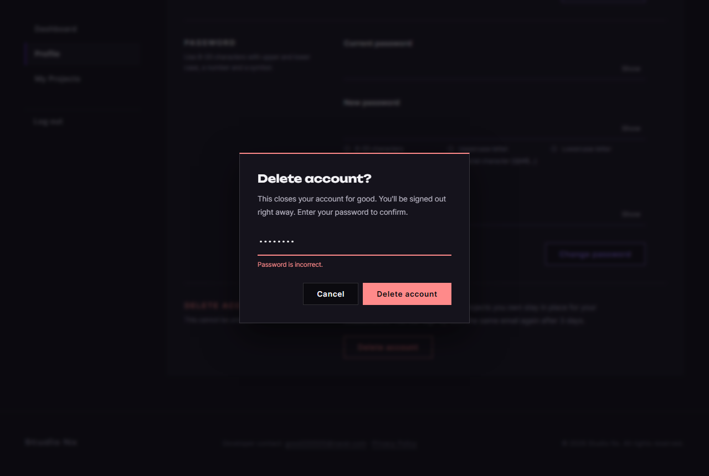

# JS 26 — `initWithdraw()` (템플릿 `initWithdrawForm`)

| 항목 | 내용 |
|---|---|
| 파일 | `studionx/frontend/static/js/pages/userinfo.js` · `userInfo.html` (탈퇴 모달 삭제 · 버튼) · `backend/app/schemas/user.py` (주석 한 줄) |
| 작업 | P1-10 회원 정보 화면 JS — 회원 탈퇴 · PRD 01 FR-108 |
| 작성 | Claude (AI) · 2026-10-08 · 사용자 검토 |
| 이전 · 다음 | [25 `initPasswordForm()`](25_userinfo_initPasswordForm.md) · [27 `initLogoutButton()`](27_auth-ui_initLogoutButton.md) |

## 1. 하는 일
**Delete account** 를 누르면 FIX-01 의 확인창(`promptDialog`)으로 비밀번호를 받고, 맞으면 탈퇴한 뒤 홈으로 보낸다.



| 한 일 | 결과 |
|---|---|
| Delete account | 빨간 확인창 "Delete account?" — 비밀번호 칸에 커서 |
| Cancel · Esc · 바깥 클릭 | 닫힘, 아무 일도 없음 |
| 빈 채로 Delete account | 창 안 "Enter your password." |
| 틀린 비밀번호 | 창 안 "Password is incorrect." — **창은 그대로**, 다시 입력 |
| 맞는 비밀번호 | 탈퇴 → `home.html` (헤더 Sign In · Join Us), 뒤로 가기로 회원 정보 화면에 돌아오지 않음 |

## 2. 언제 쓰나
userInfo.html 이 열릴 때 한 번. 이어지는 것들:

| 순서 | 하는 곳 |
|---|---|
| ① 확인창 · 비밀번호 칸 · 확인 중 잠금 | [FIX-01 21 `promptDialog`](<../fix - SweetAlert 알림창/21_dialog_promptDialog.md>) |
| ② 탈퇴 요청 | [백엔드 48 `DELETE /users/me`](<../../backend(fastAPI_Python)/P1-09 - 비밀번호 변경·탈퇴/48_users_route_withdraw.md>) → 46 (소프트 삭제 · 사진 삭제) · 리프레시 쿠키 삭제 |
| ③ 메모리 토큰 지우기 | [P1-02 `clearAccessToken`](<../P1-02 - 프론트 공통 JS/01_api_refreshAccessToken.md>) |

### 사용자 결정 반영 (2026-10-07, FIX-01 목업 08 · 14)
탈퇴 확인은 **비밀번호만** (체크박스 없음), SweetAlert 확인창으로. 그래서 HTML 을 이렇게 바꿨다.

| 전 | 지금 |
|---|---|
| `<dialog id="withdraw-modal">` — 비밀번호 칸 · "I understand…" 체크박스 · 오류 줄 · 버튼 | **삭제** (그 자리에 "확인창은 JS 가 띄움" 주석) |
| Delete account 버튼 `command="show-modal" commandfor="withdraw-modal"` | `id="withdraw-button"` — JS 가 누름을 받음 |
| 함수 이름 `initWithdrawForm` | `initWithdraw` — 더는 폼이 아니라서. 아래쪽 호출 줄과 서버 스키마 주석도 같이 |

## 3. 코드
**import** (파일 맨 위)
```js
import { api, clearAccessToken } from '../core/api.js';
import { promptDialog } from '../core/dialog.js';
```
**`clearAccessToken` 과 `dialog.js` 줄을 이번에 추가했다.**

**함수**
```js
export function initWithdraw() {
  const button = document.getElementById('withdraw-button');
  if (!button) return;

  button.addEventListener('click', async () => {
    const password = await promptDialog({
      title: 'Delete account?',
      text: "This closes your account for good. You'll be signed out right away. Enter your password to confirm.",
      inputType: 'password',
      placeholder: 'Password',
      confirmText: 'Delete account',
      danger: true,
      requiredMessage: 'Enter your password.',
      check: async (value) => {
        try {
          await api.delete('/users/me', { body: { password: value } });
          return null; // 탈퇴됨 → 창이 닫힘
        } catch (err) {
          return err.code === 'WRONG_PASSWORD' ? 'Password is incorrect.' : err.message;
        }
      },
    });
    if (password === null) return; // 취소 · Esc · 바깥 클릭
    clearAccessToken();
    location.replace('home.html');
  });
}
```

**최신 문법으로 쓰면** (공부용 — 바뀌는 부분만)
```js
check: (value) => api.delete('/users/me', { body: { password: value } })
  .then(() => null)
  .catch((err) => (err.code === 'WRONG_PASSWORD' ? 'Password is incorrect.' : err.message)),
…
document.getElementById('withdraw-button')?.addEventListener('click', async () => { … });
```
| 최신 문법 | 실제 코드 | 뜻 |
|---|---|---|
| `.then(…).catch(…)` 이어 쓰기 | `try { await … } catch (err) { … }` | 성공 · 실패 나누기 — `try` 가 읽기 쉬움 |
| `el?.addEventListener(…)` | `if (!button) return;` | 버튼이 있을 때만 |

### 문법 풀이
| import 문법 | 뜻 |
|---|---|
| `import { api, clearAccessToken } from '../core/api.js'` | 같은 파일에서 두 개 — 메모리의 Access Token 을 지우는 함수 (P1-02) |
| `import { promptDialog } from '../core/dialog.js'` | FIX-01 21 — 입력칸 하나짜리 확인창 |

| 식 | 뜻 |
|---|---|
| `check: async (value) => { … }` | 객체 칸에 함수를 넣음 — 확인을 누를 때 `promptDialog` 가 불러 줌. 글자를 돌려주면 창 안에 빨갛게, `null` 이면 창을 닫음 |
| `api.delete('/users/me', { body: { … } })` | `api.delete` 의 두 번째 인자는 **옵션** — 본문은 그 안의 `body` 로 (P1-09 48 에서 찾아 고친 점) |
| `err.code === 'WRONG_PASSWORD'` | 서버(P1-09 44) 400 의 코드 |
| `password === null` | 창이 확인 없이 닫힘 (21 의 약속) |
| `location.replace('home.html')` | 방문 기록에 회원 정보 화면을 남기지 않고 옮김 |

## 4. 흐름
1. 버튼 → 확인창.
2. 확인 → 빈 칸이면 창 안 문구 → 서버에 탈퇴 요청 (그동안 취소 · Esc 잠김).
3. 비밀번호가 틀리면 창 안 문구, 계속 입력.
4. 성공하면 창이 닫힘 → 메모리 토큰 지움 → 홈으로.
5. 취소면 아무 일도 없음.

## 5. 왜 이렇게
| 선택 | 이유 |
|---|---|
| 확인창 **안에서** 서버 요청 (`check`) | 비밀번호가 틀렸을 때 창을 다시 열 필요가 없다. 예전 모달도 틀리면 모달 안에 문구를 보였다 |
| 체크박스 없음 | 사용자 결정. 빨간 선 · 빨간 버튼 · 설명 · 비밀번호 입력이 이미 확인 단계 |
| 설명에 닉네임을 넣지 않음 ("your account") | 템플릿 모달은 닉네임을 보였는데, 닉네임 칸(24)에 저장하지 않은 글자가 있을 수 있어 틀린 이름을 보일 수 있다 |
| 성공하면 `clearAccessToken` | 서버가 쿠키는 지웠지만, 이 페이지 메모리의 Access Token(최대 30분)이 남아 있다. 어차피 서버가 막지만(06) 깨끗이 |
| `location.replace` (템플릿은 `location.href`) | 뒤로 가기를 누르면 탈퇴한 계정의 회원 정보 화면으로 돌아가 오류가 난다 |
| 오류 문구는 서버 문구 그대로 (비밀번호 틀림만 바꿈) | 서버 문구 "Password is incorrect." 와 같지만, 화면 문구를 이 함수가 정하도록 코드로 확인 |

## 6. 시험 (실제 userInfo.html · 실제 서버 · 10개)
탈퇴하면 그 계정을 다시 쓸 수 없어서, 이 시험만 따로 만든 계정(`sitetest.p110w@example.com`)으로 하고 끝난 뒤 지웠다.

| 시험 | 확인한 것 |
|---|---|
| HTML | `#withdraw-modal` 없음, 버튼에 `command` 없음 |
| 열기 | 제목 "Delete account?", 비밀번호 칸(커서), 빨간 창 · 빨간 "Delete account" |
| Cancel | 창 닫힘, 그대로 로그인 · 탈퇴 안 됨, 주소 그대로 |
| 빈 칸 · 틀린 비밀번호 | "Enter your password." · "Password is incorrect." (창 그대로), 탈퇴 안 됨 |
| 맞는 비밀번호 (옮겨 간 뒤 확인) | `/home.html` · `isLoggedIn()` false · 헤더 로그아웃 상태 · 그 계정 로그인 401 · 방문 기록 수 그대로 (replace) |

처음 9/10 — 방문 기록 수를 "2" 로 고정해 본 **시험 쪽 실수**(시험 도구가 먼저 연 빈 페이지 · 서버 주소도 기록에 들어감). 누르기 전후의 수가 같은지로 고쳐 10/10. 22 ~ 25 시험도 다시 돌려 모두 통과.
