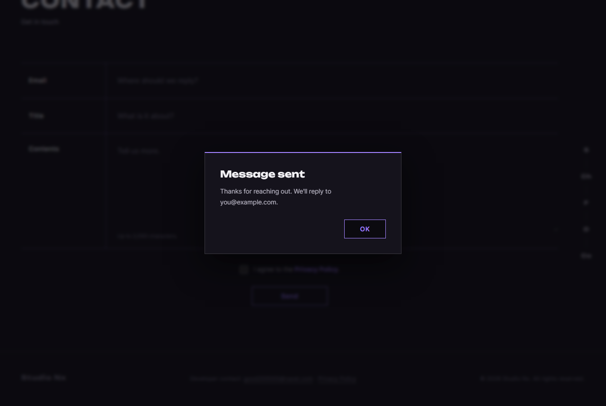
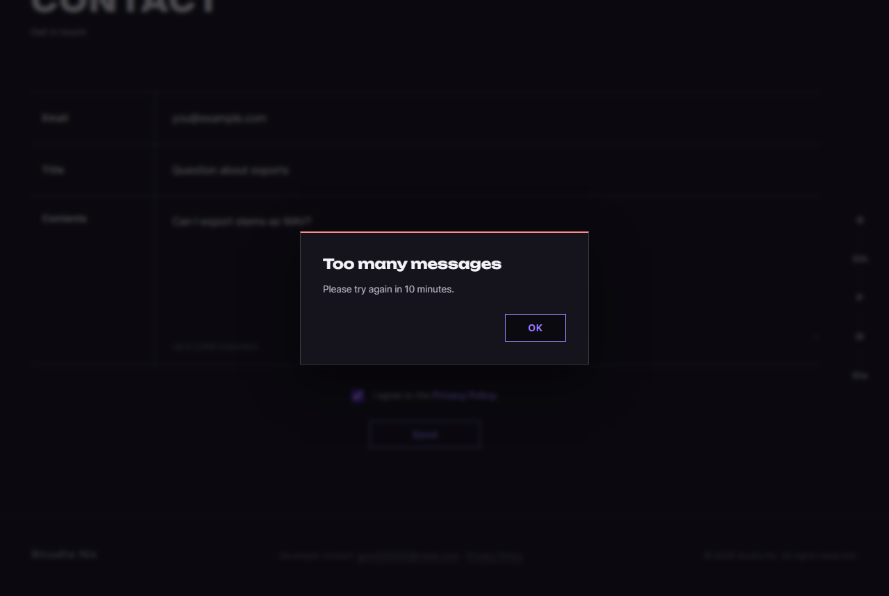

# JS 28 — `initContactForm()`

| 항목 | 내용 |
|---|---|
| 파일 | `studionx/frontend/static/js/pages/home.js` |
| 작업 | P1-12 문의: 홈 Contact 폼 보내기, 로그인하면 이메일 자동 채움 (PRD 01 FR-112, FR-113; P1-11 화면에서 남은 JS) |
| 작성 | Claude (AI), 2026-10-08, 사용자 검토 |
| 이전 · 다음 | [27 `initLogoutButton()`](<../P1-10 - 회원 정보 화면 JS/27_auth-ui_initLogoutButton.md>) · [29 `formatRelativeTime()`](<../P1-14 - 내 프로젝트 화면 JS/29_myproject_formatRelativeTime.md>) (P1-14) |

## 1. 하는 일
홈 화면 **Contact** 폼의 **Send** 버튼을 서버(백엔드 53)에 연결하고, 결과를 알림창으로 알려 줍니다.

| 보냄 | 이미 3번째 (10분에 2번을 넘음) |
|---|---|
|  |  |

| 상황 | 화면 |
|---|---|
| 로그인한 사람이 홈을 열면 | 이메일 칸에 **내 이메일이 미리 채워집니다** (비어 있을 때만) |
| 빈 칸, 형식 틀림, 동의하지 않음 | 보내지 않고 알림창을 띄웁니다 (FIX-01 19: 브라우저 검사) |
| 보내는 중 | Send가 잠깁니다 |
| 성공 | 알림 "Message sent — Thanks for reaching out. We'll reply to you@example.com."이 뜨고, 폼을 비웁니다 (내 이메일은 다시 채웁니다) |
| 10분에 3번째 (서버 429) | 빨간 알림 "Too many messages — Please try again in 10 minutes."가 뜨고, 폼은 그대로 둡니다 |
| 그 밖의 서버 오류 | 빨간 알림 "Couldn't send your message"와 서버 문구가 뜨고, 폼은 그대로 둡니다 |

## 2. 언제 쓰나
home.html이 열릴 때 한 번 부릅니다. 이어지는 것들은 다음과 같습니다.

| 순서 | 하는 곳 |
|---|---|
| ① 칸 검사와 알림 | 브라우저의 기본 검사와 [FIX-01 19 `initFormAlerts`](<../fix - SweetAlert 알림창/19_dialog_initFormAlerts.md>)입니다. 통과해야 `submit`이 일어납니다 |
| ② 보내기 | [백엔드 53 `POST /inquiries`](<../../backend(fastAPI_Python)/P1-12 - 문의 API/53_inquiries_route_create.md>) → 50, 51, 52 |
| ③ 결과 | [FIX-01 18 `showAlert`](<../fix - SweetAlert 알림창/18_dialog_showAlert.md>) |
| (자동 채움) | P1-02 `isLoggedIn` → P1-08 `GET /users/me` |

결과를 알림창으로 보여 주므로 **HTML은 바꾸지 않았습니다** (폼에 결과 문구 자리가 없었습니다).

## 3. 코드
**import** (`home.js` 맨 위)
```js
import { initAuthState, initLoginForm, initPasswordToggles, initOAuthPlaceholders } from '../core/auth-ui.js';
import { initModalFallback } from '../core/modal.js';
import { includePartials } from '../core/include.js';
import { parseLoginHash, isLoggedIn } from '../core/auth.js';
import { initFormAlerts, showAlert } from '../core/dialog.js';
import { api } from '../core/api.js';
```
**`isLoggedIn`, `showAlert`, `api`를 이번에 추가했습니다.**

**함수**
```js
export function initContactForm() {
  const form = document.getElementById('contact-form');
  const email = document.getElementById('contact-email');
  const title = document.getElementById('contact-subject');
  const content = document.getElementById('contact-content');
  const agree = document.getElementById('contact-agree');
  if (!form || !email || !title || !content || !agree) return;
  const submit = form.querySelector('button[type="submit"]');
  let myEmail = '';

  // 로그인 상태면 내 이메일을 미리 채움 (기다리지 않음 — 폼은 바로 쓸 수 있음)
  isLoggedIn().then(async (loggedIn) => {
    if (!loggedIn) return;
    try {
      myEmail = (await api.get('/users/me')).email;
    } catch {
      return; // 못 받아도 문의는 직접 적어 보낼 수 있음
    }
    if (email.value === '') email.value = myEmail;
  });

  form.addEventListener('submit', async (event) => {
    event.preventDefault();
    if (submit) submit.disabled = true;
    try {
      const sentTo = email.value.trim();
      // 토큰을 붙여 보냄 → 로그인한 회원이면 서버가 문의를 회원과 연결 (FR-112).
      // 토큰이 없거나 틀려도 이 API 는 401 이 아니라 비회원으로 받음 (백엔드 53)
      await api.post('/inquiries', {
        email: sentTo,
        title: title.value,
        content: content.value,
        privacy_agreed: agree.checked,
      });
      form.reset();
      if (myEmail) email.value = myEmail;
      showAlert('Message sent', `Thanks for reaching out. We'll reply to ${sentTo}.`); // 닫힐 때까지 기다리지 않음 — 버튼은 바로 다시 켬
    } catch (err) {
      if (err.status === 429) {
        const wait = err.details && err.details.retry_after ? err.details.retry_after : 600;
        const minutes = Math.ceil(wait / 60);
        showAlert(
          'Too many messages',
          `Please try again in ${minutes} minute${minutes === 1 ? '' : 's'}.`,
          { tone: 'error' },
        );
      } else {
        showAlert("Couldn't send your message", err.message, { tone: 'error' });
      }
    } finally {
      if (submit) submit.disabled = false;
    }
  });
}
```

**최신 문법으로 쓰면** (공부용이며, 바뀌는 부분만 적었습니다)
```js
const wait = err.details?.retry_after ?? 600;
…
const { email: mine } = await api.get('/users/me');
email.value ||= mine;
```
| 최신 문법 | 실제 코드 | 뜻 |
|---|---|---|
| `err.details?.retry_after ?? 600` | `err.details && err.details.retry_after ? err.details.retry_after : 600` | 있으면 그 값을, 없으면 600을 씁니다 |
| `const { email: mine } = …` | `myEmail = (await …).email` | 응답에서 칸을 꺼내면서 이름을 바꿉니다 |
| `a \|\|= b` | `if (a === '') a = b` | 비어 있을 때만 넣습니다 |

### 문법 풀이
| import 문법 | 뜻 |
|---|---|
| `import { …, isLoggedIn } from '../core/auth.js'` | P1-02 06번입니다. 토큰이 없으면 재발급을 시도해서 로그인 여부를 알려 줍니다 |
| `import { …, showAlert } from '../core/dialog.js'` | FIX-01 18번의 알림창입니다 |

| 식 | 뜻 |
|---|---|
| `isLoggedIn().then(async (loggedIn) => { … })` | **기다리지 않고**, 결과가 오면 실행합니다. 그동안에도 폼을 쓸 수 있습니다 |
| `catch { … }` (괄호 없음) | 오류 내용을 쓰지 않을 때 이렇게 줄여 씁니다 (`api.js`도 같은 방식입니다) |
| `form.reset()` | 모든 칸을 처음 값으로 되돌립니다 (체크박스도 해제됩니다) |
| `Math.ceil(wait / 60)` | 초를 분으로 바꾸며 올림합니다 (예: 599초 → 10분) |
| `` `minute${minutes === 1 ? '' : 's'}` `` | 1이면 minute, 아니면 minutes가 됩니다 |
| `showAlert(…)` (`await` 없음) | 알림창이 닫히기를 **기다리지 않습니다** (아래 §5 참고) |

## 4. 흐름
**페이지를 열 때:** 로그인 상태를 확인하고, 로그인 상태면 내 이메일을 받아서 칸이 비어 있을 때 채웁니다.
**보낼 때:** (브라우저 검사를 통과하면) Send를 잠그고 보냅니다. 성공하면 폼을 비우고(내 이메일은 다시 채움) 알림을 띄우고, 429면 "몇 분 뒤"를, 그 밖의 오류면 서버 문구를 보여 준 뒤 Send를 다시 켭니다.

## 5. 왜 이렇게
| 선택 | 이유 |
|---|---|
| 결과를 알림창으로 보여 줌 | 폼에 결과 문구 자리가 없고, FIX-01에서 모든 알림을 같은 모양으로 쓰기로 했습니다 |
| 알림창을 **기다리지 않음** | 시험에서 찾은 문제입니다. 처음에는 `await showAlert(…)`였는데, 그러면 사용자가 OK를 누를 때까지 `finally`(Send 다시 켜기)가 실행되지 않았습니다 |
| 막히거나 실패하면 폼을 비우지 않음 | 적어 둔 문의가 사라지면 다시 써야 합니다 |
| 429는 "몇 분 뒤"로 보여 줌 | 서버가 `retry_after`(초)를 줍니다(51). 사람은 분 단위로 읽는 편이 편합니다 |
| 토큰을 붙여 보냄 (`api.post`의 기본값) | 로그인한 회원이면 서버(52)가 문의에 `user_id`를 연결합니다 (FR-112). 이 API는 토큰이 없거나 틀려도 401이 아니라 비회원으로 받으므로(53), 문의가 막히지 않습니다 |
| 자동 채움은 칸이 **비어 있을 때만** | 사용자가 먼저 다른 주소를 적었다면 덮어쓰지 않습니다 |
| 자동 채움을 기다리지 않음 | 로그인 확인과 내 정보 요청이 진행되는 동안에도 폼을 바로 쓸 수 있게 합니다 |

**처음 만든 것과 바꾼 점 (회원 연결):** 처음에는 `{ auth: false }`(토큰 없이)로 보냈는데, 그러면 로그인한 회원의 문의도 **회원과 연결되지 않았습니다** (FR-112의 빈틈). 이 API는 토큰 문제로 401을 내지 않으므로 토큰을 붙여 보내도록 고쳤습니다. DB에서 회원의 문의는 `user_id`가 연결되고, 비회원의 문의는 비어 있음을 확인했습니다.

## 6. 시험 (실제 home.html, 실제 서버, 9개)
반복 전송 제한은 서버 메모리에서 세므로, 시험마다 시험 서버를 다시 켜서 기록을 비웠습니다.

| 시험 | 확인한 것 |
|---|---|
| 비회원 | 이메일 칸이 비어 있습니다 |
| 보내기 | 보내는 동안 Send가 잠기고, "Message sent"와 받는 주소가 나오며, 폼이 비워지고 Send가 다시 켜집니다 |
| 3번째 | 빨간 "Too many messages"와 "Please try again in 10 minutes."가 나오고, 폼은 그대로입니다 |
| 서버 오류 (가짜 500) | "Couldn't send your message"와 서버 문구가 나옵니다 |
| 로그인한 사람 | 이메일이 미리 채워지고, 보낸 뒤 폼을 비워도 내 이메일은 다시 채워집니다. **DB에서 그 문의의 `user_id`는 그 회원입니다** (비회원 문의는 비어 있습니다) |

처음에는 6/7이었습니다. §5의 "알림을 기다려서 Send가 잠긴 채로 남는 문제"를 찾아 고친 뒤 7/7, 로그인 시험 2/2가 되었습니다. 회원 연결 빈틈(위)도 고친 뒤 다시 돌려서 통과했습니다. 홈 화면의 앞선 시험(P1-07 13, 14, FIX-01 18, 19)도 다시 돌려서 모두 통과했습니다. 시험이 만든 문의와 계정은 지웠습니다.
