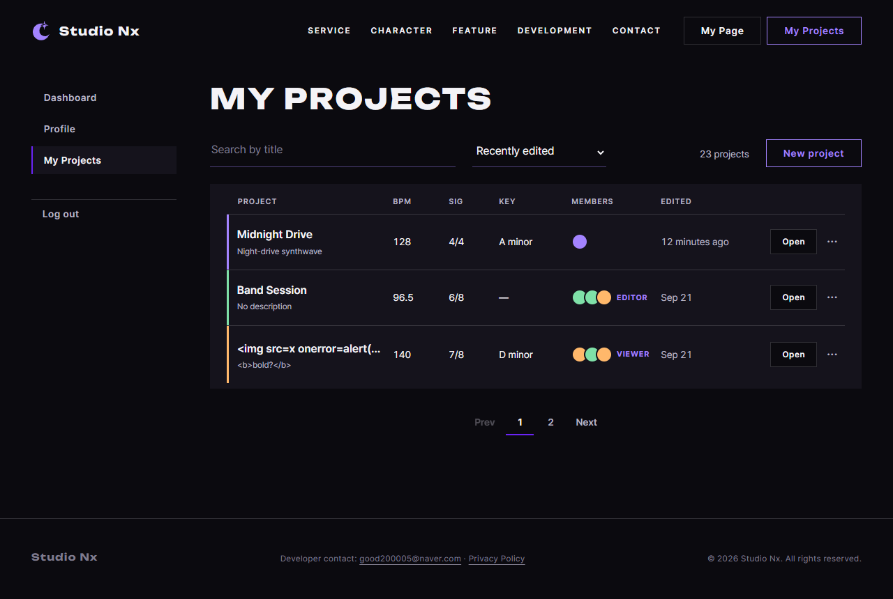
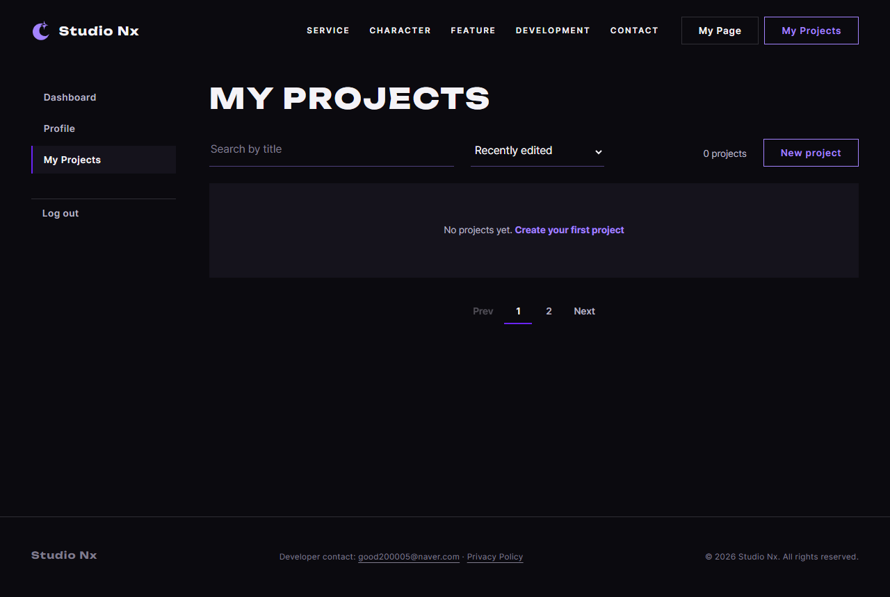

# JS 31 — `renderProjects()` (+ `buildRow`)

| 항목 | 내용 |
|---|---|
| 파일 | `studionx/frontend/static/js/pages/myproject.js`, (CSS) `static/css/pages/myproject.css` |
| 작업 | P1-14 내 프로젝트 화면: 목록 그리기 (PRD 01 FR-123, FR-125, FR-130) |
| 작성 | Claude (AI), 2026-10-08, 사용자 검토 |
| 이전 · 다음 | [30 `loadProjects()`](30_myproject_loadProjects.md) · [32 `renderPager()`](32_myproject_renderPager.md) |

## 1. 하는 일
`loadProjects`(30)가 받은 목록을 **화면의 줄로 그립니다**. HTML의 예시 줄 7개를 지우고, `<template id="project-row-template">`을 프로젝트 수만큼 복사해서 채웁니다.

| 칸 | 넣는 것 | 예 |
|---|---|---|
| 제목 | 제목과, 아직 열지 않았으면 `Not opened` 표시 | `Lo-fi Sketch [Not opened]` |
| 설명 | 설명이며, 없으면 `No description` | |
| BPM, Sig, Key | `Number(bpm)`, `7/8`, 키가 없으면 `—` | `'128.50'` → `128.5`, `'120.00'` → `120` |
| Members | 점을 최대 3개 그리고, OWNER가 아니면 역할을 씁니다 | 5명, EDITOR → ●●● `Editor` |
| Edited | `formatRelativeTime(updated_at)`(29)과 휴대폰용 `data-meta` | `12 minutes ago`, meta `128 BPM · A minor · ` |
| ··· 메뉴 | OWNER가 아니면 Delete를 잠그고 `Owner only`를 붙이며, VIEWER는 Edit도 잠급니다 | |
| 링크 | 제목과 Open이 `studioNx.html?projectId=번호`를 가리킵니다 | |

| 목록 | 화면 |
|---|---|
| 1개 이상 | 개수 `2 projects`(1개면 `1 project`), 제목 줄, 목록 |
| 0개, 검색어 없음 | `No projects yet. Create your first project` |
| 0개, 검색어 있음 | `No projects match your search.` |

개수는 **이 페이지의 줄 수가 아니라 전체 개수**(`total`)입니다. 23개 중 1쪽을 보고 있으면 `23 projects`입니다.

## 2. 언제 쓰나
| 호출하는 곳 | 화면 |
|---|---|
| 페이지 시작, 검색, 페이지 넘김, 새 프로젝트, 삭제 뒤 (32, 33, 35, 37, 38) | 항상 `loadProjects` 다음에 부릅니다: `const data = await loadProjects(…); if (data) renderProjects(data);` |

**`<template>`**은 화면에 보이지 않는 HTML 틀입니다. `template.content` 안의 요소를 `cloneNode(true)`로 복사하면 같은 모양의 새 줄이 생깁니다. 줄 모양은 HTML이 정하고, JS는 값만 채웁니다 (나중에 React로 옮길 때도 틀을 그대로 컴포넌트로 바꿀 수 있습니다).

## 3. 코드
**import** (`myproject.js` 맨 위: 30번과 같고, 이번에 추가한 것은 없습니다)
```js
import { initAuthState } from '../core/auth-ui.js';
import { requireLogin, logout, loginUrl } from '../core/auth.js';
import { api } from '../core/api.js';
import { initModalFallback } from '../core/modal.js';
import { canOpenStudio, showDesktopOnly, initDesktopOnlyLinks, openStudio } from '../core/studio.js';
import { includePartials } from '../core/include.js';
import { initFormAlerts } from '../core/dialog.js';
```
이 함수는 import를 쓰지 않습니다. 같은 파일의 `current`(30)와 `formatRelativeTime`(29)만 씁니다.

**함수** (줄 하나를 만드는 부분은 `buildRow`로 나눴습니다. 파일 밖에서는 쓰지 않습니다)
```js
export function renderProjects(data) {
  const list = document.getElementById('project-list');
  const template = document.getElementById('project-row-template');
  const count = document.getElementById('project-count');
  const label = document.querySelector('.pj-list .pj-row--label');
  const empty = document.getElementById('project-empty');
  const noResult = document.getElementById('project-no-result');
  if (!list || !template) return;

  // 1. 개수 · 빈 목록 안내
  if (count) count.textContent = data.total === 1 ? '1 project' : data.total + ' projects';
  const isEmpty = data.items.length === 0;
  list.hidden = isEmpty;
  if (label) label.hidden = isEmpty;
  if (empty) empty.hidden = !(isEmpty && !current.query);
  if (noResult) noResult.hidden = !(isEmpty && current.query);

  // 2. 줄 그리기 — 예시 줄을 지우고 틀을 복사해 채움
  list.textContent = '';
  for (let i = 0; i < data.items.length; i++) {
    list.appendChild(buildRow(template, data.items[i]));
  }
}

/** 프로젝트 하나 → 목록 한 줄 <li> (renderProjects 가 씀) */
function buildRow(template, item) {
  const row = template.content.firstElementChild.cloneNode(true);
  const field = function (name) { return row.querySelector('[data-field="' + name + '"]'); };
  const href = 'studioNx.html?projectId=' + item.project_id;
  const bpm = String(Number(item.bpm));             // '128.50' → '128.5', '120.00' → '120'
  const key = item.music_key ? item.music_key : '—';
  const isOwner = item.my_role === 'OWNER';

  row.dataset.projectId = item.project_id;
  row.dataset.title = item.title;                                        // 34 가 수정 칸을 채울 때 씀
  row.dataset.description = item.description ? item.description : '';
  row.querySelector('.pj-row__head').href = href;
  row.querySelector('.pj-row__act a').href = href;

  // 제목 · 설명 · Not opened
  const title = row.querySelector('.pj-row__head b');
  title.textContent = item.title;
  if (!item.opened) {
    const badge = document.createElement('span');
    badge.className = 'pj-badge';
    badge.textContent = 'Not opened';
    title.appendChild(document.createTextNode(' '));
    title.appendChild(badge);
  }
  row.querySelector('.pj-row__head > span').textContent = item.description ? item.description : 'No description';

  // BPM · 박자 · 키 · 언제 (모바일 한 줄 정보는 data-meta)
  field('bpm').textContent = bpm;
  field('sig').textContent = item.time_sig_num + '/' + item.time_sig_den;
  field('key').textContent = key;
  const when = field('when');
  when.textContent = formatRelativeTime(item.updated_at);
  when.dataset.meta = bpm + ' BPM · ' + (item.music_key ? item.music_key + ' · ' : '');

  // 참여자 점 (최대 3개) + 내 역할 (OWNER 가 아니면)
  const members = field('members');
  for (let i = 0; i < Math.min(item.member_count, 3); i++) {
    members.appendChild(document.createElement('i'));
  }
  let membersLabel = item.member_count === 1 ? '1 member' : item.member_count + ' members';
  if (!isOwner) {
    const roleName = item.my_role.charAt(0) + item.my_role.slice(1).toLowerCase();   // 'EDITOR' → 'Editor'
    const role = document.createElement('span');
    role.className = 'pj-role';
    role.textContent = roleName;
    members.appendChild(role);
    membersLabel += ', your role: ' + roleName.toLowerCase();
  }
  members.setAttribute('aria-label', membersLabel);

  // ··· 메뉴 — 삭제는 OWNER 만, 수정은 OWNER · EDITOR 만
  row.querySelector('.pj-more').setAttribute('aria-label', 'More actions for ' + item.title);
  if (!isOwner) {
    const deleteButton = row.querySelector('[data-action="delete"]');
    deleteButton.disabled = true;
    deleteButton.title = 'Only the owner can delete';
    const small = document.createElement('small');
    small.textContent = 'Owner only';
    deleteButton.appendChild(document.createTextNode(' '));
    deleteButton.appendChild(small);
  }
  if (item.my_role === 'VIEWER') {
    const editButton = row.querySelector('[data-action="edit"]');
    editButton.disabled = true;
    editButton.title = 'Viewers can’t edit';
  }
  return row;
}
```

**CSS** (`myproject.css`, 이번에 추가)
```css
/* JS 가 hidden 으로 숨기는 것 (목록 0개 · 페이지 1개) — display: grid · flex 가 hidden 을 이기지 않게 (P1-14) */
.pj-list [hidden], .pj-pager[hidden] { display: none; }
```

**최신 문법으로 쓰면** (공부용이며, 바뀌는 부분만 적었습니다)
```js
list.replaceChildren(...data.items.map((item) => buildRow(template, item)));
const field = (name) => row.querySelector(`[data-field="${name}"]`);
members.append(...Array.from({ length: Math.min(item.member_count, 3) }, () => document.createElement('i')));
title.append(' ', badge);
```
| 최신 문법 | 실제 코드 | 뜻 |
|---|---|---|
| `list.replaceChildren(...줄들)` | `list.textContent = ''` + `for`로 `appendChild` | 안을 비우고 새로 채웁니다 |
| `(name) => …` (화살표 함수) | `function (name) { return …; }` | 짧은 함수입니다 |
| `Array.from({ length: n }, () => …)` | `for (let i = 0; i < n; i++)` | n번 만듭니다 |
| `el.append(' ', badge)` | `appendChild(createTextNode(' '))` + `appendChild(badge)` | 글자와 요소를 한 번에 붙입니다 |

### 문법 풀이
| import 문법 | 뜻 |
|---|---|
| (이 함수는 import 없음) | 같은 파일의 `current`와 `formatRelativeTime`을 그대로 부릅니다 |

| 식 | 뜻 | 예 |
|---|---|---|
| `template.content.firstElementChild.cloneNode(true)` | 틀 안의 첫 요소(`<li>`)를 **안쪽까지 통째로** 복사합니다 | `true`가 없으면 `<li>` 껍데기만 복사됩니다 |
| `el.textContent = 값` | 글자로만 넣습니다. ``도 태그가 아니라 글자로 보입니다 | 제목이 ``이면 그 글자 그대로 보입니다 |
| `list.textContent = ''` | 안쪽을 모두 지웁니다 (HTML 예시 줄 포함) | |
| `row.dataset.projectId = 5` | `data-project-id="5"` 속성입니다 (34, 36, 37이 읽습니다) | |
| `String(Number('128.50'))` | 문자열을 숫자로, 다시 문자열로 바꾸면 끝의 0이 빠집니다 | `'128.5'`, `'120'` |
| `item.my_role.charAt(0) + item.my_role.slice(1).toLowerCase()` | 첫 글자만 대문자로 만듭니다 | `'EDITOR'` → `'Editor'` |
| `'.pj-row__head > span'` | `<a>` **바로 아래**의 span입니다 (제목 안의 `Not opened` span은 아닙니다) | 설명 칸 |
| `!(isEmpty && !current.query)` | "비었고 검색어도 없음"이 **아니면** 숨깁니다 | |

## 4. 흐름
1. 개수 글자와 빈 목록 안내(검색어 유무에 따라 둘 중 하나)를 정하고, 목록과 제목 줄을 보이거나 숨깁니다.
2. 목록을 비운 뒤 프로젝트마다 `buildRow`를 부릅니다. `buildRow`는 틀을 복사하고, 번호와 링크, 제목(+ Not opened)과 설명, BPM, 박자, 키, 수정 시각, 멤버 점과 역할을 채운 뒤 ··· 메뉴를 잠급니다.

## 5. 왜 이렇게
| 선택 | 이유 |
|---|---|
| 모든 글자를 `textContent`로 넣음 | 제목과 설명은 사용자가 입력한 글자입니다. `innerHTML`을 쓰면 `` 같은 제목이 **실행됩니다** (XSS). 시험에서 그대로 글자로 보이고 이미지가 0개임을 확인했습니다 |
| 줄 만들기를 `buildRow`로 나눔 | 칸이 많아서 한 함수에 다 넣으면 길어집니다. 36번(수정 뒤 그 줄만 다시 그리기)에서도 씁니다 |
| `Number(bpm)` | 서버가 소수를 문자열 `'128.50'`으로 보냅니다 (P1-13에서 확인). 화면 예시처럼 `128`, `128.5`로 보여 줍니다 |
| 개수는 `total` | 페이지당 10개라서 `items.length`는 최대 10입니다. 사용자가 알고 싶은 것은 전체 개수입니다 |
| 빈 목록 안내를 두 가지로 | 처음 쓰는 사용자에게는 "만들기" 버튼을, 검색 결과가 없을 때는 "검색어를 바꾸라"는 안내를 보여 줍니다 (템플릿대로) |
| VIEWER는 Edit도 잠금 | 템플릿에는 Delete만 있었지만, 서버가 VIEWER의 수정을 403으로 막습니다(P1-13 60). 누르고 실패하는 것보다 미리 잠그는 편이 낫습니다. Phase 1에서는 OWNER만 생기므로 지금은 보이지 않습니다 |
| 멤버 점은 최대 3개 | 화면 예시와 템플릿을 따랐습니다. 정확한 수는 `aria-label`(`5 members, your role: viewer`)로 화면 읽기 프로그램에 알려 줍니다 |
| `data-title`, `data-description` (34에서 추가) | 34번이 수정 칸을 채울 때, 화면 글자(`Not opened`, `No description`이 섞임) 대신 이 값을 읽습니다 |
| CSS에 `[hidden]` 규칙 추가 | `.pj-row`가 `display: grid`라서 `hidden` 속성을 이기는 바람에 제목 줄이 숨지 않았습니다. 규칙이 없으면 `.pj-row`는 hidden이어도 `grid`로 계산된다는 것을 시험으로 확인했습니다. 32번 페이지 넘김(`.pj-pager`는 flex)도 같은 문제라서 함께 고쳤습니다 |

## 6. 시험 (실제 myProject.html, 실제 서버, 헤드리스 Chrome)
시험 계정으로 프로젝트 2개를 만들어 실제 목록을 그렸고, 역할, 멤버, 키, XSS는 가짜 응답으로 그렸습니다. 보이는지는 **계산된 CSS**(`getComputedStyle(…).display`)로 확인했습니다. 끝난 뒤 계정과 프로젝트를 지웠습니다.

| # | 상황 | 결과 |
|---|---|---|
| 01 | 실제 서버, 2개 | `2 projects`이고, 최근 것이 먼저 나옵니다. `Lo-fi Sketch`는 bpm `128.5`, `7/8`, 키 `—`, `Not opened`이고, `First Idea`는 설명 `No description`, bpm `120`, `Just now`이며, 링크는 `studioNx.html?projectId=…`입니다 |
| 02 | 가짜 3개 (total 23) | `23 projects`입니다. OWNER는 역할 표시가 없고 Delete가 열려 있으며 `12 minutes ago`, meta `128 BPM · A minor · `입니다. EDITOR 3명은 점 3개, `Editor`, Delete 잠금 `Owner only`, Edit 열림, `Sep 21`입니다. VIEWER 5명은 점 3개, `5 members, your role: viewer`, Edit와 Delete 모두 잠금입니다 |
| 02 | 제목 ``, 설명 `<b>bold?</b>` | 글자 그대로 나오고, 목록 안의 이미지는 0개입니다 |
| 03 | 0개, 검색어 없음 | `0 projects`이고, `No projects yet`이 보이며, 목록과 제목 줄은 숨겨집니다 |
| 04 | 0개, 검색어 `zzz` (실제) | `No projects match your search.`가 보입니다 |
| 05 | 다시 1개 | `1 project`이고, 목록과 제목 줄이 다시 보입니다 |

### 캡처



