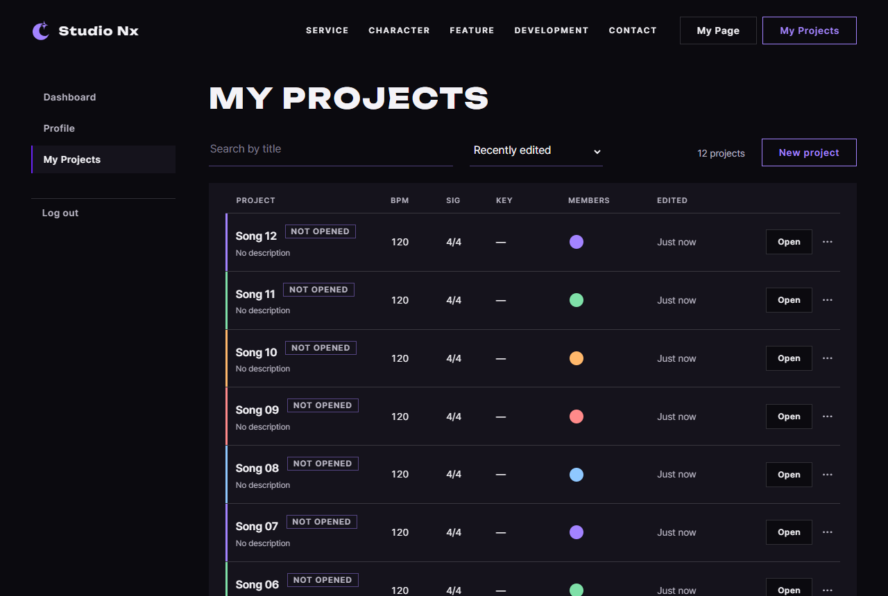

# JS 32 — `renderPager()`

| 항목 | 내용 |
|---|---|
| 파일 | `studionx/frontend/static/js/pages/myproject.js` |
| 작업 | P1-14 내 프로젝트 화면: 페이지 넘김 (PRD 01 FR-123) |
| 작성 | Claude (AI), 2026-10-08, 사용자 검토 |
| 이전 · 다음 | [31 `renderProjects()`](31_myproject_renderProjects.md) · [33 `initSearch()`](33_myproject_initSearch.md) |

## 1. 하는 일
목록 아래의 페이지 넘김 줄(`#project-pager`)을 **전체 개수에 맞게 다시 그리고**, 번호를 누르면 그 페이지를 받아서 목록과 이 줄을 다시 그립니다 (페이지는 새로 열리지 않습니다).

| 전체 (10개씩) | 지금 페이지 | 화면 (별표 = 지금, (x) = 막힘) |
|---|---|---|
| 0개, 10개 | — | 줄을 숨깁니다 |
| 11개 (2쪽) | 1 | `Prev(x) 1* 2 Next` |
| 3쪽 | 3 | `Prev 1 2 3* Next(x)` |
| 7쪽 | 4 | `Prev 1 2 3 4* 5 6 7 Next` (7쪽까지는 모두 보여 줍니다) |
| 20쪽 | 10 | `Prev 1 … 9 10* 11 … 20 Next` |
| 20쪽 | 4 | `Prev 1 2 3 4* 5 … 20 Next` (`…`가 한 쪽만 가리면 번호로 보여 줍니다) |
| 20쪽 | 20 | `Prev 1 … 19 20* Next(x)` |

링크 주소에도 검색어와 정렬이 들어갑니다. 검색어가 `lo fi`이고 이름순이면 2쪽 링크는 `?query=lo+fi&sort=title&page=2`입니다. 그래서 **새 탭으로 열어도** 같은 목록이 나옵니다 (그 주소를 읽는 일은 38번이 합니다).

## 2. 언제 쓰나
| 호출하는 곳 | 화면 |
|---|---|
| `renderProjects` 다음마다 (페이지 시작, 검색, 새 프로젝트, 삭제: 33, 35, 37, 38) | `renderPager(data.total, data.page, data.size)` |
| 이 함수 자신 | 번호를 누른 뒤 새 페이지 기준으로 다시 그립니다 |

## 3. 코드
**import** (`myproject.js` 맨 위: 30번과 같고, 이번에 추가한 것은 없습니다)
```js
import { initAuthState } from '../core/auth-ui.js';
import { requireLogin, logout, loginUrl } from '../core/auth.js';
import { api } from '../core/api.js';
import { initModalFallback } from '../core/modal.js';
import { canOpenStudio, showDesktopOnly, initDesktopOnlyLinks, openStudio } from '../core/studio.js';
import { includePartials } from '../core/include.js';
import { initFormAlerts } from '../core/dialog.js';
```
이 함수는 import를 쓰지 않습니다. 같은 파일의 `PAGE_SIZE`, `current`, `loadProjects`(30), `renderProjects`(31)를 씁니다.

**함수** (링크 주소 만들기는 `pageHref`로 나눴습니다)
```js
export function renderPager(total, page, size = PAGE_SIZE) {
  const pager = document.getElementById('project-pager');
  if (!pager) return;
  const pages = Math.max(1, Math.ceil(total / size));
  pager.textContent = '';
  pager.hidden = pages <= 1;
  if (pages <= 1) return;

  // 버튼 하나 — 갈 수 없으면 href 없이 aria-disabled
  const addButton = function (text, target, label) {
    const button = document.createElement('a');
    button.className = 'pj-pager__btn';
    button.textContent = text;
    if (label) button.setAttribute('aria-label', label);
    if (target < 1 || target > pages) {
      button.setAttribute('aria-disabled', 'true');
    } else {
      button.href = pageHref(target);
      button.dataset.page = target;
      if (target === page && !label) button.setAttribute('aria-current', 'page');
    }
    pager.appendChild(button);
  };
  const addGap = function () {
    const gap = document.createElement('span');
    gap.className = 'pj-pager__btn';
    gap.setAttribute('aria-hidden', 'true');
    gap.textContent = '…';
    pager.appendChild(gap);
  };

  addButton('Prev', page - 1, 'Previous page');
  for (let n = 1; n <= pages; n++) {
    // 7쪽 이하는 전부, 넘으면 처음 · 끝 · 지금 앞뒤 하나만 (사이는 …)
    const near = n === 1 || n === pages || Math.abs(n - page) <= 1;
    if (pages <= 7 || near) {
      addButton(String(n), n);
    } else if (n === page - 2 || n === page + 2) {
      // … 가 한 쪽만 가리면 (2 · 끝에서 둘째) 그냥 그 번호를 보임
      if (n === 2 || n === pages - 1) addButton(String(n), n);
      else addGap();
    }
  }
  addButton('Next', page + 1, 'Next page');

  // 클릭 → 같은 검색어 · 정렬로 그 페이지를 받아 다시 그림 (페이지는 바뀌지 않음)
  pager.onclick = async function (event) {
    const button = event.target.closest('a[data-page]');
    if (!button) return;
    event.preventDefault();
    const data = await refreshList({ query: current.query, sort: current.sort, page: button.dataset.page });
    if (data) window.scrollTo(0, 0);
  };
}

/** 페이지 링크 주소 — 지금 검색어 · 정렬 + 그 페이지 (loadProjects 가 주소창에 남기는 모양과 같음) */
function pageHref(page) {
  const params = new URLSearchParams();
  if (current.query) params.set('query', current.query);
  if (current.sort !== 'updated') params.set('sort', current.sort);
  if (page !== 1) params.set('page', String(page));
  const search = params.toString();
  return search ? '?' + search : location.pathname;
}
```

**최신 문법으로 쓰면** (공부용이며, 바뀌는 부분만 적었습니다)
```js
const addButton = (text, target, label) => { … };
pager.addEventListener('click', async (event) => { … }, { signal });   // 다시 그릴 때 AbortController 로 옛 것 떼기
const { query, sort } = current;
const data = await loadProjects({ query, sort, page: button.dataset.page });
```
| 최신 문법 | 실제 코드 | 뜻 |
|---|---|---|
| `(a, b) => { … }` | `function (a, b) { … }` | 함수입니다 |
| `addEventListener(…, { signal })` | `pager.onclick = …` | 다시 그려도 클릭 처리가 하나만 남게 합니다 |
| `const { query, sort } = current` + `{ query, sort }` | `{ query: current.query, sort: current.sort }` | 칸을 꺼내고 줄임 속성으로 씁니다 |

### 문법 풀이
| import 문법 | 뜻 |
|---|---|
| (이 함수는 import 없음) | 같은 파일의 함수와 값을 그대로 부릅니다 |

| 식 | 뜻 | 예 |
|---|---|---|
| `Math.ceil(total / size)` | 올림입니다. 남는 것이 있으면 한 쪽을 더합니다 | 11 / 10 = 1.1 → 2 |
| `Math.max(1, …)` | 0쪽이 되지 않게 합니다 | 0개 → 1쪽 (숨김) |
| `Math.abs(n - page) <= 1` | 지금 페이지와 1 이하로 떨어진 번호입니다 | 지금이 10이면 9, 10, 11 |
| `button.dataset.page = target` | `data-page="2"`입니다. 누를 수 있는 번호에만 붙입니다 | Prev가 막혔으면 붙이지 않습니다 |
| `aria-current="page"` | 화면 읽기 프로그램과 CSS가 "지금 페이지"로 알아봅니다 (보라색 밑줄) | |
| `aria-disabled="true"` | 막힌 버튼입니다. CSS가 흐리게 만들고 눌리지 않게 합니다 | |
| `pager.onclick = 함수` | 클릭 처리를 **바꿔 끼웁니다**. 몇 번을 다시 그려도 하나만 남습니다 | `addEventListener`는 부를 때마다 하나씩 쌓입니다 |
| `event.target.closest('a[data-page]')` | 누른 곳에서 위로 올라가며 번호 버튼을 찾습니다 | `…`나 막힌 버튼은 null이므로 무시합니다 |
| `event.preventDefault()` | 링크의 기본 동작(페이지 새로 열기)을 막고, JS로 받아서 그립니다 | |
| `window.scrollTo(0, 0)` | 맨 위로 올립니다. 페이지 줄은 목록 아래에 있기 때문입니다 | |

## 4. 흐름
1. 페이지 수를 계산합니다. 1쪽 이하면 줄을 숨기고 끝냅니다.
2. `Prev`, 번호들(7쪽 이하면 모두, 넘으면 처음, 끝, 지금 앞뒤와 `…`), `Next`를 차례로 만듭니다.
3. 번호를 누르면 링크의 기본 동작을 막고, 같은 검색어와 정렬로 그 페이지를 받은 뒤(30), 목록(31)과 이 줄을 다시 그리고 맨 위로 올립니다.

## 5. 왜 이렇게
| 선택 | 이유 |
|---|---|
| 7쪽이 넘으면 줄임 | 프로젝트가 많으면 버튼이 한 줄을 넘칩니다. 처음, 끝, 지금 근처만 있어도 어디로든 두세 번 안에 갈 수 있습니다 |
| `…`가 한 쪽만 가리면 번호로 보여 줌 | `1 … 3`의 `…`는 2 하나뿐이므로, 그냥 `1 2 3`이 더 짧고 정확합니다 (처음 만든 뒤 시험에서 보고 고쳤습니다) |
| 링크에 실제 주소(`href`)를 넣음 | 마우스 가운데 버튼이나 새 탭으로 열기가 됩니다. 클릭은 JS가 가로채므로 페이지를 새로 열지 않습니다 |
| 막힌 Prev, Next에는 `href`가 없음 | 누를 곳이 아니기 때문입니다 (화면 예시와 같습니다). CSS가 흐리게 만들고 클릭되지 않게 합니다 |
| `onclick` 하나만 씀 | 이 함수는 페이지를 넘길 때마다 다시 불립니다. `addEventListener`를 쓰면 한 번 누를 때 요청이 여러 번 갑니다. 시험에서 세 번 다시 그린 뒤 한 번 눌러서 요청이 **1번**임을 확인했습니다 |
| 클릭 뒤 처리는 `refreshList`로 묶음 (33에서) | 받기 → 목록 → 페이지 줄의 세 줄이 검색, 새 프로젝트, 삭제와 같기 때문입니다 |
| 지금 페이지도 링크로 둠 | 화면 예시와 같고, 다시 누르면 새로 받습니다 |

## 6. 시험 (실제 myProject.html, 헤드리스 Chrome, 10개)
| # | 상황 | 결과 |
|---|---|---|
| 01 | 전체 0개, 10개, 11개 | 숨김, 숨김, `Prev(x) 1* 2 Next` (숨김은 계산된 CSS로 확인했습니다) |
| 02, 03 | 3쪽 중 1쪽, 3쪽 | `Prev(x) 1* 2 3 Next`, `Prev 1 2 3* Next(x)` |
| 04 | 20쪽 중 10쪽 | `Prev 1 … 9 10* 11 … 20 Next` |
| 05 | 20쪽 중 1, 3, 4, 20쪽 | `1* 2 … 20`, `1 2 3* 4 … 20`, `1 2 3 4* 5 … 20`, `1 … 19 20*` |
| 06 | 8쪽 중 4쪽, 7쪽 중 4쪽 | `1 2 3 4* 5 … 8`, `1 2 3 4* 5 6 7` |
| 07 | 검색어 `lo fi`, 이름순 | 링크가 `?query=lo+fi&sort=title&page=2` 등이 됩니다. 기본 조건이면 1쪽 링크는 `/myProject.html`입니다 |
| 08 | 실제 프로젝트 12개에서 2를 누름 | 목록 2줄, `Prev 1 2* Next(x)`, 주소 `?page=2`이고, 요청은 **1번**입니다 (세 번 다시 그린 뒤) |
| 08 | 이어서 Prev를 누름 | 목록 10줄, `Prev(x) 1* 2 Next`, 주소 `myProject.html` |
| 09 | 막힌 Prev를 누름 | 요청 0번이고, 주소는 그대로입니다 |

처음 만든 것은 20쪽 중 4쪽에서 `1 … 3 4 5`로 나와서 `…`가 2 하나만 가렸습니다. 번호로 보이게 고친 뒤 01~09를 다시 돌려서 모두 통과했습니다.

### 캡처: 2쪽

