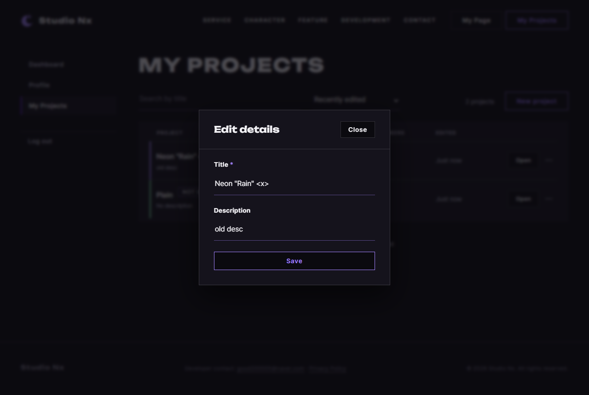

# JS 34 — `initRowMenus()`

| 항목 | 내용 |
|---|---|
| 파일 | `studionx/frontend/static/js/pages/myproject.js` |
| 작업 | P1-14 내 프로젝트 화면 — 줄의 ··· 메뉴 · PRD 01 FR-124 · FR-125 |
| 작성 | Claude (AI) · 2026-10-08 · 사용자 검토 |
| 이전 · 다음 | [33 `initSearch()`](33_myproject_initSearch.md) · [35 `canOpenStudio()`](35_studio_canOpenStudio.md) |

## 1. 하는 일
목록 줄 오른쪽 `···` 메뉴의 **Edit details · Delete 가 어느 프로젝트인지** 기억하고, 모달 칸을 채우고, 메뉴를 닫는다. 모달을 여는 일은 HTML 버튼의 `command="show-modal"` 속성이 이미 한다.

| 사용자가 한 일 | 결과 |
|---|---|
| `···` → Edit details | `selected` = 그 프로젝트 · Edit 모달의 제목 · 설명 칸에 지금 값 · 지난 오류 문구 지움 · 메뉴 닫힘 |
| 설명 없는 줄의 Edit details | 설명 칸은 **빈 칸** (화면 글자 `No description` 이 아님) |
| `···` → Delete | `selected` = 그 프로젝트 · 메뉴 닫힘 (확인창은 41 `initDeleteProject`) |
| 메뉴를 연 채 다른 줄 `···` | 앞 메뉴 닫힘, 새 메뉴만 열림 |
| 메뉴 바깥을 누름 | 열린 메뉴 닫힘 |
| 메뉴 안에서 Esc | 메뉴 닫힘 · 포커스는 `···` 버튼으로 |

**31 `buildRow` 에 두 줄 추가:** 줄에 `data-title` · `data-description` 을 넣는다. 화면의 제목 글자에는 `Not opened`, 설명 글자에는 `No description` 이 섞여 있어서 그대로 읽으면 수정 칸에 잘못 들어가기 때문.

## 2. 언제 쓰나
| 호출하는 곳 | 화면 |
|---|---|
| 페이지 시작 (`myproject.js` 맨 아래, 이미 있음) | `initRowMenus();` — 한 번만 |
| `selected` 를 읽는 곳 | 36 `initEditProjectForm`(저장할 프로젝트 번호) · 37 `initDeleteProject`(지울 번호 · 확인창 제목) |

**이벤트 위임(event delegation)**: 줄마다 버튼에 듣기를 거는 대신 **목록(`ul`) 하나에만** 걸고, 눌린 곳에서 `closest('[data-action]')` 으로 버튼을 찾는 방법. 검색 · 페이지 넘김으로 줄이 다시 그려져도 `ul` 은 그대로라 다시 걸 필요가 없다.

## 3. 코드
**import** (`myproject.js` 맨 위 — 30 과 같음, 이번에 추가한 것 없음)
```js
import { initAuthState } from '../core/auth-ui.js';
import { requireLogin, logout, loginUrl } from '../core/auth.js';
import { api } from '../core/api.js';
import { initModalFallback } from '../core/modal.js';
import { canOpenStudio, showDesktopOnly, initDesktopOnlyLinks, openStudio } from '../core/studio.js';
import { includePartials } from '../core/include.js';
import { initFormAlerts } from '../core/dialog.js';
```
이 함수는 import 를 쓰지 않는다.

**상수** (이번에 추가)
```js
/** ··· 메뉴에서 고른 프로젝트 — Edit details · Delete 가 어느 프로젝트인지 (34 가 채움, 36 · 37 이 읽음) */
export const selected = { id: null, title: '', description: '' };
```

**함수**
```js
export function initRowMenus() {
  const list = document.getElementById('project-list');
  if (!list) return;

  // ··· 메뉴 안 버튼 — 목록에 하나만 걸어 둠 (줄을 다시 그려도 동작)
  list.addEventListener('click', function (event) {
    const button = event.target.closest('[data-action]');
    if (!button) return;
    const row = button.closest('li[data-project-id]');
    selected.id = Number(row.dataset.projectId);
    selected.title = row.dataset.title;
    selected.description = row.dataset.description;

    if (button.dataset.action === 'edit') {
      const title = document.getElementById('edit-title');
      const description = document.getElementById('edit-description');
      const error = document.getElementById('edit-project-error');
      if (title) title.value = selected.title;
      if (description) description.value = selected.description;
      if (error) { error.hidden = true; error.textContent = ''; }   // 지난번 실패 문구 지우기
    }
    const menu = button.closest('details');
    if (menu) menu.open = false;
  });

  // 메뉴 바깥을 누르면 열린 메뉴 닫기 (다른 줄의 ··· 를 눌러도 앞 메뉴는 닫힘)
  document.addEventListener('click', function (event) {
    const menus = document.querySelectorAll('.pj-menu[open]');
    for (let i = 0; i < menus.length; i++) {
      if (!menus[i].contains(event.target)) menus[i].open = false;
    }
  });

  // Esc → 열린 메뉴 닫고, 메뉴 안에 있던 포커스는 ··· 버튼으로 돌려줌
  document.addEventListener('keydown', function (event) {
    if (event.key !== 'Escape') return;
    const menus = document.querySelectorAll('.pj-menu[open]');
    for (let i = 0; i < menus.length; i++) {
      const hadFocus = menus[i].contains(document.activeElement);
      menus[i].open = false;
      if (hadFocus) menus[i].querySelector('summary').focus();
    }
  });
}
```

**31 `buildRow` 에 추가한 줄**
```js
  row.dataset.title = item.title;                                        // 34 가 수정 칸을 채울 때 씀
  row.dataset.description = item.description ? item.description : '';
```

**최신 문법으로 쓰면** (공부용 — 바뀌는 부분만)
```js
for (const menu of document.querySelectorAll('.pj-menu[open]')) {
  if (!menu.contains(event.target)) menu.open = false;
}
row.dataset.description = item.description ?? '';
error?.setAttribute('hidden', '');
```
| 최신 문법 | 실제 코드 | 뜻 |
|---|---|---|
| `for (const x of 목록)` | `for (let i = 0; i < 목록.length; i++)` | 하나씩 돌기 |
| `a ?? ''` | `a ? a : ''` | 없으면 빈 글자 |
| `error?.…` | `if (error) …` | 있을 때만 |

### 문법 풀이
| import 문법 | 뜻 |
|---|---|
| (이 함수는 import 없음) | |

| 식 | 뜻 | 예 |
|---|---|---|
| `event.target.closest('[data-action]')` | 누른 곳에서 위로 올라가며 `data-action` 이 있는 요소 | 버튼 안 글자를 눌러도 버튼을 찾음 |
| `row.dataset.projectId` | `data-project-id` 속성 값 (글자) → `Number(…)` 로 숫자 | `'1801'` → 1801 |
| `details.open = false` | `<details>` 메뉴 닫기 (`open` 속성 제거) | |
| `document.querySelectorAll('.pj-menu[open]')` | 열려 있는 메뉴들만 | |
| `menus[i].contains(event.target)` | 누른 곳이 그 메뉴 안인지 | 바깥이면 닫음 |
| `document.activeElement` | 지금 포커스가 있는 요소 | Esc 전 `Edit details` 버튼 |

## 4. 흐름
1. **목록 클릭:** 버튼 찾기 → 그 줄의 번호 · 제목 · 설명을 `selected` 에 → Edit 이면 수정 칸 채우기 · 오류 지우기 / Delete 면 삭제 모달 제목 → 메뉴 닫기.
2. **문서 클릭:** 열린 메뉴 중 누른 곳을 품지 않은 것을 닫음.
3. **Esc:** 열린 메뉴를 닫고, 포커스가 메뉴 안이었으면 `···` 로.

## 5. 왜 이렇게
| 선택 | 이유 |
|---|---|
| 목록 하나에 듣기 (위임) | 줄은 검색 · 페이지마다 다시 그려짐. 줄마다 걸면 다시 그릴 때마다 다시 걸어야 함 (템플릿) |
| `data-title` · `data-description` 에서 읽음 | 화면 글자에서 읽으면 `Neon Rain Not opened` · `No description` 이 수정 칸에 들어감 |
| `selected` 를 밖으로 | 저장(36) · 삭제(37)는 다른 함수 — 어느 프로젝트인지 넘겨받을 곳이 필요 |
| 지난 오류 문구 지움 | 앞 프로젝트 저장에 실패한 문구가 다른 프로젝트 모달에 남지 않게 |
| 바깥 클릭 · Esc 로 닫기 | `<details>` 는 다시 눌러야만 닫힘 — 일반 메뉴처럼 동작하게 (템플릿) |
| Esc 뒤 포커스를 `···` 로 | 키보드 사용자가 메뉴 안 버튼에 있다가 닫히면 포커스가 사라짐 |
| (41 에서 바꿈) Delete 모달 제목 채우기를 지움 | 41 이 HTML 삭제 모달을 `confirmDialog` 로 바꿔 모달이 없어짐 — 처음에는 여기서 `#delete-project-name` 을 채웠다 |

**참고:** 모달은 버튼의 `command` 속성으로 열린다 (최신 Chrome · Edge 지원). 지원하지 않는 브라우저용 `initModalFallback`(`core/modal.js`)은 아직 템플릿이다 — 이 작업 범위 밖.

## 6. 시험 (실제 myProject.html · 실제 서버 · 7개)
프로젝트 `Plain` 과 `Neon "Rain" <x>`(설명 `old desc`)를 만들고 페이지 안에서 눌렀다.

| # | 한 일 | 결과 |
|---|---|---|
| 01 | 첫 줄 `···` → Edit details | 메뉴 열림 → 닫힘 · Edit 모달 열림 · 제목 `Neon "Rain" <x>` · 설명 `old desc` · `selected.id` 맞음 |
| 02 | (오류 문구를 띄워 둔 채) 설명 없는 줄 Edit | 설명 칸 빈 칸 · 오류 숨김 · 글자 비움 |
| 03 | 첫 줄 Delete | (41 뒤 다시 시험) 확인창 `Delete project?` · 제목 글자 그대로 · `selected` 맞음 · 메뉴 닫힘 |
| 04 | 첫 메뉴 연 채 둘째 `···` | 첫째 닫힘 · 둘째 열림 |
| 05 | 페이지 제목 누름 | 둘 다 닫힘 |
| 06 | 메뉴 안 `Edit details` 에 포커스 → Esc | 닫힘 · 포커스 `···` |
| 07 | 이름순으로 다시 그린 뒤 Edit | 그대로 동작 |

### 캡처 — Edit 모달에 채워진 값

