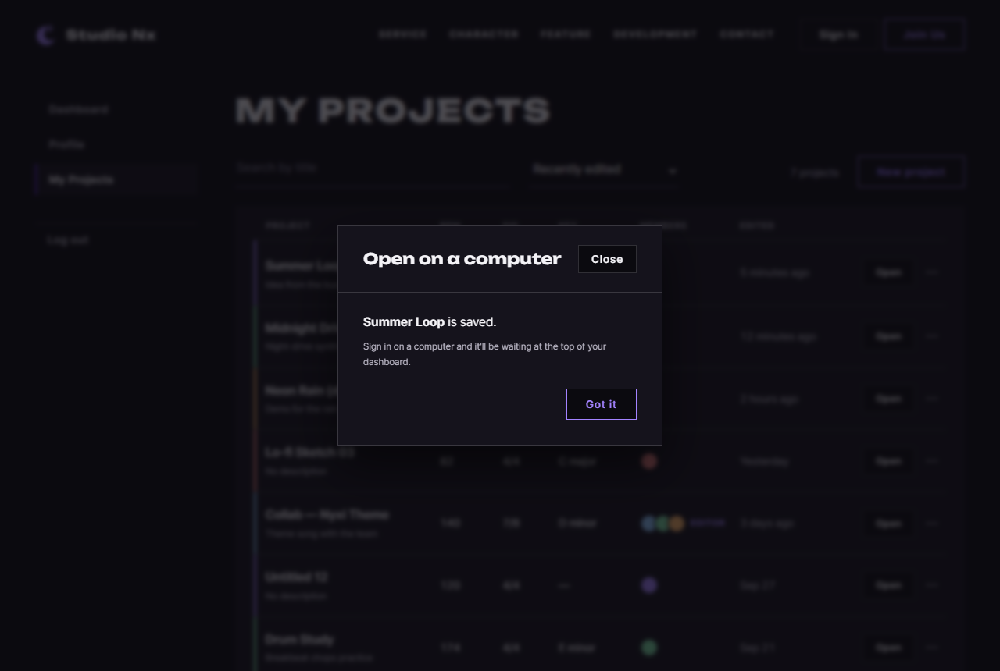

# JS 36 — `showDesktopOnly()` (core/studio.js)

| 항목 | 내용 |
|---|---|
| 파일 | `studionx/frontend/static/js/core/studio.js` |
| 작업 | P1-14 내 프로젝트 화면 — 작은 화면 안내 모달 · PRD 01 FR-129 |
| 작성 | Claude (AI) · 2026-10-08 · 사용자 검토 |
| 이전 · 다음 | [35 `canOpenStudio()`](35_studio_canOpenStudio.md) · [37 `openStudio()`](37_studio_openStudio.md) |

## 1. 하는 일
화면이 좁아 시퀀서를 열 수 없을 때(35 가 false) **"컴퓨터에서 여세요" 모달**(`#desktop-only-modal`, `static/partials/desktop-only-modal.html`)을 띄운다. 상황에 맞는 문장 하나만 보이고 제목을 채운다.

| 부른 값 | 보이는 문장 |
|---|---|
| `showDesktopOnly('created', 'Summer Loop')` | **Summer Loop** is saved. — 작은 화면에서 프로젝트를 **만든 직후** (39) |
| `showDesktopOnly('open', 'Summer Loop')` | **Summer Loop** opens in the studio, which needs a larger screen. — Open · 제목을 **눌렀을 때** (38) |
| 그 밖의 값 (`'xyz'`) | `open` 문장 |

두 경우 모두 아래에 "Sign in on a computer and it'll be waiting at the top of your dashboard." 와 Got it 버튼.

## 2. 언제 쓰나
| 호출하는 곳 | 화면 |
|---|---|
| 39 `initNewProjectForm` | 작은 화면에서 만들기 성공 → `'created'` |
| 38 `initDesktopOnlyLinks` | 작은 화면에서 Open · 제목 클릭 → `'open'` (myProject · myPage) |

**`<dialog>` 와 `showModal()`**: HTML 기본 모달. `showModal()` 로 열면 뒤 화면이 막히고 Esc 로 닫힌다. 이미 열린 모달에 다시 `showModal()` 을 부르면 오류(`InvalidStateError`)가 나므로 `modal.open` 을 먼저 본다.

## 3. 코드
**import** (`studio.js` 맨 위)
```js
export const STUDIO_MIN_WIDTH = 1280;
```
`studio.js` 는 import 가 없다. 이 함수는 브라우저 기본 기능만 쓴다.

**함수**
```js
export function showDesktopOnly(variant, title) {
  const modal = document.getElementById('desktop-only-modal');
  if (!modal) return;
  if (variant !== 'created') variant = 'open';

  // 상황에 맞는 문단만 보이기
  const leads = modal.querySelectorAll('[data-variant]');
  for (let i = 0; i < leads.length; i++) {
    leads[i].hidden = leads[i].dataset.variant !== variant;
  }
  const name = document.getElementById('desktop-only-' + variant + '-name');
  if (name) name.textContent = title;

  if (!modal.open) modal.showModal();
}
```

**최신 문법으로 쓰면** (공부용)
```js
for (const lead of modal.querySelectorAll('[data-variant]')) lead.hidden = lead.dataset.variant !== variant;
document.getElementById(`desktop-only-${variant}-name`)?.replaceChildren(title);
modal.open || modal.showModal();
```
| 최신 문법 | 실제 코드 | 뜻 |
|---|---|---|
| `for (const x of 목록)` | `for (let i = 0; …; i++)` | 하나씩 |
| `el?.replaceChildren(title)` | `if (name) name.textContent = title` | 있을 때만 글자 넣기 |
| `a \|\| b()` | `if (!a) b()` | a 가 아니면 b 실행 |

### 문법 풀이
| import 문법 | 뜻 |
|---|---|
| (import 없음) | |

| 식 | 뜻 | 예 |
|---|---|---|
| `modal.querySelectorAll('[data-variant]')` | 모달 안 `data-variant` 가 있는 문단들 | created · open 두 개 |
| `leads[i].hidden = 조건` | 조건이 true 면 숨김 | 고른 것과 다르면 숨김 |
| `'desktop-only-' + variant + '-name'` | 고른 문장 안의 제목 칸 id | `desktop-only-created-name` |
| `name.textContent = title` | 글자로만 넣기 | `Night <b>Drive</b>` → 그 글자 그대로 |
| `modal.open` | 지금 열려 있는지 | |

## 4. 흐름
1. 모달이 없으면 끝 → 2. 모르는 값이면 `'open'` → 3. 고른 문장만 보이기 → 4. 제목 넣기 → 5. 닫혀 있으면 열기.

## 5. 왜 이렇게
| 선택 | 이유 |
|---|---|
| 문장 두 개를 HTML 에 두고 숨기기만 | 글자는 HTML(화면 담당)이 정하고 JS 는 고르기만 — 문구를 고칠 때 JS 를 건드리지 않음 (템플릿) |
| `textContent` | 제목은 사용자가 친 글자 — 태그로 해석되지 않게 (31 과 같음) |
| 모르는 값은 `'open'` | 부르는 쪽이 잘못 넘겨도 모달이 빈 문장으로 뜨지 않게 |
| 열려 있으면 다시 열지 않음 | `showModal()` 을 두 번 부르면 오류. 문장 · 제목만 바뀜 |
| 모달이 없으면 조용히 끝 | 공통 조각(`includePartials`)이 아직 안 끼워진 페이지에서 불려도 오류가 나지 않게 |

## 6. 시험 (실제 myProject.html · 헤드리스 Chrome · 5개)
보이는지는 계산된 CSS 로 확인했다.

| # | 한 일 | 결과 |
|---|---|---|
| 01 | `('created', 'Summer Loop')` | 모달 열림 · created 문장만 보임 · 제목 `Summer Loop` |
| 02 | 닫고 `('open', 'Night <b>Drive</b>')` | open 문장만 · 제목은 글자 그대로 (`<b>` 요소 0개) |
| 03 | 열린 채 `('created', 'Second')` | 오류 없음 · 문장이 created 로 바뀌고 제목 `Second` |
| 04 | `('xyz', 'Fallback')` | open 문장 · 제목 `Fallback` |
| 05 | Got it 누름 | 닫힘 |

### 캡처 — 만든 직후 안내 (`created`)

