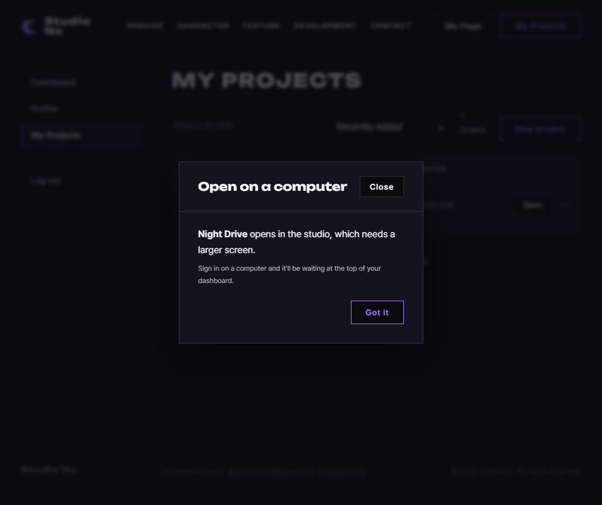

# JS 38 — `initDesktopOnlyLinks()` (core/studio.js)

| 항목 | 내용 |
|---|---|
| 파일 | `studionx/frontend/static/js/core/studio.js` |
| 작업 | P1-14 내 프로젝트 화면: 시퀀서 링크 클릭 처리 (PRD 01 FR-126, FR-129) |
| 작성 | Claude (AI), 2026-10-08, 사용자 검토 |
| 이전 · 다음 | [37 `openStudio()`](37_studio_openStudio.md) · [39 `initNewProjectForm()`](39_myproject_initNewProjectForm.md) |

## 1. 하는 일
목록의 **제목이나 Open**처럼 `studioNx.html`로 가는 링크를 누르면, 지금 탭에서 넘어가는 대신 화면 폭에 따라 다르게 처리합니다.

| 사용자 동작 | 결과 |
|---|---|
| 넓은 화면(1280 이상)에서 **그냥 클릭** | 시퀀서가 **새 브라우저 창**으로 열립니다 (37). 같은 프로젝트라면 이미 열린 창이 앞으로 옵니다 |
| 좁은 화면에서 그냥 클릭 | "Open on a computer" 안내 모달이 뜹니다 (36). 제목에는 `Not opened` 표시가 붙지 않습니다 |
| Ctrl, ⌘, Shift, Alt + 클릭, 휠 클릭 | **브라우저 기본 동작 그대로**입니다 (새 탭, 새 창, 내려받기) |
| 시퀀서가 아닌 링크 | 그대로 둡니다 |

**사용자 질문 (2026-10-08): "Ctrl 클릭을 해야 해?"** 아닙니다. **그냥 클릭 한 번으로 새 창이 열립니다.** Ctrl+클릭 등은 "새 탭으로 열기"에 익숙한 사람의 습관을 **막지 않는다**는 뜻입니다. 창과 탭 중에서 사용자가 고르는 설정은 Phase 2의 환경 설정(PRD 02 FR-2164)에 있습니다.

## 2. 언제 쓰나
| 호출하는 곳 | 범위 |
|---|---|
| `myproject.js` 맨 아래 (이미 있음) | `initDesktopOnlyLinks(document.getElementById('project-list'))`로 목록에 겁니다 |
| `mypage.js` (P1-17, 이미 있음) | `initDesktopOnlyLinks(document.getElementById('recent-list'))`로 최근 프로젝트에 겁니다 |

**링크의 `href`는 그대로 둡니다.** JS가 꺼져 있거나 오류가 나도 링크는 지금 탭에서 열립니다 (점진적 향상).

## 3. 코드
**import** (`studio.js` 맨 위)
```js
export const STUDIO_MIN_WIDTH = 1280;
```
`studio.js`에는 import가 없습니다. 이 함수는 같은 파일의 `canOpenStudio`(35), `showDesktopOnly`(36), `openStudio`(37)를 씁니다.

**함수** (제목 찾기는 `studioLinkTitle`로 나눴습니다)
```js
export function initDesktopOnlyLinks(root = document) {
  if (!root) return;
  root.addEventListener('click', function (event) {
    // 새 탭 · 새 창 · 내려받기 같은 브라우저 기본 동작은 막지 않음
    if (event.defaultPrevented || event.button !== 0) return;
    if (event.ctrlKey || event.metaKey || event.shiftKey || event.altKey) return;
    const link = event.target.closest('a[href^="studioNx.html"]');
    if (!link) return;

    event.preventDefault();
    if (!canOpenStudio()) {
      showDesktopOnly('open', studioLinkTitle(link));
      return;
    }
    const params = new URLSearchParams(link.getAttribute('href').split('?')[1]);
    openStudio(params.get('projectId'));
  });
}

/** 링크가 속한 프로젝트의 제목 — 줄의 data-title, 없으면 <b> 안 첫 글자 마디 */
function studioLinkTitle(link) {
  const row = link.closest('[data-title]');
  if (row) return row.dataset.title;
  const holder = link.querySelector('b') ? link : link.closest('li, section, article, div');
  const bold = holder ? holder.querySelector('b') : null;
  return bold && bold.firstChild ? bold.firstChild.textContent.trim() : 'This project';
}
```

**최신 문법으로 쓰면** (공부용이며, 바뀌는 부분만 적었습니다)
```js
if (event.ctrlKey || event.metaKey || event.shiftKey || event.altKey) return;   // 같음
const projectId = new URL(link.href).searchParams.get('projectId');
return link.closest('[data-title]')?.dataset.title
    ?? holder?.querySelector('b')?.firstChild?.textContent.trim()
    ?? 'This project';
```
| 최신 문법 | 실제 코드 | 뜻 |
|---|---|---|
| `a?.b` 사슬 | `a ? a.b : null`, `if` | 있을 때만 다음으로 넘어갑니다 |
| `x ?? y` | `x ? x : y` | 없으면 다음 값을 씁니다 |
| `new URL(link.href).searchParams` | `new URLSearchParams(href.split('?')[1])` | 주소의 `?` 뒤 값을 읽습니다 |

### 문법 풀이
| import 문법 | 뜻 |
|---|---|
| (import 없음) | |

| 식 | 뜻 | 예 |
|---|---|---|
| `event.button !== 0` | 왼쪽 버튼이 아니라는 뜻입니다 (1 = 휠, 2 = 오른쪽) | 휠 클릭이면 브라우저가 새 탭을 엽니다 |
| `event.ctrlKey`, `metaKey`, `shiftKey`, `altKey` | 누른 채로 클릭한 키입니다 (meta = Mac의 ⌘) | Ctrl = 새 탭, Shift = 새 창, Alt = 내려받기 |
| `event.defaultPrevented` | 앞에서 다른 코드가 이미 막았는지 확인합니다 | |
| `'a[href^="studioNx.html"]'` | `href`가 `studioNx.html`로 **시작하는** 링크입니다 | |
| `link.getAttribute('href').split('?')[1]` | `?` 뒤의 부분입니다 | `'projectId=7'` |
| `params.get('projectId')` | 그 값입니다 | `'7'` |
| `link.closest('[data-title]')` | 위로 올라가며 `data-title`이 있는 요소를 찾습니다 (myProject의 줄, 31) | |
| `bold.firstChild.textContent` | `<b>`의 첫 글자 마디만 읽습니다. 뒤의 `<span>Not opened</span>`는 빠집니다 | `Night Drive` |

## 4. 흐름
1. 범위(`root`) 안에서 클릭이 일어나면, 이미 막힌 클릭이거나 왼쪽 버튼이 아니거나 보조 키를 누른 경우에는 그대로 둡니다.
2. 시퀀서 링크가 아니면 그대로 두고, 맞으면 기본 이동을 막습니다.
3. 좁은 화면이면 제목을 찾아서 안내 모달을 띄우고, 넓은 화면이면 주소의 `projectId`로 새 창을 엽니다.

## 5. 왜 이렇게
| 선택 | 이유 |
|---|---|
| 그냥 클릭하면 새 창 | 목록 창을 닫아도 작업 창이 남게 합니다 (2026-10-05 결정) |
| 보조 키와 휠 클릭은 그대로 둠 | 사용자가 **직접 고른** 동작(새 탭 등)을 JS가 바꾸면 불편합니다. 템플릿의 Ctrl, ⌘, 휠에 Shift와 Alt도 더했습니다 |
| 범위(`root`) 하나에만 이벤트를 검 | 목록이 다시 그려져도 동작합니다 (34번과 같은 위임 방식) |
| 제목은 `data-title`을 먼저 읽음 | 화면 글자에는 `Not opened`가 섞여 있습니다 (31). myPage처럼 `data-title`이 없으면 `<b>`의 첫 마디를 읽습니다 |
| 제목을 찾지 못하면 `This project` | 모달이 빈 이름으로 뜨지 않게 합니다 |
| `href`를 남겨 둠 | JS 없이도 링크가 동작하고, 마우스를 올리면 주소가 보입니다 |

**P1-17 참고:** myPage의 'Ready to start' 배너는 제목이 `<h2>`라서 지금 규칙으로는 `This project`가 됩니다. 배너는 `recent-list` 밖에 있어서 지금은 이 함수의 범위가 아니며, P1-17에서 배너에 `data-title`을 넣으면 그대로 맞게 됩니다.

## 6. 시험 (실제 myProject.html, 실제 서버, 헤드리스 Chrome, 6개)
프로젝트 `Night Drive`를 만들어 목록을 그리고, "사용자가 누른 것"처럼 클릭했습니다. 클릭이 막혔는지는 문서 끝에서 `defaultPrevented`로 기록했습니다.

| # | 한 일 | 결과 |
|---|---|---|
| 01 | 1280 화면에서 제목을 그냥 클릭 | 기본 이동을 막고, **새 창** `studioNx.html?projectId=…`이 생기며, 지금 탭은 myProject 그대로입니다 |
| 02 | 같은 줄의 Open 버튼 | 기본 이동을 막고, 창 수는 그대로입니다 (같은 창이 앞으로 옵니다) |
| 03 | Ctrl, Shift, Alt, Meta, 휠 클릭 | 5번 모두 **막지 않고**, 모달도 뜨지 않습니다 |
| 04 | 1024 화면에서 제목 클릭 | 기본 이동을 막고, 안내 모달이 뜨며, 제목은 `Night Drive`입니다 (`Not opened` 없음). 새 창은 생기지 않습니다 |
| 05 | `data-title`이 없는 myPage 모양의 줄 | 안내 모달의 제목이 `Midnight Drive`입니다 |
| 06 | 목록 안의 다른 링크(`userInfo.html`) | 막지 않고, 모달도 뜨지 않습니다 |

### 캡처: 좁은 화면(1024)에서 제목을 눌렀을 때

