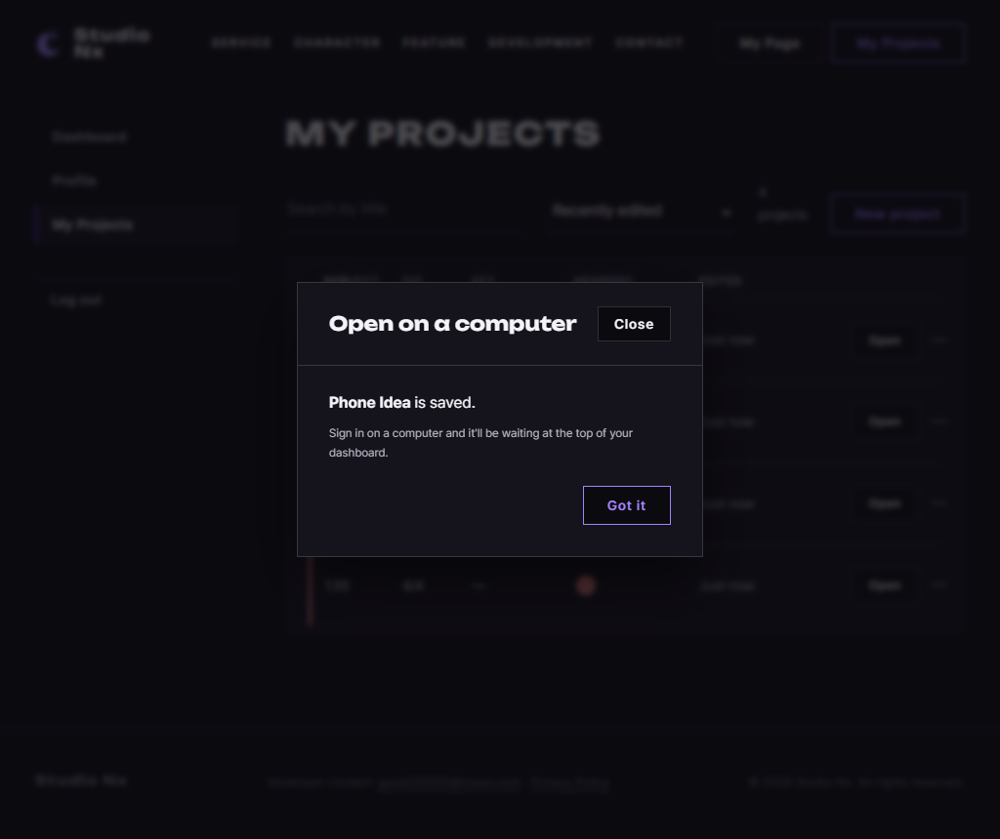
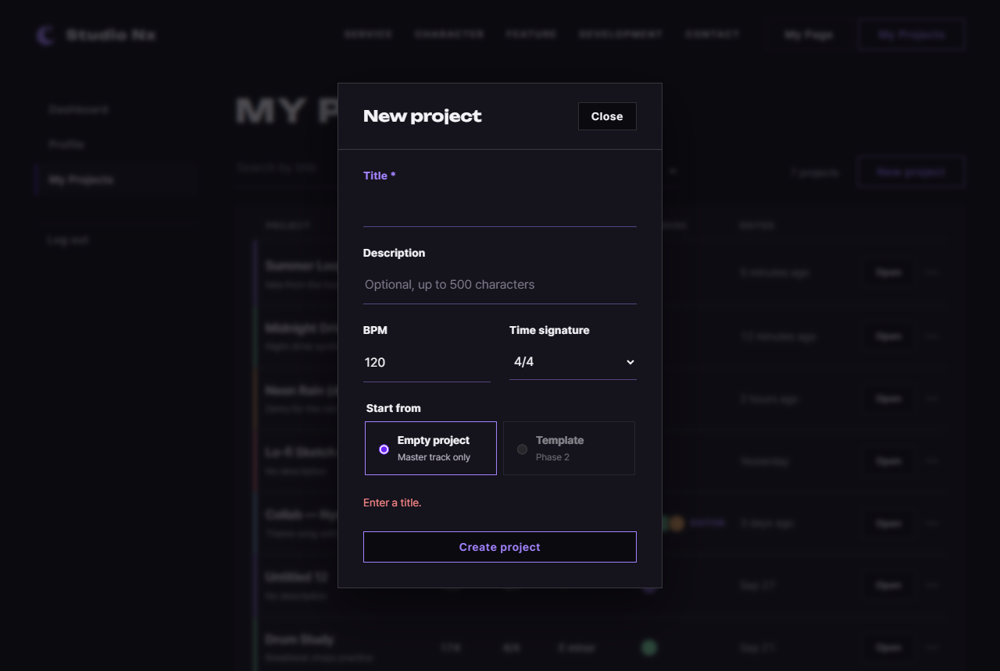

# JS 39 — `initNewProjectForm()`

| 항목 | 내용 |
|---|---|
| 파일 | `studionx/frontend/static/js/pages/myproject.js` |
| 작업 | P1-14 내 프로젝트 화면: 새 프로젝트 만들기 (PRD 01 FR-122, FR-126, FR-129) |
| 작성 | Claude (AI), 2026-10-08, 사용자 검토 |
| 이전 · 다음 | [38 `initDesktopOnlyLinks()`](38_studio_initDesktopOnlyLinks.md) · [40 `initEditProjectForm()`](40_myproject_initEditProjectForm.md) |

## 1. 하는 일
New project 모달에서 **Create project**를 누르면 서버에 프로젝트를 만들고(`POST /projects`, P1-13 59), 화면 폭에 따라 다음 단계로 이어 갑니다.

| 상황 | 결과 |
|---|---|
| 넓은 화면 (1280 이상) | 누른 순간 **빈 새 창**이 열리고, 응답이 오면 그 창이 `studioNx.html?projectId=…&new=1`(시퀀서의 "새 프로젝트" 로딩)로 바뀝니다 |
| 좁은 화면 | 창을 열지 않고 **"… is saved."** 안내를 띄웁니다 (36 `created`) |
| 두 경우 모두 | 모달을 닫고 폼을 비운 뒤, 검색과 정렬을 기본으로 되돌리고 목록을 다시 받습니다. 그래서 **새 프로젝트가 맨 위**에 나옵니다 |
| 제목이 공백뿐 | 보내지 않고 `Enter a title.`을 보여 줍니다 |
| BPM 10(20~999 밖) 등 | 브라우저 검사에서 멈추고 알림창을 띄우며(FIX-01 `initFormAlerts`), 보내지 않습니다 |
| 서버 오류 | 미리 열어 둔 빈 창을 **닫고**, 모달 안에 서버 문구를 보여 줍니다. 입력값은 그대로 둡니다 |
| 보내는 동안 | Create 버튼을 잠급니다 (두 번 눌러서 프로젝트가 두 개 만들어지지 않게) |

보내는 값은 `{ title, description(없으면 null), bpm(숫자), time_sig_num, time_sig_den }`입니다. 박자 칸의 `'7/8'`은 7과 8로 나눠서 보냅니다.

## 2. 언제 쓰나
| 호출하는 곳 | 화면 |
|---|---|
| 페이지 시작 (`myproject.js` 맨 아래, 이미 있음) | `initNewProjectForm();`으로 폼에 한 번 걸어 둡니다 |

모달은 `New project` 버튼의 `command="show-modal"`이 엽니다 (HTML). 이 함수는 **보내기**만 맡습니다.

## 3. 코드
**import** (`myproject.js` 맨 위)
```js
import { initAuthState } from '../core/auth-ui.js';
import { requireLogin, logout, loginUrl } from '../core/auth.js';
import { api } from '../core/api.js';
import { initModalFallback } from '../core/modal.js';
import { canOpenStudio, showDesktopOnly, initDesktopOnlyLinks, openStudio, openBlankStudio } from '../core/studio.js';
import { includePartials } from '../core/include.js';
import { initFormAlerts } from '../core/dialog.js';
```
**`openBlankStudio`를 이번에 추가했습니다.** 이 함수는 `api`(P1-02), `canOpenStudio`(35), `showDesktopOnly`(36), `openStudio`와 `openBlankStudio`(37), 같은 파일의 `refreshList`(33)를 씁니다.

**함수**
```js
export function initNewProjectForm() {
  const form = document.getElementById('new-project-form');
  if (!form) return;
  const modal = document.getElementById('new-project-modal');
  const error = document.getElementById('new-project-error');
  const submit = form.querySelector('[type="submit"]');
  const showError = function (message) {
    error.textContent = message;
    error.hidden = false;
  };

  form.addEventListener('submit', async function (event) {
    event.preventDefault();
    const title = document.getElementById('new-title').value.trim();
    const description = document.getElementById('new-description').value.trim();
    const sig = document.getElementById('new-sig').value.split('/');   // '7/8' → ['7', '8']
    error.hidden = true;
    if (!title) {
      showError('Enter a title.');
      return;
    }

    // 넓은 화면: 클릭한 지금 빈 창을 열어 둠 (응답 뒤에 열면 팝업으로 막힘 — 37)
    const wide = canOpenStudio();
    const win = wide ? openBlankStudio() : null;
    submit.disabled = true;
    let project;
    try {
      project = await api.post('/projects', {
        title: title,
        description: description ? description : null,
        bpm: Number(document.getElementById('new-bpm').value),
        time_sig_num: Number(sig[0]),
        time_sig_den: Number(sig[1]),
      });
    } catch (err) {
      if (win) win.close();
      showError(err.message);
      return;
    } finally {
      submit.disabled = false;
    }

    // 성공 — 모달 닫고 폼 비우기
    if (modal && modal.open) modal.close();
    form.reset();
    if (wide) {
      openStudio(project.project_id, { isNew: true, win: win });
    } else {
      showDesktopOnly('created', project.title);
    }

    // 목록은 기본 조건(최근 수정순 · 검색 없음)으로 — 새 프로젝트가 맨 위
    const query = document.getElementById('project-query');
    const sort = document.getElementById('project-sort');
    if (query) query.value = '';
    if (sort) sort.value = 'updated';
    refreshList({ query: '', sort: 'updated', page: 1 });
  });
}
```

**최신 문법으로 쓰면** (공부용이며, 바뀌는 부분만 적었습니다)
```js
const [num, den] = document.getElementById('new-sig').value.split('/').map(Number);
project = await api.post('/projects', { title, description: description || null, bpm: +bpmField.value, time_sig_num: num, time_sig_den: den });
win?.close();
openStudio(project.project_id, { isNew: true, win });
```
| 최신 문법 | 실제 코드 | 뜻 |
|---|---|---|
| `const [a, b] = 배열` | `sig[0]`, `sig[1]` | 배열에서 값을 꺼냅니다 |
| `.map(Number)` | `Number(sig[0])`를 따로 씀 | 모두 숫자로 바꿉니다 |
| `{ title }`, `{ win }` | `{ title: title }`, `{ win: win }` | 줄임 속성입니다 |
| `x \|\| null` | `x ? x : null` | 비었으면 null입니다 |
| `win?.close()` | `if (win) win.close()` | 있을 때만 닫습니다 |

### 문법 풀이
| import 문법 | 뜻 |
|---|---|
| `import { …, openBlankStudio } from '../core/studio.js'` | 클릭할 때 빈 시퀀서 창을 미리 여는 함수입니다 (37) |

| 식 | 뜻 | 예 |
|---|---|---|
| `form.addEventListener('submit', async function (event) { … })` | Enter나 Create를 누르면 실행됩니다 (브라우저 검사를 통과한 뒤에만 불립니다) | |
| `'7/8'.split('/')` | `/`로 나눕니다 | `['7', '8']` |
| `Number('128.5')` | 문자열을 숫자로 바꿉니다 | 128.5 |
| `try { … } catch { … } finally { … }` | 실패하면 catch를, **성공이든 실패든** 끝에 finally를 실행합니다 | 버튼 잠금 풀기 |
| `catch` 안의 `return` 뒤에도 `finally`가 실행됨 | | |
| `form.reset()` | 칸을 HTML의 처음 값으로 되돌립니다 (제목 빈 칸, BPM 120, 4/4) | |
| `modal.close()` | `<dialog>`를 닫습니다 | |

## 4. 흐름
1. 기본 보내기(페이지 이동)를 막습니다. 제목이 공백뿐이면 문구를 보여 주고 끝냅니다.
2. 넓은 화면이면 **바로** 빈 창을 엽니다 (응답을 기다리기 전에).
3. 버튼을 잠그고 `POST /projects`를 보냅니다.
4. 실패하면 빈 창을 닫고, 문구를 보여 주고, 버튼을 풉니다.
5. 성공하면 모달을 닫고 폼을 비웁니다. 넓은 화면이면 빈 창을 시퀀서로 바꾸고, 좁은 화면이면 "saved" 안내를 띄웁니다. 그리고 검색 칸과 정렬 칸을 기본으로 되돌린 뒤 목록을 다시 받습니다(33 `refreshList`).

## 5. 왜 이렇게
| 선택 | 이유 |
|---|---|
| 빈 창을 **await 전에** 엶 | 응답 뒤에 열면 팝업이 차단됩니다 (37) |
| 실패하면 빈 창을 닫음 | 빈 흰 창이 남지 않게 합니다 (시험 05에서 창 수가 그대로임을 확인했습니다) |
| 공백뿐인 제목은 보내지 않음 | `required`는 공백 한 칸도 통과시킵니다. 서버 422의 영어 검사 문구보다 짧고 분명한 문구를 보여 주려는 것입니다 |
| 검사는 브라우저에 맡김 (BPM 범위, 필수 칸) | HTML에 `min`, `max`, `required`가 이미 있고, FIX-01이 말풍선 대신 알림창으로 보여 줍니다 |
| 만든 뒤에는 검색과 정렬을 기본으로 되돌림 | 검색 중(`zzz`)이었다면 새 프로젝트가 목록에 보이지 않습니다. "맨 위에 보인다"는 템플릿의 요구를 지키기 위해서입니다. 검색 칸과 정렬 칸의 글자도 함께 비웁니다 |
| 좁은 화면에서는 "saved" 안내를 띄움 | 시퀀서를 열 수 없는 화면이므로, 프로젝트가 만들어졌다는 것과 컴퓨터에서 열면 된다는 것을 알려 줍니다 (FR-129) |
| 목록 창은 그대로 둠 | 시퀀서는 새 창으로 열리고, 이 창은 갱신된 목록으로 남습니다 (템플릿) |

## 6. 시험 (실제 myProject.html, 실제 서버, 헤드리스 Chrome, 7개)
New project 버튼으로 모달을 열고 칸을 채운 뒤 보냈습니다 ("사용자가 누른 것"처럼). 열린 창은 Chrome의 창 목록으로 확인했습니다.

| # | 한 일 | 결과 |
|---|---|---|
| 01 | 1280, `'  New Wave '`, 설명, 128.5, 7/8 | 새 창 `studioNx.html?projectId=…&new=1`이 열리고, 모달이 닫히며, 제목 칸이 비워지고, 목록 맨 위에 `New Wave`가 나옵니다. 서버에 저장된 값은 제목 `New Wave`, 설명, bpm `128.50`, `7/8`입니다 |
| 02 | 검색 `zzz`(0개) 중에 `Second` 만들기 | 목록이 기본 조건으로 돌아가서 `Second, New Wave, Old One`이 나오고, 주소의 `?query=zzz`가 없어지며, 검색 칸이 비워집니다 |
| 03 | 1024, `Phone Idea`, 3/4 | 새 창은 열리지 않고, "Phone Idea is saved." 안내가 뜨며, 목록 맨 위에 나옵니다 |
| 04 | 제목이 공백 | `Enter a title.`이 나오고, 요청은 0번이며, 창도 열리지 않고, 모달은 그대로입니다 |
| 05 | 서버 500 (가짜) | 문구 `Something went wrong. Please try again.`이 나오고, 빈 창이 닫혀서 창 수는 그대로이며, 버튼이 풀리고, 입력값은 그대로입니다 |
| 06 | 응답을 0.8초 늦춤 | 보내는 동안 버튼이 잠기고, 끝나면 풀리며, 요청은 1번입니다 |
| 07 | BPM 10 | 요청은 0번이고, 알림창(FIX-01)이 뜹니다 |

### 캡처
좁은 화면에서 만든 뒤:



공백 제목:


