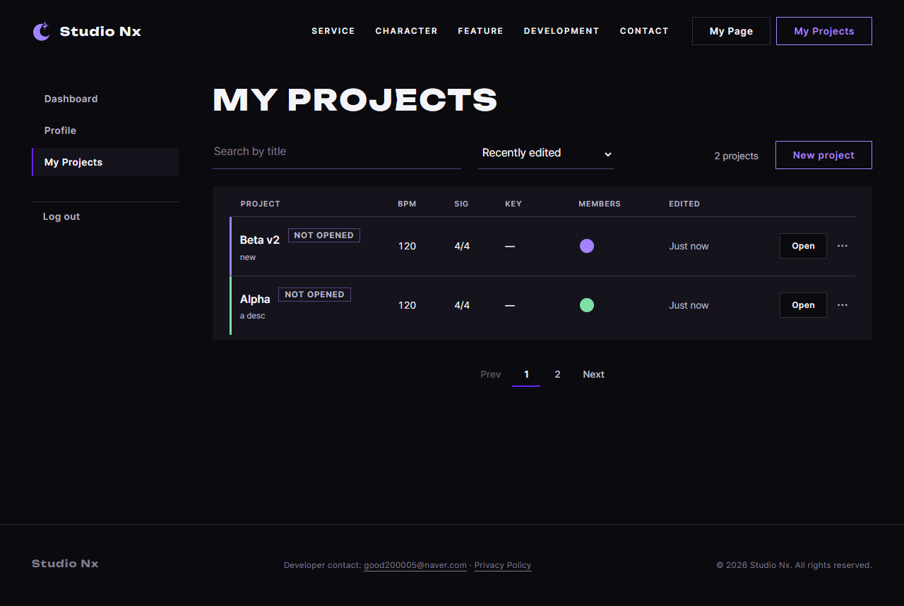

# JS 40 — `initEditProjectForm()`

| 항목 | 내용 |
|---|---|
| 파일 | `studionx/frontend/static/js/pages/myproject.js` |
| 작업 | P1-14 내 프로젝트 화면: 제목과 설명 수정 (PRD 01 FR-124) |
| 작성 | Claude (AI), 2026-10-08, 사용자 검토 |
| 이전 · 다음 | [39 `initNewProjectForm()`](39_myproject_initNewProjectForm.md) · [41 `initDeleteProject()`](41_myproject_initDeleteProject.md) |

## 1. 하는 일
Edit details 모달의 **Save**를 누르면 `PATCH /projects/{id}`(P1-13 60)로 제목과 설명을 저장하고, 성공하면 **그 줄만** 새 값으로 다시 그립니다.

| 상황 | 결과 |
|---|---|
| 제목 `'  Beta v2 '`, 설명 `new` | 모달이 닫히고, 그 줄이 `Beta v2 · new`로 바뀝니다 (자리는 그대로). 다른 줄은 그대로입니다 |
| 설명을 비우거나 공백만 넣음 | 설명을 지우므로 줄에는 `No description`이 나오고, 서버 값은 `null`이 됩니다 |
| 제목이 공백 | 보내지 않고 `Enter a title.`을 보여 줍니다 |
| 그사이 다른 창에서 지워진 프로젝트 | `Project not found.`를 보여 주고, 목록을 다시 받아서 그 줄이 사라지게 합니다 |
| VIEWER (31번에서 Edit이 잠겨 있지만, 혹시 보내면) | 서버 문구 `You don't have permission.`을 보여 줍니다 |
| 서버 오류 | 모달 안에 문구를 보여 주고, 입력값은 그대로 두며, 버튼을 풉니다 |

## 2. 언제 쓰나
| 호출하는 곳 | 화면 |
|---|---|
| 페이지 시작 (`myproject.js` 맨 아래, 이미 있음) | `initEditProjectForm();` |
| 함께 쓰는 것 | 34번 `initRowMenus`가 `selected`와 칸 값을 채우고 모달을 엽니다. 이 함수는 저장만 맡습니다 |

## 3. 코드
**import** (`myproject.js` 맨 위: 39번과 같고, 이번에 추가한 것은 없습니다)
```js
import { initAuthState } from '../core/auth-ui.js';
import { requireLogin, logout, loginUrl } from '../core/auth.js';
import { api } from '../core/api.js';
import { initModalFallback } from '../core/modal.js';
import { canOpenStudio, showDesktopOnly, initDesktopOnlyLinks, openStudio, openBlankStudio } from '../core/studio.js';
import { includePartials } from '../core/include.js';
import { initFormAlerts } from '../core/dialog.js';
```
이 함수는 `api`(P1-02)와 같은 파일의 `selected`(34), `current`(30), `buildRow`(31), `refreshList`(33)를 씁니다.

**함수**
```js
export function initEditProjectForm() {
  const form = document.getElementById('edit-project-form');
  if (!form) return;
  const modal = document.getElementById('edit-project-modal');
  const error = document.getElementById('edit-project-error');
  const submit = form.querySelector('[type="submit"]');
  const showError = function (message) {
    error.textContent = message;
    error.hidden = false;
  };

  form.addEventListener('submit', async function (event) {
    event.preventDefault();
    if (selected.id === null) return;
    const title = document.getElementById('edit-title').value.trim();
    const description = document.getElementById('edit-description').value.trim();
    error.hidden = true;
    if (!title) {
      showError('Enter a title.');
      return;
    }

    submit.disabled = true;
    let item;
    try {
      item = await api.patch('/projects/' + selected.id, {
        title: title,
        description: description ? description : null,   // 비우면 설명 지우기
      });
    } catch (err) {
      showError(err.message);
      if (err.status === 404) refreshList({ query: current.query, sort: current.sort, page: current.page });
      return;
    } finally {
      submit.disabled = false;
    }

    if (modal && modal.open) modal.close();
    selected.title = item.title;
    selected.description = item.description ? item.description : '';
    const row = document.querySelector('#project-list > li[data-project-id="' + item.project_id + '"]');
    const template = document.getElementById('project-row-template');
    if (row && template) row.replaceWith(buildRow(template, item));
  });
}
```

**최신 문법으로 쓰면** (공부용이며, 바뀌는 부분만 적었습니다)
```js
item = await api.patch(`/projects/${selected.id}`, { title, description: description || null });
selected.description = item.description ?? '';
document.querySelector(`#project-list > li[data-project-id="${item.project_id}"]`)?.replaceWith(buildRow(template, item));
```
| 최신 문법 | 실제 코드 | 뜻 |
|---|---|---|
| 템플릿 문자열 | `'/projects/' + selected.id` | 문자열을 잇습니다 |
| `a ?? ''` | `a ? a : ''` | 없으면 빈 문자열입니다 |
| `el?.replaceWith(…)` | `if (row && template) row.replaceWith(…)` | 있을 때만 실행합니다 |

### 문법 풀이
| import 문법 | 뜻 |
|---|---|
| (새 import 없음) | `api.patch(주소, 본문)`은 PATCH 요청을 보내며, 토큰은 자동으로 붙습니다 (P1-02) |

| 식 | 뜻 | 예 |
|---|---|---|
| `description ? description : null` | 빈 문자열이면 null을 보내서 서버가 설명을 지우게 합니다 (P1-13 56에서 `""`도 None으로 처리하지만, 뜻을 분명히 하려고 씁니다) | |
| `'li[data-project-id="' + id + '"]'` | 그 번호의 줄을 찾습니다 | |
| `row.replaceWith(새 요소)` | 그 자리에 새 줄을 끼우고 옛 줄을 뺍니다 | 순서와 다른 줄은 그대로입니다 |
| `err.status === 404` | 프로젝트가 없다는 뜻입니다 (지워졌거나 권한을 잃음, P1-13 57) | |

## 4. 흐름
1. 기본 보내기를 막습니다. 고른 프로젝트가 없으면 끝내고, 제목이 공백이면 문구를 보여 줍니다.
2. 버튼을 잠그고 `PATCH /projects/{id}` `{ title, description }`을 보냅니다.
3. 실패하면 문구를 보여 주고, 404이면 목록을 다시 받으며, 버튼을 풉니다.
4. 성공하면 모달을 닫고, `selected`를 새 값으로 바꾼 뒤, 그 줄을 `buildRow`로 다시 만들어 바꿔 끼웁니다.

## 5. 왜 이렇게
| 선택 | 이유 |
|---|---|
| 그 줄만 다시 그림 | 템플릿대로입니다. 응답(`ProjectItem`)에 줄을 그리는 데 필요한 값이 모두 있으므로 목록 전체를 다시 받지 않아도 됩니다 (P1-13 62) |
| 줄의 자리를 옮기지 않음 | 최근 수정순이라면 원래 맨 위로 가야 하지만, 고친 줄이 눈앞에서 사라지면 사용자가 결과를 확인하기 어렵습니다. 다음에 새로고침하거나 검색할 때 위로 올라갑니다 |
| `buildRow`를 다시 씀 | `Not opened`, 역할, 잠금 등 줄의 규칙이 31번과 똑같이 적용됩니다. `data-title`도 새 값으로 바뀌므로, 다음 Edit에서 새 값이 채워집니다 (시험 02) |
| 공백뿐인 제목은 보내지 않음 | 39번과 같은 이유입니다 |
| 404이면 목록을 다시 받음 | 지워진 프로젝트의 줄이 남아 있으면 사용자가 또 누르게 됩니다 |
| 설명을 비우면 `null`로 보냄 | 수정 칸을 비우는 것은 설명을 지운다는 뜻입니다 (P1-13 60의 표와 같습니다) |

## 6. 시험 (실제 myProject.html, 실제 서버, 5개)
프로젝트 `Alpha`(설명 `a desc`)와 `Beta`를 만들고, ··· → Edit details로 모달을 연 뒤 저장했습니다.

| # | 한 일 | 결과 |
|---|---|---|
| 01 | Beta를 `'  Beta v2 '`, `new`로 수정 | 모달이 닫히고, 줄이 `Beta v2 · new`가 되며(첫 줄 그대로), `Alpha` 줄은 그대로입니다. 서버에는 `Beta v2`, `new`가 저장되고, PATCH는 1번입니다 |
| 02 | 다시 Edit을 열고 설명을 공백으로 | 모달에 새 값(`Beta v2`, `new`)이 채워져 있고, 저장한 뒤에는 `No description`이 나오며, 서버 값은 `null`입니다 |
| 03 | Alpha의 제목을 공백으로 | `Enter a title.`이 나오고, PATCH는 0번이며, 모달은 그대로입니다 |
| 04 | Edit을 연 뒤 다른 곳에서 Alpha를 지우고 저장 | `Project not found.`가 나오고, 목록을 다시 받아서 Alpha 줄이 사라집니다 |
| 05 | 서버 500 (가짜) | 문구가 나오고, 모달은 그대로이며, 버튼이 풀립니다 |

### 캡처: 저장한 뒤 (`Beta v2 · new`)

