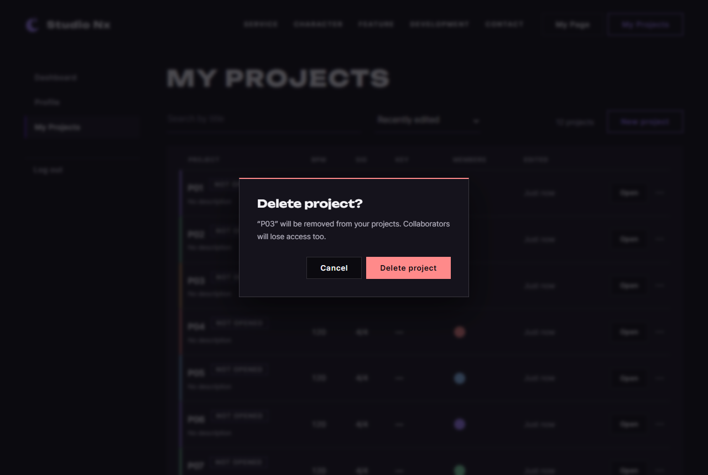
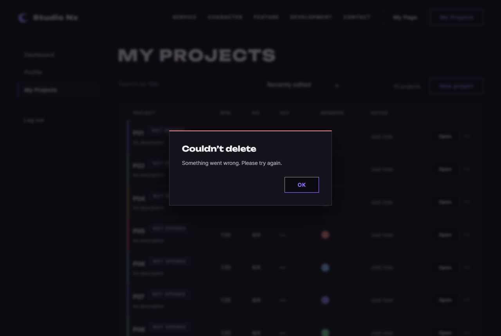

# JS 41 — `initDeleteProject()`

| 항목 | 내용 |
|---|---|
| 파일 | `studionx/frontend/static/js/pages/myproject.js` · `studionx/frontend/myProject.html` |
| 작업 | P1-14 내 프로젝트 화면 — 프로젝트 삭제 · PRD 01 FR-125 · FIX-01 확인창 (2026-10-07 결정) |
| 작성 | Claude (AI) · 2026-10-08 · 사용자 검토 |
| 이전 · 다음 | [40 `initEditProjectForm()`](40_myproject_initEditProjectForm.md) · [42 `loadInitialList()`](42_myproject_loadInitialList.md) |

## 1. 하는 일
`···` → **Delete** 를 누르면 확인창(`confirmDialog`, FIX-01 20)을 띄우고, **Delete project** 를 고르면 `DELETE /projects/{id}`(P1-13 61, 소프트 삭제) 후 목록을 다시 받는다.

| 상황 | 결과 |
|---|---|
| Delete → 확인창 | 제목 `Delete project?` · 문장 `“P03” will be removed from your projects. Collaborators will lose access too.` · 빨간 `Delete project` 버튼 (처음 커서는 Cancel) |
| Cancel · Esc · 바깥 클릭 | 아무 일 없음 |
| Delete project | 삭제 → 같은 검색 · 정렬 · 페이지로 다시 받음 (`12 projects` → `11 projects`) |
| 2쪽의 마지막 한 줄을 지움 | 빈 2쪽을 그리지 않고 **1쪽으로** |
| OWNER 가 아님 | Delete 버튼이 잠겨 있어(31) 확인창도 뜨지 않음 |
| 서버 오류 | 알림창 `Couldn’t delete` + 서버 문구 · 버튼 다시 켜짐 |
| 그사이 다른 곳에서 지워짐 (404) | 알림창 `Project not found.` + 목록 다시 받음 |

**HTML 도 바꿈 (2026-10-07 결정대로):** `#delete-project-modal` `<dialog>` 를 지우고, 목록 줄 · 틀(`<template>`)의 Delete 버튼 7곳에서 `command="show-modal" commandfor="delete-project-modal"` 을 뺐다. **34 `initRowMenus` 에서도** 삭제 모달 제목을 채우던 세 줄을 지웠다 (모달이 없어져서).

## 2. 언제 쓰나
| 호출하는 곳 | 화면 |
|---|---|
| 페이지 시작 (`myproject.js` 맨 아래, 이미 있음) | `initDeleteProject();` — 목록에 한 번 |

**확인창(`confirmDialog`)**: 브라우저 기본 `confirm()` 대신 쓰는 SweetAlert2 창 (FIX-01 20). `await confirmDialog({...})` 는 확인이면 `true`, 취소 · Esc · 바깥 클릭이면 `false`. `danger: true` 면 확인 버튼이 빨강이고, 처음 커서가 **Cancel** 에 있어 Enter 를 바로 눌러도 지워지지 않는다.

## 3. 코드
**import** (`myproject.js` 맨 위)
```js
import { initAuthState } from '../core/auth-ui.js';
import { requireLogin, logout, loginUrl } from '../core/auth.js';
import { api } from '../core/api.js';
import { initModalFallback } from '../core/modal.js';
import { canOpenStudio, showDesktopOnly, initDesktopOnlyLinks, openStudio, openBlankStudio } from '../core/studio.js';
import { includePartials } from '../core/include.js';
import { initFormAlerts, confirmDialog, showAlert } from '../core/dialog.js';
```
**`confirmDialog` · `showAlert` 를 이번에 추가했다.** 이 함수는 `api` · `confirmDialog` · `showAlert` 와 같은 파일의 `current` · `loadProjects` · `renderProjects` · `renderPager` · `refreshList` 를 쓴다.

**함수**
```js
export function initDeleteProject() {
  const list = document.getElementById('project-list');
  if (!list) return;

  list.addEventListener('click', async function (event) {
    const button = event.target.closest('[data-action="delete"]');
    if (!button || button.disabled) return;
    const row = button.closest('li[data-project-id]');
    const id = row.dataset.projectId;
    const title = row.dataset.title;

    const ok = await confirmDialog({
      title: 'Delete project?',
      text: '“' + title + '” will be removed from your projects. Collaborators will lose access too.',
      confirmText: 'Delete project',
      danger: true,
    });
    if (!ok) return;

    button.disabled = true;   // 두 번 누름 방지 (성공하면 줄이 다시 그려짐)
    try {
      await api.delete('/projects/' + id);
    } catch (err) {
      button.disabled = false;
      await showAlert('Couldn’t delete', err.message, { tone: 'error' });
      if (err.status === 404) refreshList({ query: current.query, sort: current.sort, page: current.page });
      return;
    }

    // 같은 조건으로 다시 받기 — 마지막 줄을 지워 그 페이지가 비면 (빈 화면을 그리지 않고) 한 페이지 앞으로
    const page = current.page;
    const data = await loadProjects({ query: current.query, sort: current.sort, page: page });
    if (!data) return;
    if (data.items.length === 0 && page > 1) {
      refreshList({ query: current.query, sort: current.sort, page: page - 1 });
      return;
    }
    renderProjects(data);
    renderPager(data.total, data.page, data.size);
  });
}
```

**최신 문법으로 쓰면** (공부용 — 바뀌는 부분만)
```js
const { projectId: id, title } = row.dataset;
text: `“${title}” will be removed from your projects. Collaborators will lose access too.`,
const { query, sort, page } = current;
```
| 최신 문법 | 실제 코드 | 뜻 |
|---|---|---|
| `const { projectId: id, title } = row.dataset` | `const id = row.dataset.projectId` 등 두 줄 | 칸 꺼내며 이름 바꾸기 |
| 템플릿 문자열 | `'“' + title + '” will …'` | 글자 잇기 |
| `const { query, sort, page } = current` | `current.query` 등 그대로 | 칸 꺼내기 |

### 문법 풀이
| import 문법 | 뜻 |
|---|---|
| `import { …, confirmDialog, showAlert } from '../core/dialog.js'` | 확인창 (true/false) · 알림창 (FIX-01 20 · 18) |

| 식 | 뜻 | 예 |
|---|---|---|
| `event.target.closest('[data-action="delete"]')` | 누른 곳에서 Delete 버튼 찾기 (목록 하나에 위임, 34 와 같음) | |
| `button.disabled` | 잠긴 버튼 — 브라우저는 잠긴 버튼의 클릭을 보내지 않지만 한 번 더 확인 | EDITOR |
| `const ok = await confirmDialog({…})` | 사용자가 고를 때까지 기다림 | true / false |
| `api.delete('/projects/' + id)` | DELETE 요청 — 성공이면 204 (본문 없음, `null`) | |
| `data.items.length === 0 && page > 1` | 지운 뒤 그 쪽이 비었고 1쪽이 아님 | 2쪽의 마지막 한 줄 |

## 4. 흐름
1. Delete 버튼이 아니거나 잠겼으면 끝 → 그 줄의 번호 · 제목.
2. 확인창 → 취소면 끝.
3. 버튼 잠금 → `DELETE`.
4. 실패: 버튼 풀기 · 알림창 · 404 면 목록 다시 받기.
5. 성공: 같은 조건으로 받기 → 그 쪽이 비었고 1쪽이 아니면 앞 쪽으로, 아니면 그대로 그리기.

## 5. 왜 이렇게
| 선택 | 이유 |
|---|---|
| HTML 모달 대신 `confirmDialog` | 2026-10-07 결정 (FIX-01) — 모든 확인창을 같은 모양으로 · 휴대폰에서는 아래 시트 |
| 번호 · 제목을 **누른 줄**에서 바로 읽음 | 34 의 `selected` 는 다른 듣기가 먼저 불려야 채워짐 → 듣는 순서에 기대지 않음 |
| 처음 커서는 Cancel (`danger`) | 되돌리기 어려운 일 — Enter 한 번에 지워지지 않게 |
| 실패는 알림창 | 모달이 없어져 문구 칸(`#delete-project-error`)도 없음 |
| 빈 쪽을 **그리지 않고** 앞 쪽으로 | 처음엔 `refreshList` 로 빈 2쪽을 그린 뒤 1쪽으로 갔는데, 그 사이 "No projects yet" 가 잠깐 보였다 → 받은 결과를 먼저 보고 결정하도록 고침 (시험 03 에서 빈 안내가 한 번도 안 보였음을 확인) |
| 404 면 목록 다시 받기 | 지워진 줄이 남지 않게 (40 과 같음) |
| 누른 뒤 버튼 잠금 | 확인 뒤 응답 전 두 번 눌림 방지 (템플릿) |

## 6. 시험 (실제 myProject.html · 실제 서버 · 7개 + 34 다시)
프로젝트 12개(`P01` ~ `P12`)를 이름순으로 그리고 `···` → Delete 를 눌렀다.

| # | 한 일 | 결과 |
|---|---|---|
| 01 | P03 Delete | 확인창 제목 · 문장 · 버튼 글자 맞음 |
| 01b | Cancel | DELETE 0번 · 12개 그대로 · 창 닫힘 |
| 02 | 다시 Delete → Delete project | DELETE 1번 · `11 projects` · P03 사라지고 P11 이 올라옴 · 서버 검색 0개 |
| 03 | 2쪽(P12 한 줄)에서 P12 삭제 | 1쪽 10개 · 주소 `?sort=title` · 페이지 줄 숨김 · **빈 안내가 한 번도 안 보임** |
| 04 | EDITOR 줄(가짜)의 Delete | 확인창 안 뜸 · DELETE 0번 |
| 05 | 서버 500 (가짜) | 알림창 `Couldn’t delete` · `Something went wrong. Please try again.` · 버튼 다시 켜짐 · 목록 그대로 |
| 06 | 확인창을 띄운 채 다른 곳에서 P02 를 지움 → Delete project | 알림창 `Project not found.` → 목록 다시 받아 P02 사라짐 |

**34 다시:** 삭제 모달이 없어졌으므로 34 의 시험 03 을 "Delete → 확인창이 뜨고 `selected` 가 그 프로젝트" 로 바꿔 7개를 다시 돌렸다 — 모두 통과 (제목 `Neon "Rain" <x>` 도 확인창에 글자 그대로).

### 캡처
확인창:



서버 오류:


