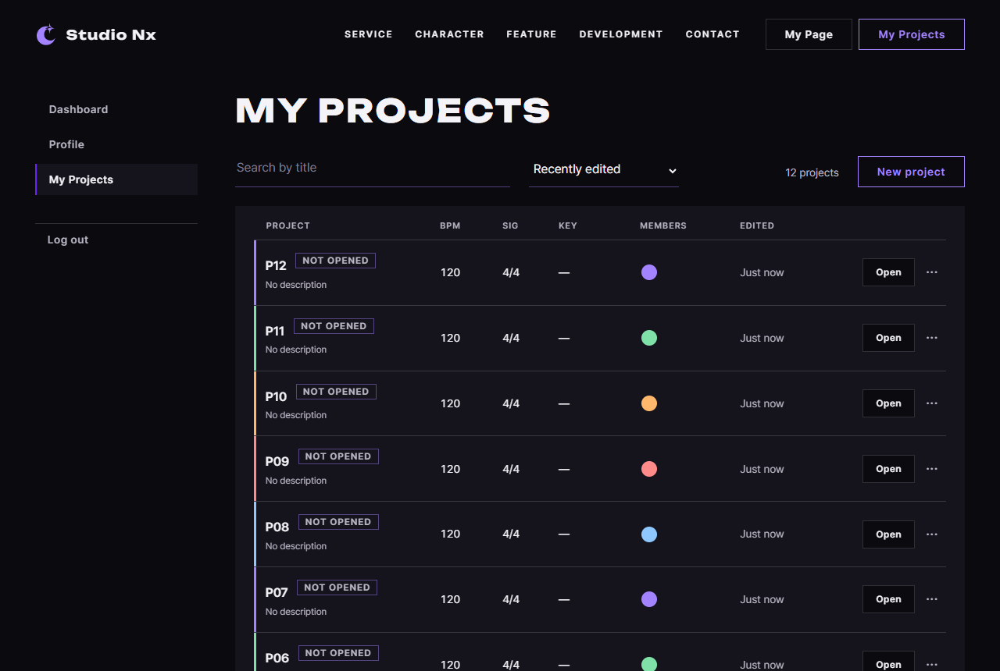

# JS 42 — `loadInitialList()` · 페이지 시작

| 항목 | 내용 |
|---|---|
| 파일 | `studionx/frontend/static/js/pages/myproject.js` |
| 작업 | P1-14 내 프로젝트 화면: 페이지를 열 때 (로그인 확인, 첫 목록, 로그아웃 버튼) (PRD 01 FR-123) |
| 작성 | Claude (AI), 2026-10-08, 사용자 검토 |
| 이전 · 다음 | [41 `initDeleteProject()`](41_myproject_initDeleteProject.md) · (P1-14 끝, 개요 [51](<../../51_p1-14_myproject_js.md>)) |

## 1. 하는 일
myProject.html을 **열었을 때** 할 일을 마무리합니다. 이 함수가 생기기 전에는 HTML의 예시 줄 7개가 그대로 보였고, 로그인하지 않아도 페이지가 열렸습니다.

| 주소로 열기 | 결과 |
|---|---|
| 로그인하지 않은 채로 `myProject.html` | `home.html#login?next=%2FmyProject.html`로 가고, 로그인하면 돌아옵니다 |
| `myProject.html` | 최근 수정순으로 10개, `12 projects`, `Prev 1* 2 Next`가 나오고, 예시 줄은 없습니다 |
| `?query=p1&sort=title` | 검색 칸은 `p1`, 정렬은 Name이고, `P10, P11, P12`가 나옵니다 |
| `?page=9` (2쪽까지 있음) | **마지막 쪽(2)**으로 가고, 주소는 `?page=2`가 됩니다 |
| `?sort=random&page=abc` | 정렬은 Recently edited, 1쪽이 되고, 주소는 깨끗해집니다 (30번이 고칩니다) |
| Log out 버튼 | 로그아웃한 뒤 `home.html`로 갑니다 (P1-10 27 `initLogoutButton`) |

**함께 바꾼 것**
- 파일 맨 아래의 시작 코드에 있던 두 TODO를 채웠습니다: `if (await requireLogin()) await loadInitialList();`
- 비어 있던 `initLogoutButton` 템플릿 함수를 지우고, `core/auth-ui.js`의 함수를 import했습니다 (P1-10에서 세 화면 공용으로 만든 것). 쓰지 않게 된 `logout` import도 뺐습니다.

## 2. 언제 쓰나
| 호출하는 곳 | 화면 |
|---|---|
| `myproject.js` 맨 아래 (페이지를 열 때 한 번) | 로그인을 확인한 뒤 첫 목록을 받습니다 |

**시작 순서** (파일 맨 아래)
```js
await includePartials();          // 헤더 · 푸터 · 안내 모달 끼우기 (아래 init 들이 그 요소를 찾음)

initAuthState();
initModalFallback();
initFormAlerts();
initSearch();                     // 33
initNewProjectForm();             // 39
initRowMenus();                   // 34
initDesktopOnlyLinks(document.getElementById('project-list'));   // 38
initEditProjectForm();            // 40
initDeleteProject();              // 41
initLogoutButton();               // core/auth-ui.js (P1-10 27) — 세 화면 공용

// 로그인 확인 → 첫 목록 (로그인 안 했으면 home.html#login?next=… 로 옮겨 감)
if (await requireLogin()) await loadInitialList();
```
버튼과 폼의 이벤트 처리를 먼저 걸고, 서버를 기다리는 일(로그인 확인, 목록)은 **맨 끝**에 둡니다. 그래서 기다리는 동안에도 버튼이 반응합니다.

## 3. 코드
**import** (`myproject.js` 맨 위)
```js
import { initAuthState, initLogoutButton } from '../core/auth-ui.js';
import { requireLogin, loginUrl } from '../core/auth.js';
import { api } from '../core/api.js';
import { initModalFallback } from '../core/modal.js';
import { canOpenStudio, showDesktopOnly, initDesktopOnlyLinks, openStudio, openBlankStudio } from '../core/studio.js';
import { includePartials } from '../core/include.js';
import { initFormAlerts, confirmDialog, showAlert } from '../core/dialog.js';
```
**`initLogoutButton`을 추가하고 `logout`을 뺐습니다.** 이 함수는 같은 파일의 `refreshList`(33)와 `current`(30)를 쓰고, 시작 코드는 `requireLogin`(P1-02)과 `initLogoutButton`(P1-10)을 씁니다.

**함수**
```js
export async function loadInitialList() {
  const list = document.getElementById('project-list');
  const count = document.getElementById('project-count');
  const pager = document.getElementById('project-pager');
  if (list) list.textContent = '';
  if (count) count.textContent = '';
  if (pager) pager.hidden = true;

  const params = new URLSearchParams(location.search);
  const options = {
    query: params.get('query') || '',
    sort: params.get('sort') || 'updated',
    page: params.get('page') || 1,
  };
  let data = await refreshList(options);
  if (data && data.items.length === 0 && data.total > 0) {
    options.page = Math.ceil(data.total / data.size);   // 없는 쪽 → 마지막 쪽
    data = await refreshList(options);
  }
  if (!data) return null;

  const query = document.getElementById('project-query');
  const sort = document.getElementById('project-sort');
  if (query) query.value = current.query;
  if (sort) sort.value = current.sort;
  return data;
}
```

**최신 문법으로 쓰면** (공부용이며, 바뀌는 부분만 적었습니다)
```js
const params = new URLSearchParams(location.search);
const options = {
  query: params.get('query') ?? '',
  sort: params.get('sort') ?? 'updated',
  page: params.get('page') ?? 1,
};
document.getElementById('project-query')?.setAttribute('value', current.query);
```
| 최신 문법 | 실제 코드 | 뜻 |
|---|---|---|
| `a ?? b` | `a \|\| b` | 없으면(null) 기본값을 씁니다. 여기서는 빈 문자열도 기본값으로 바꿔야 하므로 `\|\|`가 오히려 맞습니다 |
| `el?.…` | `if (el) …` | 있을 때만 실행합니다 |

### 문법 풀이
| import 문법 | 뜻 |
|---|---|
| `import { initAuthState, initLogoutButton } from '../core/auth-ui.js'` | 로그아웃 버튼 함수입니다 (P1-10 27). userInfo, myPage와 같은 함수를 씁니다 |
| `import { requireLogin } from '../core/auth.js'` | 로그인 상태면 `true`를, 아니면 로그인 화면으로 보내고 `false`를 돌려줍니다 (P1-02) |

| 식 | 뜻 | 예 |
|---|---|---|
| `new URLSearchParams(location.search)` | 주소의 `?` 뒷부분을 칸별로 나눕니다 | `?query=p1&sort=title` |
| `params.get('query') \|\| ''` | 없으면 빈 문자열을 씁니다 | `null` → `''` |
| `Math.ceil(data.total / data.size)` | 마지막 쪽 번호입니다 | 12 / 10 → 2 |
| `if (await requireLogin()) await loadInitialList();` | 로그인을 확인한 **뒤에만** 목록을 요청합니다 | |
| 맨 위의 `await` (모듈 맨 바깥) | `type="module"` 스크립트에서는 함수 밖에서도 `await`를 쓸 수 있습니다 | |

## 4. 흐름
1. 예시 줄과 개수를 지우고 페이지 줄을 숨깁니다 (받는 동안 가짜 목록이 보이지 않게 합니다).
2. 주소에서 검색어, 정렬, 페이지를 읽어서 목록을 받습니다 (`refreshList`; 틀린 값은 30번이 고칩니다).
3. 받은 쪽이 비었는데 전체 개수는 있으면 마지막 쪽을 다시 받습니다.
4. 검색 칸과 정렬 칸을 실제로 쓴 값(`current`)으로 맞춥니다.

## 5. 왜 이렇게
| 선택 | 이유 |
|---|---|
| 주소에서 읽음 | 30번이 주소에 남긴 값입니다. 새로고침, 뒤로 가기, 복사한 주소, 페이지 링크를 새 탭으로 연 경우(32)에도 같은 목록이 나옵니다 |
| 칸은 `current`로 맞춤 | 주소의 틀린 값(`sort=random`)이 아니라 실제로 쓴 값을 보여 줍니다 |
| 없는 쪽이면 마지막 쪽으로 | 프로젝트를 지운 뒤 북마크해 둔 `?page=9` 같은 주소로 와도 빈 화면이 아니라 마지막 목록이 나옵니다 |
| 받기 전에 예시 줄을 지움 | HTML 예시(Summer Loop 등)가 실제 목록처럼 잠깐 보이지 않게 합니다 |
| 로그인 확인을 먼저 함 | 로그인하지 않은 사람에게 목록을 요청했다가 401을 받고 로그인으로 이동하는 일이 두 번 일어나지 않게 합니다 (userInfo와 같은 모양) |
| `initLogoutButton`은 import함 | P1-10에서 세 화면 공용으로 만들어 둔 함수입니다. 템플릿 주석대로 이 파일의 빈 함수는 지웠습니다 |

## 6. 시험 (실제 myProject.html을 주소로 열기, 실제 서버, 7개 + 앞의 시험 다시)
이번에는 함수를 직접 부르지 않고 **페이지를 주소로 열기만** 했습니다.

| # | 한 일 | 결과 |
|---|---|---|
| 01 | 로그인하지 않은 채로 열기 | `home.html#login?next=%2FmyProject.html`로 갑니다 |
| 02 | 로그인하고 프로젝트 12개를 만든 뒤 열기 | `P12 … P03` 10줄, `12 projects`, `Prev 1* 2 Next`가 나오고, 검색 칸은 비어 있으며, 정렬은 updated이고, 예시 줄은 없습니다 |
| 03 | `?query=p1&sort=title` | 검색 칸 `p1`, 정렬 title, `P10, P11, P12`, `3 projects`가 나오고, 페이지 줄은 숨겨집니다 |
| 04 | `?page=9` | `P02, P01`, `Prev 1 2* Next`가 나오고, 주소는 `?page=2`가 됩니다 |
| 05 | `?sort=random&page=abc` | 정렬 updated, 1쪽이 되고, 주소는 `myProject.html`입니다 |
| 06 | Log out 클릭 | `home.html`로 갑니다 |
| 07 | 로그아웃한 뒤 다시 열기 | 로그인 화면으로 갑니다 |

**앞의 시험 다시 (이제 페이지가 스스로 목록을 받으므로):** 30번(14개), 33번(6개), 39번(7개), 41번(7개)을 다시 돌려서 결과가 모두 그대로임을 확인했습니다.

### 캡처: 로그인한 뒤 열었을 때

