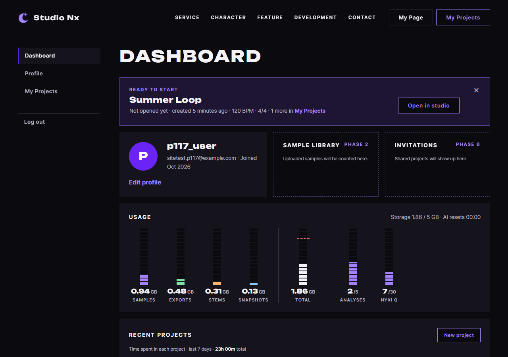

# JS 71 — `renderProfile()` (프로필 카드)

| 항목 | 내용 |
|---|---|
| 파일 | `studionx/frontend/static/js/pages/mypage.js` |
| 작업 | P1-17 마이페이지 JS: 프로필 카드 채우기 (PRD 01 FR-121) |
| 작성 | Claude (AI), 2026-10-12, 사용자 검토 |
| 이전 · 다음 | [70 `loadDashboard()`](70_mypage_loadDashboard.md) · 72 (다음) |

## 1. 하는 일
대시보드 응답의 `user` 칸으로 마이페이지 왼쪽 위의 **프로필 카드**를 채웁니다. HTML에 들어 있던 예시 값(`nightowl`, `nyxi@studionx.app`, `Oct 2026`, 보라색 `N`)을 실제 값으로 바꿉니다.



| 칸 | 채우는 값 |
|---|---|
| `#profile-name` | 닉네임 `p117_user` |
| `#profile-email` | 이메일 `sitetest.p117@example.com` |
| `#profile-joined` | 가입한 달 `Oct 2026` (서버의 UTC 시각을 **이 컴퓨터의 시간대**로 바꿔서 계산) |
| `#profile-avatar` | 사진이 있으면 ``, 없으면 닉네임의 첫 글자(대문자) `P` |

## 2. 언제 쓰나
| 호출하는 곳 | 화면 |
|---|---|
| 페이지 시작 (이후 단계에서 연결) | `renderProfile(data.user)` |

userinfo.js의 `renderAvatar`와 같은 모양으로 동그라미를 그립니다. userinfo.js를 불러오면 그 페이지의 시작 코드까지 실행되므로, 이 파일 안에 같은 내용을 따로 두었습니다 (열 줄 남짓입니다).

## 3. 코드
**import**: 이 함수는 import를 쓰지 않습니다. `document`, `Date`, `toLocaleDateString`은 브라우저의 기본 기능입니다.

**함수**
```js
export function renderProfile(user) {
  const name = document.getElementById('profile-name');
  const email = document.getElementById('profile-email');
  const joined = document.getElementById('profile-joined');
  const avatar = document.getElementById('profile-avatar');

  if (name) name.textContent = user.nickname;
  if (email) email.textContent = user.email;
  if (joined) {
    const hasZone = /[zZ]$|[+-]\d\d:\d\d$/.test(user.created_at);
    const date = new Date(hasZone ? user.created_at : user.created_at + 'Z');
    joined.textContent = date.toLocaleDateString('en-US', { month: 'short', year: 'numeric' });
  }
  if (avatar) {
    avatar.textContent = '';
    if (user.profile_image_url) {
      const img = document.createElement('img');
      img.src = user.profile_image_url;
      img.alt = '';
      avatar.appendChild(img);
    } else {
      avatar.textContent = user.nickname.charAt(0).toUpperCase();
    }
  }
}
```

**최신 문법으로 쓰면** (공부용이며, 실제 코드는 위에 있습니다)
```js
export function renderProfile({ nickname, email, created_at, profile_image_url }) {
  document.getElementById('profile-name')?.replaceChildren(nickname);
  document.getElementById('profile-email')?.replaceChildren(email);
  document.getElementById('profile-joined')?.replaceChildren(
    new Date(/[zZ]$|[+-]\d\d:\d\d$/.test(created_at) ? created_at : `${created_at}Z`)
      .toLocaleDateString('en-US', { month: 'short', year: 'numeric' }));
  const avatar = document.getElementById('profile-avatar');
  avatar?.replaceChildren(profile_image_url
    ? Object.assign(new Image(), { src: profile_image_url, alt: '' })
    : nickname.at(0).toUpperCase());
}
```
| 최신 문법 | 실제 코드 | 뜻 |
|---|---|---|
| `({ nickname, … })` (매개변수 구조 분해) | `user.nickname` | 객체에서 칸을 바로 꺼냅니다 |
| `요소?.replaceChildren(글)` | `if (요소) 요소.textContent = 글` | 요소가 있을 때만 안을 새 글자로 바꿉니다 |
| `` `${created_at}Z` `` | `user.created_at + 'Z'` | 문자열에 값을 끼워 넣습니다 |
| `Object.assign(new Image(), {…})` | `createElement('img')` 후 속성을 하나씩 대입 | 요소를 만들면서 속성을 한 번에 넣습니다 |
| `nickname.at(0)` | `nickname.charAt(0)` | 첫 글자입니다 |

### 문법 풀이
| 식 | 뜻 | 예 |
|---|---|---|
| `el.textContent = 값` | 글자로만 넣습니다. 태그가 있어도 해석하지 않고 글자 그대로 보입니다 | 닉네임 `<b>x</b>`가 그대로 보입니다 |
| `/[zZ]$\|[+-]\d\d:\d\d$/.test(값)` | 끝이 `Z`나 `+09:00`처럼 시간대로 끝나는지 확인합니다 | `"…23:30:00"`은 false, `"…23:30:00Z"`는 true |
| `new Date('2026-09-30T23:30:00Z')` | 끝에 `Z`가 있으면 UTC로 읽습니다. **없으면 이 컴퓨터의 시각으로 읽어서** 시간대만큼 어긋납니다 | |
| `toLocaleDateString('en-US', { month: 'short', year: 'numeric' })` | 영어로 `Oct 2026` 모양을 만듭니다 | |
| `avatar.textContent = ''` | 안쪽을 모두 지웁니다. 그림이든 글자든 새로 그리기 전에 비웁니다 | 사진을 지운 뒤 다시 그릴 때 |
| `img.alt = ''` | 그림 설명이 없다는 뜻으로, 꾸밈용 그림임을 나타냅니다 | 동그라미는 `aria-hidden`이고 닉네임이 옆에 글자로 있습니다 |

## 4. 흐름
1. 카드의 네 칸 요소를 찾습니다. 없는 칸은 건너뜁니다.
2. 닉네임과 이메일을 글자로 넣습니다.
3. 가입 시각에 시간대 표시가 없으면 `Z`를 붙여 UTC로 읽고, 이 컴퓨터의 시간대로 `Oct 2026`을 만듭니다.
4. 동그라미를 비우고, 사진 주소가 있으면 ``를, 없으면 닉네임의 첫 글자를 넣습니다.

## 5. 왜 이렇게
| 선택 | 이유 |
|---|---|
| `Z`를 붙여서 읽음 | 서버는 UTC 시각을 시간대 표시 없이 보냅니다. 붙이지 않으면 한국 컴퓨터에서 달의 경계(예: 9월 30일 밤)에 가입한 사람의 달이 한 달 어긋납니다. 이미 `Z`가 있으면 두 번 붙이지 않습니다 |
| 글자는 `textContent`로만 넣음 | 닉네임과 이메일은 사용자가 입력한 값입니다. `innerHTML`을 쓰면 태그가 실행될 수 있습니다 (XSS) |
| 사진은 `` 요소로 만들어 넣음 | 주소를 HTML 문자열에 끼워 넣지 않으므로 안전합니다 |
| 칸이 없어도 나머지는 채움 | 화면을 고쳐서 칸이 빠져도 오류로 멈추지 않습니다 |
| 가입일을 `Oct 2026`까지만 보여 줌 | HTML 예시의 형식입니다. 마이페이지에서는 일자까지 필요하지 않습니다 (회원 정보 화면은 `Oct 8, 2026`) |
| `renderAvatar`를 userinfo.js에서 가져오지 않음 | 그 파일을 불러오면 회원 정보 화면의 시작 코드(로그인 확인, 폼 연결)가 마이페이지에서 함께 실행됩니다 |

## 6. 시험 (실제 myPage.html, 실제 서버, 헤드리스 Chrome, 12개)
페이지 안에서 `import('/static/js/pages/mypage.js')`로 함수를 불렀습니다. 시간대는 Chrome 설정으로 바꿔 가며 확인했습니다.

| # | 상황 | 결과 |
|---|---|---|
| 01 | 사진이 없는 값 | 닉네임, 이메일, `Oct 2026`이 들어가고 동그라미에는 `P`가 있으며 ``는 없습니다 |
| 02 | 사진 주소가 있는 값 | `` 한 개, `alt=""`, 주소가 맞고 글자는 비어 있습니다 |
| 03 | 사진을 지운 값으로 다시 호출 | ``가 사라지고 첫 글자 `Z`로 돌아옵니다 |
| 04 | 닉네임 `<b>x</b>`, 이메일 `<i>e</i>@x.com` | 글자 그대로 보이고 태그가 생기지 않습니다 |
| 05 | 서울 시간대, `2026-09-30T23:30:00` | `Oct 2026` (한국에서는 이미 10월 1일입니다) |
| 06 | 뉴욕 시간대, 같은 시각 | `Sep 2026` |
| 07 | 값에 이미 `Z`가 붙은 경우 | `Z`를 두 번 붙이지 않고 `Sep 2026`이 나옵니다 |
| 08 | `+09:00` 표시가 붙은 값 | 시간대를 이해하고 `Sep 2026`이 나옵니다 |
| 09 | 이메일 칸과 동그라미 요소를 지운 뒤 호출 | 오류 없이 닉네임은 채워집니다 |
| 10 | 실제 API 응답(`loadDashboard`)으로 | 닉네임, 이메일, `Oct 2026`, `P`가 맞습니다 |

12개 모두 통과했습니다. 70번(`loadDashboard`) 시험 23개도 다시 돌려서 통과했습니다.
