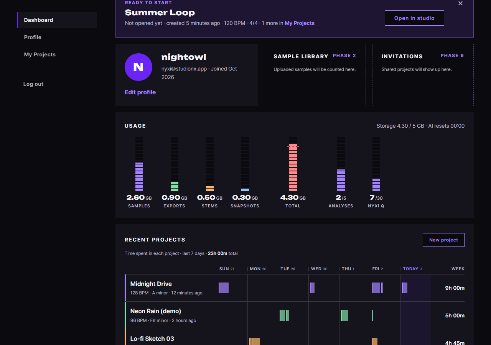

# JS 72 — `renderUsage()` (사용량 미터)

| 항목 | 내용 |
|---|---|
| 파일 | `studionx/frontend/static/js/pages/mypage.js` |
| 작업 | P1-17 마이페이지 JS: 저장 용량과 AI 사용량 미터 채우기 (PRD 01 FR-133, FR-136) |
| 작성 | Claude (AI), 2026-10-12, 사용자 검토 (2026-10-13에 초기화 시각 추가) |
| 이전 · 다음 | [71 `renderProfile()`](71_mypage_renderProfile.md) · 73 (다음) |

## 1. 하는 일
대시보드 응답의 `storage`와 `ai`로 **Usage 카드의 미터 7개**를 채웁니다. 칸마다 미터의 높이(`--p`), 숫자, 화면 읽기용 이름(`aria-label`)을 정하고, 위쪽의 `Storage 1.86 / 5 GB` 요약도 갱신합니다. 총 사용량이 80% 이상이면 TOTAL 미터를 빨갛게 바꿉니다.



| 칸 | 숫자 | 미터 높이 | 화면 읽기 이름 |
|---|---|---|---|
| Samples, Exports, Stems, Snapshots | `0.94` + 작은 글씨 `GB` | 종류별 바이트 ÷ 한도 | `Samples 0.94 of 5 GB` |
| Total | `1.86` + `GB` | 사용 바이트 ÷ 한도 | `Total 1.86 of 5 GB, warning at 80%` |
| Analyses | `2` + 작은 글씨 `/5` | 사용 ÷ 한도 | `Reference analyses today 2 of 5` |
| Nyxi Q | `7` + 작은 글씨 `/30` | 사용 ÷ 한도 | `Nyxi questions today 7 of 30` |

Phase 1에서는 종류별 사용량이 모두 0이고, AI 사용량도 0입니다 (서버가 파일 테이블과 AI 기록이 생기는 Phase 2와 5부터 채웁니다).

## 2. 언제 쓰나
| 호출하는 곳 | 화면 |
|---|---|
| 페이지 시작 (이후 단계에서 연결) | `renderUsage(data.storage, data.ai)` |

**CSS 변수 `--p`**: 미터 안쪽 막대(`<i>`)의 크기를 정하는 값입니다. PC에서는 세로 미터의 `height`, 모바일에서는 가로 막대의 `width`로 같은 값을 씁니다 (mypage.css). 그래서 이 함수는 PC와 모바일을 구분하지 않고 `--p`만 바꿉니다.

## 3. 코드
**import**: 이 함수는 import를 쓰지 않습니다. 같은 파일의 상수 `STORAGE_WARN_RATIO`(0.8)를 씁니다.

**함수**
```js
export function renderUsage(storage, ai) {
  const GB = 1024 * 1024 * 1024;
  const quotaGb = Number((storage.quota_bytes / GB).toFixed(2));
  const toGb = (bytes) => (bytes / GB).toFixed(2);
  const percent = (used, limit) => {
    if (!limit) return 0;
    return Math.round(Math.min(100, (used / limit) * 100) * 10) / 10;
  };

  const fillStrip = (name, pct, number, unit, label) => {
    const strip = document.querySelector('[data-usage="' + name + '"]');
    if (!strip) return null;
    const meter = strip.querySelector('.strip__meter');
    const bar = strip.querySelector('.strip__meter i');
    const value = strip.querySelector('.strip__value');
    if (bar) bar.style.setProperty('--p', pct + '%');
    if (meter) meter.setAttribute('aria-label', label);
    if (value) {
      const small = document.createElement('small');
      small.textContent = unit;
      value.textContent = number;
      value.appendChild(small);
    }
    return strip;
  };

  const kinds = [['samples', 'Samples'], ['exports', 'Exports'],
                 ['stems', 'Stems'], ['snapshots', 'Snapshots']];
  for (const kind of kinds) {
    const bytes = storage.by_kind[kind[0]];
    fillStrip(kind[0], percent(bytes, storage.quota_bytes), toGb(bytes), 'GB',
      kind[1] + ' ' + toGb(bytes) + ' of ' + quotaGb + ' GB');
  }

  const totalPct = percent(storage.used_bytes, storage.quota_bytes);
  const total = fillStrip('total', totalPct, toGb(storage.used_bytes), 'GB',
    'Total ' + toGb(storage.used_bytes) + ' of ' + quotaGb + ' GB, warning at '
    + Math.round(STORAGE_WARN_RATIO * 100) + '%');
  if (total) {
    total.classList.toggle('is-warn', totalPct >= STORAGE_WARN_RATIO * 100);
    const warnLine = total.querySelector('.strip__warn');
    if (warnLine) warnLine.style.setProperty('--w', STORAGE_WARN_RATIO * 100 + '%');
  }

  const aiRows = [['analyses', 'Reference analyses today', ai.analyses],
                  ['questions', 'Nyxi questions today', ai.questions]];
  for (const row of aiRows) {
    const count = row[2];
    fillStrip(row[0], percent(count.used, count.limit), String(count.used), '/' + count.limit,
      row[1] + ' ' + count.used + ' of ' + count.limit);
  }

  const summary = document.getElementById('usage-storage');
  if (summary) summary.textContent = toGb(storage.used_bytes) + ' / ' + quotaGb + ' GB';
}
```

**최신 문법으로 쓰면** (공부용이며, 실제 코드는 위에 있습니다)
```js
export function renderUsage({ quota_bytes, used_bytes, by_kind }, { analyses, questions }) {
  const GB = 1024 ** 3;
  const quotaGb = +(quota_bytes / GB).toFixed(2);
  const pct = (used, limit) => (limit ? Math.round(Math.min(100, (used / limit) * 100) * 10) / 10 : 0);
  const fill = (name, p, number, unit, label) => {
    const strip = document.querySelector(`[data-usage="${name}"]`);
    strip?.querySelector('.strip__meter i')?.style.setProperty('--p', `${p}%`);
    strip?.querySelector('.strip__meter')?.setAttribute('aria-label', label);
    strip?.querySelector('.strip__value')?.replaceChildren(
      number, Object.assign(document.createElement('small'), { textContent: unit }));
    return strip;
  };
  for (const [key, title] of [['samples', 'Samples'], ['exports', 'Exports'],
                              ['stems', 'Stems'], ['snapshots', 'Snapshots']]) {
    fill(key, pct(by_kind[key], quota_bytes), (by_kind[key] / GB).toFixed(2), 'GB', …);
  }
  // total, analyses, questions 도 같은 방식
}
```
| 최신 문법 | 실제 코드 | 뜻 |
|---|---|---|
| `({ quota_bytes, … }, { analyses, … })` | `storage.quota_bytes`, `ai.analyses` | 매개변수에서 칸을 바로 꺼냅니다 (구조 분해) |
| `1024 ** 3` | `1024 * 1024 * 1024` | 거듭제곱입니다 |
| `+값.toFixed(2)` | `Number(값.toFixed(2))` | 문자열을 숫자로 바꿉니다 |
| `for (const [key, title] of 목록)` | `for (const kind of kinds)`와 `kind[0]`, `kind[1]` | 배열의 칸을 한 번에 꺼냅니다 |
| `요소?.메서드()` | `if (요소) 요소.메서드()` | 요소가 있을 때만 실행합니다 |
| 템플릿 문자열 | `'…' + name + '…'` | 문자열에 값을 끼워 넣습니다 |

### 문법 풀이
| 식 | 뜻 | 예 |
|---|---|---|
| `bytes / GB` | 바이트를 GB(1024³ 바이트)로 바꿉니다 | 5368709120 → 5 |
| `값.toFixed(2)` | 소수 둘째 자리까지 **문자열**로 만듭니다 | `0.9399` → `'0.94'` |
| `Number(값.toFixed(2))` | 문자열을 다시 숫자로 바꿔서 끝의 0을 뗍니다 | `'5.00'` → `5` (그래서 `5 GB`로 보입니다) |
| `Math.min(100, …)` | 100을 넘지 않게 자릅니다 | 140% → 100 |
| `Math.round(x * 10) / 10` | 소수 첫째 자리까지 반올림합니다 | `18.7999` → `18.8` |
| `if (!limit) return 0` | 한도가 0이거나 없으면 0으로 계산해서, 0으로 나누지 않습니다 | `1 / 0`의 Infinity를 막습니다 |
| `el.style.setProperty('--p', '18.8%')` | CSS 변수의 값을 바꿉니다 | 미터 높이가 18.8%가 됩니다 |
| `classList.toggle('is-warn', 조건)` | 조건이 참이면 클래스를 붙이고, 거짓이면 뗍니다 | 80% 이상이면 빨강 |
| `querySelector('[data-usage="samples"]')` | `data-usage` 속성이 그 값인 요소를 찾습니다 | |
| `value.textContent = number; value.appendChild(small)` | 숫자 글자를 넣은 뒤 작은 글씨를 뒤에 붙입니다. 매번 `textContent`로 비우고 시작하므로 `<small>`이 쌓이지 않습니다 | `0.94` + `GB` |

## 4. 흐름
1. 한도를 GB로 바꾸고(`5`), 바이트를 GB 글자로 바꾸는 함수와 비율 계산 함수를 준비합니다.
2. 종류별 네 칸(Samples, Exports, Stems, Snapshots)을 채웁니다.
3. TOTAL 칸을 채우고, 비율이 80% 이상이면 `is-warn`을 붙이거나 뗍니다. 경고선 위치(`--w`)도 같은 기준으로 맞춥니다.
4. AI 두 칸(Analyses, Nyxi Q)을 채웁니다.
5. 위쪽의 `Storage 1.86 / 5 GB` 요약을 갱신합니다.

## 5. 왜 이렇게
| 선택 | 이유 |
|---|---|
| 한도 0이면 비율 0 | 0으로 나누면 `NaN`이나 `Infinity`가 나와서 CSS 값이 깨집니다. 한도가 없는 상태는 "채워지지 않음"이 자연스럽습니다 |
| 비율을 100으로 자름 | 한도를 넘긴 값(예: 9 GB / 5 GB)이 미터 밖으로 삐져나가지 않게 합니다. 숫자는 실제 값 그대로 보여 줍니다 |
| 경고 기준 80% (`>=`) | FR-133입니다. 79%는 경고가 아니고 80%부터 경고입니다 (시험 03, 04) |
| 경고 클래스를 `toggle`로 | 값이 줄어들어 80% 밑으로 내려가면 빨강이 다시 빠집니다 |
| 칸을 `data-usage`로 찾음 | HTML에 있는 칸 구조를 그대로 두고 값만 바꿉니다. 칸이 없으면 건너뜁니다 |
| 숫자와 `<small>`을 요소로 만들어 붙임 | `innerHTML`로 문자열을 끼워 넣지 않으므로 안전하고, 매번 비우고 시작하므로 여러 번 호출해도 쌓이지 않습니다 |
| `aria-label`도 같은 값으로 | 미터는 `role="img"`라서 화면 읽기 프로그램이 이 글자를 읽습니다. 눈에 보이는 숫자와 같아야 합니다 |
| 한도를 `Number(…toFixed(2))`로 | `5.00 GB`보다 `5 GB`가 보기 좋고, 한도가 10 GB로 바뀌어도 그대로 `10 GB`로 나옵니다 |

## 6. 시험 (실제 myPage.html, 실제 서버, 헤드리스 Chrome, 17개)
| # | 상황 | 결과 |
|---|---|---|
| 01 | 사용량 0 | 미터가 0%, 숫자 `0.00` + `GB`, 요약 `0.00 / 5 GB`, AI는 `0` + `/5`와 `0` + `/30`이고 경고는 없습니다 |
| 02 | HTML 예시와 같은 값 (0.94, 0.48, 0.31, 0.13, 1.86 GB, AI 2/5, 7/30) | 18.8%, 9.6%, 6.2%, 2.6%, 37.2%, 40%, 23.3%이고 이름과 요약이 모두 맞습니다 |
| 03 | 한도 100 중 79 | 경고가 없습니다 |
| 04 | 한도 100 중 80 | `is-warn`이 붙고 80%입니다 |
| 05 | 다시 50으로 호출 | `is-warn`이 빠집니다 |
| 06 | 한도 초과 (7 GB / 5 GB, 9 GB, AI 9/5) | 미터는 100%에서 멈추고 경고는 유지됩니다 |
| 07 | 한도가 0인 값 | `NaN`이나 `Infinity` 없이 0%이고 요약은 `0.00 / 0 GB`입니다 |
| 08 | 한도 10 GB, 사용 2.5 GB | 요약 `2.50 / 10 GB`, 25%, 이름 `Total 2.50 of 10 GB, …`입니다 |
| 09 | 경고선 위치 | `--w`가 `80%`입니다 |
| 10 | 같은 값으로 두 번 호출 | `<small>`이 값마다 1개뿐입니다 |
| 11 | 칸 하나와 요약 요소를 지운 뒤 호출 | 오류 없이 나머지는 채워집니다 |
| 12 | 실제 API 응답(`loadDashboard`)으로 | `0.00` GB, `/5`, `/30`, 요약 `0.00 / 5 GB`가 맞습니다 |

17개 모두 통과했습니다. 70번(23개)과 71번(12개) 시험도 다시 돌려서 통과했습니다.

## 7. 추가: `AI resets` 시각을 시간대에 맞게 넣기 (2026-10-13)
HTML에 `AI resets 00:00`이 고정되어 있었습니다. 서버는 AI 사용량을 **UTC 0시**에 0으로 돌리므로, 한국에서는 실제 초기화가 오전 9시인데 자정이라고 알려 주는 셈이었습니다. 그래서 HTML의 시각을 `<span id="usage-reset">`으로 감싸고, 함수 끝에서 이 컴퓨터의 시간대로 바꿔 넣습니다. (사용자 결정: 시간대에 맞게 계산하는 A안)

```js
const reset = document.getElementById('usage-reset');
if (reset) {
  const now = new Date();
  const utcMidnight = new Date(Date.UTC(now.getUTCFullYear(), now.getUTCMonth(), now.getUTCDate()));
  const pad = (n) => (n < 10 ? '0' : '') + n;
  reset.textContent = pad(utcMidnight.getHours()) + ':' + pad(utcMidnight.getMinutes());
}
```
| 줄 | 뜻 |
|---|---|
| `Date.UTC(연, 월, 일)` | 오늘(UTC 기준 날짜)의 UTC 0시를 나타내는 밀리초 값입니다 |
| `new Date(그 값)` | 같은 순간을 브라우저가 이 컴퓨터의 시간대로 읽는 날짜 객체입니다 |
| `getHours()`, `getMinutes()` | 그 순간의 이 컴퓨터 시계 값입니다 (`getUTCHours`와 달리 현지 시간대가 적용됩니다) |
| `pad` | 한 자리 숫자 앞에 `0`을 붙입니다 (`5` → `05`) |

| 접속한 곳 | 화면 글자 |
|---|---|
| 한국, 일본 | `09:00` |
| 인도 | `05:30` (30분 단위 시간대도 맞습니다) |
| 영국, 미국 동부, 미국 서부 (10월, 서머타임) | `01:00`, `20:00`, `17:00` (브라우저가 서머타임을 알아서 반영합니다) |
| UTC | `00:00` |

**시험 9개** (`Emulation.setTimezoneOverride`로 시간대를 바꿔서, 결과를 `Intl.DateTimeFormat`의 값과 비교): 서울, 도쿄, 런던, 뉴욕, 로스앤젤레스, 콜카타, UTC, 키리티마티(+14)에서 모두 같았고, `#usage-reset` 칸이 없어도 오류 없이 나머지가 채워졌습니다. 기존 17개 시험도 다시 통과했습니다.

**한계**: 시각만 보여 주며 날짜는 보여 주지 않습니다 (예: 미국 동부는 "오늘 저녁 8시"이고 이미 지났다면 다음 초기화는 내일 같은 시각입니다). "곧 초기화됨" 같은 남은 시간 표시는 만들지 않았습니다.
