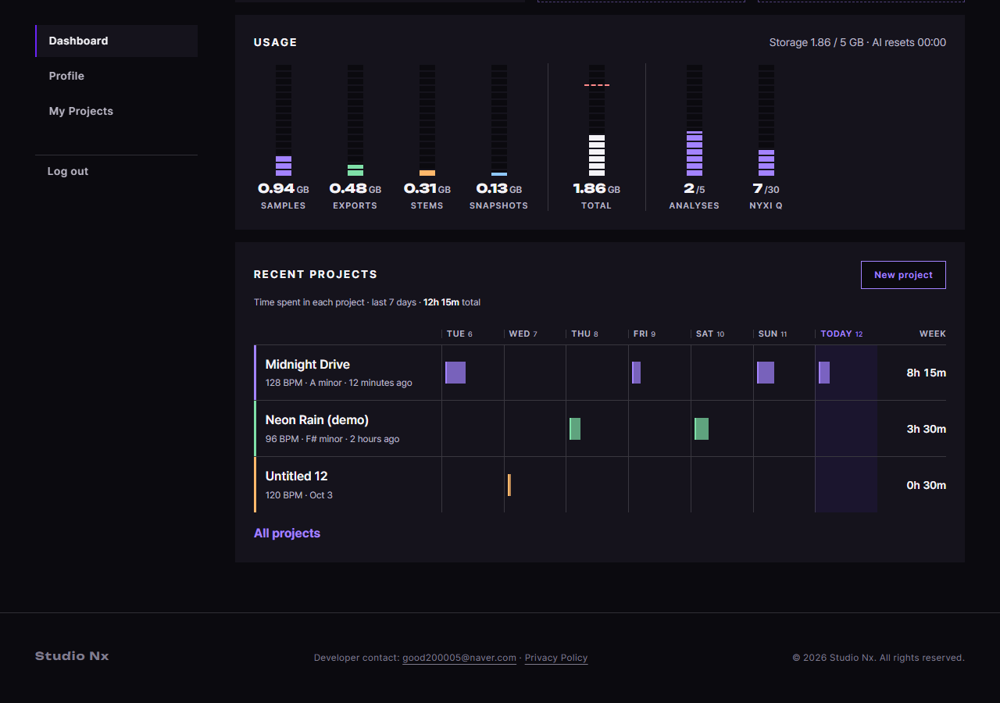

# JS 74 — `renderRecentProjects()` (+ `core/time.js`)

| 항목 | 내용 |
|---|---|
| 파일 | `studionx/frontend/static/js/pages/mypage.js`, 새 파일 `static/js/core/time.js`, CSS `static/css/pages/mypage.css`(한 줄) |
| 작업 | P1-17 마이페이지 JS: 최근 프로젝트 5개와 최근 7일 작업 시간 (PRD 01 FR-121, FR-128) |
| 작성 | Claude (AI), 2026-10-12, 사용자 검토 |
| 이전 · 다음 | [73 `formatDuration()`](73_mypage_formatDuration.md) · 75 `renderReadyBanner()` (다음) |

## 1. 하는 일
대시보드 응답의 `recent_projects`로 **Recent projects 카드**를 그립니다. 오늘을 포함한 지난 7일의 요일 눈금을 만들고, 프로젝트마다 한 줄(`li.lane`)을 만들어서 날짜 칸마다 작업 세션 막대를 놓습니다.



| 그리는 것 | 내용 |
|---|---|
| 요일 눈금 `#recent-days` | `Tue 6`, `Wed 7` … 마지막 칸은 `Today 12`(강조)이고, 끝에 `Week` 칸이 있습니다 |
| 줄 머리 | 제목과 `128.5 BPM · A minor · 12 minutes ago` (키가 없으면 키를 빼고, 일주일이 지났으면 `Oct 3` 같은 날짜) |
| 세션 막대 | 세션이 시작한 날의 칸에 놓입니다. 너비는 작업 시간 ÷ 8시간이고, 마우스를 올리면 `Fri 2 · 19:30–22:00 · 2h 30m`이 나옵니다 |
| 줄 합계 `.lane__sum` | 그 프로젝트의 7일 작업 시간 (`9h 00m`) |
| 맨 위 합계 `#recent-week-total` | 모든 프로젝트의 합계 |
| 프로젝트가 없음 | 목록과 눈금을 숨기고 "No projects yet" 안내만 보여 줍니다 |

## 2. 언제 쓰나
| 호출하는 곳 | 화면 |
|---|---|
| 페이지 시작 (이후 단계에서 연결) | `renderRecentProjects(data.recent_projects)` |

**줄 색**은 JS가 정하지 않습니다. CSS가 `.lane:nth-child`로 순서대로 5가지 색을 줍니다. **모바일**에서는 CSS가 요일 칸을 숨기고 합계만 보여 주므로, JS는 PC와 모바일을 구분하지 않고 같은 HTML을 만듭니다.

**`core/time.js` (새 파일)**: 줄 머리의 `12 minutes ago`를 만드는 `formatRelativeTime`은 myproject.js(P1-14 29)에 있습니다. 그 파일을 불러오면 내 프로젝트 화면의 시작 코드가 함께 실행되므로, 같은 함수를 공통 파일로 **복사**해서 마이페이지가 가져다 씁니다. myproject.js는 이미 검토와 시험이 끝난 코드라서 그대로 두었습니다 (2026-10-12 결정, 오류 이동 규칙 `page-errors.js`와 같은 방식).

## 3. 코드
**import** (`mypage.js` 맨 위, 이번에 추가한 것만)
```js
import { formatRelativeTime } from '../core/time.js';
```

**CSS** (`mypage.css`, 한 줄 추가)
```css
.lanes__ruler[hidden], .lanes__list[hidden] { display: none; }
```
눈금(`display: grid`)과 목록이 `hidden` 속성을 이기지 않게 하는 규칙입니다. 이 규칙이 없으면 프로젝트가 없어도 눈금이 그대로 보입니다 (시험 01에서 확인).

**함수**
```js
export function renderRecentProjects(projects) {
  const list = document.getElementById('recent-list');
  const ruler = document.getElementById('recent-days');
  const empty = document.getElementById('recent-empty');
  const weekTotal = document.getElementById('recent-week-total');

  const toDate = (value) => {
    const hasZone = /[zZ]$|[+-]\d\d:\d\d$/.test(value);
    return new Date(hasZone ? value : value + 'Z');
  };
  const two = (n) => (n < 10 ? '0' : '') + n;
  const hhmm = (date) => two(date.getHours()) + ':' + two(date.getMinutes());
  const dayKey = (date) => date.getFullYear() + '-' + date.getMonth() + '-' + date.getDate();

  const now = new Date();
  const days = [];
  for (let i = 6; i >= 0; i--) {
    const date = new Date(now.getFullYear(), now.getMonth(), now.getDate() - i);
    days.push({
      key: dayKey(date),
      weekday: date.toLocaleDateString('en-US', { weekday: 'short' }),
      dayNumber: date.getDate(),
      isToday: i === 0,
    });
  }

  const describe = (seconds) => { /* '9 hours' · '4 hours 45 minutes' · '30 minutes' */ };

  if (ruler) { /* 요일 칸 7개 + 'Week' 칸 */ }

  let grandTotal = 0;
  if (list) list.textContent = '';
  for (const project of projects) {
    /* 날짜 칸 7개 만들기 → 세션을 시작한 날의 칸에 막대 넣기 → 줄 머리, 합계 만들기 */
  }

  if (weekTotal) weekTotal.textContent = formatDuration(grandTotal);

  const hasProjects = projects.length > 0;
  if (list) list.hidden = !hasProjects;
  if (ruler) ruler.hidden = !hasProjects;
  if (empty) empty.hidden = hasProjects;
}
```
위는 구조만 줄여서 보여 준 것이고, 전체 코드(약 120줄)는 `mypage.js`에 있습니다. 세션 하나를 칸에 놓는 핵심 부분은 다음과 같습니다.

```js
const start = toDate(session.started_at);
let index = -1;
for (let d = 0; d < days.length; d++) {
  if (days[d].key === dayKey(start)) index = d;
}
if (index < 0) continue; // 7일 칸 밖의 세션은 막대도 합계도 아님

const end = toDate(session.last_seen_at);
const endText = dayKey(end) === dayKey(start) ? hhmm(end) : '24:00';
const percent = Math.round(Math.min(100, (session.active_seconds / DAY_FULL_SECONDS) * 100) * 10) / 10;

const bar = document.createElement('i');
bar.style.setProperty('--w', percent + '%');
bar.title = label + ' · ' + hhmm(start) + '–' + endText + ' · ' + formatDuration(session.active_seconds);
cells[index].appendChild(bar);
projectTotal += session.active_seconds;
```

**최신 문법으로 쓰면** (공부용이며, 실제 코드는 위에 있습니다)
```js
const toDate = (v) => new Date(/[zZ]$|[+-]\d\d:\d\d$/.test(v) ? v : `${v}Z`);
const dayKey = (d) => `${d.getFullYear()}-${d.getMonth()}-${d.getDate()}`;
const days = Array.from({ length: 7 }, (_, k) => {
  const date = new Date(now.getFullYear(), now.getMonth(), now.getDate() - (6 - k));
  return { key: dayKey(date), weekday: date.toLocaleDateString('en-US', { weekday: 'short' }),
           dayNumber: date.getDate(), isToday: k === 6 };
});
const meta = [`${Number(project.bpm)} BPM`, project.music_key, formatRelativeTime(project.updated_at)]
  .filter(Boolean).join(' · ');
const index = days.findIndex((day) => day.key === dayKey(start));
if (index < 0) continue;
```
| 최신 문법 | 실제 코드 | 뜻 |
|---|---|---|
| `` `${v}Z` ``, `` `${…}-${…}` `` | `v + 'Z'`, `a + '-' + b` | 문자열에 값을 끼워 넣습니다 |
| `Array.from({ length: 7 }, (_, k) => …)` | `for (let i = 6; i >= 0; i--)` | 7번 반복해서 배열을 만듭니다 |
| `[…].filter(Boolean).join(' · ')` | `meta.push(…)`를 조건마다 | 값이 없는 칸(키)을 빼고 잇습니다 |
| `days.findIndex((day) => …)` | `for`로 돌며 `index`에 담기 | 조건에 맞는 칸의 위치를 찾습니다 |

### 문법 풀이
| 식 | 뜻 | 예 |
|---|---|---|
| `new Date(y, m, d - i)` | 이 컴퓨터 시간대의 `d - i`일 자정입니다. 날짜가 음수가 되면 지난달로 알아서 넘어갑니다 | 3일에서 4일 전은 지난달 29일 |
| `date.toLocaleDateString('en-US', { weekday: 'short' })` | 영어 요일 줄임말입니다 | `Tue` |
| `dayKey(date)` | 연-월-일을 하나의 글자로 만들어 날짜끼리 비교합니다 | `2026-9-12` |
| `arr.slice().sort((a, b) => 시각(a) - 시각(b))` | 원본 배열을 건드리지 않고 복사해서 시작 시각 순으로 정렬합니다 | 서버가 순서를 바꿔 줘도 막대는 시간 순서대로 놓입니다 |
| `continue` | 이번 세션을 건너뛰고 다음 세션으로 갑니다 | 7일 칸 밖의 세션 |
| `Math.min(100, … )` | 100을 넘지 않게 자릅니다 | 하루 8시간을 넘겨도 칸을 넘치지 않습니다 |
| `el.style.setProperty('--w', '18.8%')` | 막대 너비를 정하는 CSS 변수를 바꿉니다 | |
| `el.title = 글자` | 마우스를 올렸을 때 나오는 안내입니다 | `Today · 14:00–15:30 · 1h 30m` |
| `Number(project.bpm)` | 서버가 글자 `'128.50'`으로 보낸 소수를 숫자로 바꿔서 끝의 0을 뗍니다 | `128.5` |
| `encodeURIComponent(project.project_id)` | 주소에 넣어도 안전한 글자로 바꿉니다 | |
| `list.hidden = !hasProjects` | `hidden` 속성을 켜고 끕니다 | |

## 4. 흐름
1. 서버 시각에 `Z`를 붙여 UTC로 읽는 도우미와, 오늘을 포함한 지난 7일의 날짜 목록(이 컴퓨터의 시간대 기준)을 준비합니다.
2. 요일 눈금을 지우고 다시 그립니다 (7칸과 `Week` 칸, 마지막 칸은 `Today`와 `is-today`).
3. 프로젝트마다 날짜 칸 7개를 만들고, 세션을 시작 시각 순으로 훑으면서 시작한 날의 칸에 막대를 넣습니다. 7일 칸 밖의 세션은 건너뜁니다.
4. 줄 머리(제목과 BPM, 키, 수정 시각), 7일 합계, 화면 읽기용 이름(`aria-label`)을 만들어 `li.lane`으로 묶고 목록에 붙입니다.
5. 전체 합계를 쓰고, 프로젝트가 없으면 목록과 눈금을 숨기고 안내를 보여 줍니다.

## 5. 왜 이렇게
| 선택 | 이유 |
|---|---|
| 날짜는 이 컴퓨터의 시간대로 나눔 | 서버는 UTC로 저장합니다. 사용자의 밤 11시 세션이 UTC로는 다음 날일 수 있어서, 요일 구분은 브라우저가 합니다 (DB.md의 `project_sessions` 메모, P1-16 53번과 같은 결정) |
| 자정을 넘긴 세션은 시작한 날에 표시하고 끝은 `24:00` | 한 세션을 두 칸에 나누지 않습니다. 막대 안내에서 끝 시각이 다음 날로 넘어가 헷갈리지 않게 그날의 끝까지로 적습니다 |
| 7일 칸 밖의 세션은 합계에서도 뺌 | 막대와 합계가 어긋나지 않게 합니다. 서버가 UTC 기준으로 7일을 잘라 주기 때문에, 시간대에 따라 가장자리의 세션이 칸 밖으로 밀릴 수 있습니다 |
| 막대 너비는 시간 ÷ 8시간, 최대 100% | 하루 칸을 넘치지 않게 합니다. 8시간을 넘겨도 합계 숫자에는 실제 값이 들어갑니다 |
| 세션을 시작 시각 순으로 다시 정렬 | 서버가 순서를 보장해 주지 않아도 같은 날의 막대가 시간 순서대로 놓입니다 |
| 모든 글자를 `textContent`와 요소로 넣음 | 프로젝트 제목은 사용자가 입력한 값입니다. `innerHTML`을 쓰면 태그가 실행될 수 있습니다 (XSS) |
| 매번 목록과 눈금을 비우고 다시 그림 | 여러 번 불러도 줄이 쌓이지 않습니다 |
| `formatRelativeTime`을 `core/time.js`로 복사 | 위 2번 항목 참고. 같은 함수가 두 곳에 있으므로, 규칙을 바꿀 일이 생기면 두 파일을 함께 고쳐야 합니다 |
| 한 줄 CSS 추가 (`[hidden]`) | `display: grid`가 `hidden` 속성을 이기는 문제는 P1-14 31번에서도 겪었습니다 |

## 6. 시험 (실제 myPage.html, 실제 서버, 헤드리스 Chrome, 27개)
서버 형식의 시각(UTC, `Z` 없음)은 페이지 안에서 "지금에서 몇 시간 전"으로 만들어 넣었습니다. 시간대는 Chrome 설정으로 바꿔 가며 확인했습니다 (서울 기준, 13번만 세 곳).

| # | 상황 | 결과 |
|---|---|---|
| 01 | 프로젝트 0개 | 목록과 눈금은 계산된 CSS도 `none`이고, 안내가 보이며, 합계는 `0h 00m`입니다 |
| 02 | 프로젝트 1개 | 눈금 8칸(`Week` 포함), 마지막이 `Today`이며 `is-today`가 붙습니다. 날짜 글자가 브라우저 달력과 같고, 안내는 다시 숨겨집니다 |
| 03 | 오늘 90분 세션 | 오늘 칸에 막대 1개, 너비 `18.8%`, 안내 `Today · HH:MM–HH:MM · 1h 30m`, 합계 `1h 30m`, 이름 `1 hour 30 minutes` |
| 04 | 같은 날 세션 2개 | 두 세션 모두 합계에 들어갑니다 (`1h 30m`) |
| 04b | 어제 20:00과 10:00 세션을 거꾸로 전달 | 막대가 시간 순서(`10:00–11:00`, `20:00–20:30`)로 놓입니다 |
| 05 | 4h45m, 30m, 9h, 1h01m | 이름이 `4 hours 45 minutes`, `30 minutes`, `9 hours`, `1 hour 1 minute`이고 합계가 `4h 45m`, `0h 30m`, `9h 00m`, `1h 01m`입니다 |
| 06 | 하루 8시간 초과 (40000초) | 막대는 `100%`에서 멈추고 합계는 실제 값 `11h 07m`입니다 |
| 07 | 9일 전 세션 + 10분 세션 | 9일 전 세션은 막대도 합계도 아닙니다 (`0h 10m`) |
| 08 | 어제 23:15에 시작해 다음 날 00:15에 끝난 세션 | 어제 칸에 표시되고 안내가 `23:15–24:00 · 0h 45m`입니다. 오늘 칸은 비어 있습니다 |
| 09 | BPM `128.50`과 키가 있는 프로젝트, 키가 없고 10일 전에 수정한 프로젝트 | `128.5 BPM · A minor · 12 minutes ago`, `120 BPM · Oct 3`이고 링크는 `studioNx.html?projectId=7`과 `8`입니다. 줄마다 날짜 칸이 7개입니다 |
| 10 | 두 프로젝트(1h, 1h30m) | 맨 위 합계 `2h 30m` |
| 11 | 제목 `` | 글자 그대로 보이고 ``가 만들어지지 않습니다 |
| 12 | 두 번 호출 | 줄이 쌓이지 않고 마지막 호출의 2개이며, 눈금은 8칸 그대로입니다 |
| 13 | 키리바시(UTC+14), 사모아(UTC-11), 뉴욕에서 20시간 전 세션 | 각 시간대의 달력으로 계산한 칸과 같은 칸(어제)에 놓입니다 |
| 14 | 실제 API 응답(`loadDashboard`) | 줄 3개가 최근 수정순(`Lo-fi Sketch`가 맨 위)으로 나오고 모두 `0h 00m`입니다 |

27개 모두 통과했습니다. 70번(23개), 71번(12개), 72번(17개), 73번(20개) 시험도 다시 돌려서 통과했습니다.
