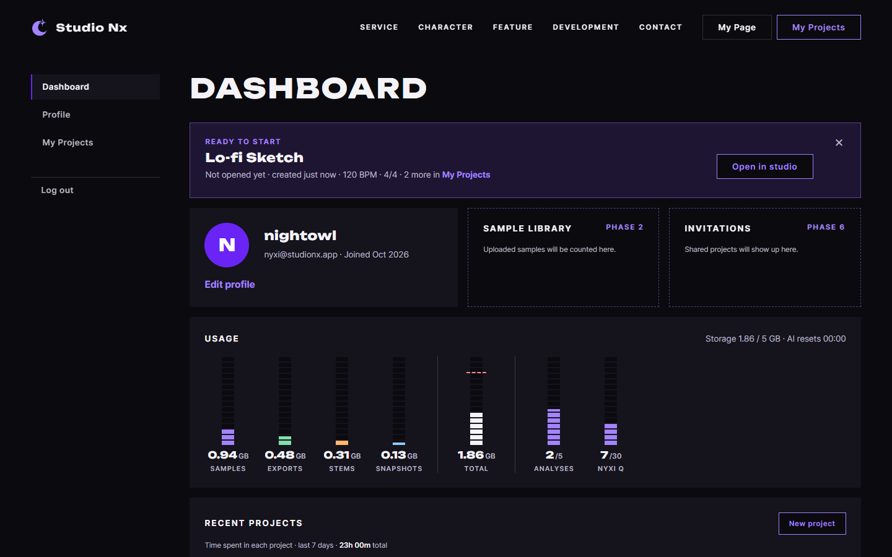

# JS 75 — `renderReadyBanner()` (Ready to start 배너)

| 항목 | 내용 |
|---|---|
| 파일 | `studionx/frontend/static/js/pages/mypage.js` |
| 작업 | P1-17 마이페이지 JS: 휴대폰에서 만든 프로젝트를 PC에서 이어 하게 하는 배너 (PRD 01 FR-129, FR-130) |
| 작성 | Claude (AI), 2026-10-12, 사용자 검토 |
| 이전 · 다음 | [74 `renderRecentProjects()`](74_mypage_renderRecentProjects.md) · 76 `initLogoutButton` 정리와 시작 코드 (다음) |

## 1. 하는 일
대시보드 응답의 `ready_projects`(내가 시퀀서에서 아직 한 번도 열지 않은 프로젝트, 최근 생성순)로 마이페이지 맨 위의 **Ready to start 배너**를 채웁니다. 가장 최근 프로젝트 하나를 보여 주고, 나머지는 개수만 알려 줍니다. × 버튼으로 닫으면 그 프로젝트는 이 브라우저에서 다시 나오지 않습니다.



| 상황 | 결과 |
|---|---|
| 이어 하기 프로젝트가 없음 | 배너를 숨깁니다 |
| 프로젝트 3개 | 첫 번째를 보여 주고 `· 2 more in My Projects`(링크)를 붙입니다 |
| × 를 누름 | 배너가 닫히고, 그 프로젝트 번호를 이 브라우저에 저장합니다 |
| 다시 그림 | 닫은 프로젝트를 빼고 다음 프로젝트를 보여 줍니다 |
| 모두 닫음 | 배너를 숨깁니다 |
| 폭 1280px 미만 | CSS가 숨깁니다 (시퀀서를 열 수 없는 화면이기 때문입니다) |

배너의 글자는 `Not opened yet · created 5 minutes ago · 120 BPM · 4/4`입니다. 만든 시각이 방금이면 `created just now`, 어제이면 `created yesterday`, 일주일이 넘으면 `created Sep 12`처럼 날짜가 나옵니다.

## 2. 언제 쓰나
| 호출하는 곳 | 화면 |
|---|---|
| 페이지 시작 (이후 단계에서 연결) | `renderReadyBanner(data.ready_projects)` |

**배너의 Open in studio 링크**는 최근 프로젝트 목록과 같은 방식으로 새 창에서 열려야 합니다. 그래서 이 함수가 배너에 `data-title`(프로젝트 제목)을 넣어 둡니다. 페이지 시작 코드에서 `initDesktopOnlyLinks(배너)`를 걸면(다음 단계), 좁은 화면에서 누를 때 안내 모달의 제목이 `This project`가 아니라 실제 제목이 됩니다 (JS 38의 메모, 시험 14).

## 3. 코드
**import**: 이 함수는 import를 새로 쓰지 않습니다. 74번에서 추가한 `formatRelativeTime`(`core/time.js`)을 씁니다.

**함수**
```js
export function renderReadyBanner(projects) {
  const KEY = 'studionx.readyDismissed';
  const banner = document.getElementById('ready-banner');
  if (!banner) return;

  // 이 브라우저에서 닫은 프로젝트 번호들 (localStorage 가 막혀 있으면 빈 목록)
  let dismissed = [];
  try {
    const saved = JSON.parse(localStorage.getItem(KEY));
    if (Array.isArray(saved)) dismissed = saved;
  } catch (err) {
    dismissed = [];
  }

  // 지금 이어 하기 목록에 없는 번호는 버림
  const stillReady = [];
  for (const id of dismissed) {
    for (const project of projects) {
      if (project.project_id === id) stillReady.push(id);
    }
  }
  if (stillReady.length !== dismissed.length) {
    dismissed = stillReady;
    try {
      localStorage.setItem(KEY, JSON.stringify(dismissed));
    } catch (err) {
      // 저장하지 못해도 화면에는 영향 없음
    }
  }

  const candidates = [];
  for (const project of projects) {
    if (dismissed.indexOf(project.project_id) < 0) candidates.push(project);
  }
  if (candidates.length === 0) {
    banner.hidden = true;
    return;
  }

  const project = candidates[0];
  // … 제목, Open 링크, 메타 줄, "N more" 링크를 채움 (전체 코드는 mypage.js)

  if (close) {
    close.onclick = function () {
      dismissed.push(project.project_id);
      try {
        localStorage.setItem(KEY, JSON.stringify(dismissed));
      } catch (err) {
        // 저장하지 못해도 이번 접속에서는 닫힘
      }
      banner.hidden = true;
    };
  }
  banner.hidden = false;
}
```
메타 줄을 만드는 부분은 다음과 같습니다.
```js
let created = formatRelativeTime(project.created_at);
if (created === 'Just now' || created === 'Yesterday') created = created.toLowerCase();
const text = 'Not opened yet · created ' + created + ' · ' + Number(project.bpm) + ' BPM · '
  + project.time_sig_num + '/' + project.time_sig_den;
meta.textContent = '';
meta.appendChild(document.createTextNode(text));
if (more) {
  more.textContent = '';
  const rest = candidates.length - 1;
  more.hidden = rest === 0;
  if (rest > 0) {
    const link = document.createElement('a');
    link.className = 'text-link text-link--strong';
    link.href = 'myProject.html';
    link.textContent = 'My Projects';
    more.appendChild(document.createTextNode(' · ' + rest + ' more in '));
    more.appendChild(link);
  }
  meta.appendChild(more);
}
```

**최신 문법으로 쓰면** (공부용이며, 실제 코드는 위에 있습니다)
```js
const saved = (() => { try { const v = JSON.parse(localStorage.getItem(KEY)); return Array.isArray(v) ? v : []; } catch { return []; } })();
const dismissed = saved.filter((id) => projects.some((p) => p.project_id === id));
const [project, ...others] = projects.filter((p) => !dismissed.includes(p.project_id));
if (!project) return void (banner.hidden = true);
const created = formatRelativeTime(project.created_at).replace(/^(Just now|Yesterday)$/, (s) => s.toLowerCase());
meta.replaceChildren(`Not opened yet · created ${created} · ${Number(project.bpm)} BPM · ${project.time_sig_num}/${project.time_sig_den}`, more);
close.addEventListener('click', () => { localStorage.setItem(KEY, JSON.stringify([...dismissed, project.project_id])); banner.hidden = true; }, { once: true });
```
| 최신 문법 | 실제 코드 | 뜻 |
|---|---|---|
| `catch { … }` (괄호 없는 catch) | `catch (err) { … }` | 오류 값을 쓰지 않을 때 줄여 씁니다 |
| `.filter(…)`와 `.some(…)` | 이중 `for`와 `indexOf` | 조건에 맞는 것만 거르고, 하나라도 맞는지 확인합니다 |
| `const [project, ...others] = 목록` | `candidates[0]`과 `candidates.length - 1` | 첫 번째와 나머지로 나눕니다 (구조 분해, 나머지 펼치기) |
| `[...dismissed, 새 번호]` | `dismissed.push(새 번호)` | 배열을 복사하면서 하나 더합니다 |
| `` `…${값}…` `` | `'…' + 값 + '…'` | 문자열에 값을 끼워 넣습니다 |
| `addEventListener('click', …, { once: true })` | `close.onclick = function () { … }` | 한 번만 받습니다. 실제 코드는 `onclick`에 하나만 걸어서 여러 번 불러도 쌓이지 않게 했습니다 |

### 문법 풀이
| 식 | 뜻 | 예 |
|---|---|---|
| `localStorage.getItem(KEY)` | 이 브라우저에 저장해 둔 글자를 읽습니다. 없으면 `null`입니다 | `'[1,2]'` |
| `JSON.parse(글자)` | 글자를 배열이나 객체로 되돌립니다. 망가진 글자(`abc`)는 오류를 던집니다 | `'[1,2]'` → `[1, 2]` |
| `Array.isArray(값)` | 진짜 배열인지 확인합니다 | `null`, `{"a":1}`, `"x"`는 거짓 |
| `try { … } catch (err) { … }` | 저장소가 막혀 있거나 값이 망가져서 오류가 나도 멈추지 않고 빈 목록으로 이어 갑니다 | 개인 창에서는 `localStorage` 접근이 오류를 던질 수 있습니다 |
| `dismissed.indexOf(id) < 0` | 목록에 없다는 뜻입니다 | |
| `banner.dataset.title = …` | HTML의 `data-title="…"` 속성을 만듭니다 | |
| `close.onclick = function () { … }` | 클릭 처리를 **바꿔 끼웁니다**. `addEventListener`는 부를 때마다 하나씩 쌓입니다 | 두 번 그려도 한 번 눌러서 한 번만 저장됩니다 |
| `created.toLowerCase()` | 소문자로 바꿉니다 | `Just now` → `just now` (문장 중간에서 어색하지 않게) |
| `Number(project.bpm)` | 서버의 글자 `'128.50'`을 숫자 `128.5`로 바꿉니다 | |

## 4. 흐름
1. 배너 요소를 찾습니다. 없으면 끝냅니다.
2. 저장해 둔 "닫은 프로젝트 번호" 목록을 읽습니다 (저장소가 막혔거나 값이 망가졌으면 빈 목록).
3. 지금 이어 하기 목록에 없는 번호는 목록에서 지웁니다 (그사이 열었거나 지운 프로젝트).
4. 닫지 않은 프로젝트 중 첫 번째를 고릅니다. 없으면 배너를 숨기고 끝냅니다.
5. 제목, `Open in studio` 링크, 메타 줄, `N more` 링크를 채우고 `data-title`을 넣습니다.
6. × 버튼에 "번호를 저장하고 숨김" 동작을 걸고 배너를 보입니다.

## 5. 왜 이렇게
| 선택 | 이유 |
|---|---|
| 닫은 번호를 `localStorage`에 저장 | 서버에 "닫음"을 기록할 곳이 없고, 이 배너는 이 기기에서의 편의 기능입니다. 다른 기기에서는 다시 나와도 괜찮습니다 |
| 저장소 읽기와 쓰기를 `try`로 감쌈 | 개인 창이나 차단 설정에서는 접근이 오류를 던집니다. 실패하면 "닫은 것이 없다"로 보고 그냥 보여 줍니다 (시험 07) |
| 망가진 값은 빈 목록으로 | 직접 고쳤거나 다른 형식으로 저장된 값이 와도 배너가 죽지 않습니다 (시험 08) |
| 목록에 없는 번호를 지움 | 그사이 프로젝트를 시퀀서에서 열었거나 지웠으면 그 번호는 더 필요하지 않습니다. 지우지 않으면 목록이 계속 커집니다 (시험 06) |
| × 를 누르면 다음 프로젝트를 바로 보여 주지 않음 | 닫은 것은 "지금은 그만 보겠다"는 뜻입니다. 다음 프로젝트는 다음에 접속할 때 나옵니다 |
| `onclick` 하나만 씀 | 같은 함수를 여러 번 불러도 처리기가 쌓이지 않아서, 한 번 눌렀는데 번호가 두 번 저장되지 않습니다 (시험 12) |
| `N more` 링크를 매번 새로 만듦 | 칸을 비울 때 안의 링크도 지워집니다. 처음에는 기존 링크를 다시 쓰려고 했는데, 프로젝트가 1개였다가 3개로 바뀌면 링크가 사라지는 문제가 생겨서 새로 만드는 방식으로 바꿨습니다 (시험 13) |
| 배너에 `data-title`을 넣음 | `Open in studio` 링크를 눌렀을 때 좁은 화면 안내 모달의 제목이 실제 프로젝트 제목이 되게 합니다 |
| 글자는 모두 `textContent`와 요소로 넣음 | 제목은 사용자가 입력한 값입니다 (XSS 방지, 시험 11) |

## 6. 알게 된 문제와 고친 것: DB 시각이 UTC가 아니었습니다 (시험 15 중 발견)
실제 API 응답으로 시험하다가, 몇 시간 전에 만든 프로젝트의 메타 줄이 `created just now`로 나왔습니다. 화면 코드의 잘못이 아니라 DB에 저장된 시각의 문제였습니다.

| 확인 (고치기 전) | 값 |
|---|---|
| MySQL `NOW()` (이 PC) | 2026-10-12 **23:18** (한국 시각) |
| MySQL `UTC_TIMESTAMP()` / 파이썬 UTC | 2026-10-12 **14:18** |
| 저장된 `created_at` (`DEFAULT CURRENT_TIMESTAMP(3)`) | 22:59 (UTC로는 13:59여야 합니다) |
| MySQL 시간대 설정 | `time_zone = SYSTEM` (이 PC의 시간대) |

`docs/DB.md`는 "시간은 **UTC 기준**으로 저장"한다고 정했고, 화면 코드는 모두 서버 시각 끝에 `Z`를 붙여 UTC로 읽습니다. 그런데 `CURRENT_TIMESTAMP`는 MySQL 연결의 시간대를 따르고 `app/db/session.py`가 연결 시간대를 정하지 않아서, 이 PC에서는 **한국 시각이 저장**되고 있었습니다. UTC로 읽으면 9시간 미래라서 `Just now`로 보였고, 파이썬이 직접 넣는 값(`deleted_at` 등)은 UTC라서 같은 테이블에 두 기준이 섞여 있었습니다.

**고친 것** (사용자 결정, 2026-10-12): 연결할 때마다 시간대를 UTC로 맞춥니다.
```python
engine = create_engine(
    get_settings().database_url,
    pool_pre_ping=True,
    future=True,
    connect_args={"init_command": "SET time_zone = '+00:00'"},
)
```
| 확인 (고친 뒤) | 결과 |
|---|---|
| 새 프로젝트의 `created_at`, `updated_at` | UTC 현재 시각과 0.0초 차이입니다 (실제 서버에 요청해서 확인) |
| 새 시험 `tests/test_db_timezone.py` 3개 | 연결 시간대가 `+00:00`, `NOW()`와 `UTC_TIMESTAMP()`가 같음, 기본값으로 저장된 `created_at`이 UTC와 1분 안 |
| 백엔드 pytest 전체 | 524개 통과, `ruff` 통과 |

**남은 것**: 고치기 전에 저장된 개발용 데이터는 9시간 앞선 한국 시각 그대로입니다. 새 데이터부터 맞고, 예전 행은 고치지 않았습니다. `DB.md`의 시간 규칙에 이 설정을 적어 두었습니다.

## 7. 시험 (실제 myPage.html, 실제 서버, 헤드리스 Chrome, 26개)
| # | 상황 | 결과 |
|---|---|---|
| 01 | 이어 하기 0개 | 배너가 숨겨지고 계산된 CSS도 `none`입니다 |
| 02 | 1개 | 제목, 링크 `studioNx.html?projectId=7`, 메타 `Not opened yet · created 5 minutes ago · 120 BPM · 4/4`, `more`는 숨김, 배너의 `data-title`이 제목입니다 |
| 03 | 3개 | 첫 번째만 보이고 ` · 2 more in My Projects`와 `myProject.html` 링크가 붙습니다 |
| 04 | × 를 누름, 같은 목록으로 다시 그림 | 배너가 숨겨지고 `[1]`이 저장됩니다. 다시 그리면 2번 프로젝트가 나오고 `1 more`입니다 |
| 05 | 두 개를 모두 닫음 | 배너가 숨겨지고 `[1,2]`가 저장됩니다 |
| 06 | 저장된 `[1, 99]`, 목록은 1, 2 | `99`가 지워져 `[1]`이 되고 2번이 나옵니다 |
| 07 | `localStorage`가 오류를 던짐 | 오류 없이 배너가 보이고, × 도 이번 접속에서 닫힙니다 |
| 08 | 저장된 값이 `abc`, `{"a":1}`, `null`, `"x"` | 모두 "닫은 것 없음"으로 보고 배너를 보여 줍니다 |
| 09 | 만든 시각이 10초 전, 어제, 3일 전, 2시간 전, 30일 전 | `created just now`, `created yesterday`, `created 3 days ago`, `created 2 hours ago`, `created Sep 12` 같은 날짜 |
| 10 | BPM `128.50`, 박자 7/8 | `128.5 BPM · 7/8` |
| 11 | 제목 `` | 글자 그대로 보이고 ``가 만들어지지 않습니다 |
| 12 | 두 번 그린 뒤 × 를 한 번 | `[1]`이 저장됩니다 (`[1,1]`이 아닙니다) |
| 13 | 프로젝트 1개로 그렸다가 3개로 다시 그림 | `N more` 링크가 되살아납니다 |
| 14 | 폭 1024에서 `Open in studio` 클릭 (`initDesktopOnlyLinks`를 배너에 걺) | 안내 모달이 열리고 이름이 `Night Drive`입니다 (`This project`가 아닙니다) |
| 15 | 실제 API 응답(`loadDashboard`) | 가장 최근 프로젝트 `Lo-fi Sketch`와 `2 more`가 나오고 메타 줄 모양이 맞습니다 (이 시험 계정의 프로젝트는 고치기 전 데이터라서 만든 시각 글자가 `just now`로 나옵니다) |

26개 모두 통과했습니다. 70~74번 시험도 다시 돌려서 통과했습니다.
