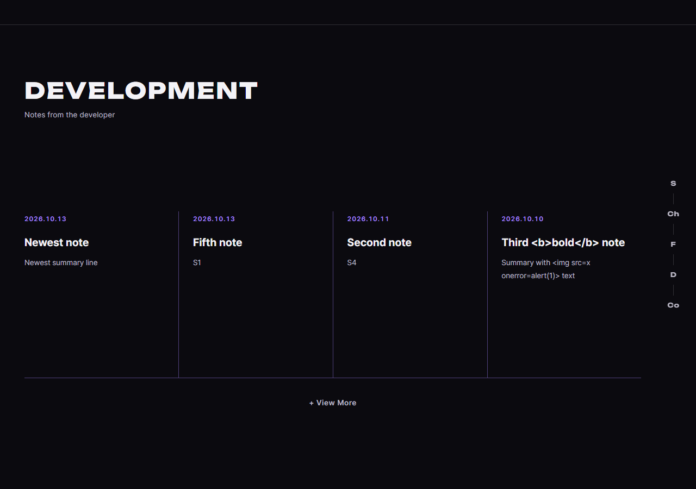

# JS 97 — `loadDevNotes()`, `formatNoteDate()` (홈의 Development 공지 카드)

| 항목 | 내용 |
|---|---|
| 파일 | `studionx/frontend/static/js/pages/home.js`, `home.html`, `static/css/pages/home.css` |
| 작업 | P1-23 화면 마무리: 홈의 Development 카드 4개를 HTML의 예시 글자가 아니라 관리자가 쓴 실제 공지로 채우기 (PRD 01 FR-114) |
| 작성 | Claude (AI), 2026-10-13, 사용자 검토 |
| 이전 · 다음 | [96 `initErrorActions()`](96_error_initErrorActions.md) · 98 View More 모달 (다음) |

## 1. 하는 일
`GET /api/v1/dev-notes?limit=4`(P1-21의 85번)를 불러서 `.dev-notes` 목록에 카드 4개를 만듭니다. 카드 한 칸은 날짜, 제목, 요약입니다.



| 상황 | 화면 |
|---|---|
| 공지가 있음 | 최신 순으로 카드 최대 4개와 `+ View More` |
| 공지가 하나도 없음 | "No notes yet. Check back soon." (`+ View More`는 숨김) |
| 불러오지 못함 (서버 오류, 네트워크 끊김) | "Notes are unavailable right now. Please try again later." (`+ View More`는 숨김) |
| 응답 모양이 이상함 (`items`가 없음 등) | 공지가 없는 것으로 처리 |

세 파일이 함께 바뀌었습니다.
- **`home.html`**: 예시 공지 4개("69 tasks, one board" 등)를 지우고 빈 `<ol id="dev-notes">`와 안내 문구 자리(`#dev-notes-empty`), `+ View More` 자리(`#dev-notes-more`)를 두었습니다. 가짜 공지가 진짜처럼 보이는 일이 없게 하기 위해서입니다.
- **`home.css`**: 안내 문구 모양(`.dev-empty`)과, `hidden` 속성이 `display` 지정에 눌리지 않게 하는 규칙을 더했습니다.
- **`home.js`**: 두 함수를 구현했습니다.

## 2. 언제 쓰나
| 호출하는 곳 | 시점 |
|---|---|
| `home.js` 맨 아래 `loadDevNotes();` | 홈이 열릴 때 한 번 |
| `formatNoteDate()` | `loadDevNotes()`가 카드마다 부르고, 다음 함수(98, View More 모달)도 씁니다 |

## 3. 코드
**import**: 새로 추가한 것은 없습니다 (`api`는 이미 가져와 있었습니다).

**날짜 글자**
```js
export function formatNoteDate(isoTime) {
  const hasZone = /[zZ]$|[+-]\d\d:\d\d$/.test(isoTime);
  const date = new Date(hasZone ? isoTime : isoTime + 'Z');
  if (isNaN(date.getTime())) return { label: '', iso: '' };
  const pad = function (n) { return n < 10 ? '0' + n : String(n); };
  const y = date.getFullYear();
  const m = pad(date.getMonth() + 1);
  const d = pad(date.getDate());
  return { label: y + '.' + m + '.' + d, iso: y + '-' + m + '-' + d };
}
```

**공지 불러오기**
```js
export async function loadDevNotes() {
  const list = document.getElementById('dev-notes');
  const empty = document.getElementById('dev-notes-empty');
  const more = document.getElementById('dev-notes-more');
  if (!list) return;

  const showMessage = function (text) {
    list.textContent = '';
    if (more) more.hidden = true;
    if (empty) { empty.textContent = text; empty.hidden = false; }
  };

  let data = null;
  try {
    data = await api.get('/dev-notes?limit=4', { auth: false });
  } catch (err) {
    showMessage('Notes are unavailable right now. Please try again later.');
    return;
  }
  const items = data && Array.isArray(data.items) ? data.items : [];
  if (items.length === 0) { showMessage('No notes yet. Check back soon.'); return; }

  list.textContent = '';
  for (const note of items) {
    const when = formatNoteDate(note.published_at);
    const item = document.createElement('li');
    item.className = 'dev-note';
    const time = document.createElement('time');
    if (when.iso) time.setAttribute('datetime', when.iso);
    time.textContent = when.label;
    const title = document.createElement('h3');
    title.className = 'dev-note__title';
    title.textContent = note.title;
    const excerpt = document.createElement('p');
    excerpt.className = 'dev-note__excerpt';
    excerpt.textContent = note.summary;
    item.appendChild(time);
    item.appendChild(title);
    item.appendChild(excerpt);
    list.appendChild(item);
  }
  if (empty) empty.hidden = true;
  if (more) more.hidden = false;
}
```

**최신 문법으로 쓰면** (공부용이며, 실제 코드는 위에 있습니다)
```js
export const loadDevNotes = async () => {
  const list = document.getElementById('dev-notes');
  if (!list) return;

  let items;
  try {
    ({ items = [] } = (await api.get('/dev-notes?limit=4', { auth: false })) ?? {});
  } catch {
    return showMessage('Notes are unavailable right now. Please try again later.');
  }
  if (!items.length) return showMessage('No notes yet. Check back soon.');

  list.replaceChildren(...items.map((note) => {
    const { label, iso } = formatNoteDate(note.published_at);
    const li = document.createElement('li');
    li.className = 'dev-note';
    li.append(
      Object.assign(document.createElement('time'), { textContent: label, dateTime: iso }),
      Object.assign(document.createElement('h3'), { className: 'dev-note__title', textContent: note.title }),
      Object.assign(document.createElement('p'), { className: 'dev-note__excerpt', textContent: note.summary }),
    );
    return li;
  }));
};
```
| 최신 문법 | 실제 코드 | 뜻 |
|---|---|---|
| `?? {}` | `data && Array.isArray(data.items) ? data.items : []` | 값이 `null`이나 `undefined`일 때 기본값을 씁니다 |
| `catch { }` | `catch (err) { }` | 쓰지 않는 오류 변수를 생략합니다 |
| `({ items = [] } = …)` | `data.items` | 객체에서 꺼내면서 기본값을 정합니다 (구조 분해) |
| `list.replaceChildren(...목록)` | `textContent = ''`와 `appendChild` 반복 | 자식을 한 번에 갈아 끼웁니다 |
| `items.map(…)` | `for (const note of items)` | 목록을 다른 목록으로 바꿉니다 |
| `Object.assign(요소, { … })` | `요소.속성 = 값`을 줄마다 | 속성 여러 개를 한 번에 넣습니다 |
| `li.append(a, b, c)` | `appendChild`를 세 번 | 여러 자식을 한 번에 붙입니다 |

### 문법 풀이
| 식 | 뜻 |
|---|---|
| `api.get(경로, { auth: false })` | 로그인 없이 읽는 API라서 토큰을 붙이지 않고, 토큰이 없다고 재발급을 시도하지도 않습니다 |
| `Array.isArray(data.items)` | `items`가 목록인지 확인합니다 |
| `document.createElement('li')` | 새 HTML 요소를 만듭니다 |
| `element.textContent = 글자` | 글자를 **글자 그대로** 넣습니다. `<b>` 같은 글자가 있어도 태그로 해석하지 않습니다 |
| `list.textContent = ''` | 안의 내용을 모두 비웁니다 (다시 그릴 때 겹치지 않게) |
| `isoTime + 'Z'` | 서버의 시각은 UTC이고 시간대 표시가 없어서(`2026-10-12T22:30:00`) 끝에 `Z`를 붙여 UTC로 읽게 합니다 |
| `date.getFullYear()`, `getMonth()`, `getDate()` | 이 컴퓨터의 시간대 기준 연, 월(0부터 시작), 일입니다 (`getUTC…`와 다릅니다) |
| `isNaN(date.getTime())` | 읽을 수 없는 날짜인지 확인합니다 |

## 4. 흐름
1. 목록, 안내 문구, View More의 요소를 찾고, 목록이 없으면 끝냅니다.
2. 토큰 없이 공지 API를 부릅니다. 실패하면 오류 안내 문구를 보이고 끝냅니다.
3. 응답에서 `items` 목록을 꺼냅니다. 비어 있으면 "공지 없음" 문구를 보입니다.
4. 목록을 비우고 공지마다 카드를 만들어 붙입니다.
5. 안내 문구를 숨기고 `+ View More`를 보입니다.

## 5. 왜 이렇게
| 선택 | 이유 |
|---|---|
| 글자를 `textContent`로만 넣음 | 공지는 관리자가 쓰지만, 관리자 계정이 뚫리거나 실수로 `<script>`를 넣어도 홈 방문자에게 실행되지 않게 합니다 (시험 D04에서 ``로 확인했습니다) |
| 인증 없이 부름 (`auth: false`) | 홈은 로그인 전에도 보이는 화면입니다. 인증을 켜면 토큰이 없을 때 재발급을 먼저 시도해 요청이 한 번 더 나갑니다 |
| 예시 공지를 HTML에서 지움 | 불러오는 동안이나 실패했을 때 가짜 공지가 진짜 공지처럼 보이는 것을 막습니다 |
| 오류를 밖으로 던지지 않음 | 홈에는 공지 말고도 로그인 모달, 문의 폼 등이 있습니다. 공지 하나가 실패해도 나머지는 동작해야 합니다 |
| 실패와 "공지 없음"을 다른 문구로 | 사용자에게 "아직 글이 없음"과 "지금 못 불러옴"은 다른 상황입니다 |
| 날짜를 이 컴퓨터의 시간대로 | 같은 공지가 서울에서는 10월 13일, 로스앤젤레스에서는 10월 12일일 수 있습니다. 마이페이지와 같은 방식입니다 (P1-17) |
| 날짜 계산을 `formatNoteDate`로 따로 뺌 | 다음 함수(98, View More 모달)도 같은 날짜 글자를 씁니다 |
| `<time datetime="2026-10-13">` | 사람은 `2026.10.13`으로 읽고, 기계(검색 로봇, 화면 낭독기)는 `datetime` 값을 읽습니다 |
| 다시 불러도 같은 결과 | 목록을 비우고 그리므로 두 번 불러도 카드가 겹치지 않습니다 |

## 6. 시험 (실제 서버와 실제 DB, 헤드리스 Chrome, 16개)
공지 9개를 DB에 넣고 시험했습니다 (공개 5개, 초안, 예약 중, 삭제, 그리고 제목과 요약에 `<b>`, ``가 들어간 것). 시험 데이터는 P1-23이 끝날 때 지웁니다.

| # | 한 일 | 결과 |
|---|---|---|
| D01 | 로그인하지 않고 홈을 엶 | 최신 4개가 카드로, 최신순 ✔ |
| D02 | 초안, 예약 중, 삭제한 공지 | 카드에 없음 ✔ |
| D03 | 카드의 요약과 제목 요소 | 요약이 들어가고 제목은 `<h3>` ✔ |
| D04 | 제목과 요약에 `<b>`, `` | 글자로 보이고 태그가 되지 않음 ✔ |
| D05 | 공지가 있을 때 | 안내 문구는 숨김, `+ View More`는 보임 ✔ |
| D06 | `loadDevNotes`가 보내는 요청 | 공지 API 한 번뿐, `/auth/refresh` 없음 ✔ |
| D07 | 시간대를 서울로 (UTC 22:30 공지) | `2026.10.13` (다음 날), `datetime="2026-10-13"` ✔ |
| D08 | 시간대를 로스앤젤레스로 | 같은 공지가 `2026.10.12` ✔ |
| D09 | `formatNoteDate`에 여러 값 | `Z` 없는 값은 UTC로, `Z`와 `+09:00`은 그대로, 읽을 수 없으면 빈 글자 ✔ |
| D10 | 응답이 빈 목록 | 카드 없음, "No notes yet…", View More 숨김 ✔ |
| D11 | 서버 오류(500) | "Notes are unavailable…", View More 숨김 ✔ |
| D12 | 네트워크 끊김 | 같은 오류 안내 ✔ |
| D13 | 응답에 `items`가 없음 | 공지 없음으로 처리, 오류 없음 ✔ |
| D14 | 두 번 연속 호출 | 카드 4개 그대로(겹치지 않음), 안내 문구 숨김 ✔ |
| D15 | 목록 요소가 없음 | 오류 없이 끝남 ✔ |
| D16 | 폭 390 | 가로로 넘치지 않음 ✔ |

16개 모두 통과했습니다. 처음 돌렸을 때 D06이 실패했는데, 홈이 열릴 때 머리글의 로그인 상태 확인(`initAuthState`)이 `/auth/refresh`를 부르는 것을 `loadDevNotes`의 요청으로 잘못 센 시험의 문제였습니다. `loadDevNotes`만 따로 불러서 요청을 세도록 시험을 고쳤습니다.
