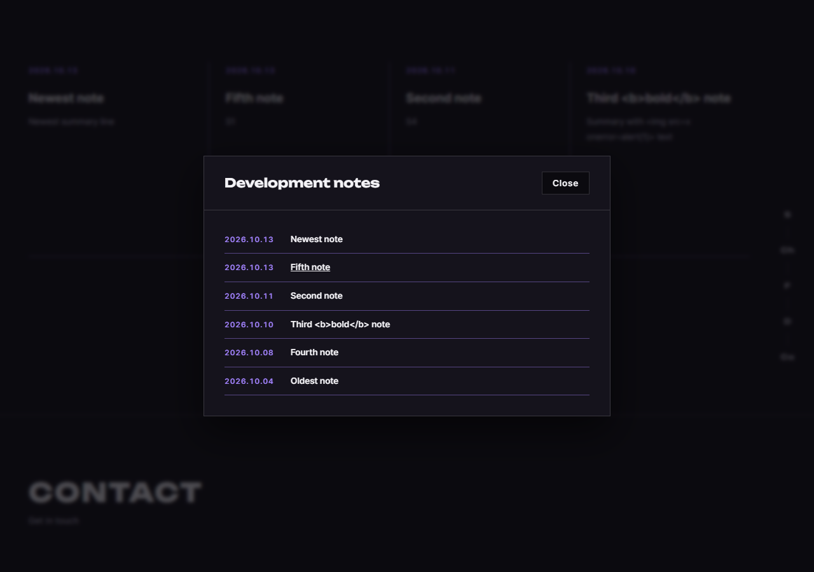
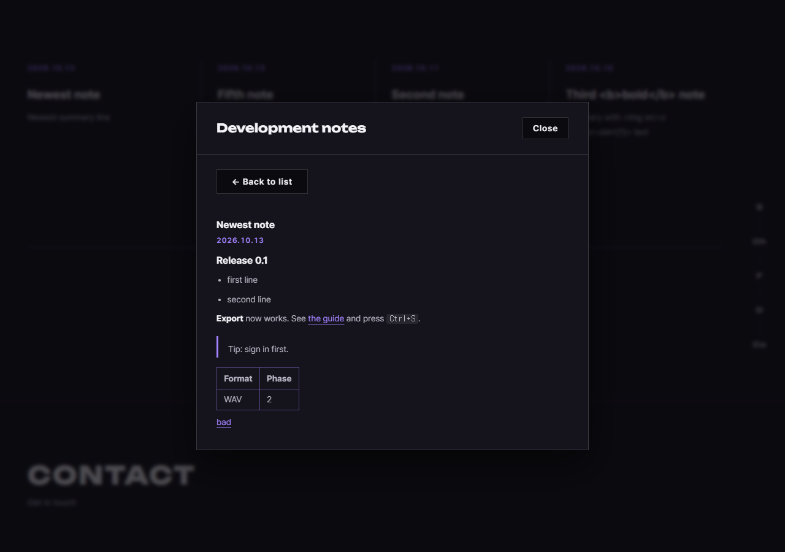

# JS 98 — `initDevNotesModal()` (+ View More 공지 모달: 목록과 상세)

| 항목 | 내용 |
|---|---|
| 파일 | `studionx/frontend/static/js/pages/home.js`, `home.html`, `static/css/pages/home.css` |
| 작업 | P1-23 화면 마무리: `+ View More`를 누르면 공지 전체 목록을 보여 주고, 하나를 누르면 Markdown 본문을 안전하게 보여 주는 모달 (PRD 01 FR-114) |
| 작성 | Claude (AI), 2026-10-13, 사용자 검토 |
| 이전 · 다음 | [99 `markdownToFragment()`](99_markdown_markdownToFragment.md) · 100 `initSideNavActiveState()`, `initMobileMenuClose()`, `initIntro()` (다음) |

## 1. 하는 일
지금까지 "The full archive … will be listed here."라는 안내 문구뿐이던 모달에 두 화면을 넣었습니다.

| 화면 | 내용 |
|---|---|
| **목록** | 공개된 공지를 최신순으로 최대 50개, 날짜(보라색)와 제목 한 줄씩 |
| **상세** | `← Back to list` 버튼, 제목, 날짜, 본문(Markdown을 서식으로 변환) |





| 동작 | 내용 |
|---|---|
| `+ View More`를 누름 | 모달이 열리고(HTML의 `command` 속성이 엶), **그때마다** `GET /dev-notes?limit=50`으로 목록을 새로 불러 새 공지가 반영됩니다 |
| 목록에서 공지를 누름 | `GET /dev-notes/{id}`로 본문을 받아 상세 화면으로 바꿉니다. 본문은 99번 `markdownToFragment()`로만 넣습니다 |
| `Back to list` | 목록 화면으로 돌아갑니다. 목록은 다시 부르지 않고, 방금 본 공지에 포커스를 돌려줍니다 |
| 모달을 닫음(`Close`, `Esc`) | 다음에 열 때는 항상 목록 화면부터 보입니다 |
| 공지가 하나도 없음 | "No notes yet. Check back soon." |
| 목록을 불러오지 못함 | "Notes are unavailable right now. Please try again later." |
| 상세에서 404 (그 사이 비공개나 삭제됨) | "This note is no longer available." 와 `Back to list` |
| 상세를 불러오지 못함 (네트워크 등) | "The note could not be loaded. Please try again later." |

함께 바뀐 파일은 아래와 같습니다.
- **`home.html`**: 모달 안을 `#note-list-view`(목록)와 `#note-detail-view`(상세, `Back to list` 버튼, 제목, 날짜, 본문, 안내 문구)로 바꿨습니다.
- **`home.css`**: 목록과 상세 모양, 본문 서식(제목 크기를 모달 제목보다 크지 않게 맞춤, 표와 코드 상자가 가로로 넘치지 않게 함)을 더했습니다.
- **`home.js`**: 이 함수와 맨 아래의 `initDevNotesModal();` 호출을 더했고, `markdownToFragment`를 가져옵니다.

## 2. 언제 쓰나
| 호출하는 곳 | 시점 |
|---|---|
| `home.js` 맨 아래 `initDevNotesModal();` | 홈이 열릴 때 한 번 (이벤트 처리기를 연결) |

## 3. 코드
**import** (이번에 추가한 것)
```js
import { markdownToFragment } from '../core/markdown.js';
```

**함수** (줄이 길어 핵심 구조만 옮깁니다. 전체는 `home.js`에 있습니다)
```js
export function initDevNotesModal() {
  const modal = document.getElementById('dev-notes-modal');
  const more = document.querySelector('#dev-notes-more button');
  /* listView, detailView, list, listEmpty, back, title, date, body, detailEmpty 요소 찾기 */
  if (!modal || !list || !listView || !detailView) return;

  let requestId = 0;       // 요청마다 번호를 올려서, 늦게 온 이전 응답을 버림
  let lastOpenedId = null; // Back to list 때 포커스를 돌려줄 공지

  const showList = function () {
    requestId += 1;
    detailView.hidden = true;
    listView.hidden = false;
    if (lastOpenedId !== null) {
      const item = list.querySelector('[data-note-id="' + lastOpenedId + '"]');
      if (item) item.focus();
    }
  };

  const openNote = async function (noteId) {
    requestId += 1;
    const mine = requestId;
    lastOpenedId = noteId;
    listView.hidden = true;
    detailView.hidden = false;
    title.textContent = 'Loading…';
    body.textContent = '';
    back.focus();

    let note = null;
    let failure = '';
    try {
      note = await api.get('/dev-notes/' + encodeURIComponent(noteId), { auth: false });
    } catch (err) {
      failure = err && err.status === 404
        ? 'This note is no longer available.'
        : 'The note could not be loaded. Please try again later.';
    }
    if (mine !== requestId) return;   // 그 사이 다른 공지를 눌렀거나 목록으로 돌아감

    if (!note) { title.textContent = ''; detailEmpty.textContent = failure; detailEmpty.hidden = false; return; }
    const when = formatNoteDate(note.published_at);
    title.textContent = note.title;
    date.textContent = when.label;
    body.appendChild(markdownToFragment(note.content));
    title.focus();
  };

  const loadList = async function () { /* 같은 방식: 번호표, 불러오기, 줄마다 버튼 만들기 */ };

  list.onclick = function (event) {
    const button = event.target.closest('[data-note-id]');
    if (button) openNote(Number(button.getAttribute('data-note-id')));
  };
  back.onclick = showList;
  if (more) more.onclick = loadList;
  modal.onclose = function () {
    requestId += 1;              // 닫은 뒤에 도착하는 응답은 버림
    detailView.hidden = true;
    listView.hidden = false;
  };
}
```

**최신 문법으로 쓰면** (공부용이며, 실제 코드는 위에 있습니다)
```js
export const initDevNotesModal = () => {
  const $ = (id) => document.getElementById(id);
  const modal = $('dev-notes-modal');
  if (!modal) return;
  let requestId = 0;

  const openNote = async (noteId) => {
    const mine = ++requestId;
    try {
      const note = await api.get(`/dev-notes/${encodeURIComponent(noteId)}`, { auth: false });
      if (mine !== requestId) return;
      $('note-detail-title').textContent = note.title;
      $('note-detail-body').replaceChildren(markdownToFragment(note.content));
    } catch (err) {
      if (mine !== requestId) return;
      showDetailMessage(err?.status === 404 ? 'This note is no longer available.' : 'The note could not be loaded.');
    }
  };
  $('note-list').addEventListener('click', ({ target }) => {
    const id = target.closest('[data-note-id]')?.dataset.noteId;
    if (id) openNote(Number(id));
  });
};
```
| 최신 문법 | 실제 코드 | 뜻 |
|---|---|---|
| `++requestId` | `requestId += 1;` 다음 줄에서 읽기 | 올리면서 바로 값을 씁니다 |
| `err?.status` | `err && err.status` | 값이 없을 때 안전하게 꺼냅니다 (옵셔널 체이닝) |
| `` `/dev-notes/${id}` `` | `'/dev-notes/' + id` | 글자에 값을 끼워 넣습니다 (템플릿 문자열) |
| `({ target }) =>` | `function (event)`와 `event.target` | 화살표 함수와 구조 분해입니다 |
| `.dataset.noteId` | `getAttribute('data-note-id')` | `data-` 속성을 객체처럼 읽습니다 |
| `replaceChildren(조각)` | `textContent = ''`와 `appendChild` | 자식을 한 번에 갈아 끼웁니다 |

### 문법 풀이
| 식 | 뜻 |
|---|---|
| `requestId` (번호표) | 요청을 시작할 때마다 올립니다. 응답이 돌아왔을 때 `mine !== requestId`이면 그 사이 다른 요청이나 닫기가 있었다는 뜻이라 **그 응답을 버립니다**. 느린 응답이 나중에 와서 화면을 덮어쓰는 것을 막습니다 |
| `element.hidden = true/false` | 요소를 숨기거나 보입니다 (CSS에 `[hidden]` 규칙을 함께 두었습니다) |
| `event.target.closest('[data-note-id]')` | 누른 곳에서 위로 올라가며 `data-note-id`가 있는 가장 가까운 요소(공지 버튼)를 찾습니다. 줄 안의 날짜나 제목 글자를 눌러도 같은 버튼을 찾습니다 |
| `list.onclick = …` | 목록에 클릭 처리기를 **하나** 둡니다. `addEventListener`와 달리 다시 호출해도 처리기가 쌓이지 않고 덮어씁니다 |
| `modal.onclose` | `<dialog>`가 닫힐 때(버튼, `Esc` 모두) 불립니다 |
| `encodeURIComponent(noteId)` | 주소에 넣어도 안전한 글자로 바꿉니다 |
| `title.focus()` | 화면 낭독기가 새 내용(제목)을 읽도록 포커스를 옮깁니다. 제목에 `tabindex="-1"`을 두어 코드로만 포커스를 받게 했습니다 |

## 4. 흐름
1. 홈이 열릴 때 요소를 찾아 처리기를 연결합니다. 필요한 요소가 없으면 아무것도 하지 않습니다.
2. `+ View More`를 누르면 모달이 열리고 `loadList`가 목록을 불러옵니다.
3. 공지를 누르면 `openNote`가 상세 화면으로 바꾸고 본문을 불러 그립니다. 응답 전에는 "Loading…"입니다.
4. `Back to list`는 목록을 다시 불러오지 않고 목록 화면으로만 돌아갑니다.
5. 모달이 닫히면 번호표를 올려서 늦게 오는 응답을 버리고, 다음에 열 때를 위해 목록 화면으로 되돌립니다.

## 5. 왜 이렇게
| 선택 | 이유 |
|---|---|
| 같은 모달 안에서 목록과 상세를 번갈아 보여 줌 | 모달 위에 모달을 또 띄우면 `Esc`와 포커스가 복잡해집니다. 화면 두 개를 숨기고 보이는 쪽이 단순합니다 |
| 열 때마다 목록을 새로 불러옴 | 관리자가 새 공지를 쓰거나 지웠을 때, 홈을 새로 고치지 않아도 다음에 열면 반영됩니다 |
| `Back to list`는 목록을 다시 안 부름 | 방금 본 목록 그대로이고, 방금 본 공지에 포커스가 돌아가서 이어서 읽기 편합니다 |
| **번호표**(`requestId`)로 늦은 응답을 버림 | 공지 A를 누르고 응답이 오기 전에 B를 누르면, 느린 A가 나중에 와서 B 화면을 덮어쓰는 문제가 생깁니다 (시험 G14, G15) |
| 목록과 상세 모두 인증 없이(`auth: false`) 부름 | 홈은 로그인 전에도 보이는 화면이고, 공지는 공개 정보입니다 (97번과 같음) |
| 본문은 `markdownToFragment`로만 넣음 | 안전 처리가 그 함수 안에 고정되어 있어서, 이 함수에서 빠뜨릴 수 없습니다 |
| 404를 별도 문구로 | 목록을 본 뒤에 관리자가 그 공지를 지웠거나 비공개로 바꿀 수 있습니다. "불러오지 못함"과 다른 상황입니다 |
| `onclick`을 씀 (`addEventListener` 아님) | 마이페이지에서와 같은 이유입니다. 두 번 호출해도 처리기가 겹치지 않습니다 |
| 목록은 최대 50개 | API의 `limit` 최대값입니다. 공지가 50개를 넘는 때의 쪽 나누기는 필요해질 때 더합니다 |
| 제목에 포커스, 목록에는 항목에 포커스 | 키보드와 화면 낭독기 사용자가 화면이 바뀐 것을 알 수 있게 합니다 |

## 6. 시험 (실제 서버와 실제 DB, 마우스와 키보드로 조작, 23개)
공지 9개(공개 6, 초안, 예약 중, 삭제 각 1)를 DB에 두고 시험했습니다. `Newest note`의 본문에는 서식(제목, 목록, 굵게, 링크, 코드, 인용, 표)과 공격 글(`<script>`, ``, `javascript:` 링크)을 넣었습니다.

| # | 한 일 | 결과 |
|---|---|---|
| G01 | `+ View More`를 마우스로 누름 | 모달이 열리고 목록 화면 ✔ |
| G02 | 목록 | 공개 6개가 최신순, 초안, 예약 중, 삭제는 없음 ✔ |
| G03 | 공지를 누름 | 상세 화면(목록은 숨김), 제목과 날짜 ✔ |
| G04 | 상세의 본문 | 제목, 목록, 굵게, 링크, 코드, 인용, 표가 서식으로 보임 ✔ |
| G05 | 본문의 공격 글 | 실행되지 않고(`__xss`가 0) `script`, `img`가 남지 않음 ✔ |
| G06 | 본문의 링크 | 허용된 링크는 새 창과 `noopener noreferrer`, 위험한 링크는 `href` 없음 ✔ |
| G07 | 상세로 감 | 제목에 포커스 ✔ |
| G08 | `Back to list` | 목록 화면, 방금 본 공지에 포커스 ✔ |
| G09 | 서버 요청 횟수 | 목록 1번, 상세 1번 (돌아갈 때 다시 안 부름) ✔ |
| G10, G11 | `Close`로 닫고 다시 열기 | 닫힘, 다시 열면 목록 화면이고 목록을 새로 불러옴(2번째) ✔ |
| G12, G13 | 상세에서 `Esc`로 닫고 다시 열기 | 닫힘, 다시 열면 목록 화면부터 ✔ |
| G14 | 공지 A 응답이 1.2초 늦는 상태에서 A를 누르고 바로 목록으로 가서 B를 누름 | 늦게 온 A가 화면을 덮지 않고 B가 유지됨 ✔ |
| G15 | 공지를 누르고 응답이 오기 전에 모달을 닫음 | 늦게 온 응답이 반영되지 않고 목록 화면 유지 ✔ |
| G16, G17 | 목록을 본 뒤 그 공지를 삭제하고 누름 | "This note is no longer available.", 제목은 비고 `Back to list`가 됨 ✔ |
| G18 | 목록 서버 오류(500) | "Notes are unavailable…" ✔ |
| G19 | 목록이 비어 있음 | "No notes yet. Check back soon." ✔ |
| G20 | 서버가 회복된 뒤 다시 열기 | 목록이 다시 나오고 문구가 사라짐 ✔ |
| G21 | 상세에서 네트워크 끊김 | "The note could not be loaded…" ✔ |
| G22 | 목록 제목에 `<b>` 글자 | 태그가 되지 않고 글자로 보임 ✔ |
| G23 | 폭 390 | 모달이 화면 안에 들어오고 표 포함 본문이 가로로 넘치지 않음 ✔ |

23개 모두 통과했습니다. 시험 중에 두 가지 시험 쪽 문제가 있었습니다. 처음에는 마우스 클릭이 모달을 못 열었는데, 사이트 CSS의 부드러운 스크롤 때문에 스크롤이 끝나기 전에 좌표로 눌러서였고(시험을 "즉시 스크롤"로 고침), 시험 공지의 본문이 줄바꿈 없는 한 줄로 저장되어 서식이 안 보였던 것은 시험 데이터를 넣는 스크립트의 문제였습니다. 두 경우 모두 앱 코드는 고치지 않았습니다.
