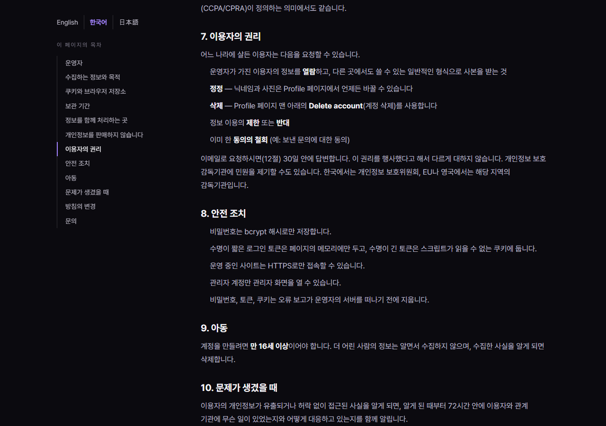

# JS 102 — `initLanguageLinks()` (처리방침의 언어 전환: 읽던 절을 이어서)

| 항목 | 내용 |
|---|---|
| 파일 | `studionx/frontend/static/js/pages/privacy.js` |
| 작업 | P1-24 개인정보 처리방침 한국어, 일본어판: 언어 전환 링크를 누르면 지금 읽는 절에서 이어서 열리게 하기 |
| 작성 | Claude (AI), 2026-10-13, 사용자 검토 |
| 이전 · 다음 | [101 `initTocActiveState()`](<../P1-23 - 화면 마무리/101_privacy_initTocActiveState.md>) · (P1-24 끝, 개요는 64번) |

## 1. 하는 일
처리방침은 영어(`privacy.html`), 한국어(`privacy.ko.html`), 일본어(`privacy.ja.html`) 세 파일이고, 왼쪽 옆줄(목차 위)에 언어 전환 링크가 있습니다. 이 함수는 링크를 누르기 직전에 **지금 읽는 절의 `#번호`를 주소 뒤에 붙여서**, 다른 언어로 가도 같은 절에서 이어서 읽게 합니다.

| 상황 | 눌렀을 때 열리는 주소 |
|---|---|
| 영어판에서 7절(Your rights)을 읽는 중 `한국어`를 누름 | `privacy.ko.html#rights` (한국어판의 같은 절) |
| 목차로 `keep` 절에 간 뒤 `English`를 누름 | `privacy.html#keep` |
| 맨 위(어느 절도 아닌 곳)에서 누름 | `privacy.ja.html` (해시 없음) |
| 주소가 `…#contact`인데 목차 표시가 아직 없음 | 주소의 `#contact`를 이어서 붙임 |



## 2. 언제 쓰나
| 호출하는 곳 | 시점 |
|---|---|
| `privacy.js` 맨 아래 `initLanguageLinks();` | 처리방침(세 언어 모두)이 열릴 때 한 번 |

## 3. 코드
```js
export function initLanguageLinks() {
  const links = document.querySelectorAll('.policy__lang a');
  for (const link of links) {
    link.setAttribute('data-base', (link.getAttribute('href') || '').split('#')[0]);
    const update = function () {
      const base = link.getAttribute('data-base');
      const current = document.querySelector('.policy__toc a[aria-current="true"]');
      let hash = '';
      if (current) {
        const href = current.getAttribute('href') || '';
        hash = href.indexOf('#') >= 0 ? href.slice(href.indexOf('#')) : '';
      } else if (location.hash) {
        hash = location.hash;
      }
      link.setAttribute('href', base + hash);
    };
    link.addEventListener('pointerdown', update);
    link.addEventListener('focus', update);
    link.addEventListener('click', update);
  }
}
```
**최신 문법으로 쓰면** (공부용)
```js
export const initLanguageLinks = () => {
  document.querySelectorAll('.policy__lang a').forEach((link) => {
    const base = link.getAttribute('href').split('#')[0];
    const update = () => {
      const current = document.querySelector('.policy__toc a[aria-current="true"]');
      const hash = current?.hash || location.hash || '';
      link.href = base + hash;
    };
    ['pointerdown', 'focus', 'click'].forEach((type) => link.addEventListener(type, update));
  });
};
```
| 최신 문법 | 실제 코드 | 뜻 |
|---|---|---|
| `current?.hash \|\| location.hash \|\| ''` | `if` / `else if`로 차례로 확인 | 앞의 값이 없으면 다음 값을 씁니다 (옵셔널 체이닝과 `\|\|`) |
| `current.hash` | `href.slice(href.indexOf('#'))` | 링크 주소의 `#…` 부분 |
| `['pointerdown', …].forEach(…)` | 줄마다 `addEventListener` | 같은 처리기를 여러 이벤트에 연결 |
| `.forEach((link) => …)` | `for (const link of links)` | 목록을 하나씩 처리 |

### 문법 풀이
| 식 | 뜻 |
|---|---|
| `data-base` | 링크의 **원래 주소**(`privacy.ko.html`)를 처음에 한 번 저장해 둡니다. 이후 `href`를 몇 번 고쳐도 `#…`가 겹쳐 붙지 않습니다 |
| `.policy__toc a[aria-current="true"]` | 목차에서 지금 읽는 절의 항목입니다 (101번 `initTocActiveState`가 표시) |
| `pointerdown` | 마우스나 손가락을 **누르는 순간**입니다. 클릭보다 먼저라서, 휠 클릭이나 오른쪽 클릭 메뉴의 "새 탭으로 열기"에도 고쳐진 주소가 쓰입니다 |
| `focus` | 키보드의 Tab으로 링크에 포커스가 올 때입니다 |
| `click` | 클릭이나 Enter로 실행될 때의 마지막 확인입니다 |
| `location.hash` | 현재 주소의 `#…` 부분 |

## 4. 흐름
1. 시작할 때 각 언어 링크의 원래 주소를 저장합니다.
2. 링크를 누르거나 포커스를 받을 때마다 목차에서 지금 읽는 절을 찾습니다.
3. 있으면 그 절의 `#번호`, 없으면 현재 주소의 `#…`, 둘 다 없으면 아무것도 붙이지 않고 원래 주소 + 해시로 `href`를 정합니다.
4. 브라우저가 그 주소로 이동하면 새 판은 같은 절에서 열립니다. 절의 `id`(`#rights` 등)가 세 판에서 같기 때문입니다.

## 5. 왜 이렇게
| 선택 | 이유 |
|---|---|
| 세 판의 절 `id`를 똑같이 | 이 함수가 가능한 이유입니다. `who`, `collect`, `cookies`, `keep`, `share`, `sell`, `rights`, `security`, `children`, `breach`, `changes`, `contact` 12개가 영어, 한국어, 일본어에서 같습니다 (시험으로 확인) |
| 언어 링크를 **스크롤해도 따라오는 옆줄**(목차 위)에 둠 | 처음에는 제목 줄 오른쪽 끝에 두었는데, 7절을 읽다가 언어를 바꾸려면 맨 위로 올라가야 해서 "읽던 절"이 이미 사라집니다. 옆줄에 두면 어디를 읽든 바로 누를 수 있습니다 (시험에서 이 문제를 발견해 위치를 옮겼습니다) |
| 클릭이 아니라 **누름과 포커스에서** 주소를 고침 | 새 탭으로 열기(휠 클릭 등)는 `click`이 오지 않아서, `click`만 쓰면 그 경우에는 해시가 빠집니다 |
| 원래 주소를 `data-base`로 저장 | 매번 `href`를 읽어서 덧붙이면 `#rights#rights`처럼 겹칩니다 |
| 목차 표시가 없으면 주소의 `#…`를 이어 줌 | 목차 표시(`IntersectionObserver`)가 안 되는 환경이나, 주소로 바로 들어온 직후에도 이어서 볼 수 있게 합니다 |
| 자동 언어 전환(브라우저 언어를 보고 이동)은 하지 않음 | 처리방침은 법적 문서라서, 사용자가 읽는 언어를 스스로 고르는 것이 안전합니다. 검색 엔진에는 `hreflang`으로 세 판의 관계를 알려 줍니다 |

## 6. 시험 (실제 서버, 헤드리스 Chrome, 마우스와 키보드로 조작)
`docs/ai-notes/65_p1-24_site_test.md`에 처리방침 전체 시험 25개의 표가 있고, 이 함수에 해당하는 시험은 아래와 같습니다.

| # | 한 일 | 결과 |
|---|---|---|
| S00 | 영어판에서 `rights` 절을 읽는 중 | 목차에 `Your rights`가 표시됨 ✔ |
| S01 | 옆줄의 `한국어`를 마우스로 누름 | `/privacy.ko.html#rights`로 열리고 한국어판의 같은 절이 표시됨 ✔ |
| S02 | `日本語`를 누름 | `/privacy.ja.html#rights` ✔ |
| S03 | 목차로 `keep` 절에 간 뒤 `English`를 누름 | `/privacy.html#keep`, `#`가 겹치지 않음 ✔ |
| S04 | 맨 위에서 누름 | 해시 없이 `/privacy.ja.html` ✔ |
| S05 | 주소가 `#contact`일 때 `pointerdown`을 일으킨 뒤 링크 주소 | `privacy.ko.html#contact` (또는 현재 절) ✔ |
| S06 | 같은 링크에 5번 반복 | `#`가 한 번만 있음 ✔ |
| S07 | 키보드: 링크에 포커스를 주고 Enter (`security` 절을 읽는 중) | `/privacy.ja.html#security…`로 열림 ✔ |

모두 통과했습니다. 처음에는 S01, S02, S07이 실패했습니다. 언어 링크가 맨 위에 있으면 눌러 가려고 맨 위로 스크롤하는 순간 "읽던 절"이 사라진다는 것을 시험에서 발견해서, 위의 "왜 이렇게"처럼 링크를 따라오는 옆줄로 옮겼습니다.
