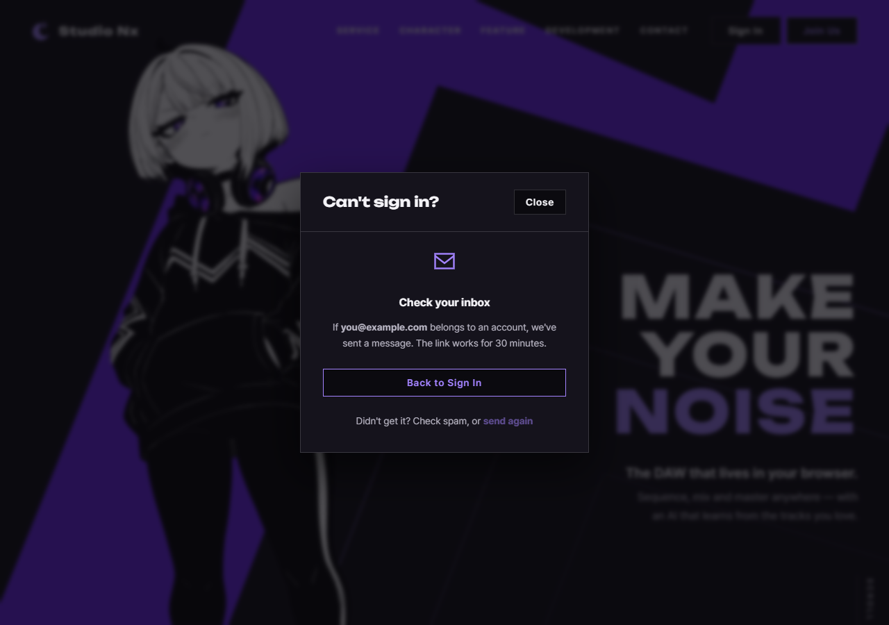

# JS 170 — `showSentView()` ("메일을 보냈다" 화면 보이기)

| 항목 | 내용 |
|---|---|
| 파일 | `studionx/frontend/static/js/core/recover.js` |
| 작업 | P1-28 계정 찾기 화면: JS 여섯 번째 함수 |
| 작성 | Claude (AI), 2026-10-15, 사용자 검토 |
| 이전 | [169 `initRecoverFromHash()`](169_recover_initRecoverFromHash.md) |
| 다음 | `initRecoverForms()`: 두 폼의 전송을 맡아 API를 부르고 이 함수를 부름 |

## 1. 하는 일
복구 화면에서 요청이 성공한 뒤 보여 주는 **"Check your inbox" 화면**으로 바꿉니다.

| 하는 일 | 설명 |
|---|---|
| 화면 정리 | 탭 목록, 두 패널, `Back to Sign In` 줄을 숨기고 보낸 뒤 화면(`#recover-sent`)을 보입니다 |
| 이메일 표시 | 입력한 이메일을 `#recover-sent-email`에 **글자로** 넣습니다 |
| 보충 문장 | Password 탭은 "The link works for 30 minutes.", Email 탭은 "If you don't see it, check your spam folder." |
| 커서 | `Back to Sign In` 버튼으로 옮깁니다(입력칸이 숨었으므로) |
| 반환 | 바꿨으면 `true`, 모르는 `kind`, 모달이나 복구 화면, 보낸 뒤 화면이 없으면 아무것도 바꾸지 않고 `false` |



## 2. 코드
```js
const SENT_DETAIL = {
  password: 'The link works for 30 minutes.',
  email: "If you don't see it, check your spam folder.",
};

export function showSentView(modal, kind, email) {
  if (!modal || RECOVER_TABS.indexOf(kind) < 0) return false;
  const recover = modal.querySelector('[data-view="recover"]');
  const sent = modal.querySelector('#recover-sent');
  if (!recover || !sent) return false;

  const tabs = recover.querySelector('[role="tablist"]');
  const backRow = recover.querySelector('#recover-back-row');
  if (tabs) tabs.hidden = true;
  for (const panel of recover.querySelectorAll('[role="tabpanel"]')) panel.hidden = true;
  if (backRow) backRow.hidden = true;
  sent.hidden = false;

  const shown = sent.querySelector('#recover-sent-email');
  if (shown) shown.textContent = typeof email === 'string' ? email : '';
  const detail = sent.querySelector('#recover-sent-detail');
  if (detail) detail.textContent = SENT_DETAIL[kind];

  showView(modal, 'recover');
  const back = sent.querySelector('#recover-sent-back');
  if (back) back.focus();
  return true;
}
```
**최신 문법으로 쓰면** (공부용)
```js
export const showSentView = (modal, kind, email) => {
  if (!modal || !RECOVER_TABS.includes(kind)) return false;
  const recover = modal.querySelector('[data-view="recover"]');
  const sent = modal.querySelector('#recover-sent');
  if (!recover || !sent) return false;

  recover.querySelector('[role="tablist"]')?.setAttribute('hidden', '');
  recover.querySelectorAll('[role="tabpanel"]').forEach((p) => { p.hidden = true; });
  recover.querySelector('#recover-back-row')?.setAttribute('hidden', '');
  sent.hidden = false;

  sent.querySelector('#recover-sent-email')?.replaceChildren(typeof email === 'string' ? email : '');
  sent.querySelector('#recover-sent-detail')?.replaceChildren(SENT_DETAIL[kind]);

  showView(modal, 'recover');
  sent.querySelector('#recover-sent-back')?.focus();
  return true;
};
```
| 최신 문법 | 실제 코드 | 뜻 |
|---|---|---|
| `…?.setAttribute('hidden', '')` | `if (tabs) tabs.hidden = true;` | 요소가 있을 때만 숨깁니다 |
| `replaceChildren(글자)` | `textContent = 글자` | 안의 내용을 글자로 바꿉니다. 둘 다 마크업으로 해석하지 않습니다 |
| `?.focus()` | `if (back) back.focus();` | 버튼이 있을 때만 커서를 줍니다 |

### 문법 풀이
| 식 | 뜻 |
|---|---|
| `shown.textContent = …` | 값을 **글자 그대로** 넣습니다. `innerHTML`은 `` 같은 값을 마크업으로 해석해서 스크립트가 실행될 수 있습니다 |
| `typeof email === 'string' ? email : ''` | 문자열이 아니면(숫자, `undefined`, 객체) 빈 글자로 둡니다. 화면에 `undefined`가 찍히는 것을 막습니다 |
| `SENT_DETAIL[kind]` | 요청 종류에 맞는 문장을 고릅니다 |

## 3. 왜 이렇게
| 선택 | 이유 |
|---|---|
| **`textContent`로 이메일을 넣음** | 이메일은 사용자가 입력한 값이라 믿을 수 없습니다. `a">@e.com` 같은 값이 마크업이 되어 스크립트가 실행되는 일(XSS)을 막습니다. 시험에서 `onerror`가 실행되지 않음을 확인했습니다 |
| 문구는 "있다면 보냈다" | 서버 응답이 가입 여부와 관계없이 항상 같으므로 화면도 같은 말만 합니다. 이메일을 보여 주는 것은 사용자가 오타를 알아채게 하려는 것이고, 가입 여부를 알려 주지 않습니다 |
| 보충 문장을 종류별로 | Password 탭의 메일에는 링크 유효 시간(30분)이 의미 있고, Email 탭의 메일에는 의미가 없어서 스팸함 안내로 대신합니다 |
| **커서를 `Back to Sign In`으로** | 입력칸이 모두 숨으므로 커서가 사라지면(§166의 같은 문제) 키보드 사용자가 위치를 잃습니다 |
| 로그인 화면에서 불러도 복구 화면으로 바꿈 | 이 함수가 "복구 화면 안에서만 불러야 한다"는 전제를 부르는 쪽에 요구하지 않게 합니다 |
| 모르는 `kind`는 `false` | 오타로 보충 문장이 `undefined`가 되는 일을 막습니다 |
| 이메일을 비우지 않고 계속 보여 줌(돌아가면 비움) | 돌아가는 처리(`initRecover`)가 이미 비웁니다. 이 함수는 보여 주는 일만 합니다 |

## 4. 시험 (실제 서버, 36개 통과)
`home.html`, `join.html`에서 같은 시험을 했습니다.

| 확인 | 결과 |
|---|---|
| `password`: 보낸 뒤 화면만 보임(탭, 두 패널, Back 줄이 **실제로** 숨음), 로그인 화면에서 불러도 바뀜 | ✔ ✔ |
| 이메일, 보충 문장(30분), 제목, 커서가 `Back to Sign In` | ✔ ✔ |
| `email`: 보충 문장이 스팸함 안내로, 이메일 글자 갱신 | ✔ ✔ |
| 같은 값으로 다시 불러도 같은 결과 | ✔ ✔ |
| **이메일의 `<`, `&`는 마크업이 되지 않고 `onerror`가 실행되지 않음** | ✔ ✔ |
| 이메일이 문자열이 아니면(`undefined`, `123`) 빈 글자 | ✔ ✔ ✔ ✔ |
| `Back to Sign In`을 누르면 로그인 화면, 보낸 뒤 화면과 이메일이 비워짐 | ✔ ✔ |
| 다시 열면 탭과 Back 줄이 돌아오고 보낸 뒤 화면은 숨음 | ✔ ✔ |
| 모르는 `kind` 7종은 `false`이고 안 바뀜 | ✔ (14개) |
| 모달이 `null`이면 `false` | ✔ ✔ |
| 보낸 뒤 화면이나 복구 화면이 없으면 `false` | ✔ |
| 세부 요소(이메일 칸, 버튼)가 없어도 오류 없이 `true` | ✔ |

**시험을 확인하는 시험.** 일부러 틀리게 바꿔 시험이 잡는지 보았습니다.

| 바꾼 것 | 결과 |
|---|---|
| 탭 목록을 안 숨김 | 2개 실패 |
| 패널을 안 숨김 | 2개 실패 |
| Back 줄을 안 숨김 | 2개 실패 |
| 보낸 뒤 화면을 안 보이게 | 7개 실패 |
| **이메일을 `innerHTML`로 넣음**(XSS) | 2개 실패 |
| 문자열이 아니어도 그대로 넣음 | 2개 실패 |
| 보충 문장을 고정 | 2개 실패 |
| 커서 이동 제거 | 2개 실패 |
| 화면 전환(`showView`) 제거 | 4개 실패 |
| `kind` 검사 제거 | 14개 실패 |
| 보낸 뒤 화면이 없어도 진행 | 시험이 오류로 중단됨(없는 요소를 읽어서 예외) |

모든 변이가 시험에 걸렸습니다.

## 5. 아직 이 함수를 부르는 곳이 없습니다
다음 함수(`initRecoverForms`)가 폼 전송이 성공하면 이 함수를 부릅니다.
