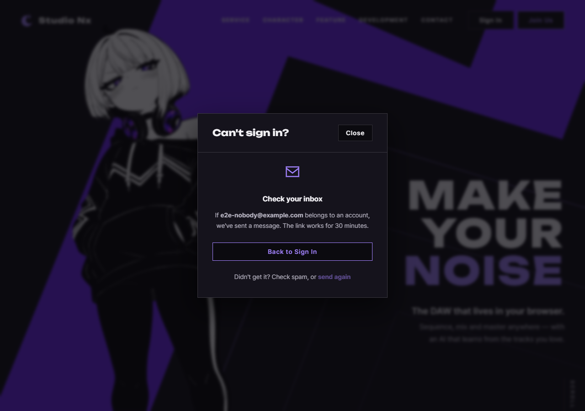
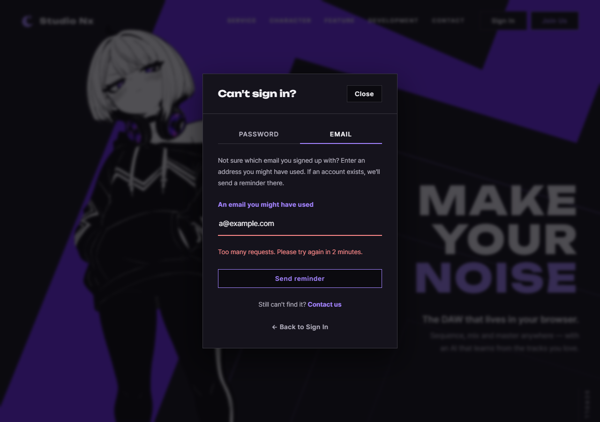

# JS 171 — `initRecoverForms()` (복구 화면의 두 폼 전송)

| 항목 | 내용 |
|---|---|
| 파일 | `studionx/frontend/static/js/core/recover.js` (내부 도우미 `recoverErrorText()`, 상수 `RECOVER_FORMS` 포함) |
| 작업 | P1-28 계정 찾기 화면: JS 일곱 번째 함수 |
| 작성 | Claude (AI), 2026-10-15, 사용자 검토 |
| 이전 | [170 `showSentView()`](170_recover_showSentView.md) |
| 다음 | `send again` 1분 잠금 |

## 1. 하는 일
복구 화면의 두 폼(Password 탭, Email 탭)이 전송되면 서버 API를 부르고 결과를 화면에 보여 줍니다.

| 탭 | 보내는 곳 |
|---|---|
| Password | `POST /api/v1/auth/password-reset/request` |
| Email | `POST /api/v1/auth/email-reminder/request` |

| 결과 | 화면 |
|---|---|
| 성공(202) | `showSentView()`로 "Check your inbox" 화면. 성공한 요청의 종류와 이메일을 `modal.recoverLast`에 남김(`send again`이 쓸 값) |
| 429(요청이 잦음) | 폼 아래에 "Too many requests. Please try again in N minute(s)." (`retry_after`를 분으로 올림, 없으면 10분) |
| 422(형식 오류) | "Please enter a valid email address." |
| 연결 실패 | "Can't reach the server. Check your connection and try again." |
| 그 밖(500 등) | "Something went wrong. Please try again." |

실패하면 입력칸에 `aria-invalid="true"`를 달고 커서를 돌려줍니다. 새로 전송하거나 입력칸에 다시 적기 시작하면 오류 표시가 사라집니다.





## 2. 코드 (요약)
```js
const RECOVER_FORMS = [
  { kind: 'password', formId: 'recover-password-form', errorId: 'recover-password-error', path: '/auth/password-reset/request' },
  { kind: 'email',    formId: 'recover-email-form',    errorId: 'recover-email-error',    path: '/auth/email-reminder/request' },
];

function recoverErrorText(err) { /* 429, 422, 연결 실패(0), 그 밖을 고정 문구로 */ }

export function initRecoverForms(modal) {
  if (!modal) return false;
  let wired = false;
  for (const spec of RECOVER_FORMS) {
    const form = modal.querySelector('#' + spec.formId);
    if (!form) continue;
    const input = form.querySelector('input[name="email"]');
    const button = form.querySelector('button[type="submit"]');
    const errorBox = modal.querySelector('#' + spec.errorId);
    if (!input) continue;
    wired = true;

    const clearError = function () { /* 문구 비우고 숨기기, aria-invalid 풀기 */ };
    input.oninput = clearError;
    form.onsubmit = async function (event) {
      event.preventDefault();
      if (form.getAttribute('data-busy') === 'true') return;   // 연속 전송 무시
      form.setAttribute('data-busy', 'true');
      if (button) button.disabled = true;
      clearError();
      const email = input.value.trim();
      try {
        await api.post(spec.path, { email: email });
        modal.recoverLast = { kind: spec.kind, email: email };
        showSentView(modal, spec.kind, email);
      } catch (err) {
        /* 문구 보이기, aria-invalid, 입력칸에 커서 */
      } finally {
        form.removeAttribute('data-busy');
        if (button) button.disabled = false;
      }
    };
  }
  return wired;
}
```
**최신 문법으로 쓰면** (공부용)
```js
export const initRecoverForms = (modal) => {
  if (!modal) return false;
  let wired = false;
  for (const { kind, formId, errorId, path } of RECOVER_FORMS) {
    const form = modal.querySelector(`#${formId}`);
    const input = form?.querySelector('input[name="email"]');
    if (!input) continue;
    wired = true;
    const button = form.querySelector('button[type="submit"]');
    const errorBox = modal.querySelector(`#${errorId}`);
    const clearError = () => { errorBox.textContent = ''; errorBox.hidden = true; input.removeAttribute('aria-invalid'); };

    input.addEventListener('input', clearError);
    form.addEventListener('submit', async (e) => {
      e.preventDefault();
      if (form.dataset.busy) return;
      form.dataset.busy = 'true';
      button.disabled = true;
      clearError();
      const email = input.value.trim();
      try {
        await api.post(path, { email });
        modal.recoverLast = { kind, email };
        showSentView(modal, kind, email);
      } catch (err) {
        errorBox.textContent = recoverErrorText(err);
        errorBox.hidden = false;
        input.setAttribute('aria-invalid', 'true');
        input.focus();
      } finally {
        delete form.dataset.busy;
        button.disabled = false;
      }
    });
  }
  return wired;
};
```
| 최신 문법 | 실제 코드 | 뜻 |
|---|---|---|
| `for (const { kind, … } of …)` | `for (const spec of …)` 후 `spec.kind` | 객체의 값을 바로 풀어 씁니다(구조 분해) |
| `{ email }` | `{ email: email }` | 이름이 같으면 줄여 씁니다 |
| `form.querySelector(…)?.…` | `if (!form) continue;` | 폼이 없으면 건너뜁니다 |
| `form.dataset.busy` | `getAttribute('data-busy')` | `data-` 속성을 읽습니다 |
| `addEventListener('submit', …)` | `form.onsubmit = …` | 처리기를 연결합니다. 이 코드는 두 번 불러도 겹치지 않도록 대입을 씁니다 |

### 문법 풀이
| 식 | 뜻 |
|---|---|
| `async function` / `await api.post(…)` | 서버 응답을 기다립니다. 실패하면 `catch`로 갑니다 |
| `finally` | 성공이든 실패든 마지막에 한 번 실행되어 버튼을 풉니다 |
| `err.status` | `api.js`의 `ApiError`에 있는 HTTP 상태(네트워크 오류는 0) |
| `Math.ceil(wait / 60)` | 초를 분으로 **올림**합니다(61초는 2분: 1분 뒤에 눌러도 아직 막혀 있을 수 있으므로) |

## 3. 왜 이렇게
| 선택 | 이유 |
|---|---|
| **서버가 보낸 문구를 그대로 보여 주지 않음** | 서버 문구에 내부 사정이 섞일 수 있고, 가입 여부를 짐작하게 하는 문구가 새면 안 됩니다. 화면은 상태 코드로 고정 문구를 고릅니다. 시험에서 서버 문구에 `SECRET`을 넣어 노출되지 않음을 확인했습니다 |
| 성공하면 **항상 같은 화면** | 서버 응답이 가입 여부와 관계없이 같으므로 화면도 같습니다 |
| 429를 **올림**으로 | 61초를 1분으로 버리면 사용자가 1분 뒤에 눌러도 또 막혀서 "안내가 틀렸다"고 느낍니다 |
| **보내는 동안 버튼 잠금, 연속 전송 무시** | 연속 클릭으로 같은 메일이 두 통 가거나 횟수 제한(10분에 3번)을 헛되이 쓰는 일을 막습니다. 버튼만 잠그면 Enter 키로 보내는 경우가 샐 수 있어서 `data-busy`로 폼 자체도 막습니다 |
| 실패하면 **입력칸으로 커서** | 오류를 고치고 다시 보내려면 입력칸에 있어야 합니다. `aria-invalid`는 화면 낭독기에 알립니다 |
| 다시 적으면 오류를 지움 | 이미 고치기 시작한 사람에게 옛 오류가 남아 있으면 혼란스럽습니다 |
| 이메일 형식 검사는 브라우저(`type="email"`)에 맡김 | 틀리면 `initFormAlerts`가 알림창을 띄우고 이 처리기는 불리지 않습니다. 서버의 422는 그래도 올 수 있어서 문구를 둡니다 |
| 성공한 요청을 `modal.recoverLast`에 저장 | `send again`이 같은 종류와 이메일로 다시 보낼 수 있게 합니다(다음 함수) |
| `api.post`를 씀 | 다른 화면과 같은 호출 모듈입니다. 오류를 `ApiError`로 통일하고 네트워크 실패는 상태 0으로 줍니다 |

## 4. 시험 (`fetch`를 가짜로 바꿔서 53개, 실제 서버로 2개 통과)
실제 서버에는 요청 횟수 제한(이메일 3번, IP 10번)과 메일 기록이 있어서, 반복 시험은 브라우저의 `fetch`를 가짜로 바꾸고 보낸 요청과 화면을 확인했습니다. `home.html`, `join.html`에서 같은 시험을 했습니다.

| 확인 | 결과 |
|---|---|
| 연결하면 `true`(두 번 불러도) | ✔ ✔ |
| Password 탭: 올바른 주소, `POST`, 공백 없는 이메일, JSON | ✔ ✔ |
| 한 번만 보냄, 보낸 뒤 화면(30분 문장, 이메일), 커서가 Back 버튼 | ✔ (6개) |
| 성공한 요청의 종류와 이메일이 `modal.recoverLast`에 남음 | ✔ ✔ |
| Email 탭: 이메일 안내 주소, 스팸함 문장 | ✔ ✔ |
| 실패 7종(429가 61초, 600초, 1초, 값 없음, 422, 500, 연결 실패)이 정해진 문구이고, 보낸 뒤 화면은 안 뜨고, **서버 문구가 노출되지 않음** | ✔ (14개) |
| 실패하면 커서가 입력칸으로, `aria-invalid`, 버튼이 다시 켜짐 | ✔ (14개) |
| Email 탭의 실패는 Email 탭의 문구 자리에 | ✔ ✔ |
| 다시 입력하면 오류 문구와 `aria-invalid`가 사라짐 | ✔ ✔ |
| **보내는 동안 버튼이 잠기고 연속 세 번 전송해도 요청은 한 번**, 끝나면 풀림 | ✔ (4개) |
| 오류 뒤 다시 보내 성공하면 이전 오류가 지워짐 | ✔ ✔ |
| 형식이 틀린 이메일은 서버로 가지 않음 | ✔ ✔ |
| 모달이 `null`이거나 폼이나 이메일 칸이 없으면 `false` | ✔ |
| **실제 서버**: 없는 주소로 요청해도 같은 "보냈다" 화면, 자바스크립트 오류 없음 | ✔ ✔ |

**시험을 확인하는 시험.** 일부러 틀리게 바꿔 시험이 잡는지 보았습니다.

| 바꾼 것 | 결과 |
|---|---|
| Email 탭도 Password 탭과 같은 주소로 | 2개 실패 |
| 성공해도 보낸 뒤 화면을 안 띄움 | 8개 실패 |
| `recoverLast`를 남기지 않음 | 시험이 예외로 중단 |
| **서버 문구를 그대로 노출** | 16개 실패 |
| 429를 올림 대신 버림 | 4개 실패 |
| 429의 기본값(10분) 제거 | 2개 실패 |
| 버튼 잠금 제거 | 2개 실패 |
| 연속 전송 무시(`data-busy`) 제거 | 4개 실패 |
| 끝난 뒤 버튼을 안 풀어 줌 | 34개 실패 |
| 오류 때 커서를 안 줌 | 16개 실패 |
| 새로 전송할 때 이전 오류를 안 지움 | 2개 실패 |
| 입력하면 오류를 안 지움 | 2개 실패 |
| `preventDefault()` 제거(브라우저의 기본 전송이 일어나 페이지가 이동) | 시험이 중단 |
| 연결 반환값을 항상 `true`로 | 1개 실패 |
| 422 문구 제거 | 2개 실패 |
| 연결 실패 문구 제거 | 2개 실패 |
| **이메일 공백을 안 뗌(`trim()` 제거)** | **실패 없음** |

**마지막 한 가지는 시험의 빈틈이 아니라 브라우저의 성질입니다.** 입력칸이 `type="email"`이면 브라우저가 앞뒤 공백을 값에서 스스로 지웁니다(`  you@example.com  `을 넣으면 `value`가 `you@example.com`). 직접 확인했습니다. 그래서 `trim()`을 지워도 결과가 같습니다. `trim()`은 입력칸의 종류가 바뀌거나 값을 프로그램이 넣는 경우를 위한 방어입니다.

## 5. 페이지 연결
`home.js`와 `join.js`에 한 줄씩 더했습니다.
```js
initRecoverForms(document.getElementById('login-modal'));
```
이제 실제 화면에서 `Send reset link`와 `Send reminder`를 누르면 서버로 요청이 갑니다. 기존 시험(열기 28개, 주소 31개, 연결 24개, 보낸 뒤 화면 36개, 함수별 시험)도 그대로 통과합니다.

## 6. 아직 안 된 것
`send again`은 아직 잠긴 채입니다. 다음 함수가 1분 뒤에 켜고, 누르면 `modal.recoverLast`로 다시 보냅니다.
