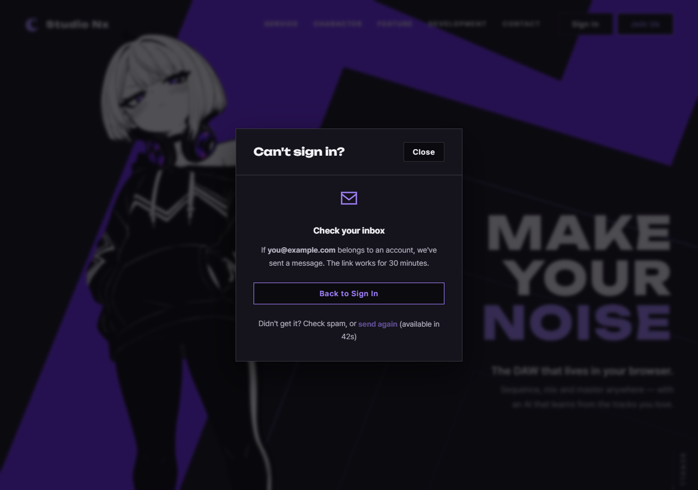

# JS 172 — `startResendCooldown()`와 `stopResendCooldown()` (`send again`의 1분 기다림)

| 항목 | 내용 |
|---|---|
| 파일 | `studionx/frontend/static/js/core/recover.js` (상수 `RESEND_COOLDOWN_SECONDS = 60`) |
| 작업 | P1-28 계정 찾기 화면: JS 여덟 번째, 아홉 번째 함수 (짝으로 만듦) |
| 작성 | Claude (AI), 2026-10-15, 사용자 검토 |
| 이전 | [171 `initRecoverForms()`](171_recover_initRecoverForms.md) |
| 다음 | 다시 보내기: `send again`을 누르면 `modal.recoverLast`로 다시 보내고, 폼 전송 성공 때 이 시간 세기를 시작하고, 모달을 닫을 때 멈춤 |

## 1. 하는 일
보낸 뒤 화면의 `send again` 버튼을 **1분 동안 잠그고 남은 시간을 보여 주다가** 0이 되면 풀어 줍니다.

| 함수 | 하는 일 |
|---|---|
| `startResendCooldown(modal, seconds)` | 버튼을 잠그고 옆에 `(available in 58s)`를 1초마다 갱신합니다. 0이 되면 글자를 지우고 버튼을 풀고 타이머를 정리합니다. `seconds`를 생략하면 60초입니다 |
| `stopResendCooldown(modal)` | 타이머를 끊고 **처음 상태**(잠김, 안내 글자 없음)로 되돌립니다. 화면을 떠나거나 모달을 닫을 때, 그리고 새로 시작하기 전에 부릅니다 |



| 입력 | 결과 |
|---|---|
| `start(modal)` | 60초 |
| `start(modal, 2.2)` | `(available in 3s)`(올림) |
| 세는 중에 `start`를 다시 부름 | 처음부터 다시 셈 |
| `seconds`가 `0`, `-1`, `NaN`, `Infinity`, 문자열, `null`, `true`, 배열, 객체 | `false`이고 아무것도 안 바뀜 |
| 버튼이 없음 | `false` |
| 안내 글자 칸이 없음 | 오류 없이 동작 |

## 2. 코드
```js
export const RESEND_COOLDOWN_SECONDS = 60;

export function stopResendCooldown(modal) {
  if (!modal) return false;
  if (modal.recoverTimer) {
    window.clearInterval(modal.recoverTimer);
    modal.recoverTimer = null;
  }
  const button = modal.querySelector('#recover-resend');
  const note = modal.querySelector('#recover-resend-wait');
  if (note) note.textContent = '';
  if (!button) return false;
  button.disabled = true;
  return true;
}

export function startResendCooldown(modal, seconds) {
  const total = seconds === undefined ? RESEND_COOLDOWN_SECONDS : seconds;
  if (!modal || typeof total !== 'number' || !isFinite(total) || total <= 0) return false;
  const button = modal.querySelector('#recover-resend');
  const note = modal.querySelector('#recover-resend-wait');
  if (!button) return false;

  stopResendCooldown(modal);
  const endAt = Date.now() + total * 1000;

  const render = function () {
    const left = Math.ceil((endAt - Date.now()) / 1000);
    if (left <= 0) {
      stopResendCooldown(modal);
      button.disabled = false;   // stop 은 잠그므로 끝난 뒤에 풀음
      return;
    }
    if (note) note.textContent = '(available in ' + left + 's)';
  };

  button.disabled = true;
  render();
  modal.recoverTimer = window.setInterval(render, 1000);
  return true;
}
```
**최신 문법으로 쓰면** (공부용)
```js
export const stopResendCooldown = (modal) => {
  if (!modal) return false;
  clearInterval(modal.recoverTimer);
  modal.recoverTimer = null;
  const button = modal.querySelector('#recover-resend');
  const note = modal.querySelector('#recover-resend-wait');
  if (note) note.textContent = '';
  if (!button) return false;
  button.disabled = true;
  return true;
};

export const startResendCooldown = (modal, seconds = RESEND_COOLDOWN_SECONDS) => {
  if (!modal || !Number.isFinite(seconds) || seconds <= 0) return false;
  const button = modal.querySelector('#recover-resend');
  const note = modal.querySelector('#recover-resend-wait');
  if (!button) return false;

  stopResendCooldown(modal);
  const endAt = Date.now() + seconds * 1000;
  const render = () => {
    const left = Math.ceil((endAt - Date.now()) / 1000);
    if (left <= 0) { stopResendCooldown(modal); button.disabled = false; return; }
    if (note) note.textContent = `(available in ${left}s)`;
  };
  render();
  modal.recoverTimer = setInterval(render, 1000);
  return true;
};
```
| 최신 문법 | 실제 코드 | 뜻 |
|---|---|---|
| `seconds = 기본값` | `seconds === undefined ? … : seconds` | 생략하면 기본값을 씁니다 |
| `Number.isFinite(seconds)` | `typeof … === 'number' && isFinite(…)` | 숫자이면서 유한한지 한 번에 봅니다. `Number.isFinite`는 문자열을 자동 변환하지 않아서 `'5'`를 거부합니다 |
| 템플릿 문자열 `` `…${left}…` `` | `'…' + left + '…'` | 글자와 값을 잇습니다 |
| `clearInterval(undefined)` | `if (modal.recoverTimer)` 먼저 확인 | 타이머가 없어도 오류가 나지 않아 확인이 필요 없습니다 |

### 문법 풀이
| 식 | 뜻 |
|---|---|
| `window.setInterval(render, 1000)` | `render`를 1초마다 부릅니다. 반환된 번호로 `clearInterval`이 끊습니다 |
| `Date.now()` | 지금 시각(밀리초) |
| `Math.ceil(…)` | 올림: 2.2초 남았으면 3으로 보여 줍니다 |
| `modal.recoverTimer` | 타이머 번호를 모달 요소에 붙여 두어, 나중에(다른 함수가) 끊을 수 있게 합니다 |

## 3. 왜 이렇게
| 선택 | 이유 |
|---|---|
| **남은 시간을 끝나는 시각에서 지금 시각을 빼서 계산함** | `setInterval`의 횟수를 세면(`60, 59, 58…`) 탭이 백그라운드에 있을 때 브라우저가 타이머를 느리게 돌려서 시간이 어긋납니다. 끝나는 시각을 기준으로 하면 몇 초를 놓쳐도 다음 틱에 바로잡힙니다. 시험에서 시계를 2분 앞당기자 다음 틱에 풀렸습니다 |
| 올림(`ceil`) | 0.4초 남았는데 `0s`로 보이면서 아직 잠겨 있는 어색한 순간이 생깁니다 |
| `stop`이 버튼을 **잠그는** 쪽으로 | 모달을 닫을 때(`stop`) 다음에 열면 `send again`은 새로 보낼 때까지 잠겨 있어야 합니다. 보낸 뒤 화면이 없는 동안 풀려 있으면 안 됩니다 |
| 끝난 뒤의 해제만 `start`가 함 | `stop`이 잠그므로 시간이 끝나는 곳에서만 `disabled = false`를 둡니다 |
| 다시 시작하면 이전 타이머를 끊음 | 타이머가 둘 돌면 글자가 번갈아 깜빡이고 한쪽이 먼저 버튼을 풉니다 |
| 잘못된 시간은 `false`(`'5'`도) | 문자열 `'5'`를 `Date.now() + '5' * 1000`으로 우연히 계산할 수는 있지만, 부르는 쪽의 실수를 조용히 넘기지 않습니다 |
| 타이머 번호를 `modal.recoverTimer`에 둠 | 전역 변수 대신 모달에 붙여서 여러 모달이 생겨도 섞이지 않고, 모달을 닫는 쪽이 이 번호로 끊을 수 있습니다 |
| 1분(60초) | 사용자와 정한 값입니다. 서버의 한도(이메일 3번, 10분)보다 짧아서, 누르는 대로 다 통과하면 3번 만에 막힙니다. 그래서 다음 함수는 429가 오면 그 오류를 보여 주어야 합니다 |

## 4. 시험 (실제 서버 페이지, 실제 시간, 54개 통과)
`home.html`, `join.html`에서 같은 시험을 했습니다. 짧은 시간(1~5초)으로 실제로 기다리며 확인했습니다.

| 확인 | 결과 |
|---|---|
| 기본 시간 상수가 60, 시작 전에는 잠겨 있고 글자가 없음 | ✔ ✔ ✔ ✔ |
| 시작하면 `true`, 잠김, `(available in 3s)`, 타이머 있음 | ✔ ✔ |
| 1초쯤 뒤 2초로 줄어듦 | ✔ ✔ |
| 끝나면 풀리고 글자가 지워지고 타이머가 정리됨, 그 뒤 타이머 누수 없음 | ✔ (4개) |
| 세는 중에 다시 시작하면 처음부터, 타이머가 하나뿐 | ✔ (4개) |
| `stop`: 잠기고 글자가 지워지고 타이머 정리, 시간이 지나도 풀리지 않음, 또 불러도 오류 없음 | ✔ (6개) |
| 풀린 뒤에 `stop`하면 다시 잠김 | ✔ ✔ |
| **시계가 앞서가면 다음 틱에 풀림** | ✔ ✔ |
| 시간을 생략하면 60초, 2.2초는 3으로 올림 | ✔ ✔ ✔ ✔ |
| 잘못된 시간 10종은 `false`이고 안 바뀜 | ✔ (20개) |
| 모달이 `null`이면 둘 다 `false` | ✔ ✔ |
| 버튼이 없으면 `false`, 안내 글자 칸이 없어도 오류 없음 | ✔ ✔ |

**시험을 확인하는 시험.** 일부러 틀리게 바꿔 시험이 잡는지 보았습니다. 백그라운드로 12가지를 돌렸고, 끝난 뒤 파일이 원본과 같은지 확인했습니다.

| 바꾼 것 | 결과 |
|---|---|
| 끝난 뒤 버튼을 안 풀어 줌 | 8개 실패 |
| 끝나도 타이머를 안 정리 | 4개 실패 |
| 다시 시작할 때 이전 타이머를 안 끊음 | 2개 실패 |
| **횟수로 셈(시계를 무시)** | 8개 실패 |
| 올림 대신 버림 | 8개 실패 |
| `stop`이 버튼을 안 잠금 | 2개 실패 |
| `stop`이 글자를 안 지움 | 10개 실패 |
| `stop`이 타이머를 안 끊음 | 2개 실패 |
| 시간 검사 제거 | 20개 실패 |
| 기본값 제거 | 2개 실패 |
| 글자 형식 변경 | 12개 실패 |
| **시작할 때 `button.disabled = true`를 안 함** | **실패 없음** |

마지막은 시험의 빈틈이 아니라 **중복**입니다. `start`가 바로 앞에서 `stopResendCooldown()`을 부르는데, 그 함수가 이미 버튼을 잠그기 때문에 `start`의 `button.disabled = true`가 같은 일을 한 번 더 합니다. 지워도 동작이 같습니다. 읽는 사람이 "시작하면 잠긴다"를 바로 알 수 있도록 남겨 둡니다.

## 5. 아직 이 함수를 부르는 곳이 없습니다
다음 함수가 폼 전송이 성공했을 때 `startResendCooldown()`을, 모달을 닫거나 화면을 떠날 때 `stopResendCooldown()`을 부릅니다. 그 전에는 `send again`이 잠긴 채입니다.
