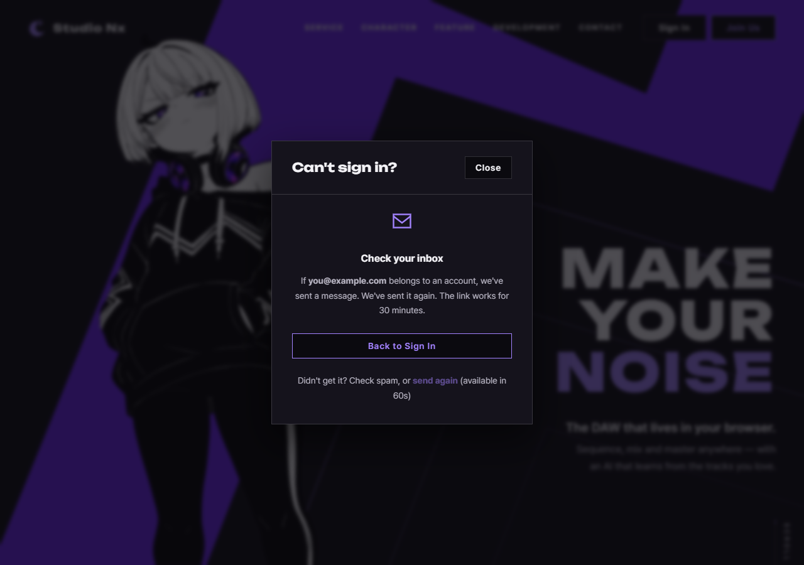

# JS 173 — `initRecoverResend()` (`send again`으로 다시 보내기)

| 항목 | 내용 |
|---|---|
| 파일 | `studionx/frontend/static/js/core/recover.js` (보낸 뒤 화면에 `#recover-resend-error` 칸을 `login-modal.html`에 더함) |
| 작업 | P1-28 계정 찾기 화면: JS 열 번째 함수. 이 함수를 만들면서 앞 함수(`initRecoverForms`, `resetRecoverState`)의 오류 두 가지도 함께 고침 |
| 작성 | Claude (AI), 2026-10-15, 사용자 검토 |
| 이전 | [172 `startResendCooldown()`, `stopResendCooldown()`](172_recover_resendCooldown.md) |
| 다음 | `resetPassword.html` (HTML, CSS, JS) |

## 1. 하는 일
보낸 뒤 화면의 `send again`을 누르면 **마지막으로 성공한 요청을 같은 종류, 같은 이메일로 다시 보냅니다.**

| 결과 | 화면 |
|---|---|
| 성공 | 보충 문장이 "We've sent it again. …"로 바뀌고 새 1분을 셈 |
| 429 | 폼 전송과 같은 문구("N분 뒤에"), 서버가 알려 준 `retry_after`(초)만큼 **다시 잠금** |
| 그 밖의 실패(500, 연결 실패) | 문구를 보이고 버튼을 풀어 다시 누를 수 있게 함 |
| 보낸 적이 없음(`modal.recoverLast`가 없음) | 아무것도 하지 않음 |



보내는 동안 버튼을 잠그고, 같은 버튼의 두 번째 클릭은 무시합니다(`data-busy`).

## 2. 코드
```js
export function initRecoverResend(modal) {
  if (!modal) return false;
  const button = modal.querySelector('#recover-resend');
  if (!button) return false;
  const errorBox = modal.querySelector('#recover-resend-error');

  button.onclick = async function () {
    const last = modal.recoverLast;
    if (!last || button.getAttribute('data-busy') === 'true') return;
    let spec = null;
    for (const candidate of RECOVER_FORMS) if (candidate.kind === last.kind) spec = candidate;
    if (spec === null) return;

    button.setAttribute('data-busy', 'true');
    button.disabled = true;
    const epoch = modal.recoverEpoch || 0;
    if (errorBox) { errorBox.textContent = ''; errorBox.hidden = true; }
    try {
      await api.post(spec.path, { email: last.email });
      if ((modal.recoverEpoch || 0) !== epoch) return;   // 기다리는 사이 화면을 떠남: 늦은 응답은 버림
      const detail = modal.querySelector('#recover-sent-detail');
      if (detail) detail.textContent = "We've sent it again. " + SENT_DETAIL[last.kind];
      startResendCooldown(modal);
    } catch (err) {
      if ((modal.recoverEpoch || 0) !== epoch) return;
      if (errorBox) { errorBox.textContent = recoverErrorText(err); errorBox.hidden = false; }
      const wait = err && err.status === 429 && err.details && typeof err.details.retry_after === 'number'
        ? err.details.retry_after : 0;
      if (wait > 0) startResendCooldown(modal, wait);
      else button.disabled = false;
    } finally {
      if ((modal.recoverEpoch || 0) === epoch) button.removeAttribute('data-busy');
    }
  };
  return true;
}
```
**최신 문법으로 쓰면** (공부용)
```js
export const initRecoverResend = (modal) => {
  const button = modal?.querySelector('#recover-resend');
  if (!button) return false;
  const errorBox = modal.querySelector('#recover-resend-error');

  button.addEventListener('click', async () => {
    const last = modal.recoverLast;
    const spec = RECOVER_FORMS.find((f) => f.kind === last?.kind);
    if (!spec || button.dataset.busy) return;

    button.dataset.busy = 'true';
    button.disabled = true;
    const epoch = modal.recoverEpoch ?? 0;
    errorBox && Object.assign(errorBox, { textContent: '', hidden: true });
    try {
      await api.post(spec.path, { email: last.email });
      if ((modal.recoverEpoch ?? 0) !== epoch) return;
      modal.querySelector('#recover-sent-detail').textContent = `We've sent it again. ${SENT_DETAIL[last.kind]}`;
      startResendCooldown(modal);
    } catch (err) {
      if ((modal.recoverEpoch ?? 0) !== epoch) return;
      if (errorBox) Object.assign(errorBox, { textContent: recoverErrorText(err), hidden: false });
      const wait = err?.status === 429 ? (err.details?.retry_after ?? 0) : 0;
      wait > 0 ? startResendCooldown(modal, wait) : (button.disabled = false);
    } finally {
      if ((modal.recoverEpoch ?? 0) === epoch) delete button.dataset.busy;
    }
  });
  return true;
};
```
| 최신 문법 | 실제 코드 | 뜻 |
|---|---|---|
| `RECOVER_FORMS.find(…)` | `for`로 돌며 변수에 담기 | 종류가 같은 폼을 찾습니다 |
| `last?.kind` | `if (!last …)` 먼저 확인 | 값이 없으면 건너뜁니다 |
| `modal.recoverEpoch ?? 0` | `modal.recoverEpoch \|\| 0` | 값이 없으면 0으로 봅니다 |
| `err.details?.retry_after ?? 0` | `err.details && typeof … === 'number' ? … : 0` | 값이 없거나 숫자가 아니면 0 |
| 템플릿 문자열 | 문자열 이음(`+`) | 글자와 값을 잇습니다 |
| `button.dataset.busy` | `getAttribute('data-busy')` | `data-` 속성 |

### 문법 풀이
| 식 | 뜻 |
|---|---|
| `button.onclick = async function …` | 처리기를 대입합니다. 두 번 불러도 겹치지 않습니다 |
| `recoverEpoch` | 화면을 처음으로 돌릴 때마다 올라가는 "세대" 번호입니다. 요청이 시작될 때의 번호를 기억해 두었다가, 응답이 왔을 때 달라져 있으면 그 사이 화면을 떠난 것이라 응답을 버립니다 |
| `finally`의 `=== epoch` 조건 | 옛 요청이 끝나면서 **그 사이 시작된 새 요청의 잠금까지** 풀지 않게 합니다 |
| `retry_after` | 서버가 알려 준 "몇 초 뒤에 다시 할 수 있는지" |

## 3. 왜 이렇게
| 선택 | 이유 |
|---|---|
| 마지막 **성공한** 요청만 다시 보냄(`recoverLast`) | 입력칸에 새로 적은 값이 아니라 사용자가 이미 보낸 이메일을 다시 보내야 합니다. 보낸 뒤 화면에는 입력칸이 없습니다 |
| 429면 **서버가 준 시간만큼** 다시 잠금 | 서버의 한도(이메일 3번, 10분)는 화면의 1분보다 길어서, 1분마다 눌러도 3번째부터 막힙니다. 서버가 풀기 전에 또 누르게 하지 않습니다 |
| 그 밖의 실패는 버튼을 **풀어 줌** | 일시적인 오류(연결 끊김)로 막아 두면 사용자가 포기합니다 |
| 서버 문구를 그대로 보여 주지 않음 | `recoverErrorText()`(171번)를 함께 씁니다. 내부 사정이 새거나 가입 여부를 짐작하게 하는 문구를 막습니다 |
| 성공하면 새 1분 | 연속으로 눌러 메일을 퍼붓는 일을 막습니다 |

## 4. 시험하며 발견한 오류 두 가지 (이 함수와 171번 모두에 있었음)
### 4-1. 늦게 도착한 응답이 닫힌 화면을 바꿈
요청을 보낸 뒤 **응답이 오기 전에** `Back to Sign In`을 누르거나 모달을 닫으면, 나중에 온 응답이 다음 일을 했습니다.
- 닫힌 모달에서 보낸 뒤 화면을 띄움(다시 열면 로그인 화면이 아니라 보낸 뒤 화면이 보임)
- 멈춰 둔 타이머를 되살림
- 이미 처리된 새 요청의 결과를 덮어씀

**고침:** `resetRecoverState()`가 호출될 때마다 `modal.recoverEpoch`를 올리고, 요청은 시작할 때의 값을 기억해 응답이 오면 비교해서 **다르면 버립니다.** `initRecoverForms()`(171)와 이 함수 모두 같은 방식입니다.

### 4-2. 옛 요청이 새 전송을 막음
첫 요청이 아직 안 끝났는데 화면을 떠났다가 다시 보내면, 옛 요청이 달아 둔 "보내는 중" 표시(`data-busy`) 때문에 **새 전송이 무시**됐습니다.

**고침:** `resetRecoverState()`가 `data-busy`와 버튼 잠금을 풀고, 옛 요청이 끝날 때의 `finally`는 **같은 세대일 때만** 풉니다(그 사이 새 요청이 시작되었다면 건드리지 않음).

### 4-3. 개인정보를 오래 남기지 않음
화면을 처음으로 돌릴 때 `modal.recoverLast`(마지막으로 보낸 이메일)도 `null`로 지웁니다.

## 5. 시험 (실제 서버 페이지, `fetch`를 가짜로 바꿈)
| 시험 | 개수 | 내용 |
|---|---|---|
| `resend.mjs` | 37 | 처음 보낸 직후 잠김(60초), 풀린 뒤 클릭하면 같은 주소, 같은 이메일, 한 번 보냄, 성공 문장과 새 1분, 429(서버 시간으로 다시 잠금, 시간 모름은 풀림), 500과 연결 실패는 문구와 버튼 풀림, 오류 뒤 성공하면 오류가 지워짐, 연속 클릭은 한 번, `Back`하면 타이머가 멈춤, Email 탭은 다른 주소, 모달을 닫으면 타이머 정리, 다시 열면 60초부터, `recoverLast` 없으면 무시 |
| `late.mjs` | 14 | (A) 응답 전에 Back, (B) 응답 전에 모달 닫기, (C) 늦은 실패 응답, (D) 가만히 기다리면 평소대로, (E) `send again`의 늦은 응답, (F) 먼저 보낸 요청의 늦은 응답이 두 번째 요청을 덮어쓰지 않음 |
| `resend_extra.mjs` | 12 | 남긴 값이 없거나 알 수 없는 종류면 요청도 오류도 없음, 보내는 중 표시가 있으면 무시, `Back`과 모달 닫기로 `recoverLast`가 지워짐, 옛 요청이 끝나도 새 요청의 잠금은 그대로 |

기존 시험(열기 28, 주소 31, 연결 24, 보낸 뒤 화면 36, 폼 53, 시간 세기 54, 탭 40과 39, 화면 전환 27, 로그인 링크 6과 처리방침 링크 17 등)도 모두 그대로 통과합니다.

### 시험을 확인하는 시험 (변이 시험 18가지)
소스를 일부러 틀리게 바꿔 시험이 잡는지 확인했습니다. 백그라운드로 돌렸고, 끝난 뒤 파일이 원본과 같은지 확인했습니다.

| # | 바꾼 것 | 처음 결과 | 보강 뒤 |
|---|---|---|---|
| M1 | `recoverLast`가 없는데도 진행 | **못 잡음** | 4개 실패 |
| M2 | 보내는 중 검사(`data-busy`) 제거 | **못 잡음** | 2개 실패 |
| M3 | 성공 때 새 1분을 안 셈 | 4개 실패 | |
| M4 | "다시 보냈다" 문장 제거 | 4개 실패 | |
| M5 | 429에서 서버 시간으로 안 잠금 | 2개 실패 | |
| M6 | 실패해도 버튼을 안 풀어 줌 | 8개 실패 | |
| M7 | 서버 문구를 그대로 보여 줌 | 8개 실패 | |
| M8 | 새로 누를 때 이전 오류를 안 지움 | 2개 실패 | |
| M9 | 종류별 주소를 무시(항상 재설정으로) | 2개 실패 | |
| M10 | 화면을 처음으로 돌릴 때 타이머를 안 멈춤 | 6개 실패 | |
| M11 | 처음으로 돌릴 때 세대를 안 올림 | 10개 실패 | |
| M12 | 처음으로 돌릴 때 `recoverLast`를 안 지움 | **못 잡음** | 4개 실패 |
| M13 | 처음으로 돌릴 때 보내는 중 표시를 안 풂 | 6개 실패 | |
| M14 | 폼의 늦은 **성공** 응답을 안 버림 | 6개 실패 | |
| M15 | 폼의 늦은 **실패** 응답을 안 버림 | 2개 실패 | |
| M16 | 폼의 `finally`가 항상 잠금을 풂 | **못 잡음** | 2개 실패 |
| M17 | 다시 보내기의 늦은 응답을 안 버림 | 2개 실패 | |
| M18 | 버튼이 없는데도 진행 | 시험이 예외로 중단 | |

**처음에 못 잡은 네 가지는 모두 시험의 빈틈이었고 보강했습니다.** 이전 함수에서 "중복 방어"라고 정리했던 것과 달리 이번에는 서로 다른 일을 막는 검사였습니다.
- **M1:** 남긴 값이 없으면 요청은 가지 않지만 **처리되지 않은 예외**가 났습니다. 요청 개수만 세던 시험은 이를 몰랐습니다. 이제 자바스크립트 예외 개수까지 확인합니다.
- **M2:** 처음에는 "버튼이 `disabled`라서 클릭이 닿지 않으니 중복 방어"라고 판단했는데, 이것은 클릭만 본 것이었습니다. `data-busy`가 붙었는데 잠금이 풀려 있는 순간(예: 오류 직후)은 `disabled`가 막지 못합니다. 이 상태를 만들어 시험했습니다.
- **M12:** `recoverLast`가 지워지는지를 아무도 확인하지 않았습니다. 개인정보를 남기는 문제라서 가장 중요한 빈틈이었습니다.
- **M16:** 옛 요청의 `finally`가 새 요청의 잠금을 풀어 버리는 경쟁을 만들려면 옛 요청이 끝나는 순간에 새 요청이 아직 가는 중이어야 합니다. 응답 시간을 다르게 한 가짜 서버로 이 순간을 만들었습니다.

## 6. 페이지 연결
`home.js`와 `join.js`에 한 줄씩 더했습니다.
```js
initRecoverResend(document.getElementById('login-modal'));
```
폼 전송이 성공하면 `startResendCooldown()`이 불리고, 화면을 처음으로 돌릴 때 `stopResendCooldown()`이 불립니다.
