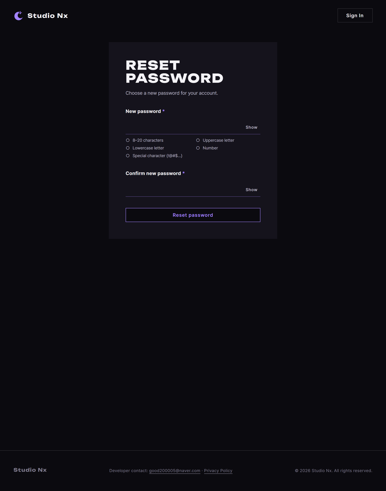

# JS 174 — `readResetToken()` (주소의 `#token=` 읽고 곧바로 지우기)

| 항목 | 내용 |
|---|---|
| 파일 | `studionx/frontend/static/js/pages/resetPassword.js` (새 파일) |
| 작업 | P1-28 비밀번호 재설정 화면: JS 첫 번째 함수 |
| 작성 | Claude (AI), 2026-10-15, 사용자 검토 |
| 이전 | [개요 70](../../70_p1-28_account_recovery_ui.md) §5 (HTML과 CSS), JS [173](173_recover_initRecoverResend.md) |
| 다음 | [175 `initResetPasswordRules()`](175_reset_initResetPasswordRules.md), 그다음 `initResetForm()` |

## 1. 하는 일
재설정 메일의 링크로 들어오면 주소가 `resetPassword.html#token=<원문>` 입니다. 이 함수는 그 `#token=` 뒤의 값을 읽어 **이 파일 안에만** 두고, 주소창에서는 **곧바로 지웁니다.**

| 주소 | 돌려주는 값 | 주소창 |
|---|---|---|
| `#token=abc-123_XYZ` | `abc-123_XYZ` | 해시를 지웁니다 |
| `#token=` (빈 값) | null | 해시를 지웁니다 |
| 해시 없음 | null | 그대로 둡니다 |
| `#something` (다른 해시) | null | 그대로 둡니다 |
| `?x=1#token=tok` | `tok` | 쿼리는 남기고 해시만 지웁니다 |

주소창은 이렇게 정리합니다: `location.pathname + location.search`, 즉 경로와 쿼리만 남깁니다.



## 2. 코드
```js
/** 재설정 토큰 (이 파일 안에서만 씀). 주소창에서 지운 뒤 여기에만 두고 localStorage 에는 두지 않는다 */
let resetToken = null;

export function readResetToken() {
  const hash = location.hash || '';
  const prefix = '#token=';
  let token = null;

  if (hash.indexOf(prefix) === 0) {
    const value = hash.slice(prefix.length);
    if (value !== '') token = value;
    // 주소창에서 지움 (경로와 쿼리만 남김)
    history.replaceState(null, '', location.pathname + location.search);
  }

  resetToken = token;
  return resetToken;
}
```
**최신 문법으로 쓰면** (공부용)
```js
export const readResetToken = () => {
  const hash = location.hash ?? '';
  const PREFIX = '#token=';
  const token = hash.startsWith(PREFIX) ? hash.slice(PREFIX.length) || null : null;
  if (hash.startsWith(PREFIX)) history.replaceState(null, '', location.pathname + location.search);
  resetToken = token;
  return token;
};
```
| 최신 문법 | 실제 코드 | 뜻 |
|---|---|---|
| `hash.startsWith(PREFIX)` | `hash.indexOf(PREFIX) === 0` | 해시가 `#token=` 로 시작하는지 봅니다 |
| `hash.slice(PREFIX.length) \|\| null` | `if (value !== '') token = value;` | 빈 값이면 null 로 봅니다 |
| (삼항 연산자) | `if` 문 | 조건에 따라 값을 고릅니다 |

### 문법 풀이
| 식 | 뜻 |
|---|---|
| `location.hash` | 주소에서 `#` 뒤 부분입니다. `#token=abc` 이면 `#token=abc` 입니다 |
| `hash.indexOf(prefix) === 0` | 문자열이 `prefix` 로 시작하면 0 입니다. 시작하지 않으면 -1 이나 다른 값입니다 |
| `hash.slice(prefix.length)` | `#token=` 만큼 잘라 낸 나머지, 즉 토큰 값입니다 |
| `history.replaceState(null, '', 주소)` | 새 기록을 남기지 않고 주소만 바꿉니다(뒤로 가기 기록이 늘지 않음) |

## 3. 왜 이렇게
| 선택 | 이유 |
|---|---|
| 읽은 값을 **이 파일 안 변수에만** 둠 | 토큰은 비밀번호를 바꿀 수 있는 열쇠입니다. `localStorage`나 쿠키에 두면 다른 스크립트가 읽거나 기록에 남을 수 있습니다 |
| 주소창에서 **곧바로** 지움 | 해시는 서버로 가지 않지만, 새로 고침이나 뒤로 가기, 주소 복사로 토큰이 남을 수 있습니다. 지우면 남지 않습니다 |
| `history.replaceState` 로 지움 | `location.hash = ''` 는 뒤로 가기 기록을 남깁니다. `replaceState` 는 남기지 않습니다 |
| `<meta name="referrer" content="no-referrer">` 와 함께 씀 | 이 페이지에서 다른 곳으로 갈 때 주소(Referer)를 넘기지 않아 링크가 새지 않습니다 |
| `#token=` 로 **시작할 때만** 지움 | 다른 해시(`#something`)는 이 페이지의 것이 아니므로 건드리지 않습니다 |
| 빈 값(`#token=`)은 토큰 없음으로 봄 | 토큰은 `secrets.token_urlsafe(32)` 라 값이 반드시 있습니다. 빈 값이면 잘못된 링크입니다 |
| 토큰이 없으면 null 을 돌려줌 | 부르는 쪽(`initResetForm`)이 "무효 링크" 화면을 보여 줄 수 있습니다 |

## 4. 시험 (실제 서버, 헤드리스 Chrome)
`docs/handoff/p1-28_tests/reset_token.mjs` 로 시험합니다. 실제 페이지를 열고 주소를 바꿔 가며 값을 확인합니다.

| 시험 | 결과 |
|---|---|
| `#token=abc-123_XYZ` 를 그대로 읽음 | 통과 |
| 토큰을 읽은 뒤 주소창에서 해시를 지움 | 통과 |
| `#token=` (빈 값)은 토큰 없음, 해시는 지움 | 통과 |
| 해시가 없으면 토큰 없음 | 통과 |
| 다른 해시(`#something`)는 토큰 없음이고 지우지 않음 | 통과 |
| `?x=1#token=tok` 은 쿼리를 남기고 해시만 지움 | 통과 |

여섯 묶음, 여덟 확인이 모두 통과했습니다.

> 페이지가 완성된 뒤에는(`initResetForm` 추가) 페이지가 뜰 때 이 함수가 토큰을 먼저 읽어 소비합니다. 그래서 시험은 해시를 한 번 더 주소에 넣고(`history.replaceState`) 함수를 직접 불러 확인합니다.

## 5. 페이지 연결
이 함수는 아직 페이지 하단에서 부르지 않습니다. 다음 함수인 `initResetForm` 이 폼을 준비할 때 가장 먼저 불러, 토큰이 없으면 "무효 링크" 화면을 보여 주게 합니다.
