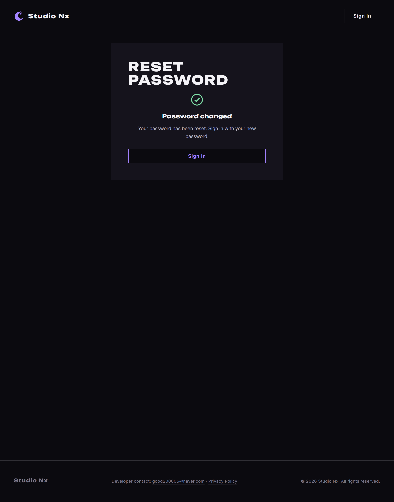

# JS 176 — `initResetForm()` (재설정 전송, 무효 링크, 성공)

| 항목 | 내용 |
|---|---|
| 파일 | `studionx/frontend/static/js/pages/resetPassword.js` |
| 작업 | P1-28 비밀번호 재설정 화면: JS 마지막(세 번째) 함수 |
| 작성 | Claude (AI), 2026-10-15, 사용자 검토 |
| 이전 | [175 `initResetPasswordRules()`](175_reset_initResetPasswordRules.md), [개요 70](../../70_p1-28_account_recovery_ui.md) §5 |
| 다음 | 없음 (이 함수로 `resetPassword.html`의 JS가 끝남) |

## 1. 하는 일
페이지를 열면 토큰을 확인하고, 폼을 보낸 결과에 따라 화면 세 가지 중 하나를 보여 줍니다.

| 때 | 화면 |
|---|---|
| 토큰 없음 | 위쪽에 무효 경고, 폼은 흐리게 잠김, 아래에 `Can't sign in?`(다시 요청) |
| 보내기 성공(204) | 초록 체크, `Password changed`, `Sign In` (자동 로그인은 하지 않음) |
| 400 (링크 틀림·만료·이미 씀) | 무효 경고와 잠긴 폼, 다시 요청 줄 |
| 422 (규칙 위반) | 비밀번호 칸에 `Check the password requirements.` (링크는 그대로 씀) |
| 연결 실패, 그 밖(500 등) | 폼 아래에 문구, 버튼을 풀어 다시 시도 |



전송 전에 화면에서 규칙과 확인을 **먼저** 검사합니다. 틀린 칸이 있으면 그 칸에 문구를 넣고 커서를 옮긴 뒤 서버로 보내지 않습니다.

## 2. 코드
```js
export function initResetForm() {
  const form = document.getElementById('reset-form');
  const card = document.querySelector('.reset__card');
  const invalid = document.getElementById('reset-invalid');
  const invalidText = document.getElementById('reset-invalid-text');
  const recoverRow = document.getElementById('reset-recover-row');
  const done = document.getElementById('reset-done');
  const sub = document.getElementById('reset-sub');
  const password = document.getElementById('reset-password');
  const confirm = document.getElementById('reset-password2');
  const passwordField = document.getElementById('reset-password-field');
  const confirmField = document.getElementById('reset-password2-field');
  const error = document.getElementById('reset-error');
  if (!form || !password || !confirm) return false;
  const submit = form.querySelector('button[type="submit"]');

  const isLocked = function () {
    return card ? card.classList.contains('is-locked') : false;
  };

  const showInvalid = function () {
    if (invalid) invalid.hidden = false;
    if (card) card.classList.add('is-locked');
    for (const control of form.querySelectorAll('input, button')) control.disabled = true;
    if (recoverRow) recoverRow.hidden = false;
  };

  const showDone = function () {
    form.hidden = true;
    if (sub) sub.hidden = true;
    if (invalid) invalid.hidden = true;
    if (recoverRow) recoverRow.hidden = true;
    if (done) done.hidden = false;
  };

  const token = resetToken || readResetToken();
  if (!token) {
    showInvalid();
    return true;
  }

  form.onsubmit = async function (event) {
    event.preventDefault();
    if (form.getAttribute('data-busy') === 'true') return;
    if (error) error.hidden = true;

    let problem = null;
    if (!PASSWORD_ALLOWED.test(password.value)) {
      setFieldState(passwordField, 'error', 'Use only English letters, numbers and symbols.');
      problem = password;
    } else {
      let met = true;
      for (const name of Object.keys(PASSWORD_RULES)) {
        if (!PASSWORD_RULES[name](password.value)) met = false;
      }
      if (!met) {
        setFieldState(passwordField, 'error', 'Check the password requirements.');
        problem = password;
      }
    }
    if (!problem && confirm.value !== password.value) {
      setFieldState(confirmField, 'error', "Passwords don't match.");
      problem = confirm;
    }
    if (problem) {
      problem.focus();
      return;
    }

    form.setAttribute('data-busy', 'true');
    if (submit) submit.disabled = true;
    try {
      await api.post(
        '/auth/password-reset/confirm',
        { token: token, new_password: password.value },
        { auth: false },
      );
      showDone();
    } catch (err) {
      if (err && err.status === 400) {
        showInvalid();
      } else if (err && err.status === 422) {
        setFieldState(passwordField, 'error', 'Check the password requirements.');
        password.focus();
      } else if (error) {
        error.textContent = err && err.status === 0
          ? "Can't reach the server. Check your connection and try again."
          : 'Something went wrong. Please try again.';
        error.hidden = false;
      }
    } finally {
      form.removeAttribute('data-busy');
      if (submit && !isLocked()) submit.disabled = false;
    }
  };
  return true;
}
```
**최신 문법으로 쓰면** (공부용)
```js
export const initResetForm = () => {
  const form = document.getElementById('reset-form');
  const card = document.querySelector('.reset__card');
  const invalid = document.getElementById('reset-invalid');
  const recoverRow = document.getElementById('reset-recover-row');
  const done = document.getElementById('reset-done');
  const password = document.getElementById('reset-password'), confirm = document.getElementById('reset-password2');
  if (!form || !password || !confirm) return false;
  const submit = form.querySelector('button[type="submit"]');

  const showInvalid = () => {
    invalid && (invalid.hidden = false);
    card?.classList.add('is-locked');
    form.querySelectorAll('input, button').forEach((el) => (el.disabled = true));
    recoverRow && (recoverRow.hidden = false);
  };
  const showDone = () => [form, document.getElementById('reset-sub'), invalid, recoverRow]
    .forEach((el) => el && (el.hidden = true)),
    done && (done.hidden = false);

  const token = resetToken ?? readResetToken();
  if (!token) { showInvalid(); return true; }

  form.onsubmit = async (event) => {
    event.preventDefault();
    if (form.dataset.busy) return;
    const message = !PASSWORD_ALLOWED.test(password.value) ? 'Use only English letters, numbers and symbols.'
      : Object.values(PASSWORD_RULES).every((r) => r(password.value)) ? '' : 'Check the password requirements.';
    if (message) return setFieldState(document.getElementById('reset-password-field'), 'error', message);
    if (confirm.value !== password.value) return setFieldState(document.getElementById('reset-password2-field'), 'error', "Passwords don't match.");

    form.dataset.busy = 'true';
    try {
      await api.post('/auth/password-reset/confirm', { token, new_password: password.value }, { auth: false });
      showDone();
    } catch (err) {
      err?.status === 400 ? showInvalid()
        : err?.status === 422 ? setFieldState(document.getElementById('reset-password-field'), 'error', 'Check the password requirements.')
        : document.getElementById('reset-error') && Object.assign(document.getElementById('reset-error'), { hidden: false, textContent: err?.status === 0 ? "Can't reach the server. Check your connection and try again." : 'Something went wrong. Please try again.' });
    } finally {
      delete form.dataset.busy;
      if (!card?.classList.contains('is-locked')) submit && (submit.disabled = false);
    }
  };
  return true;
};
```
| 최신 문법 | 실제 코드 | 뜻 |
|---|---|---|
| `resetToken ?? readResetToken()` | `resetToken \|\| readResetToken()` | 토큰이 없으면 읽습니다 |
| `form.dataset.busy` | `getAttribute('data-busy')` | `data-` 속성 |
| `Object.values(...).every(...)` | `for` 로 돌며 `met = false` | 하나라도 안 맞으면 실패 |
| `err?.status === 400` | `err && err.status === 400` | 오류일 때만 상태를 봅니다 |
| `card?.classList` | `card ? card.classList : …` | 요소가 없어도 오류가 나지 않게 |

### 문법 풀이
| 식 | 뜻 |
|---|---|
| `resetToken \|\| readResetToken()` | 이미 읽은 토큰이 있으면 그대로 씁니다. 두 번 불렀을 때 해시가 이미 지워져 있어도 다시 잠기지 않습니다 |
| `form.querySelectorAll('input, button')` | 폼 안의 입력칸과 버튼을 모두 골라 한꺼번에 잠급니다 |
| `data-busy` | 보내는 중임을 나타내는 표시입니다. 두 번째 전송을 막습니다 |
| `finally` 의 `!isLocked()` | 보낸 뒤 버튼을 다시 켜되, 무효 링크로 잠근 화면에서는 켜지 않습니다 |
| `showInvalid` / `showDone` | 화면 세 가지를 함수로 나눠 두어, 어느 결과에서도 같은 모양이 되게 합니다 |

## 3. 왜 이렇게
| 선택 | 이유 |
|---|---|
| 화면에서 **먼저** 검사 | 서버에 가지도 않을 요청을 보내지 않고, 어느 칸이 틀렸는지 바로 알려 줍니다 |
| 400은 무효 링크 화면 | 링크가 틀렸거나 만료됐거나 이미 쓴 경우입니다. 이유를 구분해 알려 주면 추측을 돕습니다(백엔드도 같은 400을 씁니다) |
| 422는 **칸 오류**로만 | 링크는 그대로 쓸 수 있으므로 폼을 잠그지 않습니다. 규칙 문구를 칸 아래에 보입니다 |
| 성공해도 **자동 로그인 없음** | 재설정한 뒤 새 비밀번호로 직접 로그인하게 합니다(FR-118) |
| 서버 문구를 그대로 보여 주지 않음 | 내부 사정이 새지 않게 상태 코드로 문구를 고릅니다(복구 모달의 `recoverErrorText`와 같은 이유) |
| 토큰을 `resetToken`에만 둠 | `readResetToken`(174)이 `localStorage`·쿠키에 두지 않고 이 파일에만 둡니다 |
| 두 번 불러도 안전 | 처리기를 `onsubmit` 대입으로 달고, 이미 읽은 토큰은 다시 읽지 않습니다 |

## 4. 시험 (실제 서버, 헤드리스 Chrome, `fetch`를 가짜로)
`docs/handoff/p1-28_tests/reset_form.mjs` 로 시험합니다.

| 시험 | 결과 |
|---|---|
| 유효 토큰: 잠기지 않고, 경고 숨김, 폼 보임, 다시 요청 줄 숨김 | 통과 |
| 규칙 미달 → 비밀번호 칸 오류, 서버로 안 보냄 | 통과 |
| 확인 불일치 → 확인 칸 오류, 서버로 안 보냄 | 통과 |
| 성공(204) → 성공 화면, 폼·안내문 숨김 | 통과 |
| 성공 → 한 번 보냄, 주소가 `confirm` | 통과 |
| 성공 → 본문에 `token` 과 `new_password` | 통과 |
| 400 → 무효 경고, 폼 잠김, 다시 요청 줄 보임 | 통과 |
| 400 → 폼은 보이되 입력·전송 잠김 | 통과 |
| 422 → 비밀번호 칸 오류, 잠기지 않고 버튼 다시 켜짐 | 통과 |
| 연결 실패 → 폼 아래 문구, 버튼 다시 켜짐 | 통과 |
| 보내는 중 두 번째 전송은 무시(한 번만) | 통과 |
| 토큰 없음 → 처음부터 무효 경고와 잠긴 폼 | 통과 |
| 두 번 불러도 true 이고 잠기지 않음 | 통과 |

열네 확인이 모두 통과했습니다.

### 시험을 고친 것
처음에는 주소의 **해시만** 바꿔 가며 시험했습니다. 그런데 해시만 바꾸면 브라우저가 페이지를 다시 실리지 않아(same-document 이동) 앞 시험의 화면이 그대로 남았습니다(성공 화면이 그대로). 매번 다른 쿼리(`?r=N`)를 붙여 페이지를 새로 실리도록 고쳤고, 그 뒤 모두 통과했습니다.

## 5. 페이지 연결
`resetPassword.js` 아래쪽에서 순서대로 부릅니다.
```js
await includePartials();
initModalFallback();
initAuthState();
initFormAlerts();
initPasswordToggles();
initResetPasswordRules();
initResetForm();
```
이 함수로 `resetPassword.html`의 JS가 끝납니다. 남은 일은 실제 서버와 실제 재설정 링크로 한 흐름을 확인하는 사이트 시험입니다.
