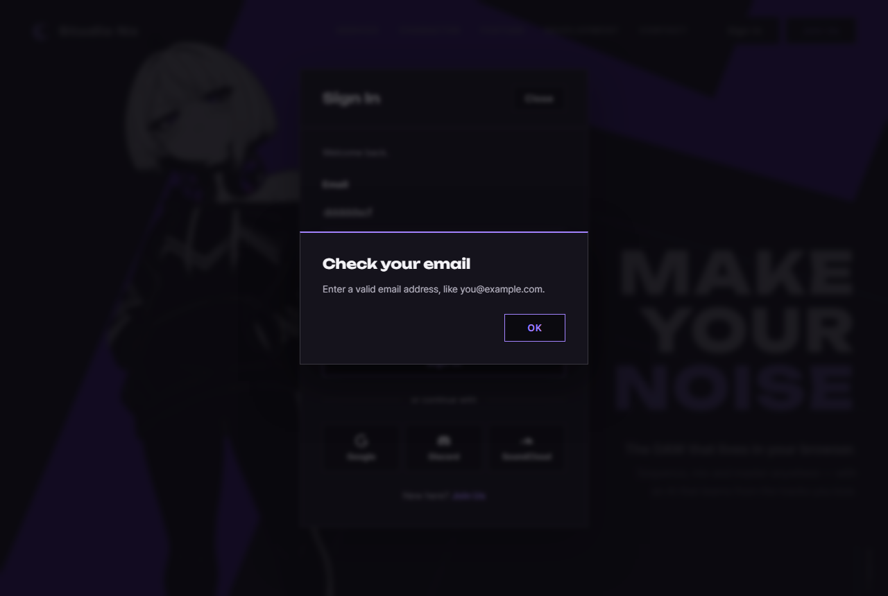

# JS 18 — `showAlert()`

| 항목 | 내용 |
|---|---|
| 파일 | `studionx/frontend/static/js/core/dialog.js` (새 파일) |
| 작업 | 수정 — 브라우저 기본 창 → SweetAlert (사용자 요청 `frontend-reference/images/main page reference/sweetalert수정.pdf`, 2026-10-07) |
| 작성 | Claude (AI) · 2026-10-07 · 사용자 검토 |
| 이전 · 다음 | [17 `initJoinForm()`](<../P1-07 - 가입·로그인 JS/17_join_initJoinForm.md>) · [19 `initFormAlerts()`](19_dialog_initFormAlerts.md) |

## 1. 하는 일
**제목(큰 글씨) · 설명 · OK 버튼**으로 된 알림창을 띄운다. 모양은 home.html 분위기에 맞췄다 — 먹색 면, 제목은 "Make your noise" · "Sign In" 과 같은 **Unbounded** 글꼴, 모서리 0, 위쪽 2px 보라 선.



| 부르는 코드 | 화면 |
|---|---|
| `showAlert('Check your email', 'Enter a valid email address.')` | 위 캡처 (위쪽 선 보라) |
| `showAlert('Oops', 'Something went wrong.', { tone: 'error' })` | 위쪽 선만 빨강 |
| `showAlert('Open on a computer', '…', { note: 'Sign in on a computer …', confirmText: 'Got it' })` | 설명 아래 작은 글씨 한 줄 + 버튼 글자 "Got it" (목업 09 · 16) |
| 휴대폰 (600px 이하) | 아래에서 올라오는 시트 · 버튼 폭 가득 (목업 09 · 13) — `dialog.css` |
| 로그인 모달이 열려 있을 때 | 모달 **위에** 뜨고, 닫으면 모달은 그대로 · 커서는 원래 칸으로 |

## 2. 언제 쓰나
사용자가 올린 수정 사항: 로그인 모달에서 Email 을 비우거나 형식이 틀리면 **브라우저 기본 말풍선**("이 입력란을 작성하세요.")이 뜬다 → SweetAlert 로, 색감 · 글꼴은 home.html 에 맞게, Prompt · Confirm 창도 같은 형식으로.

| 함수 | 하는 일 | 상태 |
|---|---|---|
| **18 `showAlert`** | 알림창 (OK 하나) — 작은 화면 안내(목업 09)에도 | **이번** |
| 19 `initFormAlerts` | 폼의 기본 말풍선을 막고 18 로 보여 줌 — 로그인 모달 · 문의 · 새 프로젝트 폼 | 다음 |
| 20 `confirmDialog` | 확인창 (확인 · 취소) — 프로젝트 삭제 (목업 05) | 그다음 |
| 21 `promptDialog` | 입력창 — 회원 탈퇴 비밀번호 (목업 08). 이름 변경은 만들지 않음 (Edit details 모달 그대로, 사용자 결정) | 그다음 |

목업: `docs/page_mockups/sweetalert/` (01 ~ 16, 사용자 검토 2026-10-07)

**함께 넣은 것 (코드 외)**
| 파일 | 내용 |
|---|---|
| `static/vendor/sweetalert2/` | SweetAlert2 **v11.26.25** (MIT, `LICENSE` 함께). CDN 대신 파일로 넣음 — 버전이 고정되고 인터넷이 없어도 됨 |
| `static/css/dialog.css` | 모양 (home.html 의 `.modal` · `.btn` · 토큰 그대로) |
| home · join · myPage · myProject · userInfo `.html` | `<link>` 두 줄 (라이브러리 CSS → `dialog.css` 순서) |

## 3. 코드
**import** (파일 맨 위)
```js
import Swal from '../../vendor/sweetalert2/sweetalert2.esm.min.js';
```

**함수**
```js
export async function showAlert(title, text, options = {}) {
  const tone = options.tone === 'error' ? 'error' : 'info';
  const openModal = document.querySelector('dialog[open]');
  let note;
  if (options.note) {
    note = document.createElement('span');
    note.textContent = options.note; // 글자 그대로 (footer 에 글자를 바로 주면 HTML 로 해석됨)
  }
  await Swal.fire({
    target: openModal || document.body,
    title: title,
    text: text || '',
    footer: note,
    confirmButtonText: options.confirmText || 'OK',
    buttonsStyling: false,          // 버튼 모양은 우리 .btn
    heightAuto: false,              // <html> · <body> 높이를 건드리지 않음
    scrollbarPadding: false,
    returnFocus: true,
    showClass: { popup: 'snx-dialog-in' },
    hideClass: { popup: 'snx-dialog-out' },
    customClass: {
      popup: 'snx-dialog snx-dialog--' + tone,
      title: 'snx-dialog__title',
      htmlContainer: 'snx-dialog__text',
      actions: 'snx-dialog__actions',
      footer: 'snx-dialog__note',
      confirmButton: 'btn btn--primary',
    },
  });
}
```

**최신 문법으로 쓰면** (공부용 — 바뀌는 부분만)
```js
export async function showAlert(title, text = '', { tone = 'info', note, confirmText = 'OK' } = {}) {
  await Swal.fire({
    target: document.querySelector('dialog[open]') ?? document.body,
    title, text, confirmButtonText: confirmText,
    footer: note && Object.assign(document.createElement('span'), { textContent: note }),
    customClass: { popup: `snx-dialog snx-dialog--${tone === 'error' ? 'error' : 'info'}`, … },
    …
  });
}
```
| 최신 문법 | 실제 코드 | 뜻 |
|---|---|---|
| `text = ''` (매개변수 기본값) | `text: text \|\| ''` | 안 넘기면 빈 글자 |
| `{ tone = 'info' } = {}` (구조 분해 + 기본값) | `options = {}` + `options.tone === 'error' ? …` | 옵션에서 `tone` 꺼내기 |
| `… ?? document.body` | `openModal \|\| document.body` | 없으면 body |
| `{ title, text }` (속성 줄여 쓰기) | `title: title` | 이름이 같으면 한 번만 |
| `` `snx-dialog--${tone}` `` | `'snx-dialog--' + tone` | 글자 잇기 |

### 문법 풀이
| import 문법 | 뜻 |
|---|---|
| `import Swal from '…'` | 그 파일의 **기본 내보내기**(`export default`)를 `Swal` 이라는 이름으로 받음 — `{ }` 없음 |
| `'../../vendor/…'` | `static/js/core/` 에서 두 폴더 위(`static/`) → `vendor/sweetalert2/` |

| 식 | 뜻 |
|---|---|
| `Swal.fire({ … })` | 창을 띄우고, **닫힐 때 끝나는 Promise** 를 돌려줌 → `await` 로 닫힐 때까지 기다림 |
| `document.querySelector('dialog[open]')` | 지금 열려 있는 `<dialog>` (없으면 `null`) |
| `target` | 창을 넣을 곳 (SweetAlert2 옵션) |
| `text` | 설명을 **글자 그대로** 넣음 (`html` 옵션과 달리 태그를 해석하지 않음) |
| `footer: note` | 설명 아래 줄. **글자를 그대로 주면 HTML 로 해석**되므로 `<span>` 을 만들고 `textContent` 로 넣어 요소를 넘김. `note` 가 `undefined` 면 줄이 안 생김 |
| `customClass` | SweetAlert2 의 각 부분에 우리 클래스를 붙임 → `dialog.css` 가 모양을 정함 |
| `buttonsStyling: false` | 라이브러리의 버튼 색을 끔 → `.btn btn--primary` 모양 그대로 |

## 4. 흐름
1. `tone` 을 `'error'` 아니면 `'info'` 로 정함.
2. 열린 `<dialog>` 모달이 있는지 봄.
3. 있으면 그 안에, 없으면 `<body>` 에 창을 띄움 (모양은 `dialog.css`).
4. OK · Enter · Esc · 바깥 클릭으로 닫히면 끝 → 커서는 열기 전 자리로.

## 5. 왜 이렇게
| 선택 | 이유 |
|---|---|
| 열린 모달 **안에** 띄움 (`target`) | `showModal()` 로 연 모달은 브라우저 맨 위층에 있고, 모달 밖은 눌리지 않는다. body 에 띄우면 알림창이 **모달 뒤에 깔리고 OK 도 못 누른다** — 로그인 모달이 바로 그 경우 |
| 진짜 Esc 가 알림창만 닫음 | 시험으로 확인: 모달 안에 띄워도 Esc 는 알림창만 닫고 로그인 모달은 남는다 |
| 라이브러리 파일을 저장소에 넣음 (CDN 아님) | 버전 고정 · 오프라인 개발. 받은 파일에 특정 지역 · 도메인에서 다르게 동작하는 코드가 없는지 확인했다 |
| `.btn btn--primary` · 토큰 재사용 | 새 색을 만들지 않는다. 라이트 모드도 토큰이 알아서 바뀐다 |
| SweetAlert 기본 아이콘 · 튀는 확대 효과 끔 | 수정 사항의 형식(제목 · 설명 · 확인)대로. home.html 의 모달처럼 살짝 올라오며 나타남 (움직임 줄이기 설정이면 없음) |
| `text` 만 받음 (`html` 아님) | 서버 오류 문구 등을 넣어도 HTML 로 해석되지 않아 안전 |
| `heightAuto: false` | SweetAlert2 기본은 `<html>` · `<body>` 높이를 바꿔 홈 첫 화면 배치가 흔들릴 수 있다 |
| 버튼 글자 기본 `OK` | 사이트 글자는 영어 (시퀀서만 다국어). 작은 화면 안내는 원래 모달처럼 "Got it" |
| `note` 를 버튼 **위**에 (`dialog.css` 의 `order`) | SweetAlert 는 footer 를 버튼 아래에 둔다. 보충 설명을 읽은 뒤 버튼을 누르게 |
| 휴대폰에서는 아래 시트 (`dialog.css` 600px 이하) | 작은 화면 안내(목업 09)는 휴대폰 · 태블릿에서만 뜬다 — 엄지가 닿는 아래쪽, 48px 버튼. 다른 창도 휴대폰에서는 같은 모양 |

## 6. 시험 (실제 home.html 을 헤드리스 Chrome 으로 열고 그 안에서 실행 · 11개)
| 시험 | 확인한 것 |
|---|---|
| 기본 | 창 · 제목 · 설명 · `OK`, 버튼 클래스 `btn btn--primary`, 커서가 OK 에 |
| 모양 | 제목 글꼴 Unbounded, 모서리 0px, 위쪽 선 `rgb(163, 131, 255)` (`--c-violet-ink`) |
| 닫기 | OK → 창 사라짐 · Promise 끝 · 커서가 원래 자리로 |
| `tone: 'error'` | 위쪽 선 `rgb(255, 138, 138)` (`--c-error`) |
| `<b>…</b> ` 설명 | 글자 그대로 보이고 태그가 생기지 않음 |
| 로그인 모달이 열린 상태 | 창이 모달 안에 생기고, OK 자리에 실제로 OK 가 보임(가려지지 않음) |
| **진짜 Esc 키** | 알림창만 닫히고 로그인 모달은 열린 채, 커서는 Email 칸 |
| **진짜 Enter 키** | 닫힘, 모달 그대로 |
| `note` · `confirmText` (목업 반영 뒤 추가) | 작은 글씨 줄이 보이고 `<b>` 가 글자 그대로, 줄이 버튼보다 위, 버튼 글자 "Got it", `note` 없으면 줄 없음 |

처음 11/11 → `note` 를 더한 뒤 14/14 통과. (Esc · Enter 는 Chrome 개발 도구 기능으로 실제 키를 눌렀다 — 브라우저 기본 동작까지 확인하려고)
