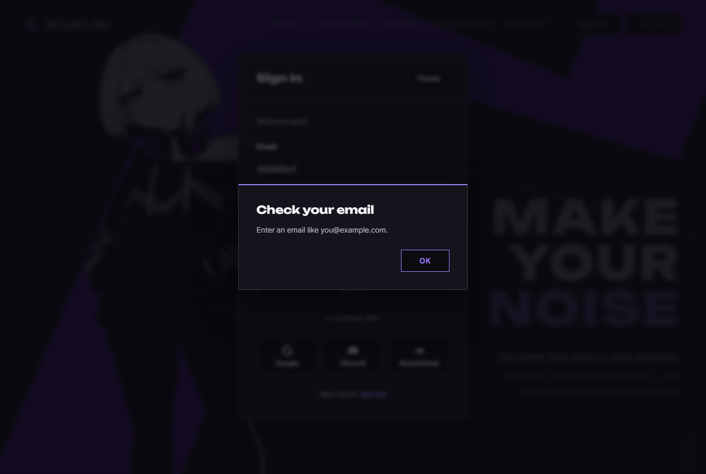
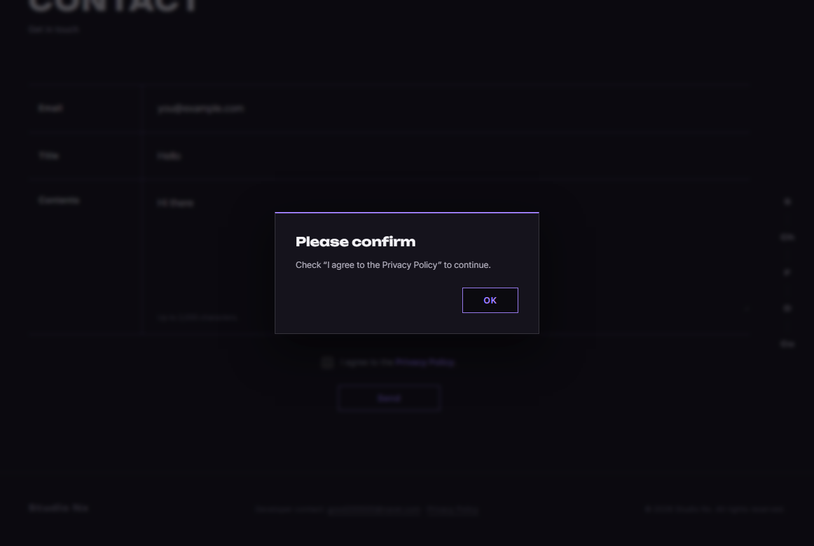

# JS 19 — `initFormAlerts()` (+ `alertMessageFor()`)

| 항목 | 내용 |
|---|---|
| 파일 | `studionx/frontend/static/js/core/dialog.js` · 부르는 곳 `pages/home.js` · `join.js` · `myproject.js` |
| 작업 | 수정 — 브라우저 기본 창 → SweetAlert (사용자 요청 `sweetalert수정.pdf`, 2026-10-07) |
| 작성 | Claude (AI) · 2026-10-07 · 사용자 검토 |
| 이전 · 다음 | [18 `showAlert()`](18_dialog_showAlert.md) · [20 `confirmDialog()`](20_dialog_confirmDialog.md) |

## 1. 하는 일
폼을 보낼 때 빈 칸 · 틀린 형식이 있으면 브라우저가 띄우던 **기본 말풍선**("이 입력란을 작성하세요.", "이메일 주소에 '@'를 포함해 주세요.")을 막고, 18 `showAlert` 알림창으로 보여 준다. OK 를 누르면 그 칸에 커서가 간다.





| 상황 (사용자 수정 사항 캡처) | 전 | 이제 |
|---|---|---|
| 로그인 모달 Email 빈 칸 | 말풍선 "이 입력란을 작성하세요." | **Email is required** · Fill in this field to continue. |
| Email `dddddscf` | 말풍선 "이메일 주소에 '@'를 포함해 주세요…" | **Check your email** · Enter an email like you@example.com. |
| 문의 폼 동의 안 함 | 말풍선 | **Please confirm** · Check “I agree to the Privacy Policy” to continue. |
| 새 프로젝트 BPM `5` | 말풍선 "값은 20 이상이어야 합니다." | **Check BPM** · Enter a number from 20 to 999. |

말풍선은 브라우저 언어(한국어)로 나와 영어 사이트와 섞였고, 모양도 사이트와 달랐다.

## 2. 언제 쓰나
각 페이지 JS 가 공통 조각(헤더 · 로그인 모달)을 끼운 **뒤** 한 번 부른다.

| 페이지 | 대상 폼 | 대상 아님 |
|---|---|---|
| home.html | 로그인 모달 `#login-form`, 문의 `#contact-form` | |
| join.html | 로그인 모달 | 가입 폼 `#join-form` — `novalidate` 라 칸 아래 문구(15 ~ 17) 그대로 |
| myProject.html | 새 프로젝트 · 정보 수정 · 검색 폼 | |
| userInfo.html | (없음 — 폼이 모두 `novalidate`, P1-10 에서 칸 아래 문구) | |

## 3. 코드
**import** (`dialog.js` — 18 과 같음, 추가 없음). 부르는 페이지 3곳에는 한 줄씩 추가:
```js
import { initFormAlerts } from '../core/dialog.js';
```

**함수**
```js
export function initFormAlerts(root = document) {
  for (const form of root.querySelectorAll('form:not([novalidate])')) {
    if (form.dataset.formAlerts === 'on') continue; // 두 번 연결하지 않음
    form.dataset.formAlerts = 'on';
    let showing = false;

    // 'invalid' 는 위로 퍼지지 않음 → 폼에서 잡으려면 capture(세 번째 인자 true)
    form.addEventListener('invalid', (event) => {
      event.preventDefault(); // 브라우저 말풍선 막기
      if (showing) return; // 한 번 보낼 때 틀린 칸마다 invalid 가 옴 → 첫 칸만 알림
      showing = true;
      const input = event.target;
      const message = alertMessageFor(input);
      input.focus(); // 먼저 커서를 옮김 → 알림창이 닫히면 이 칸으로 돌아옴 (showAlert 의 returnFocus)
      showAlert(message.title, message.text).then(() => {
        showing = false;
      });
    }, true);
  }
}
```
**안쪽 도우미 — 틀린 이유 → 문구** (내보내지 않음)
```js
function alertMessageFor(input) {
  const label = input.labels && input.labels[0] ? input.labels[0].textContent.replace('*', '').replace(/\s+/g, ' ').trim().replace(/\.$/, '') : 'This field';
  const v = input.validity;
  if (v.valueMissing && input.type === 'checkbox') {
    return { title: 'Please confirm', text: `Check “${label}” to continue.` };
  }
  if (v.valueMissing) {
    return { title: `${label} is required`, text: 'Fill in this field to continue.' };
  }
  if (v.typeMismatch && input.type === 'email') {
    return { title: 'Check your email', text: 'Enter an email like you@example.com.' };
  }
  if (v.tooShort) {
    return { title: `Check ${label}`, text: `Use at least ${input.minLength} characters.` };
  }
  if (v.tooLong) {
    return { title: `Check ${label}`, text: `Use up to ${input.maxLength} characters.` };
  }
  if (v.rangeUnderflow || v.rangeOverflow || v.stepMismatch || v.badInput) {
    const range = input.min !== '' && input.max !== '' ? `Enter a number from ${input.min} to ${input.max}.` : 'Enter a valid number.';
    return { title: `Check ${label}`, text: range };
  }
  return { title: `Check ${label}`, text: 'Check this field and try again.' };
}
```

**최신 문법으로 쓰면** (공부용 — 바뀌는 부분만)
```js
const label = input.labels?.[0]?.textContent.replace('*', '').replace(/\s+/g, ' ').trim().replace(/\.$/, '') ?? 'This field';
…
form.addEventListener('invalid', handler, { capture: true });
…
await showAlert(message.title, message.text);
showing = false;
```
| 최신 문법 | 실제 코드 | 뜻 |
|---|---|---|
| `input.labels?.[0]?.textContent` | `input.labels && input.labels[0] ? input.labels[0].textContent : …` | 이름표가 있을 때만 |
| `… ?? 'This field'` | 삼항 연산자의 `: 'This field'` | 없으면 기본 글자 |
| `{ capture: true }` | 세 번째 인자 `true` | 같은 뜻 — 객체로 쓰면 이름이 보임 |
| `async` 처리기 + `await showAlert(…)` | `showAlert(…).then(() => { … })` | 닫힌 뒤에 할 일 |

### 문법 풀이
| import 문법 | 뜻 |
|---|---|
| `import { initFormAlerts } from '../core/dialog.js'` | `pages/` 에서 한 폴더 위 → `core/dialog.js` 의 이름 있는 내보내기 |

| 식 | 뜻 |
|---|---|
| `'form:not([novalidate])'` | `novalidate` 속성이 **없는** 폼만 |
| `'invalid'` 이벤트 | 보내기를 누르면 브라우저가 칸마다 검사하고, 틀린 칸**마다** 보냄 (화면 순서대로). 하나라도 있으면 `submit` 은 일어나지 않음 |
| `addEventListener(…, true)` | **capture** — 이벤트가 칸에 닿기 전에 바깥(폼)에서 먼저 받음. `invalid` 는 위로 퍼지지(bubble) 않아서 이렇게 해야 폼 하나에 한 번만 걸면 됨 |
| `event.preventDefault()` | 기본 동작(말풍선)을 막음. 보내기는 여전히 막힘 |
| `input.validity` | 왜 틀렸는지 — `valueMissing`(빈 칸) · `typeMismatch`(이메일 형식) · `tooShort` · `rangeUnderflow`(min 미만) … |
| `input.labels[0]` | 그 칸의 `<label for=…>` |
| `.replace(/\s+/g, ' ')` | 줄바꿈 · 여러 칸 공백을 한 칸으로 (문의 동의 이름표는 HTML 에서 두 줄) |
| `.replace(/\.$/, '')` | 끝의 마침표 하나 빼기 — 따옴표 안에 넣으므로 |

## 4. 흐름
1. 페이지의 `novalidate` 없는 폼마다, 아직 안 붙였으면 `invalid` 받기를 붙인다.
2. 보내기 → 브라우저가 틀린 칸마다 `invalid` 를 보냄.
3. 매번 말풍선을 막는다. 첫 칸이면: 이유로 문구를 정하고 → 그 칸에 커서 → 알림창.
4. 두 번째 칸부터는 무시 (알림은 하나).
5. 알림창이 닫히면 커서가 그 칸으로 돌아오고, 다음 보내기를 받을 준비.

## 5. 왜 이렇게
| 선택 | 이유 |
|---|---|
| `novalidate` 를 붙이지 않고 `invalid` 만 막음 | 브라우저의 검사 규칙(`required` · `type="email"` · `min/max` · `maxlength`)은 그대로 쓰고 **보여 주는 방법만** 바꾼다. HTML 에 규칙이 이미 있으니 JS 에 다시 쓰지 않는다 |
| 첫 칸만 알림 | 알림창이 여러 개 겹치면 안 된다. 고치고 다시 누르면 다음 칸을 알려 준다 (칸 아래 문구 방식인 가입 폼은 17 처럼 한 번에 다 보여 줌) |
| 알림 **전에** 커서를 옮김 | 처음에는 닫힌 뒤 `input.focus()` 를 불렀는데, SweetAlert 가 그 **뒤에** "열기 전 자리"(보내기 버튼)로 커서를 되돌려 시험 3개가 실패했다. 먼저 옮겨 두면 "열기 전 자리" 가 그 칸이 된다 |
| 문구는 이름표에서 | 칸마다 문구를 HTML 에 따로 적지 않아도 된다. 새 폼이 생겨도 그대로 동작 |
| 기본 말풍선 문구(`validationMessage`)를 쓰지 않음 | 브라우저 언어로 나와서(한국어) 영어 사이트와 섞인다 |
| `data-form-alerts="on"` 표시 | 두 번 불려도 알림이 두 번 뜨지 않게 (10 비밀번호 토글과 같은 방식) |
| 페이지 3곳에서 부름 (`includePartials` 뒤) | 로그인 모달은 공통 조각이라 끼운 뒤에야 폼이 있다 |

## 6. 시험 (실제 페이지를 헤드리스 Chrome 으로 열고 그 안에서 실행 · 18개)
| 페이지 | 시험 | 확인한 것 |
|---|---|---|
| home | 로그인 빈 칸 | 알림 **1개** "Email is required", 말풍선 막힘(`defaultPrevented`), 로그인 요청 0번, 알림은 모달 안 |
| | OK | Email 칸에 커서, 모달 그대로 |
| | `dddddscf` | "Check your email" |
| | 비밀번호 빈 칸 → OK | "Password is required" → Password 칸에 커서 |
| | 다 채움 | 알림 없이 로그인 요청 1번 → 13 의 "Email or password is incorrect." (방해 안 함) |
| | 문의 빈 칸 → OK | "Email is required"(body 에) → 문의 Email 칸에 커서 |
| | 문의 동의 안 함 → OK | "Please confirm" · Check “I agree to the Privacy Policy” … → 체크박스에 커서 |
| join | 대상 | 가입 폼에는 안 붙고, 로그인 폼에만 붙음 |
| | 가입 폼 빈 칸 | 알림 없이 칸 아래 "Enter a valid email address." (17 그대로) |
| | 로그인 모달 빈 칸 | 알림 |
| myProject | 새 프로젝트 제목 빈 칸 | "Title is required" (새 프로젝트 모달 안) |
| | BPM `5` → OK | "Check BPM" · Enter a number from 20 to 999. → BPM 칸에 커서 |

처음 15/18 — 커서 3개 실패(§5), 동의 문구에 줄바꿈이 섞임 → 고친 뒤 **18/18**. 18 `showAlert` 14개, P1-07 시험(13 · 14 · 12 · 16 · 17)도 다시 돌려 모두 통과했다. 시험에서 만든 계정은 지웠다.
