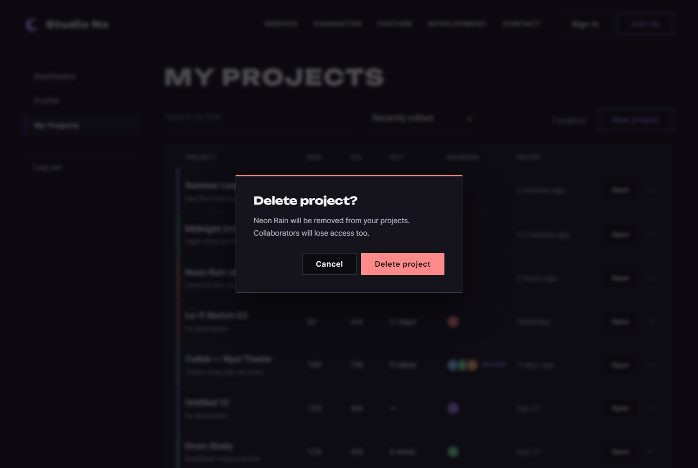
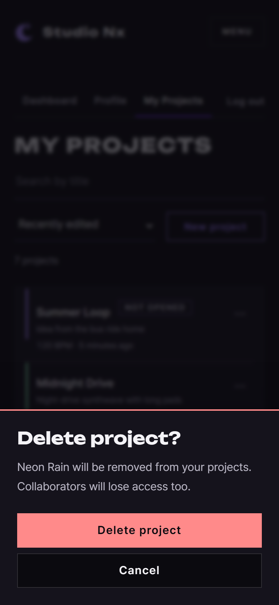

# JS 20 — `confirmDialog()`

| 항목 | 내용 |
|---|---|
| 파일 | `studionx/frontend/static/js/core/dialog.js` |
| 작업 | 수정: 브라우저 기본 창을 SweetAlert로 바꿈 (사용자 요청 `sweetalert수정.pdf`의 "Confirm 창도 SweetAlert 형식", 2026-10-07) |
| 작성 | Claude (AI), 2026-10-07, 사용자 검토 |
| 이전 · 다음 | [19 `initFormAlerts()`](19_dialog_initFormAlerts.md) · [21 `promptDialog()`](21_dialog_promptDialog.md) |

## 1. 하는 일
**취소와 확인** 두 버튼이 있는 확인창을 띄우고, 사용자가 확인을 눌렀으면 `true`, 아니면 `false`를 돌려줍니다. `window.confirm()` 대신 씁니다.

| 데스크톱 | 휴대폰 (600px 이하) |
|---|---|
|  |  |

| 부르는 코드 | 화면 | 돌려주는 값 |
|---|---|---|
| `await confirmDialog({ title: 'Delete project?', text: '…', confirmText: 'Delete project', danger: true })` | 위의 캡처입니다. 처음 커서는 **Cancel**에 있습니다 | Delete project를 누르면 `true` |
| `await confirmDialog({ title: 'Leave this page?', text: '…' })` | 보라색 OK와 Cancel이 나옵니다. 처음 커서는 OK에 있습니다 | OK를 누르면 `true` |
| (어느 쪽이든) Cancel, Esc, 바깥 클릭 | 창이 닫힙니다 | `false` |

## 2. 언제 쓰나
| 쓰는 곳 | 언제 붙이나 |
|---|---|
| 내 프로젝트의 **프로젝트 삭제** (목업 05, 12) | P1-14의 `initDeleteProject`를 구현할 때 붙입니다. 지금의 `#delete-project-modal`과 행 메뉴 Delete의 `command="show-modal"`을 지우고, Delete를 누르면 `confirmDialog`를 띄워서 `true`일 때 삭제 API를 부릅니다. `myproject.js` 템플릿 주석에 적어 두었습니다 |
| 회원 탈퇴 (목업 08) | 비밀번호 칸이 있어서 21번 `promptDialog`를 씁니다 |

지금 HTML 모달을 바로 지우지 않은 이유: 삭제 버튼이 **JS 없이** `command` 속성으로 모달을 엽니다. 모달을 지우면 P1-14 전까지 삭제 버튼이 아무 일도 하지 않게 됩니다.

## 3. 코드
**import** (`dialog.js`: 18번과 같고, 추가한 것은 없습니다)

**함수**
```js
export async function confirmDialog(options) {
  const danger = options.danger === true;
  const openModal = document.querySelector('dialog[open]');
  const result = await Swal.fire({
    target: openModal || document.body,
    title: options.title,
    text: options.text || '',
    showCancelButton: true,
    confirmButtonText: options.confirmText || 'OK',
    cancelButtonText: options.cancelText || 'Cancel',
    reverseButtons: true,           // 취소 · 확인 순서 (확인이 오른쪽)
    focusCancel: danger,
    buttonsStyling: false,
    heightAuto: false,
    scrollbarPadding: false,
    returnFocus: true,
    showClass: { popup: 'snx-dialog-in' },
    hideClass: { popup: 'snx-dialog-out' },
    customClass: {
      popup: 'snx-dialog snx-dialog--' + (danger ? 'danger' : 'info'),
      title: 'snx-dialog__title',
      htmlContainer: 'snx-dialog__text',
      actions: 'snx-dialog__actions',
      confirmButton: danger ? 'btn btn--danger' : 'btn btn--primary',
      cancelButton: 'btn btn--ghost',
    },
  });
  return result.isConfirmed === true;
}
```

**최신 문법으로 쓰면** (공부용이며, 바뀌는 부분만 적었습니다)
```js
export async function confirmDialog({ title, text = '', confirmText = 'OK', cancelText = 'Cancel', danger = false }) {
  const { isConfirmed } = await Swal.fire({
    target: document.querySelector('dialog[open]') ?? document.body,
    title, text,
    confirmButtonText: confirmText, cancelButtonText: cancelText,
    customClass: { popup: `snx-dialog snx-dialog--${danger ? 'danger' : 'info'}`, … },
    …
  });
  return isConfirmed;
}
```
| 최신 문법 | 실제 코드 | 뜻 |
|---|---|---|
| `({ title, text = '', … })` (매개변수에서 구조 분해 + 기본값) | `options` 하나를 받고 `options.text \|\| ''` | 옵션을 꺼냅니다 |
| `const { isConfirmed } = await …` | `const result = await …` + `result.isConfirmed` | 결과에서 칸 하나를 꺼냅니다 |
| `?? document.body` | `openModal \|\| document.body` | 없으면 body를 씁니다 |

### 문법 풀이
| import 문법 | 뜻 |
|---|---|
| (추가 없음) | 18번의 `import Swal from …`을 함께 씁니다 |

| 식 | 뜻 |
|---|---|
| `await Swal.fire({ … })` | 창이 닫힐 때까지 기다렸다가 **결과 객체** `{ isConfirmed, isDismissed, dismiss }`를 받습니다 |
| `result.isConfirmed` | 확인 버튼으로(또는 확인에 커서가 있을 때 Enter로) 닫혔으면 `true`입니다. Cancel, Esc, 바깥 클릭은 `false`입니다 |
| `=== true` | 혹시 `undefined`여도 반드시 `true`나 `false` 둘 중 하나가 되게 합니다 |
| `showCancelButton: true` | 취소 버튼을 보여 줍니다 |
| `reverseButtons: true` | 라이브러리 기본 순서(확인, 취소)를 뒤집어서 취소, 확인 순서로 만듭니다 |
| `focusCancel: danger` | `danger`가 참이면 처음 커서를 취소 버튼에 둡니다 |
| `danger ? 'btn btn--danger' : 'btn btn--primary'` | 삼항 연산자로, 조건에 따라 둘 중 하나를 고릅니다 |

## 4. 흐름
1. `danger`인지, 열린 `<dialog>` 모달이 있는지 확인합니다.
2. 창을 띄웁니다. danger이면 빨간 선과 빨간 확인 버튼을 쓰고, 커서는 취소에 둡니다.
3. 사용자가 닫을 때까지 기다립니다.
4. 확인으로 닫혔으면 `true`, 아니면 `false`를 돌려줍니다. 커서는 열기 전의 자리로 돌아갑니다.

## 5. 왜 이렇게
| 선택 | 이유 |
|---|---|
| `Promise<boolean>`만 돌려줌 | 부르는 쪽이 `if (await confirmDialog(…)) { 삭제 }` 한 줄로 쓸 수 있습니다. `window.confirm()`과 같은 모양이라 바꾸기도 쉽습니다 |
| danger이면 처음 커서가 **취소**에 있음 | 확인창이 뜨자마자 습관적으로 Enter를 눌러도 지워지지 않습니다 (시험으로 확인: Enter → `false`) |
| danger가 아니면 커서가 확인에 있음 | 되돌릴 수 있는 일은 Enter 한 번으로 빠르게 처리할 수 있습니다 |
| 취소는 왼쪽, 확인은 오른쪽 | 기존 HTML 확인창(`.modal__actions`)과 같은 순서입니다. 휴대폰에서는 `dialog.css`가 위아래로 바꾸고 **확인이 위**에 옵니다 (엄지에 가까운 아래쪽이 취소이므로, 실수로 지우기 어렵습니다) |
| Esc와 바깥 클릭은 취소로 처리 | 사용자가 그냥 닫는 것은 "하지 않겠다"는 뜻입니다 |
| 확인 버튼 글자를 행동으로 씀 (`'Delete project'`) | "OK"보다 무엇이 일어나는지 분명합니다 |
| 18번과 설정이 비슷해도 따로 적음 | 함수 하나만 읽어도 무엇을 하는지 보이게 했습니다. 세 함수가 모두 끝나면 공통 부분을 묶을지 검토합니다 |

**함께 고친 것 (`dialog.css`):** 휴대폰 시트가 화면 **가운데**에 떠 있었습니다 (목업 09, 13 포함). SweetAlert의 화면은 위, 가운데, 아래 3줄 격자이고 창이 가운데 줄에 있었기 때문입니다. 그래서 아래 줄과 폭 전체(`grid-row: 3; grid-column: 1 / 4`)로 옮겼습니다. 목업도 다시 찍었습니다.

## 6. 시험 (실제 myProject.html을 헤드리스 Chrome으로 열고 그 안에서 실행, 14개)
| 시험 | 확인한 것 |
|---|---|
| danger 모양 | 제목, 설명, "Delete project", "Cancel"이 나오고, 취소가 왼쪽이며, 확인은 `btn--danger`이고, 위쪽 선은 `rgb(255, 138, 138)`이며, 처음 커서는 Cancel에 있습니다 |
| **실제 Enter** (danger) | `false`이고, 지워지지 않습니다 |
| Delete project 클릭, Cancel 클릭 | `true`, `false` |
| **실제 Esc**, 바깥 클릭 | `false`, `false` |
| 보통 | `btn--primary`이고, 기본 글자는 OK와 Cancel이며, 처음 커서는 OK에 있고, 선은 보라색입니다. 실제 Enter를 누르면 `true`입니다 |
| 설명에 ``를 넣음 | 글자 그대로 나옵니다 |
| Edit details 모달이 열린 상태 | 확인창이 모달 안의 맨 위에 보이고, Esc를 누르면 확인창만 닫힙니다 (모달은 그대로) |

14개 모두 통과했습니다. 처음에는 **시험 코드**의 실수로 멈췄습니다. `async` 함수가 Promise를 돌려주면 `await`가 그 Promise가 끝날 때(창이 닫힐 때)까지 기다리기 때문입니다. 객체로 감싸서 돌려주도록 고쳤습니다. 18번과 19번 시험도 다시 돌려서 모두 통과했습니다.
