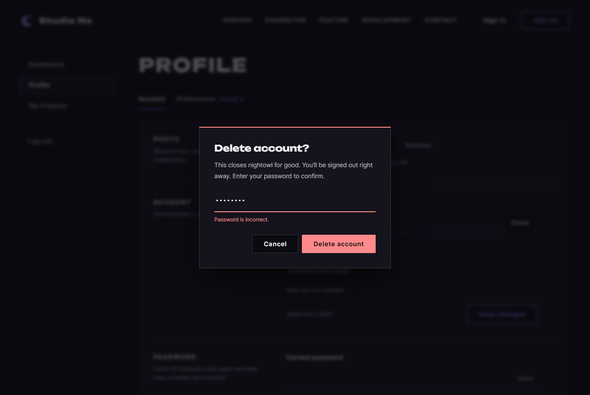
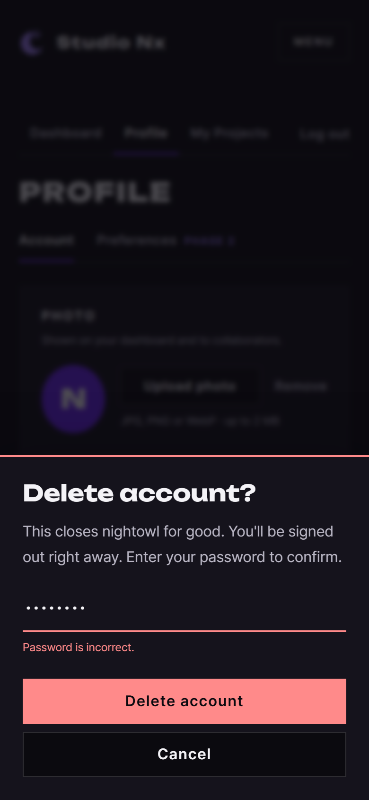

# JS 21 — `promptDialog()`

| 항목 | 내용 |
|---|---|
| 파일 | `studionx/frontend/static/js/core/dialog.js` |
| 작업 | 수정 — 브라우저 기본 창 → SweetAlert (사용자 요청 `sweetalert수정.pdf` "Prompt 창도 SweetAlert 형식", 2026-10-07) |
| 작성 | Claude (AI) · 2026-10-07 · 사용자 검토 |
| 이전 · 다음 | [20 `confirmDialog()`](20_dialog_confirmDialog.md) · (SweetAlert 수정 마지막) |

## 1. 하는 일
입력칸 하나가 있는 창을 띄우고, 확인을 누르면 **입력한 값**, 취소하면 `null` 을 돌려준다. `window.prompt()` 대신 쓴다. 회원 탈퇴의 비밀번호 확인이 대표적인 쓰임이다 (목업 08 · 14 — 사용자가 고른 "비밀번호만, 체크박스 없음").

| 데스크톱 (비밀번호 틀림) | 휴대폰 |
|---|---|
|  |  |

| 상황 | 화면 | 돌려주는 값 |
|---|---|---|
| 비운 채 Delete account | 창 안 빨간 글 "Enter your password." — 닫히지 않음 | (기다림) |
| `check` 가 "Password is incorrect." 를 돌려줌 | 위 캡처 — 창 안 빨간 글, 바로 다시 입력 | (기다림) |
| `check` 통과 | 닫힘 | 입력한 비밀번호 (공백까지 그대로) |
| 글자 칸에 `"  Neon Rain  "` | 닫힘 | `"Neon Rain"` (앞뒤 공백 제거) |
| Cancel · Esc · 바깥 클릭 | 닫힘 | `null` |

## 2. 언제 쓰나
| 쓰는 곳 | 언제 붙이나 |
|---|---|
| **회원 탈퇴** (userInfo.html, 목업 08 · 14) | P1-10 `initWithdrawForm` 구현 때 — `#withdraw-modal` 과 Delete account 버튼의 `command="show-modal"` 을 지우고 아래처럼. `userinfo.js` 템플릿 주석에 적어 둠 |
| 프로젝트 이름 바꾸기 | **쓰지 않음** — Edit details 모달 그대로 (사용자 결정 2026-10-07) |

탈퇴에서 부를 모양 (P1-10 에서):
```js
const password = await promptDialog({
  title: 'Delete account?',
  text: "This closes nightowl for good. You'll be signed out right away. Enter your password to confirm.",
  inputType: 'password', placeholder: 'Password', confirmText: 'Delete account', danger: true,
  requiredMessage: 'Enter your password.',
  check: async (pw) => {            // 확인을 누를 때 — 문구를 돌려주면 창 안에 보이고 닫히지 않음
    try { await api.delete('/users/me', { password: pw }); return null; }
    catch (err) { return err.status === 401 ? 'Password is incorrect.' : err.message; }
  },
});
if (password !== null) { /* 탈퇴 끝 → 홈으로 */ }
```

## 3. 코드
**import** (`dialog.js` — 18 과 같음, 추가 없음)

**함수**
```js
export async function promptDialog(options) {
  const danger = options.danger === true;
  const isPassword = options.inputType === 'password';
  const clean = (value) => (isPassword ? value : value.trim()); // 비밀번호의 공백도 비밀번호의 일부
  const openModal = document.querySelector('dialog[open]');
  const attributes = { 'aria-label': options.placeholder || options.title };
  if (options.maxLength) attributes.maxlength = String(options.maxLength);
  if (isPassword) attributes.autocomplete = 'current-password';

  const result = await Swal.fire({
    target: openModal || document.body,
    title: options.title,
    text: options.text || '',
    input: isPassword ? 'password' : 'text',
    inputValue: options.value || '',
    inputPlaceholder: options.placeholder || '',
    inputAttributes: attributes,
    inputAutoTrim: false,           // 라이브러리는 기본으로 앞뒤 공백을 지움 → 비밀번호가 바뀌므로 끄고 clean 으로
    inputValidator: (value) => (clean(value) === '' ? (options.requiredMessage || 'Fill in this field.') : null),
    preConfirm: async (value) => {
      if (!options.check) return clean(value);
      // 확인 중에는 취소 못 함 — 서버가 이미 처리하는데 화면만 "취소" 가 되지 않게 (탈퇴)
      Swal.getCancelButton().disabled = true;
      let message;
      try {
        message = await options.check(clean(value));
      } catch (err) {
        message = err.message || 'Something went wrong. Please try again.';
      }
      Swal.getCancelButton().disabled = false;
      if (message) {
        Swal.showValidationMessage(message); // 창 안 빨간 글, 닫지 않음
        return false;
      }
      return clean(value);
    },
    showLoaderOnConfirm: true,      // check 를 기다리는 동안 버튼 자리에 도는 표시
    allowEscapeKey: () => !Swal.isLoading(),    // 확인 중에는 Esc · 바깥 클릭으로도 닫히지 않음
    allowOutsideClick: () => !Swal.isLoading(),
    showCancelButton: true,
    confirmButtonText: options.confirmText || 'OK',
    cancelButtonText: options.cancelText || 'Cancel',
    reverseButtons: true,
    buttonsStyling: false,
    heightAuto: false,
    scrollbarPadding: false,
    returnFocus: true,
    showClass: { popup: 'snx-dialog-in' },
    hideClass: { popup: 'snx-dialog-out' },
    customClass: {
      popup: 'snx-dialog snx-dialog--' + (danger ? 'danger' : 'info'),
      title: 'snx-dialog__title',
      htmlContainer: 'snx-dialog__text',
      input: 'snx-dialog__input',
      actions: 'snx-dialog__actions',
      loader: 'snx-dialog__loader',
      confirmButton: danger ? 'btn btn--danger' : 'btn btn--primary',
      cancelButton: 'btn btn--ghost',
    },
  });
  return result.isConfirmed ? result.value : null;
}
```

**최신 문법으로 쓰면** (공부용 — 바뀌는 부분만)
```js
export async function promptDialog({ title, text = '', inputType = 'text', value = '', placeholder = '', maxLength,
  confirmText = 'OK', cancelText = 'Cancel', danger = false, requiredMessage = 'Fill in this field.', check }) {
  const isPassword = inputType === 'password';
  const clean = (v) => (isPassword ? v : v.trim());
  const { isConfirmed, value: answer } = await Swal.fire({
    target: document.querySelector('dialog[open]') ?? document.body,
    inputAttributes: { 'aria-label': placeholder || title, ...(maxLength && { maxlength: String(maxLength) }), ...(isPassword && { autocomplete: 'current-password' }) },
    preConfirm: async (v) => {
      const message = await check?.(clean(v)).catch((err) => err.message);
      …
    },
    …
  });
  return isConfirmed ? answer : null;
}
```
| 최신 문법 | 실제 코드 | 뜻 |
|---|---|---|
| 매개변수 구조 분해 + 기본값 | `options` 하나 + `options.x \|\| 기본값` | 옵션 꺼내기 |
| `...(조건 && { 키: 값 })` (조건부 펼치기) | `if (조건) attributes.키 = 값` | 조건이 맞을 때만 속성 추가 |
| `check?.(…)` | `if (!options.check) return …` | 함수가 있을 때만 부르기 |
| `.catch((err) => err.message)` | `try { … } catch (err) { message = err.message … }` | 오류를 문구로 |
| `const { isConfirmed, value: answer } = …` | `result.isConfirmed ? result.value : null` | 결과 꺼내기 (`value: answer` = 이름 바꿔 꺼내기) |

### 문법 풀이
| import 문법 | 뜻 |
|---|---|
| (추가 없음) | 18 의 `import Swal from …` 을 같이 씀 |

| 식 | 뜻 |
|---|---|
| `const clean = (value) => (isPassword ? value : value.trim())` | 안쪽 화살표 함수 — 글자 칸만 앞뒤 공백 제거 |
| `input` · `inputValue` · `inputPlaceholder` · `inputAttributes` | SweetAlert2 입력칸 옵션 — 종류 · 처음 값 · 흐린 안내 글자 · `<input>` 에 붙일 속성 |
| `inputAutoTrim: false` | 라이브러리가 값의 앞뒤 공백을 지우는 것을 끔 |
| `inputValidator` | 확인을 누르면 먼저 불림. 글자를 돌려주면 그 문구를 보여 주고 닫지 않음, `null` 이면 통과 |
| `preConfirm` | 검사를 통과한 뒤 불림. `false` 를 돌려주면 닫지 않음, 값을 돌려주면 그 값으로 닫힘 → `result.value` |
| `Swal.showValidationMessage(글)` | 입력칸 아래 빨간 글 |
| `Swal.getCancelButton().disabled = true` | 취소 버튼 잠금 |
| `showLoaderOnConfirm: true` | `preConfirm` 이 끝날 때까지 확인 버튼 자리에 도는 표시 |
| `allowEscapeKey: () => !Swal.isLoading()` | 함수로 주면 Esc 를 누를 때마다 물어봄 — 확인 중이면 `false` (닫지 않음) |

## 4. 흐름
1. 종류(글자 · 비밀번호) · danger · 열린 모달을 보고 입력칸 속성을 만든다.
2. 창을 띄움 — 커서는 입력칸.
3. 확인 → 비었으면 창 안 문구 (끝나지 않음).
4. `check` 가 있으면: 취소 · Esc · 바깥 클릭을 잠그고 도는 표시 → `check(값)` → 문구가 오면(또는 오류) 잠금을 풀고 창 안 문구, 계속 입력 / `null` 이면 닫힘.
5. 확인으로 닫혔으면 값, 아니면 `null` 을 돌려준다.

## 5. 왜 이렇게
| 선택 | 이유 |
|---|---|
| `check` 로 **창 안에서** 서버 확인 | 비밀번호가 틀렸을 때 창이 닫히고 다시 열리면 처음부터 해야 한다. 기존 탈퇴 모달도 틀리면 모달 안에 "Password is incorrect." 를 보였다 (P1-10 템플릿) |
| `check` 중에는 **취소 · Esc · 바깥 클릭 잠금** | 시험에서 찾은 빈틈: 서버가 탈퇴를 처리하는 동안 Cancel 을 누르면 화면은 "취소" 인데 실제로는 탈퇴될 수 있었다 |
| 비밀번호는 공백을 지우지 않음 (`inputAutoTrim: false`) | 시험에서 찾은 빈틈: 라이브러리가 기본으로 공백을 지워 `"  pw "` 가 `"pw"` 로 바뀌었다. **받은 그대로** 서버에 보내 서버가 판단하게 한다 |
| 글자 칸은 앞뒤 공백 제거 | 이름 같은 값은 실수로 넣은 공백이 의미가 없다 |
| `autocomplete="current-password"` | 브라우저 · 비밀번호 관리자가 저장된 비밀번호를 채워 줄 수 있다 |
| `aria-label` | 화면에 이름표(`<label>`)가 없어서, 화면 읽기 프로그램이 칸 이름을 알 수 있게 |
| 처음 커서는 입력칸 (danger 여도) | 비밀번호를 쳐야만 확인할 수 있으므로 Enter 실수로 지워질 일이 없다 |
| 체크박스 없이 비밀번호만 | 사용자 결정 (목업 08). 빨간 선 · 빨간 버튼 · 설명 문구 · 비밀번호 입력이 이미 확인 단계 역할 |

## 6. 시험 (실제 userInfo.html 을 헤드리스 Chrome 으로 열고 그 안에서 실행 · 18개)
| 시험 | 확인한 것 |
|---|---|
| 모양 | `type="password"` · `autocomplete` · `aria-label` · placeholder "Password", 처음 커서 입력칸, 빨간 선 · 빨간 Delete account · Cancel 왼쪽, 입력칸은 밑줄(상자 아님) |
| 빈 칸 | 창 안 "Enter your password.", 닫히지 않음 |
| `"  pw with spaces "` | 그대로 돌려줌 |
| `check` 틀림 | 기다리는 동안 도는 표시 · Cancel 잠김 · **Esc · 바깥 클릭에도 안 닫힘** → "Password is incorrect." · Cancel 다시 켜짐 · 닫히지 않음 |
| 다시 입력 → 통과 | 값을 돌려줌, `check` 가 받은 값 `Wrong1!x, Right1!x` |
| `check` 가 오류를 던짐 | 그 문구("Network down.")를 창 안에 |
| Cancel · 진짜 Esc | `null` · `null` |
| 글자 칸 | 미리 채움 · `maxlength=100` · 보라 버튼, 진짜 Enter → 앞뒤 공백 뺀 값, 공백만 → "Fill in this field." |
| `` 설명 | 글자 그대로 |

처음 14/16 — §5 의 빈틈 2개(비밀번호 공백, 확인 중 취소)를 고치고 시험 2개를 더해 **18/18**. 18 · 19 · 20 시험도 다시 돌려 모두 통과.
